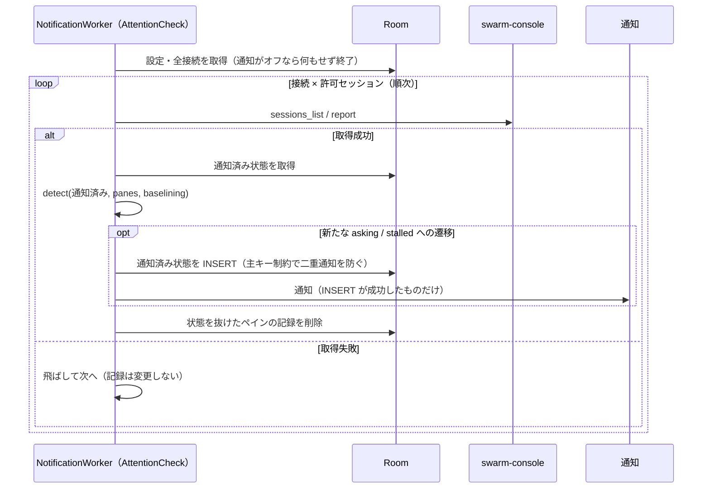

# Android 版の設計

swarm-viewer の Android 版（Kotlin + Jetpack Compose）に固有の設計を定める。デスクトップ版と共通の仕様（接続先の種類（`/report`・`/ops`）、接続の種類ごとの許可リスト、接続文字列、検証規則、`report` の読み方、通知の規則、操作モードの規則）は変えず、それぞれの正本を参照する。親 Issue は [#7](https://github.com/ousiassllc/swarm-viewer/issues/7)、操作モードは [#97](https://github.com/ousiassllc/swarm-viewer/issues/97)。

| 何を知りたいか | 参照先 |
|----------------|--------|
| Android の機能・画面・通知の規則 | [機能要件 §12](../requirements/functional.md) |
| Android の非機能要件（最小 OS・cleartext・Keystore・配布・署名） | [非機能要件 §10](../requirements/non-functional.md) |
| 技術選定・構成・コード共有範囲・未確認事項 | [アーキテクチャ設計 §12](../architecture/overview.md)、[§11](../architecture/overview.md) |
| 保存データ（Room・token の保護領域） | [ER / データモデル §7](../architecture/er.md) |
| ペアリング形式（QR・intent-filter） | [API 仕様 §2.3](../api/endpoints.md) |
| 環境構築・CI・署名鍵・リリース | [環境構築 §11](../environment/setup.md) |
| 本書 | WorkManager・通知チャンネル・権限・WindowSizeClass・テストベクタ・操作モード（§10） |

## 1. 前提

| 項目 | 値 |
|------|----|
| applicationId / パッケージ | `com.ousiassllc.swarmviewer`（ソースは `android/app/src/main/kotlin/com/ousiassllc/swarmviewer/`） |
| minSdk / targetSdk / compileSdk | 29（Android 10）/ 35 / 35 |
| UI | Jetpack Compose + Material 3 |
| 対象端末 | まず Galaxy Fold7（折りたたみ時・展開時の両方）。ほかの Android 10 以降の端末・タブレットでも動くように、画面の切替は端末名でなく WindowSizeClass（§6）で行う |
| 通信 | OkHttp。接続の種類（URL の path。`/report` = 見るだけ、`/ops` = 操作）ごとの許可リストのツールだけを呼ぶ（見るだけ: `sessions_list`・`report`・`pane_tail`・`ask_card`、操作: それに `ask_pick`・`send_text`・`send_escape`・`pane_start`・`pane_close`・`dir_list`・`skill_list` の 11 個。NFR-SEC-1・NFR-AND-SEC-5）。`tools/list` のコードパスを持たない |
| 操作系 | 操作の UI（質問への回答・送信・中断・起動・終了）は操作の接続（`/ops`）だけ。見るだけの接続には Compose にも出さず、`/ops` を呼ぶコードパスも通らない（§10） |

## 2. パッケージ構成

依存は上から下への一方向だけ。`domain` は Android の API・OkHttp・Room を import しない（純 Kotlin。JSON は kotlinx.serialization を使う）。

```
android/app/src/main/kotlin/com/ousiassllc/swarmviewer/
├── domain/   # 型・検証・解析・通知判定（副作用なし）。デスクトップの internal/domain と同じ責務
├── data/     # OkHttp の /report・/ops クライアント（種類別の許可リスト）、Room、Keystore による token 保護
├── service/  # ペアリング・接続管理・画面更新の取得とスナップショット保存・設定・ペインの操作（PaneService）（data を使うユースケース）
├── notify/   # WorkManager の周期ジョブ（通知用の確認）・通知チャンネル・通知の組み立て・権限
└── ui/       # Compose 画面（接続管理・メイン・設定・ペイン詳細・新しいセッション）、WindowSizeClass による切替
```

- `domain/` の純粋ロジック（`parseReport`・`parseSessions`・`parsePairing`・`validateUrl`（`/report`・`/ops`）・ツール結果のパーサ・`detect`・`classify`（`operation` を含む）・`usageTone`）は、デスクトップの Go 実装とテストベクタ（§8）で挙動の一致を保つ。Go のコードは共有しない
- token は `data/` の中だけで扱う。`domain` の `Connection` は token を持たず、`PairingPayload` は `toString` で token を伏せる
- 実装は Issue #17（domain）、#18（データ層）、#19（ペアリングと接続管理）、#20（メイン画面・更新・設定）、#21（バックグラウンド通知）、#22（CI とリリース）に分かれる。本書はその共通の設計

## 3. バックグラウンドの確認（WorkManager）

通知（機能要件 §8、FR-AND-3）のためのバックグラウンド取得は、WorkManager の周期ジョブ（`PeriodicWorkRequest`）で行う。FCM（プッシュ）もフォアグラウンドサービスも使わない。

### 3.1 周期ジョブ

| 項目 | 内容 |
|------|------|
| 一意名 | `attention-check`（`enqueueUniquePeriodicWork`） |
| 間隔 | 設定の通知確認間隔（15 / 30 / 60 分、既定 15 分）。WorkManager の最小の繰り返し間隔は 15 分（`PeriodicWorkRequest.MIN_PERIODIC_INTERVAL_MILLIS`）のため、デスクトップの 5 / 10 分は選択肢に含めない。正確な実行時刻は制約と OS の最適化に依る（公式ドキュメント「Define your work」、2026-11-05 に確認） |
| 制約 | ネットワーク接続あり（`NetworkType.CONNECTED`）。それ以外の制約（充電中など）は付けない |
| 方針 | 間隔を変えたときは `ExistingPeriodicWorkPolicy.UPDATE` で置き換える。通知をオフにしたときは `cancelUniqueWork` でジョブを止める（機能要件 §8.3）。オンに戻したときと、アプリ起動時に、設定どおりのジョブが登録されていることを確かめて登録し直す |
| 端末再起動 | WorkManager は端末の再起動後にジョブを再スケジュールする。アプリ起動時の再登録と合わせて、再起動後に再開することを実機で確認する（[アーキテクチャ設計 §11](../architecture/overview.md) #15） |
| 実行 | `CoroutineWorker`。全接続・全許可セッションを**順次**取得する（NFR-PERF-6）。1 本の失敗は飛ばして次へ進み、通知済み記録を変えない（機能要件 §8.3）。401・403 の接続はその回の取得を飛ばす（再ペアリングまで止める。[API 仕様 §1.5](../api/endpoints.md)） |
| 結果 | 取得の失敗で `Result.retry()` を返さない（リトライしない。NFR-AVL-2）。常に `Result.success()` を返し、次の周期で再取得する |
| 遅れ | Doze・アプリスタンバイ・バッテリー最適化で、設定した間隔より遅れうる。設定画面に明記する（FR-AND-7）。遅れの程度は実機で確認する（[アーキテクチャ設計 §11](../architecture/overview.md) #11） |

### 3.2 1 回の実行の流れ



- 判定は domain の `detect`（[ER §3.4](../architecture/er.md) の更新規則）。画面更新で取得した結果も同じ `detect` に流す。通知がオフの間は記録だけ更新して通知しない（機能要件 §8.3）
- 二重通知の防止は、`notified_states` の主キー `(connection_id, session_id, pane_id, state)` の `INSERT` が成功したときだけ通知する形にする。画面更新とバックグラウンドが同時に同じ遷移を見ても、通知は 1 回になる
- 新規ペアリング後の一巡は通知せず記録だけにする（`connections.baselined_at`。機能要件 §8.2）

## 4. 通知

### 4.1 通知チャンネル

| 項目 | 値 |
|------|----|
| チャンネル ID | `asking`（名前「答え待ち」）・`stalled`（名前「止まってるかも」）。別のチャンネルにして、利用者が OS の設定で個別に調整できるようにする。401・403 の再ペアリングの案内には `repair`（名前「再ペアリング」。重要度 `IMPORTANCE_DEFAULT`）を使う |
| 重要度 | `asking`・`stalled` は `IMPORTANCE_HIGH`（外出中に気づくための通知）。端末のシステム設定で利用者が変更できる |
| 作成 | アプリ起動時（`SystemNotifier` の生成時）（API 26 以降は必須。minSdk 29 のため分岐なし） |

### 4.2 通知の中身

| 項目 | 内容 |
|------|------|
| タイトル | 接続の表示名 |
| 本文 | セッション・`pos`・状態ラベルだけ。token・URL 全体・ペイン本文（`attention` の `detail`＝質問文の先頭を含む）は載せない（通知は他人の目にも入るため。Issue #21） |
| ロック画面 | `VISIBILITY_PRIVATE`。公開用の版は「要対応があります」だけにする |
| 識別 | 通知 ID は `(接続, セッション, ペイン ID, 状態)` から決める。同じ組の再投稿は置き換わる |
| タップ | アプリを開き、該当接続・セッションのタブを選択する（`PendingIntent`。Intent に接続 ID・セッション ID だけを載せる。FR-AND-5）。`PendingIntent` は `FLAG_IMMUTABLE` |

## 5. 権限

| 権限 | 種別 | 使う場面 |
|------|------|---------|
| `INTERNET` | 通常 | `/report`・`/ops` への通信 |
| `POST_NOTIFICATIONS` | 実行時（Android 13 / API 33 以降） | 通知。初回起動時に要求し、拒否されたら設定画面に、システムの通知設定を開く案内を出す（FR-AND-4）。API 29〜32 は実行時の許可なしで通知できる |
| `CAMERA` | 実行時 | QR 読み取りを開始したときだけ要求する。拒否されても貼り付け・ディープリンクで使える（FR-AND-1）。QR 読み取りは CameraX + ML Kit（同梱モデル）で、カメラ権限が要る（[アーキテクチャ設計 §11](../architecture/overview.md) #10）。マニフェストには `android.hardware.camera` を `required="false"` で宣言し、カメラのない端末にも入れられるようにする |

- アプリが自分で宣言する権限は上の 3 つだけ。WorkManager などの依存ライブラリがマニフェストのマージで加える権限（`WAKE_LOCK`・`ACCESS_NETWORK_STATE`・`RECEIVE_BOOT_COMPLETED` など）は、マージ後のマニフェストに現れる
- 位置情報・連絡先・ストレージの権限は要求しない

## 6. WindowSizeClass によるレイアウト切替

画面の幅の区分（Material の window size classes。Compact: 600dp 未満、Medium: 600dp 以上 840dp 未満、Expanded: 840dp 以上）で、メイン画面の出し方を切り替える（機能要件 FR-AND-2）。

| 区分 | 表示 |
|------|------|
| Compact | 縦長・狭い画面。ペインを `pos` 順のリストで 1 列に出し、利用上限・ホスト負荷はその下に縦に続ける（1 つのスクロール） |
| Medium / Expanded | 広い画面。`layout` の `rows`・`cols[]` に従って T* / B* のグリッドを出し、利用上限・ホスト負荷を**横**に置く |

- `layout` が欠落・不整合（`Layout.valid(paneCount)` が false）なら、広い画面でもペイン順のリストで出す（FR-PANE-1）
- Galaxy Fold7 は折りたたみ時に Compact、展開時に Medium または Expanded になる見込み。実際の区分は実機で確認する（[アーキテクチャ設計 §11](../architecture/overview.md) #14）
- **折りたたみ⇔展開の切替で保つ状態**: 選択中の接続・セッション、各リストのスクロール位置、取得済みの表示内容。選択は `ViewModel` と保存済みの `connections.last_session` で保ち、スクロール位置は `rememberSaveable`（`LazyListState`）で保つ。切替は構成変更（Activity の再生成）として起きうるため、状態は Composable のローカル変数に置かない
- 画面の向き・折りたたみの状態そのものでなく WindowSizeClass で分岐する（端末名・ヒンジの状態には依存しない）

## 7. フォアグラウンドの更新

| 項目 | 内容 |
|------|------|
| 間隔 | 設定の画面更新間隔（5 / 10 / 30 / 60 秒、既定 10 秒。デスクトップと同じ） |
| 対象 | 選択中セッションの `report` 1 本だけ（NFR-PERF-5）。前のリクエストが終わる前に次を出さない |
| 止める・再開 | 画面が見えている間（ライフサイクルが `STARTED` 以上）だけ動かす。バックグラウンドに回ったら止め、戻ったら即時に 1 回取得する（FR-AND-8） |
| 手動更新 | 「プルして更新」（`PullToRefresh`）。進行中の取得があればそれに相乗りする |
| 失敗 | 直前の表示をグレーアウトして残し、失敗の状態を併記する。401・403 はポーリングを止めて再ペアリングへ誘導する |

ペイン詳細（§10）の自動更新は別で、開いている間だけ 5 秒ごとに動かす（NFR-AND-PERF-8）。

## 8. テストベクタ

決めること 6（Go コードを共有しない）の担保として、デスクトップ（Go）と Android（Kotlin）が**同じ JSON ファイルを読み**、同じ入力に同じ結果を返すことを検査する。仕様を変えるときは、ベクタ・Go・Kotlin を 1 つの PR で揃える。

| 項目 | 内容 |
|------|------|
| 置き場所 | リポジトリ直下の `testdata/vectors/` |
| 説明 | `testdata/vectors/README.md` に形式（ファイルごとの入力・期待値のキー、正規化の約束）を書く |
| Go 側 | `internal/domain/vectors/*_test.go`（domain の公開 API を検証する。linterly の 1 ディレクトリ 2,000 行の上限のため `internal/domain` 直下と分ける）と `internal/web/format/vectors_test.go`（state の表示ラベル）が `testdata/vectors/*.json` を読む（テスト以外の Go コードは変えない） |
| Kotlin 側 | `android/app/src/test/kotlin/com/ousiassllc/swarmviewer/domain/` の JUnit が同じファイルを読む。Gradle のユニットテストの作業ディレクトリは `android/app` のため、親ディレクトリをたどって `testdata/vectors/` を見つける |

| ファイル | 内容 | 対応する仕様 |
|----------|------|-------------|
| `pairing.json` | 接続文字列（正常・異常）と期待する解析結果・エラー種別 | [API 仕様 §2.1・§2.2](../api/endpoints.md)、NFR-SEC-7 |
| `url.json` | 接続先 URL の検証（tailnet 範囲の境界値・ホスト名・`0.0.0.0`・userinfo・クエリ付き・path `/report`・`/ops` ちょうどと別表記の拒否） | NFR-SEC-4・5、NFR-QLT-2 |
| `report.json` | `report` / `sessions_list` の応答と、期待する解析結果 | [API 仕様 §1.3・§1.4](../api/endpoints.md)、NFR-CMP-1・2 |
| `detect.json` | 通知判定の入力列（通知済み記録・ペイン・baselining）と期待する通知・記録の操作 | [ER §3.4](../architecture/er.md)、機能要件 §8.2 |
| `classify.json` | エラー分類の入力（`err` の種類・HTTP ステータス・ツールコード）と期待する種別・コード（`operation` の対象コードを含む） | [API 仕様 §1.5・§1.5.1](../api/endpoints.md) |
| `usage_tone.json` | 利用上限の枠・使用率と期待する色（80% 黄・95% 赤・`exhausted` 赤、`unit` が `percent` 以外はしきい値なし） | 機能要件 §5.3 |

- どのテストも、ベクタの**ケース数の下限**を検査する。ファイルが空・読めない・キーの綴り違いで、テストが静かに空振りしない
- ベクタの `name` はケースの意図を書く（失敗時にどのケースか分かるように）
- Go と Kotlin で結果が食い違ったときは、仕様（本書の参照先）に照らしてどちらが正しいかを決める。Go の実装が仕様と違うなら、実装の変更は別 Issue に切り出す

## 9. ログ

- ログは Logcat のみ。ファイルへは書かない（NFR-AND-LOG-1）
- token・完全な URL・ペイン本文（`activity`・`note`・`pane_tail`・`ask_card`）・送信本文・スキル名・`invoke`・最初のタスクの本文を出さない。操作のログは接続 ID・ツール名・種別・コード・ペイン位置まで。接続は表示名と host だけで識別する（NFR-LOG-3・NFR-SEC-11 と同じ）
- 設定の「デバッグログ」は Logcat の詳細ログのオン/オフ（既定オフ）。オフの間は警告・エラーだけ出す

## 10. 操作モード（ペイン詳細・質問・送信・新しいセッション）

機能は[機能要件 §4.5〜§4.9・§12.6](../requirements/functional.md)、要件は NFR-SEC-12〜14・NFR-AND-SEC-5・9、通信は [API 仕様 §1.2](../api/endpoints.md) に従う。デスクトップ版（HALT）と同じ規則を Compose で出す。

### 10.1 構成

| 部品 | 内容 |
|------|------|
| `data/report` | `ReportTools` を種類別（見るだけ 4 つ・操作 11 個）に持つ。`ReportClient` に `paneTail`・`askCard`・`askPick`・`sendText`・`sendEscape`・`paneStart`・`paneClose`・`dirList`・`skillList`（`skill_list`。仮称。引数は `agent` だけで `session` を取らない）。見るだけの接続に操作系（`skillList` を含む）を呼ぶと通信せずに `FetchException`（`tool_not_allowed`）。`GuardInterceptor` が URL の path で送信内容を検査する（`/report` なら 4 つ、`/ops` なら 11 個）。通信の上限はツールごと（`ReportTools.timeoutScale`。基準 10 秒に、`ask_pick`・`send_text`・`send_escape` は 3 倍、`pane_start`・`pane_close` は 5 倍、`skill_list` を含む読み取りは 1 倍。swarm-console 側の `accept_timeout`（既定 10 秒）・`start_timeout`（既定 30 秒）に待つ余地を残すため。デスクトップ版の `toolTimeoutScale` と同じ。NFR-AND-PERF-4） |
| `service/PaneService` | 操作・同じペインの排他（実行中に次が来たら通信せず「前の操作がまだ終わっていません」）・401/403 の `needs_repair`・接続の種類の確認（見るだけは通信せず断る）。起動の操作は任意の最初のタスク（スキル・本文）を受け取り、`pane_start` → `send_text` を**同じ排他の中**で行う（§10.2）。結果は `StartOutcome`（`start`・`task: FirstTaskStatus`（`None`・`Sent`・`NotIdle`・`Failed`）・`send`・`error`）で返る。`resend(target, first)` は排他の中で `send_text` だけを送る（`idle` の確認は呼び出し側）。`skills(agent)` は排他に入らない読み取り |
| `ui/pane` | `PaneDetailScreen`・`PaneDetailViewModel`（`Route.PaneDetail`。接続 ID・セッション・ペイン位置を引数に取る）。5 秒ごとの自動更新は `LifecycleStartEffect`（`STARTED` 以上の間だけ）。質問カード（`PaneAsk`）・送信欄・中断・終了の確認（`PaneControls`・`PaneOperations`。`AppDialog`）。`StartSessionScreen`・`StartSessionViewModel`（`Route.StartSession`。エージェントの選択・フォルダピッカー `FolderPicker`（`dir_list`）・スキル選択（`skill_list`。一覧の各行は最小 48dp。「スキルなし」を含む）・本文の入力欄（複数行・任意）・タイトル・確認（エージェント・フォルダ・スキル名（選ばなければ「なし」）・本文の先頭 80 字・タイトルを要約）。選択中のスキル・本文は `StartSessionViewModel` が `StateFlow` で保持する） |
| `ui/main` | ペインカードのタップ・要対応のタップでペイン詳細へ。操作の接続の `shell` のカードに「＋ 始める」。接続名の隣に種類のバッジ |
| `ui/Messages.kt`・`ui/OperationMessages.kt` | 固定文言（操作の文言は `OperationMessages.kt`。機能要件 §10.1。デスクトップ版と同じ）。ホストの `message` は出さない |

### 10.2 振る舞い

- **種類の出し分け**: 接続の種類は `Connection` の `url` の path から導く（`ConnectionKind`）。見るだけの接続のペイン詳細は、ヘッダ・`pane_tail`・更新と、質問の閲覧（選択肢は一覧）だけで、送信欄・中断・終了・「＋ 始める」を Compose に出さない
- **質問カード**: 選択肢のボタンは押したらすぐ `ask_pick {n}`（確認なし）。「その他」は `text`。送信中は `PaneDetailViewModel` の `busy` で同じペインの全ボタンを無効にする。`cursor_mismatch`・`not_asking`・`option_out_of_range` ではカードを取り直す
- **中断・終了**: 確認ダイアログ（`AppDialog`。「作業中のエージェントを止めます」。取り消し / 中断する）で確定したときだけ `send_escape {confirm: true}`・`pane_close` を送る。確認を経ない経路を作らない。`exit_timeout` の「もう一度試す」は、その失敗のときだけ出す（ほかの通知が出たら落とす）。`pane_start` 成功は「起動しました」、`pane_close` 成功は「終了しました」のトースト（デスクトップ版はトーストを出さず遷移する）
- **自動更新**: ペイン詳細を開いている間、画面が見えている（`STARTED` 以上）間だけ 5 秒ごと。前のリクエストが終わる前に次を出さない。バックグラウンドで止め、戻ったら即時に 1 回取得する。401・403 は止めて再ペアリングへ誘導する。取得失敗は直前の表示を残して固定文言のバナー
- **レイアウトと入力の保持**: Compact は 1 列、Medium 以上は本文の最大幅を制限して中央寄せ。入力途中の文字（指示・「その他」・タイトル・最初のタスクの本文）・開いているペイン・フォルダ・スキルの選択は ViewModel（`StateFlow`）が保持し、折りたたみ⇔展開などの構成変更では失われない。ボタン・選択肢・フォルダの行・スキルの行は最小 48dp
- **画面を離れたとき**: `PaneDetailViewModel.reset()`・`StartSessionViewModel.reset()` が実行中の取得・操作を止め、状態（選択中のスキル・本文・取得済みのスキル一覧・最初のタスクの結果の表示を含む）と未消費のイベント（画面を閉じる・起動完了）を破棄する。再び開いたとき前の入力を引き継がない
- **質問カードの更新**: `ask_pick` が成功して質問が閉じたら、次に取り直すまでカードを出さない（古い選択肢のボタンを再び押せるようにしない）
- **フォルダ一覧・スキル一覧**: `dir_list` の取得に失敗してフォルダ一覧を読めていないときは「再読み込み」を出す（最初から読み直す）。スキル一覧も同様で、エージェントを選んだあとに `skill_list` で取得し（取得結果は画面を開いている間のメモリだけ。保存しない）、`unknown_tool`（ホストが古い）なら固定文言「スキルの一覧を取得できません（ホストの swarm-console が古い可能性があります）」、それ以外の失敗は「スキルの一覧を読み込めませんでした」と「再読み込み」を出す。どちらでも「スキルなし」で本文だけ・タスクなしの起動はできる（スキルが選べないことで起動を止めない）。エージェントを選び直したらスキルの選択と一覧を取り直す。一覧に無いスキルは選べない
- **最初のタスク（A5）**: エージェント → フォルダ → スキル（任意）→ 本文（任意）→ タイトル → 確認の順。送る文字列はスキルと本文の両方 = `<invoke> <本文>`（半角スペース 1 つ）、スキルだけ = `<invoke>`、本文だけ = `<本文>`（スキル・本文は前後の空白を除く。改行は `\n` に揃える）。合計 1〜8000 字・制御文字は `\n`・`\t` だけで、違反は送る前に入力欄の下の固定文言で拒否し（確認へ進めない）`pane_start` も呼ばない。入力欄の下に送る文字列の字数を「<字数> / 8000」で出す。`pane_start` が `ok: true` で `state` が `idle` のときだけ、同じペインの排他を保ったまま `send_text` で送る（`pane_start` の失敗なら従来の文言。`idle` 以外なら送らず、遷移せずに結果の表示で「起動しました。最初のタスクはまだ送っていません（状態: …）。ペイン詳細から送れます」（`…` は機能要件 §3 の表示ラベル）と「ペイン詳細を開く」を出す。「もう一度送る」は出さない）。どちらもスキルと本文が空なら今までどおり起動だけ。通信の上限は各ツールのまま（`pane_start` 50 秒・`send_text` 30 秒。合算の上限は設けない）。成功は今までどおり「起動しました」のトースト
- **最初のタスクを送れなかったとき**: `send_text` が失敗または `accepted: false` でも、自動で再送せず、起動を取り消さない（`pane_close` は呼ばない）。「起動しました。最初のタスクを送れませんでした」と理由の固定文言（機能要件 §10.1 の送信の文言）を結果の表示で出し、「ペイン詳細を開く」と「もう一度送る」（`send_text` だけを送り直す。`pane_start` は呼ばない）を出す。「もう一度送る」は、送る前に `SnapshotService` で最新の `report` を取り、ペインが無ければ `pane_not_found`、`idle` でなければ `invalid_state` の固定文言を理由に出して、`send_text` を呼ばずに断る（「もう一度送る」は残る）。本文はこの結果の表示の間だけ `StartSessionViewModel`（メモリ）に残し、保存・ログ出力・通知・Intent に出さない（NFR-AND-SEC-9）。「ペイン詳細を開く」や画面を離れたときは `reset()` で破棄する
- **エラーの分類**: `invalid_args` は `details.field == "session"` のときだけ `session_missing`、それ以外は操作エラー（`operation`）。Go と同じ（[API 仕様 §1.5](../api/endpoints.md)）
- **ログ・保存**: `pane_tail`・質問文・送信本文・スキル名・`invoke`・最初のタスクの本文はメモリ上の表示だけ。ディスク・ログ・通知・Intent に出さない（NFR-AND-SEC-9）
- **表示**: 本文・スキルの `name`・`description`・`invoke` は常に `Text` で描画する（NFR-AND-SEC-8）

### 10.3 テスト

JUnit（MockWebServer・`ViewModel` のテスト）で NFR-AND-QLT-5 の 6 項目を検証する（見るだけの接続では偽のコンソールの `/ops` へのリクエスト 0 件・操作部品が出ない、操作の接続での期待どおりのツール名・引数、許可リスト、排他、ログ、結果の解析と固定文言）。最初のタスクでは、許可リストが `/ops` 11 個・`/report` 4 個で見るだけから `skillList` が通信 0 件の `tool_not_allowed`、`skill_list` の引数（`agent` だけ・`session` なし）と結果の解析・`unknown_tool` と他の失敗の固定文言、`pane_start` が `ok: true` かつ `idle` のときだけ `send_text` を送る（`ok: false`・`idle` 以外では 0 件）、スキルと本文の組み立て（両方・スキルだけ・本文だけ・どちらも空は起動だけ）と制御文字・8000 字の拒否（`pane_start` も 0 件）、`pane_start` から `send_text` まで排他が途切れない、`send_text` の失敗で `pane_close` が 0 件・自動再送なし・「もう一度送る」が `send_text` だけを送る、選択中のスキル・本文が構成変更で保たれ `reset()` で破棄される、スキル名・本文がログに出ないことを検証する。ドメインの `validateUrl`・パーサ・`classify` は §8 のテストベクタで Go と一致を保つ。操作の実機確認は[アーキテクチャ設計 §11](../architecture/overview.md) #16・#17。

## 改訂履歴

| 版 | 日付 | 変更内容 | 変更理由 |
|----|------|---------|---------|
| 1.0 | 2026-11-05 | 新規作成 | Issue #15（Android 版の仕様書への反映） |
| 1.1 | 2026-11-08 | 操作モード（Issue #97）。§1 の通信・操作系を種類別の許可リストに、§5 の権限、§8 のベクタ（`/ops`・`operation`）、§9 のログ（`pane_tail`・送信本文）、§10「操作モード」を追加 | Issue #97（操作モード） |
| 1.2 | 2026-11-09 | ツールごとのタイムアウト（§10.1）、入力の保持を ViewModel（`StateFlow`）に訂正（`rememberSaveable` の記述を削除）、画面を離れたときの `reset()`・フォルダ一覧の「再読み込み」・`pick` 成功後のカードの扱い・`exit_timeout` の「もう一度試す」・`invalid_args` の分類を §10.2 に追記 | Issue #97（独立レビューの指摘とコード修正の反映） |
| 1.3 | 2026-11-09 | 最初のタスク（Issue #103）。§1・§10.1 の許可リストを操作 11 個（`skill_list` 追加）に、§10.1 に `ReportClient.skillList`・`PaneService` の `pane_start` → `send_text`・`StartSessionScreen` のスキル選択と本文、§10.2 にスキル一覧の再読み込み・最初のタスクの送信と失敗時の結果の表示（もう一度送る）・入力の保持・`reset()`、§9・§10.3 のログ・テストを追記 | Issue #103（空きセッションへの最初のタスク） |
