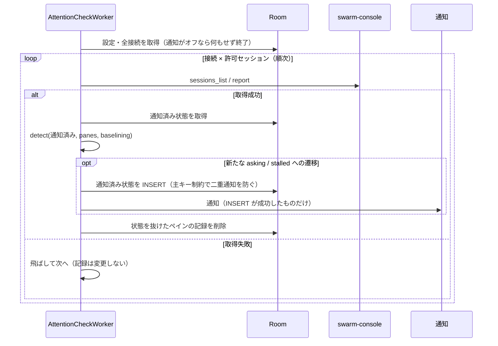

# Android 版の設計

swarm-viewer の Android 版（Kotlin + Jetpack Compose）に固有の設計を定める。デスクトップ版と共通の仕様（接続先は `/report` のみ、接続文字列、検証規則、`report` の読み方、通知の規則）は変えず、それぞれの正本を参照する。親 Issue は [#7](https://github.com/ousiassllc/swarm-viewer/issues/7)。

| 何を知りたいか | 参照先 |
|----------------|--------|
| Android の機能・画面・通知の規則 | [機能要件 §12](../requirements/functional.md) |
| Android の非機能要件（最小 OS・cleartext・Keystore・配布・署名） | [非機能要件 §10](../requirements/non-functional.md) |
| 技術選定・構成・コード共有範囲・未確認事項 | [アーキテクチャ設計 §12](../architecture/overview.md)、[§11](../architecture/overview.md) |
| 保存データ（Room・token の保護領域） | [ER / データモデル §7](../architecture/er.md) |
| ペアリング形式（QR・intent-filter） | [API 仕様 §2.3](../api/endpoints.md) |
| 環境構築・CI・署名鍵・リリース | [環境構築 §11](../environment/setup.md) |
| 本書 | WorkManager・通知チャンネル・権限・WindowSizeClass・テストベクタ |

## 1. 前提

| 項目 | 値 |
|------|----|
| applicationId / パッケージ | `com.ousiassllc.swarmviewer`（ソースは `android/app/src/main/kotlin/com/ousiassllc/swarmviewer/`） |
| minSdk / targetSdk / compileSdk | 29（Android 10）/ 35 / 35 |
| UI | Jetpack Compose + Material 3 |
| 対象端末 | まず Galaxy Fold7（折りたたみ時・展開時の両方）。ほかの Android 10 以降の端末・タブレットでも動くように、画面の切替は端末名でなく WindowSizeClass（§6）で行う |
| 通信 | OkHttp。`/report` への `POST` のみ。呼ぶツールは `sessions_list` と `report` だけ（NFR-SEC-1）。`/ops` と `tools/list` のコードパスを持たない |
| 読み取り専用 | 操作系のコントロール（ペインへの送信・選択・起動・終了）を持たない |

## 2. パッケージ構成

依存は上から下への一方向だけ。`domain` は Android の API・OkHttp・Room を import しない（純 Kotlin。JSON は kotlinx.serialization を使う）。

```
android/app/src/main/kotlin/com/ousiassllc/swarmviewer/
├── domain/   # 型・検証・解析・通知判定（副作用なし）。デスクトップの internal/domain と同じ責務
├── data/     # OkHttp の /report クライアント、Room、Keystore による token 保護
├── service/  # ペアリング・接続管理・画面更新の取得とスナップショット保存・設定（data を使うユースケース）
├── work/     # WorkManager の周期ジョブ（通知用の確認）と再スケジュール
├── notify/   # 通知チャンネル・通知の組み立て・権限
└── ui/       # Compose 画面（接続管理・メイン・設定）、WindowSizeClass による切替
```

- `domain/` の純粋ロジック（`parseReport`・`parseSessions`・`parsePairing`・`validateUrl`・`detect`・`classify`・`usageTone`）は、デスクトップの Go 実装とテストベクタ（§8）で挙動の一致を保つ。Go のコードは共有しない
- token は `data/` の中だけで扱う。`domain` の `Connection` は token を持たず、`PairingPayload` は `toString` で token を伏せる
- 実装は Issue #17（domain）、#18（データ層）、#19（ペアリングと接続管理）、#20（メイン画面・更新・設定）、#21（バックグラウンド通知）、#22（CI とリリース）に分かれる。本書はその共通の設計

## 3. バックグラウンドの確認（WorkManager）

通知（機能要件 §8、FR-AND-3）のためのバックグラウンド取得は、WorkManager の周期ジョブ（`PeriodicWorkRequest`）で行う。FCM（プッシュ）もフォアグラウンドサービスも使わない。

### 3.1 周期ジョブ

| 項目 | 内容 |
|------|------|
| 一意名 | `attention-check`（`enqueueUniquePeriodicWork`） |
| 間隔 | 設定の通知確認間隔（15 / 30 / 60 分、既定 15 分）。WorkManager の最小の繰り返し間隔は 15 分（`PeriodicWorkRequest.MIN_PERIODIC_INTERVAL_MILLIS`）のため、デスクトップの 5 / 10 分は選択肢に含めない。正確な実行時刻は制約と OS の最適化に依る（公式ドキュメント「Define your work」、2026-11-05 に確認） |
| 制約 | ネットワーク接続あり（`NetworkType.CONNECTED`）。それ以外の制約（充電中など）は付けない |
| 方針 | 間隔を変えたときは `ExistingPeriodicWorkPolicy.UPDATE` で置き換える。通知をオフにしたときは `cancelUniqueWork` でジョブを止める（機能要件 §8.3）。オンに戻したときと、アプリ起動時に、設定どおりのジョブが登録されていることを確かめて登録し直す |
| 端末再起動 | WorkManager は端末の再起動後にジョブを再スケジュールする。アプリ起動時の再登録と合わせて、再起動後に再開することを実機で確認する（[アーキテクチャ設計 §11](../architecture/overview.md) #15） |
| 実行 | `CoroutineWorker`。全接続・全許可セッションを**順次**取得する（NFR-PERF-6）。1 本の失敗は飛ばして次へ進み、通知済み記録を変えない（機能要件 §8.3）。401・403 の接続はその回の取得を飛ばす（再ペアリングまで止める。[API 仕様 §1.5](../api/endpoints.md)） |
| 結果 | 取得の失敗で `Result.retry()` を返さない（リトライしない。NFR-AVL-2）。常に `Result.success()` を返し、次の周期で再取得する |
| 遅れ | Doze・アプリスタンバイ・バッテリー最適化で、設定した間隔より遅れうる。設定画面に明記する（FR-AND-7）。遅れの程度は実機で確認する（[アーキテクチャ設計 §11](../architecture/overview.md) #11） |

### 3.2 1 回の実行の流れ



- 判定は domain の `detect`（[ER §3.4](../architecture/er.md) の更新規則）。画面更新で取得した結果も同じ `detect` に流す。通知がオフの間は記録だけ更新して通知しない（機能要件 §8.3）
- 二重通知の防止は、`notified_states` の主キー `(connection_id, session_id, pane_id, state)` の `INSERT` が成功したときだけ通知する形にする。画面更新とバックグラウンドが同時に同じ遷移を見ても、通知は 1 回になる
- 新規ペアリング後の一巡は通知せず記録だけにする（`connections.baselined_at`。機能要件 §8.2）

## 4. 通知

### 4.1 通知チャンネル

| 項目 | 値 |
|------|----|
| チャンネル ID | `attention` |
| 名前 | 「要対応」 |
| 説明 | 「ペインが答え待ち・止まってるかも になったときの通知」 |
| 重要度 | `IMPORTANCE_HIGH`（外出中に気づくための通知）。端末のシステム設定で利用者が変更できる |
| 作成 | アプリ起動時（API 26 以降は必須。minSdk 29 のため分岐なし） |

### 4.2 通知の中身

| 項目 | 内容 |
|------|------|
| タイトル | 接続の表示名 |
| 本文 | セッション・`pos`・状態ラベル（`asking` は `attention` の `detail` も添える）。token・URL 全体を含めない |
| ロック画面 | `VISIBILITY_PRIVATE`。`detail`（質問文の先頭）はロック画面に出さず、公開用の版は「要対応があります」だけにする |
| 識別 | 通知 ID は `(接続, セッション, ペイン ID, 状態)` から決める。同じ組の再投稿は置き換わる |
| タップ | アプリを開き、該当接続・セッションのタブを選択する（`PendingIntent`。Intent に接続 ID・セッション ID だけを載せる。FR-AND-5）。`PendingIntent` は `FLAG_IMMUTABLE` |

## 5. 権限

| 権限 | 種別 | 使う場面 |
|------|------|---------|
| `INTERNET` | 通常 | `/report` への通信 |
| `POST_NOTIFICATIONS` | 実行時（Android 13 / API 33 以降） | 通知。初回起動時に要求し、拒否されたら設定画面に、システムの通知設定を開く案内を出す（FR-AND-4）。API 29〜32 は実行時の許可なしで通知できる |
| `CAMERA` | 実行時 | QR 読み取りを開始したときだけ要求する。拒否されても貼り付け・ディープリンクで使える（FR-AND-1）。QR 読み取りは CameraX + ML Kit（同梱モデル）で、カメラ権限が要る（[アーキテクチャ設計 §11](../architecture/overview.md) #10）。マニフェストには `android.hardware.camera` を `required="false"` で宣言し、カメラのない端末にも入れられるようにする |

- アプリが自分で宣言する権限は上の 3 つだけ。WorkManager などの依存ライブラリがマニフェストのマージで加える権限（`WAKE_LOCK`・`ACCESS_NETWORK_STATE`・`RECEIVE_BOOT_COMPLETED` など）は、マージ後のマニフェストに現れる
- 位置情報・連絡先・ストレージの権限は要求しない

## 6. WindowSizeClass によるレイアウト切替

画面の幅の区分（Material の window size classes。Compact: 600dp 未満、Medium: 600dp 以上 840dp 未満、Expanded: 840dp 以上）で、メイン画面の出し方を切り替える（機能要件 FR-AND-2）。

| 区分 | 表示 |
|------|------|
| Compact | 縦長・狭い画面。ペインを `pos` 順のリストで 1 列に出し、利用上限・ホスト負荷はその下に縦に続ける（1 つのスクロール） |
| Medium / Expanded | 広い画面。`layout` の `rows`・`cols[]` に従って T* / B* のグリッドを出し、利用上限・ホスト負荷を**横**に置く |

- `layout` が欠落・不整合（`Layout.valid(paneCount)` が false）なら、広い画面でもペイン順のリストで出す（FR-PANE-1）
- Galaxy Fold7 は折りたたみ時に Compact、展開時に Medium または Expanded になる見込み。実際の区分は実機で確認する（[アーキテクチャ設計 §11](../architecture/overview.md) #14）
- **折りたたみ⇔展開の切替で保つ状態**: 選択中の接続・セッション、各リストのスクロール位置、取得済みの表示内容。選択は `ViewModel` と保存済みの `connections.last_session` で保ち、スクロール位置は `rememberSaveable`（`LazyListState`）で保つ。切替は構成変更（Activity の再生成）として起きうるため、状態は Composable のローカル変数に置かない
- 画面の向き・折りたたみの状態そのものでなく WindowSizeClass で分岐する（端末名・ヒンジの状態には依存しない）

## 7. フォアグラウンドの更新

| 項目 | 内容 |
|------|------|
| 間隔 | 設定の画面更新間隔（5 / 10 / 30 / 60 秒、既定 10 秒。デスクトップと同じ） |
| 対象 | 選択中セッションの `report` 1 本だけ（NFR-PERF-5）。前のリクエストが終わる前に次を出さない |
| 止める・再開 | 画面が見えている間（ライフサイクルが `STARTED` 以上）だけ動かす。バックグラウンドに回ったら止め、戻ったら即時に 1 回取得する（FR-AND-8） |
| 手動更新 | 「プルして更新」（`PullToRefresh`）。進行中の取得があればそれに相乗りする |
| 失敗 | 直前の表示をグレーアウトして残し、失敗の状態を併記する。401・403 はポーリングを止めて再ペアリングへ誘導する |

## 8. テストベクタ

決めること 6（Go コードを共有しない）の担保として、デスクトップ（Go）と Android（Kotlin）が**同じ JSON ファイルを読み**、同じ入力に同じ結果を返すことを検査する。仕様を変えるときは、ベクタ・Go・Kotlin を 1 つの PR で揃える。

| 項目 | 内容 |
|------|------|
| 置き場所 | リポジトリ直下の `testdata/vectors/` |
| 説明 | `testdata/vectors/README.md` に形式（ファイルごとの入力・期待値のキー、正規化の約束）を書く |
| Go 側 | `internal/domain/vectors/*_test.go`（domain の公開 API を検証する。linterly の 1 ディレクトリ 2,000 行の上限のため `internal/domain` 直下と分ける）と `internal/web/format/vectors_test.go`（state の表示ラベル）が `testdata/vectors/*.json` を読む（テスト以外の Go コードは変えない） |
| Kotlin 側 | `android/app/src/test/kotlin/com/ousiassllc/swarmviewer/domain/` の JUnit が同じファイルを読む。Gradle のユニットテストの作業ディレクトリは `android/app` のため、親ディレクトリをたどって `testdata/vectors/` を見つける |

| ファイル | 内容 | 対応する仕様 |
|----------|------|-------------|
| `pairing.json` | 接続文字列（正常・異常）と期待する解析結果・エラー種別 | [API 仕様 §2.1・§2.2](../api/endpoints.md)、NFR-SEC-7 |
| `url.json` | 接続先 URL の検証（tailnet 範囲の境界値・ホスト名・`0.0.0.0`・userinfo・クエリ付き） | NFR-SEC-4・5、NFR-QLT-2 |
| `report.json` | `report` / `sessions_list` の応答と、期待する解析結果 | [API 仕様 §1.3・§1.4](../api/endpoints.md)、NFR-CMP-1・2 |
| `detect.json` | 通知判定の入力列（通知済み記録・ペイン・baselining）と期待する通知・記録の操作 | [ER §3.4](../architecture/er.md)、機能要件 §8.2 |
| `classify.json` | エラー分類の入力（`err` の種類・HTTP ステータス・ツールコード）と期待する種別・コード | [API 仕様 §1.5](../api/endpoints.md) |
| `usage_tone.json` | 利用上限の枠・使用率と期待する色（80% 黄・95% 赤・`exhausted` 赤、`unit` が `percent` 以外はしきい値なし） | 機能要件 §5.3 |

- どのテストも、ベクタの**ケース数の下限**を検査する。ファイルが空・読めない・キーの綴り違いで、テストが静かに空振りしない
- ベクタの `name` はケースの意図を書く（失敗時にどのケースか分かるように）
- Go と Kotlin で結果が食い違ったときは、仕様（本書の参照先）に照らしてどちらが正しいかを決める。Go の実装が仕様と違うなら、実装の変更は別 Issue に切り出す

## 9. ログ

- ログは Logcat のみ。ファイルへは書かない（NFR-AND-LOG-1）
- token・完全な URL・ペイン本文（`activity`・`note`）を出さない。接続は表示名と host だけで識別する（NFR-LOG-3・NFR-SEC-11 と同じ）
- 設定の「デバッグログ」は Logcat の詳細ログのオン/オフ（既定オフ）。オフの間は警告・エラーだけ出す

## 改訂履歴

| 版 | 日付 | 変更内容 | 変更理由 |
|----|------|---------|---------|
| 1.0 | 2026-11-05 | 新規作成 | Issue #15（Android 版の仕様書への反映） |
