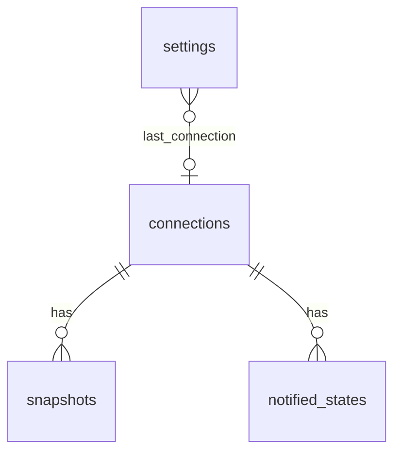
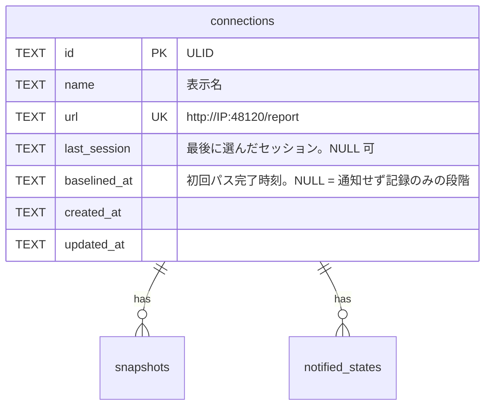
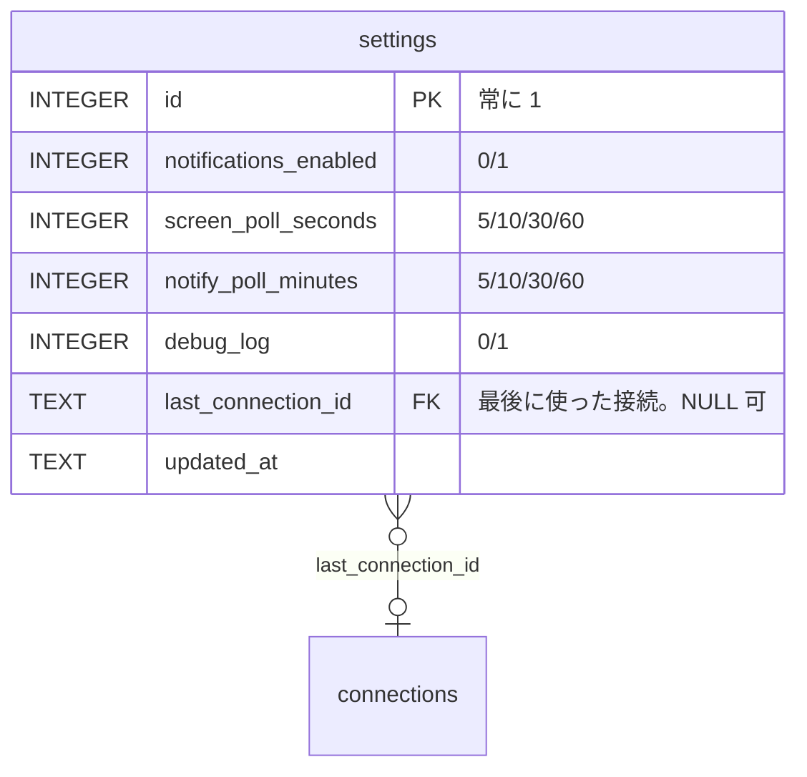
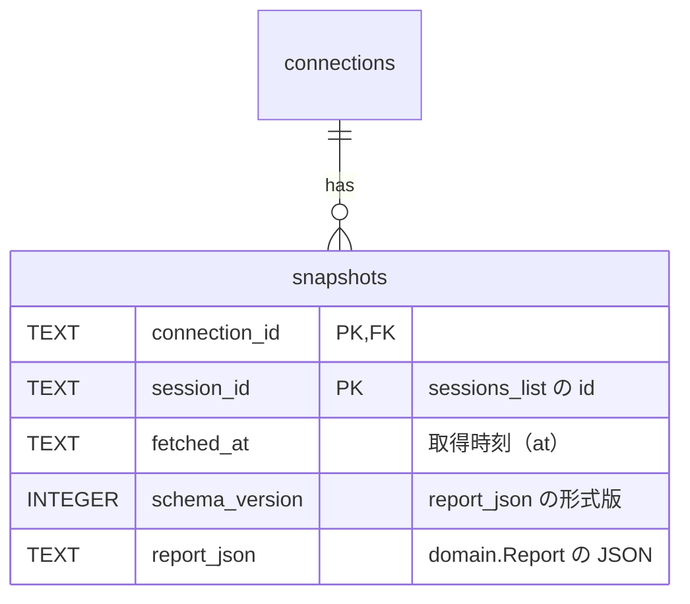
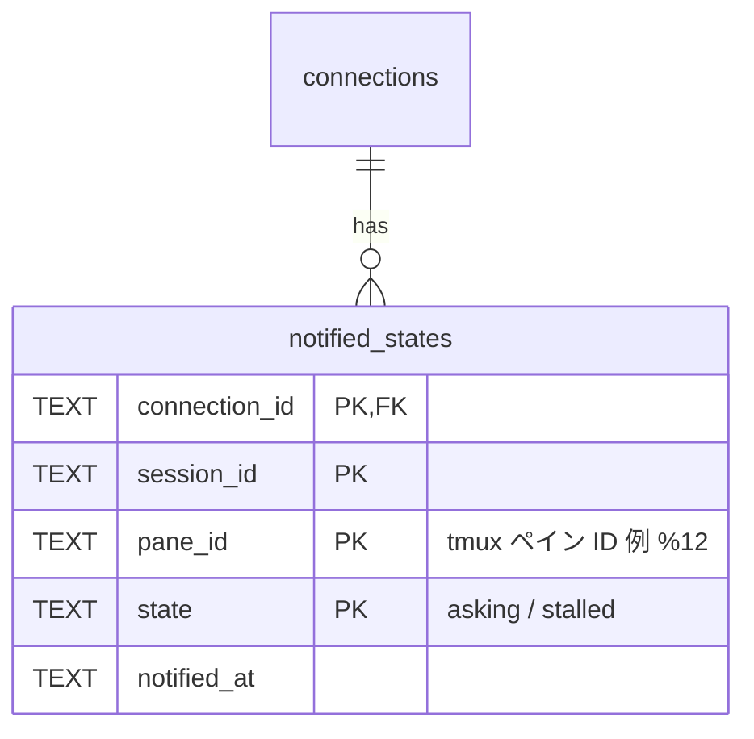

# ER / データモデル

swarm-viewer の内部データ（SQLite）と秘密領域の構成を定める。保存先・保存期間の要件は[非機能要件 §6](../requirements/non-functional.md)、使い方は[アーキテクチャ設計](overview.md)・[機能要件](../requirements/functional.md)を参照する。

> §1〜§6 はデスクトップ版（SQLite `modernc.org/sqlite` + OS 秘密領域）の定義。Android 版（Room + Android Keystore）の保存は [§7](#7-android-版の保存データ)。論理テーブルとその更新規則（§3）は両方で共通。

## 1. 保存場所の全体像

| 保存先 | 内容 | 備考 |
|--------|------|------|
| SQLite（1 ファイル `viewer.db`） | 接続・設定・スナップショット・通知済み記録 | `modernc.org/sqlite`（CGO 不要）。token は入れない |
| OS 秘密領域 | 接続ごとの token | macOS Keychain / Windows Credential Manager（§4） |
| ログファイル | エラー・警告（デバッグ時は詳細） | SQLite とは別。token・完全な URL・ペイン本文を出さない（NFR-LOG-3） |

### SQLite ファイル

| 項目 | 値 |
|------|----|
| 場所 | `os.UserConfigDir()` 配下の `swarm-viewer/viewer.db`（Windows `%AppData%`、macOS `~/Library/Application Support`） |
| 権限 | 作成時 `0600`（所有者のみ）。既存ファイルが `0600` より緩ければ起動時に `0600` へ締める（Windows は既定の ACL） |
| 起動時の PRAGMA | `foreign_keys = ON`、`busy_timeout = 5000`、`journal_mode = WAL`。`user_version` を先に読み（新しい版の DB は一切変更せず `ErrSchemaTooNew`）、整合性チェックを経てから WAL へ切り替える |
| スキーマ版 | `PRAGMA user_version`。アプリが知る版より新しい場合は起動を拒否して案内する（NFR-CMP-4）。古い場合は順にマイグレーションを実行する |
| 時刻 | UTC の RFC 3339 文字列（`TEXT`、例 `2026-11-03T09:10:05Z`）。表示時にローカル時刻へ変換する |
| 真偽値 | `INTEGER`（0 / 1）。`CHECK` で値を限定する |

## 2. 全体ER図

- `connections` を消すと `snapshots`・`notified_states` は連鎖削除される。token は SQLite 外のため、サービス層が秘密領域のエントリも削除する（§4、NFR-SEC-8）
- `settings` は 1 行だけ。最後に使った接続への参照を持つ（接続削除時は NULL に戻る）

## 3. テーブル定義

### 3.1 connections

保存済みの接続（swarm-console の `/report` 1 つにつき 1 行）。

| カラム | 型 | 制約 | 説明 |
|--------|----|------|------|
| `id` | TEXT | PK | ULID（26 文字）。URL パス・秘密領域のキー・外部キーに使う |
| `name` | TEXT | NOT NULL, `CHECK (length(name) BETWEEN 1 AND 100)` | 表示名。ペアリングの `name` が無ければ URL の host で補う |
| `url` | TEXT | NOT NULL, UNIQUE | 正規化済み URL（scheme・host・port・path を検証済み。NFR-SEC-4・5）。同じ `url` の再ペアリングは新規追加ではなく token の差し替え |
| `last_session` | TEXT | NULL 可 | 最後に選んだセッションの `id`（`sessions_list` の `id`）。許可外・消滅時は先頭の許可セッションにフォールバックする（FR-SESS-3） |
| `baselined_at` | TEXT | NULL 可 | 初回の取得パス（全許可セッション）が完了した時刻。NULL の間は通知せず通知済み記録だけを作る（[機能要件 §8.2](../requirements/functional.md)）。一部のセッションが取得に失敗し続ける間は NULL のままで、その接続は通知されない（残余リスク。機能要件の規則どおり。新規ペアリング直後の最初の一巡は `Confirm` が直ちに起動する） |
| `created_at` | TEXT | NOT NULL | 作成時刻 |
| `updated_at` | TEXT | NOT NULL | 更新時刻（token 差し替え・名前変更・`last_session` 更新） |

インデックス: `url` の UNIQUE により暗黙に作成。一覧は `created_at` 昇順で取得する（件数が少ないため追加インデックスなし）。

### 3.2 settings

アプリ全体の設定（1 行固定）。

| カラム | 型 | 制約 | 既定 | 説明 |
|--------|----|------|------|------|
| `id` | INTEGER | PK, `CHECK (id = 1)` | 1 | 1 行だけを保証する |
| `notifications_enabled` | INTEGER | NOT NULL, `CHECK (… IN (0, 1))` | 1 | OS 通知のオン/オフ。オフの間は通知用ポーリングも行わない |
| `screen_poll_seconds` | INTEGER | NOT NULL, `CHECK (… IN (5, 10, 30, 60))` | 10 | 画面更新間隔（選択中セッション） |
| `notify_poll_minutes` | INTEGER | NOT NULL, `CHECK (… IN (5, 10, 30, 60))` | 10 | 通知用ポーリング間隔（全接続・全許可セッション） |
| `debug_log` | INTEGER | NOT NULL, `CHECK (… IN (0, 1))` | 0 | デバッグログのオン/オフ（NFR-LOG-2） |
| `last_connection_id` | TEXT | FK → `connections.id` `ON DELETE SET NULL` | NULL | 起動時に開く接続。NULL なら先頭の接続 |
| `updated_at` | TEXT | NOT NULL | — | 更新時刻 |

- 初期化: マイグレーションで既定値の 1 行を `INSERT` する。アプリは常に `id = 1` を `UPDATE` する（`INSERT` しない）
- 許容値は `CHECK` で強制する。項目を増やすときはマイグレーションを追加する

### 3.3 snapshots

接続×セッションごとの、最後に取得した `report`。起動直後・取得失敗時にグレーアウトで表示するために使う（FR-POLL-4）。

| カラム | 型 | 制約 | 説明 |
|--------|----|------|------|
| `connection_id` | TEXT | PK（複合）, FK → `connections.id` `ON DELETE CASCADE` | |
| `session_id` | TEXT | PK（複合） | `sessions_list` の `id` |
| `fetched_at` | TEXT | NOT NULL | viewer が取得に成功した時刻 |
| `schema_version` | INTEGER | NOT NULL | `report_json` の形式版（アプリが定義）。読めない版・壊れた JSON は「スナップショットなし」として扱い、起動を止めない |
| `report_json` | TEXT | NOT NULL, `CHECK (json_valid(report_json))` | 取得した `report` から viewer が使う項目だけを持つ `domain.Report` の JSON（`panes[]`、`layout`、`usage`、`host`、`attention`、`warnings`）。未知のキーは保存しない |

- 書き込み: `report` の取得に成功するたび、同じキーを `UPSERT` で置き換える（履歴は持たない。接続×セッションごとに最新 1 件）
- 範囲: 画面更新で取得した結果と、通知用ポーリングで取得した結果のどちらも保存する
- 削除: 接続削除で連鎖削除する。セッションが `sessions_list` から消えたら、次の通知用ポーリングで該当行を削除する
- **保存するデータの性質**: `report_json` には `title`・`cwd`・`activity`・`note` などホスト側の作業内容が含まれる。これらはディスク上に平文で残る（§6 の方針）。token は含まれない

### 3.4 notified_states

通知済みの `(接続, セッション, ペイン, 状態)`。同じ状態の再通知を防ぐ（FR-NTF-3、[機能要件 §8.2](../requirements/functional.md)）。

| カラム | 型 | 制約 | 説明 |
|--------|----|------|------|
| `connection_id` | TEXT | PK（複合）, FK → `connections.id` `ON DELETE CASCADE` | |
| `session_id` | TEXT | PK（複合） | |
| `pane_id` | TEXT | PK（複合） | `panes[].id`（`pos` ではない。レイアウト変更に強い） |
| `state` | TEXT | PK（複合）, `CHECK (state IN ('asking', 'stalled'))` | 通知対象の状態だけを記録する |
| `notified_at` | TEXT | NOT NULL | 通知した時刻。`baselined_at` が NULL の間の記録は「通知せず記録した」時刻 |

インデックス: `(connection_id, notified_at)`（接続あたり 1,000 件を超えたとき古い順に削除するため。NFR-DAT-3）。

更新規則（ペイン `P`、現在の状態 `S` を観測したとき）:

| 観測 | `notified_states` への操作 | 通知 |
|------|--------------------------|------|
| `S` が `asking` / `stalled` で、`(P, S)` の行がない | 行を `INSERT` | **する**（`baselined_at` が NULL の間は通知しない） |
| `S` が `asking` / `stalled` で、`(P, S)` の行がある | 何もしない | しない |
| `S` が通知対象外 | `P` の行をすべて `DELETE` | しない |
| `S` が通知対象で、`P` に別の状態の行がある（例: `asking` → `stalled`） | 別の状態の行を `DELETE` し、`(P, S)` を `INSERT` | する |
| ペインがセッションから消えた | その `P` の行を `DELETE` | しない |
| 取得に失敗した | 変更しない | しない |

## 4. 秘密領域（token）

| 項目 | 値 |
|------|----|
| サービス名 | `swarm-viewer` |
| アカウント名（キー） | `connection:{connections.id}` |
| 値 | report スコープの token（平文文字列） |
| 作成 | ペアリング確定時（疎通確認に成功した後）。SQLite の `connections` の `INSERT` と同じユースケースで行う |
| 差し替え | 同じ `url` の再ペアリング時に上書きする |
| 削除 | 接続削除時。孤立エントリ（token だけが残り利用者が気づけない状態）を作らない順序にする: 先に秘密領域を削除し、次に SQLite の行を削除する。秘密領域の削除に失敗したら接続は残したままエラーを返し、利用者が再試行できる。行の削除に失敗した場合は token が先に消えているため、接続は残るが「token なし」（`needs_repair`）として扱い、再ペアリングまたは再削除で片付ける。キーのみをログに出す（値は出さない）。孤立エントリの自動掃除は行わない（採用ライブラリ `go-keyring` はエントリ一覧を取得できないため）。同じ接続 ID は再利用されない（ULID） |

- 起動時: 秘密領域にエントリがない接続（OS 側で消された等）は、その接続を「token なし」として扱い、メイン画面で再ペアリングを促す（401 と同じ導線）
- 孤立エントリは OS の資格情報管理（Keychain Access / 資格情報マネージャー）から `swarm-viewer` のエントリとして手動削除できる（README に記載）

## 5. マイグレーション

| 版 | 内容 |
|----|------|
| 1 | `connections`・`settings`（既定値の 1 行を挿入）・`snapshots`・`notified_states` と上記インデックスを作成 |

- 版ごとに SQL を埋め込み（`go:embed`）、1 つのトランザクションで適用して最後に `PRAGMA user_version` を更新する
- 破壊的な変更（列の削除・型変更）は新しい版でテーブルの作り直しとデータ移行を行い、ダウングレードは提供しない
- DB が開けない・壊れている場合の挙動は NFR-AVL-5（起動は止めず、初期化の導線を出す。token は秘密領域に残るため、初期化後は孤立エントリとして掃除される）

## 6. 保存データの取り扱い

| データ | 保存 | 理由・扱い |
|--------|------|-----------|
| token | 秘密領域のみ | SQLite・ログ・画面に出さない（NFR-SEC-2） |
| 接続の URL | SQLite（平文） | token を含まない。ログには host のみ（NFR-SEC-11） |
| `report`（ペイン本文を含む） | SQLite（平文、最新 1 件） | 起動直後と失敗時のグレーアウト表示用。履歴は持たない。ファイルは `0600`。接続削除で消える |
| 通知済み記録 | SQLite | ペイン ID と状態のみ。本文は持たない |
| ログ | ログファイル | `report` の本文（`activity`・`note`）は出さない（NFR-LOG-3）。SQLite の `snapshots` とは独立 |

- ディスク暗号化は OS（BitLocker / FileVault）に任せ、アプリでは行わない。平文でペイン本文が残る点は README に記載する

## 7. Android 版の保存データ

Android 版は、§3 の 4 テーブル（`connections`・`settings`・`snapshots`・`notified_states`）と同じ論理構造を Room（SQLite）で持つ。token は Room に入れず、Android Keystore で保護した領域に保存する。要件は[非機能要件 §10](../requirements/non-functional.md)、構成は[アーキテクチャ設計 §12](overview.md)を参照する。

### 7.1 保存場所

| 保存先 | 内容 | 備考 |
|--------|------|------|
| Room（SQLite 1 ファイル `viewer.db`） | 接続・設定・スナップショット・通知済み状態 | アプリ専用の内部ストレージ（`Context.getDatabasePath`）。他のアプリから読めない。token は入れない |
| Android Keystore で保護した領域 | 接続ごとの token | §7.3。AES-256-GCM 鍵（Keystore、エクスポート不可）で暗号化した暗号文を `noBackupFilesDir` に保存（[アーキテクチャ設計 §11](overview.md) #9） |
| Logcat | エラー・警告（デバッグ時は詳細） | ファイルには書かない。token・完全な URL・ペイン本文を出さない（NFR-AND-LOG-1） |

### 7.2 テーブル（Room のエンティティ）

カラム・意味・更新規則は §3 と同じ。Android での違いだけを示す。

| テーブル | デスクトップ版（§3）との違い |
|----------|----------------------------|
| `connections` | `id` はアプリが生成するランダムな UUID（v4、小文字）の文字列。同じ `url` の再ペアリングは新規追加でなく token の差し替え（同じ）。`url` は UNIQUE |
| `settings` | `notify_poll_minutes` の許容値は **15 / 30 / 60**、既定は **15**（WorkManager の周期ジョブの最小間隔が 15 分のため。5 / 10 は持たない）。`screen_poll_seconds` は 5 / 10 / 30 / 60、既定 10。`notifications_enabled` 既定 1、`debug_log` 既定 0。1 行固定（`id = 1`）・`last_connection_id` の外部キー（`ON DELETE SET NULL`）は同じ |
| `snapshots` | 主キー `(connection_id, session_id)`、`report_json` は domain の `Report` の JSON（`panes[]`・`layout`・`usage`・`host`・`attention`・`warnings`）。接続×セッションごとに最新 1 件、`ON DELETE CASCADE`、読めない版・壊れた JSON は「スナップショットなし」として扱う（同じ） |
| `notified_states` | 主キー `(connection_id, session_id, pane_id, state)`。**この主キー制約が二重通知の防止になる**（`INSERT` が成功したときだけ通知する。[Android 版の設計 §3.2](../android/overview.md)）。`state` は `asking` / `stalled` だけ、接続あたり 1,000 件を上限に古い順に削除（NFR-DAT-3）、インデックス `(connection_id, notified_at)`、`ON DELETE CASCADE`（同じ） |

- 時刻は UTC の RFC 3339 文字列（秒精度、例 `2026-11-03T09:10:05Z`）、真偽値は `INTEGER`（0 / 1）。§1 と同じ
- Room のアノテーションでは `CHECK` 制約を宣言しないため、許容値（`settings` の選択肢、`notified_states.state`）は domain の型・検証で強制する。デスクトップ版の `CHECK` と同じ値を許容する
- 外部キー（連鎖削除・`SET NULL`）は有効な状態で DB を開く。接続の削除で `snapshots`・`notified_states` が消えることをテストで確認する
- スキーマの版は Room の DB バージョン。Room のスキーマ JSON をエクスポートし、版ごとに `Migration` を書く。破壊的な再作成（`fallbackToDestructiveMigration`）は使わない（NFR-CMP-4 と同じ。新しい版で上げた DB を古い版のアプリが開いたときは、データを壊さず起動を拒否して案内する）。DB が開けない・壊れているときは、起動を止めずエラーを表示し、設定を初期化できる導線を出す（NFR-AVL-5 と同じ。token は保護領域に残る）

### 7.3 token の保護領域

| 項目 | 値 |
|------|----|
| キー | `connection:{connections.id}`（デスクトップ版の秘密領域のキーと同じ形） |
| 値 | report スコープの token。Android Keystore の鍵（エクスポート不可）で暗号化した暗号文だけを保存し、平文を DB・ファイル・ログに書かない |
| 保存先 | アプリの `noBackupFilesDir` 配下（`tokens/<接続 ID>.token`。DB に入れず、バックアップ・端末間転送の対象外）。Keystore の AES-256-GCM 鍵（エクスポート不可）で暗号化した `IV（12 バイト）+ 暗号文 + 認証タグ` を、一時ファイルへ書いてから置き換える（EncryptedSharedPreferences は使わない）。接続 ID を認証データに含め、別の接続のファイルへ移しても復号できない。方式の確定は[アーキテクチャ設計 §11](overview.md) #9 |
| 作成・差し替え | デスクトップ版の §4 と同じ。ペアリング確定後（疎通確認に成功した後）に作成し、同じ `url` の再ペアリングで上書きする |
| 削除 | §4 と同じ順序。先に token を削除し、次に Room の行を削除する。token の削除に失敗したら接続は残したままエラーを返し、行の削除に失敗した場合は「token なし」（`needs_repair`）として扱う。接続の削除で、token・`snapshots`・`notified_states` がすべて消える（NFR-SEC-8） |
| 起動時 | 保護領域に token がない・復号できない接続は「token なし」として扱い、メイン画面で再ペアリングを促す（401 と同じ導線） |

- 不変条件（どの方式でも守る）: token は DB・ログ・画面・バックアップ・Intent・通知に出さない
- アプリのバックアップ・端末間転送は全データを対象外にする（`allowBackup="false"`、`dataExtractionRules`、`fullBackupContent`。`android/app/src/main/res/xml/`）。このため暗号文・DB は他の端末に移らず、機種変更後は再ペアリングする

### 7.4 保存データの取り扱い

§6 と同じ方針。`snapshots.report_json` にはホスト側の作業内容（`title`・`cwd`・`activity`・`note`）が平文で含まれるが、アプリ専用の内部ストレージにあり、バックアップに含まれず、接続の削除で消える。ディスク暗号化は OS（Android のファイルベース暗号化）に任せる。

## 改訂履歴

| 版 | 日付 | 変更内容 | 変更理由 |
|----|------|---------|---------|
| 1.0 | 2026-11-03 | 新規作成 | 初版 |
| 1.1 | 2026-11-03 | 秘密領域の孤立エントリ掃除を廃止し手動削除の案内に変更 | 採用ライブラリ（go-keyring）がエントリ一覧を取得できないため |
| 1.2 | 2026-11-04 | 接続削除の順序を「先に秘密領域、次に行」へ変更し、失敗時の扱いを明記 | 秘密領域の削除失敗が利用者に伝わらず孤立 token が残るため |
| 1.3 | 2026-11-04 | 既存 DB の権限を `0600` へ締める・`user_version` を WAL 切り替えより先に読む・`baselined_at` の残余リスクを明記 | 緩い権限の DB の保護、新しい版の DB を変更しないため |
| 1.4 | 2026-11-05 | §7「Android 版の保存データ」を追加（Room の 4 テーブル、通知間隔の許容値 15 / 30 / 60 分、token の保護領域、バックアップ除外） | Issue #15（Android 版の仕様書への反映） |
