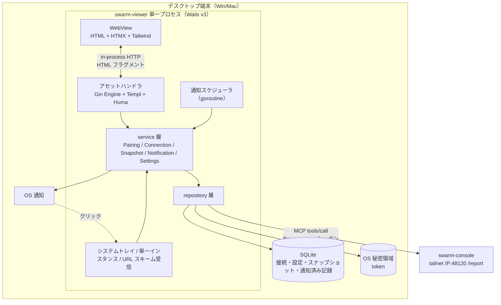
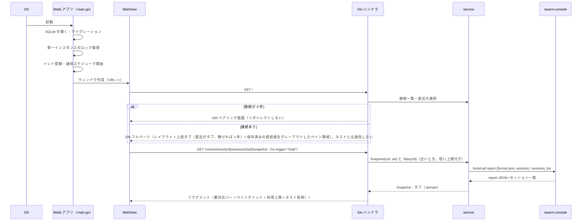
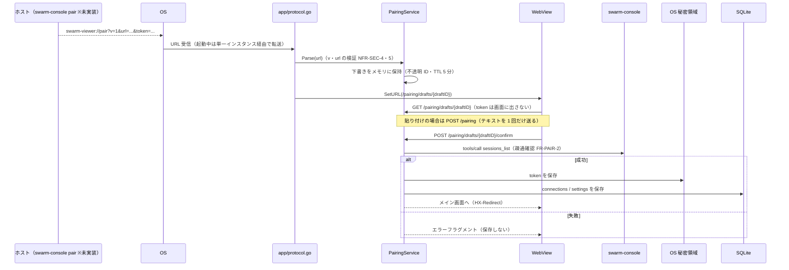
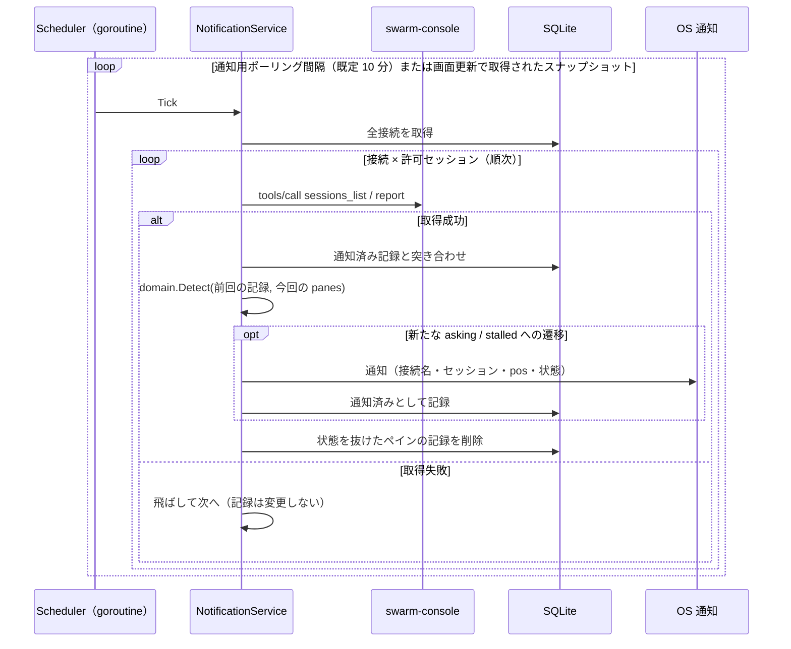
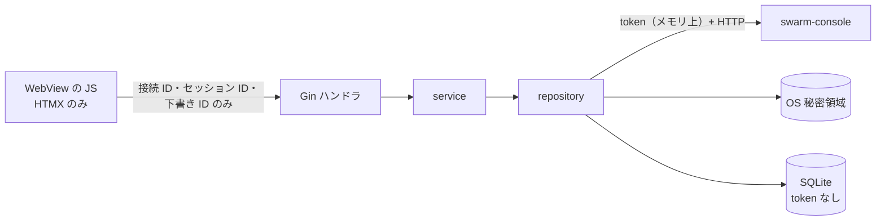
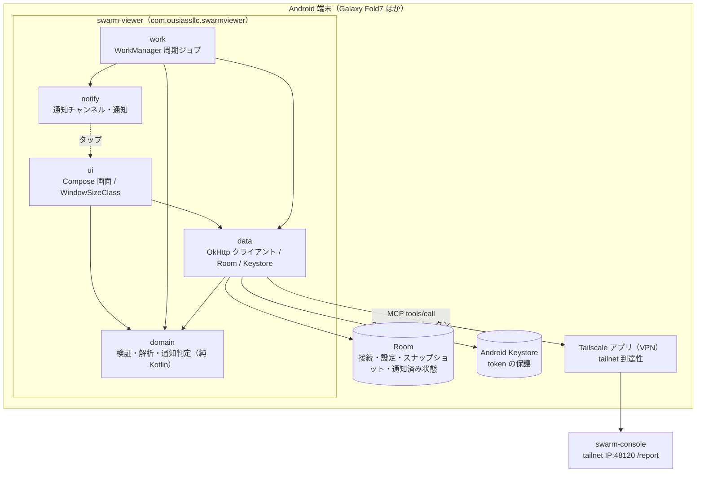

# アーキテクチャ設計

swarm-viewer の全体構成・技術選定・レイヤー構造・通信フローを定める。要件は[機能要件](../requirements/functional.md)・[非機能要件](../requirements/non-functional.md)、保存データは[ER / データモデル](er.md)、画面ルートと外部 API の形は [API 仕様](../api/endpoints.md)、モジュール分割は[コンポーネント設計](../components/overview.md)を参照する。

> §1〜§10 はデスクトップ版（Wails）の構成。Android 版（Kotlin + Jetpack Compose）の構成は [§12](#12-android-版の構成)、固有の設計（WorkManager・通知・権限・レイアウト・テストベクタ）は [Android 版の設計](../android/overview.md)を参照する。§11 の未確認事項は両方を含む。

## 1. 設計方針

フロントエンドは **HALT（HTMX + Atomic Design + Lit + Templ）** に従う。バックエンドファースト・SPA を作らない・状態はサーバー（Go）が持つ。

| 方針 | viewer での適用 |
|------|----------------|
| サーバーがUI制御を握る | 画面は Go（Gin + Templ）が HTML で返し、HTMX が差し替える。クライアント JS は HTMX 本体と、可視性制御の数行（`app.js`）、グローバルのエラーリスナーのみ |
| HATEOAS | 利用可能なアクションだけを HTML に含める。viewer は読み取り専用のため、操作系のコントロール自体を持たない（ペインへの送信・選択ボタンは存在しない） |
| 「サーバー」はアプリ内 | HTTP は Wails のアセットハンドラ（`http.Handler`）経由で WebView と Go が話す。**TCP ポートは開かない**（token を WebView の JS に渡さない NFR-SEC-3 と、外部プロセスからの到達を避けるため） |
| 疎結合 | swarm-console との通信（MCP）・SQLite・OS 秘密領域・OS 通知は、それぞれ interface の裏に置いて差し替え可能にする |
| 読み取り専用 | swarm-console への呼び出しは許可リストのツールだけ。`/ops` のコードパスを持たない（NFR-SEC-1） |

## 2. 技術スタック

| レイヤー | 技術 | 役割・選定理由 |
|---------|------|---------------|
| デスクトップシェル | Wails v3（v3.0.0 以降） | Win/Mac ネイティブ。アセットハンドラに `http.Handler` を渡せる。カスタム URL スキーム・シングルインスタンス・システムトレイ・ネイティブ通知を提供する |
| サーバーフレームワーク | Go + Gin | ルーティング + SSR（`*gin.Engine` は `http.Handler`。Wails のアセットハンドラへそのまま渡す） |
| API フレームワーク | Huma | OpenAPI 3.1 自動生成。HALT 標準に従って組み込む。v1 は公開する JSON オペレーションを持たない（§4.3） |
| テンプレートエンジン | Templ | 型安全な Go HTML テンプレート |
| インタラクション | HTMX（+ `response-targets` 拡張） | サーバー駆動の DOM 更新、ポーリング |
| リッチ UI | Lit | **初版は使わない**（使用基準に該当する画面がない）。導入時の規約は §8 |
| スタイリング | Tailwind CSS | ユーティリティクラス。ダークモードは CSS カスタム変数 + Tailwind |
| MCP クライアント | 公式 Go SDK（`github.com/modelcontextprotocol/go-sdk/mcp`） | swarm-console `/report` へ `tools/call`。HTTP トランスポートに独自の `http.Client` を渡し、Bearer 付与とタイムアウトを制御する |
| 内部 DB | SQLite（`modernc.org/sqlite`、CGO 不要） | 接続・設定・直近スナップショット・通知済み記録（NFR-DAT-1・2。[ER](er.md)） |
| 秘密領域 | OS キーストア（macOS Keychain / Windows Credential Manager）を `github.com/zalando/go-keyring` 経由で利用 | token の保存（NFR-SEC-2）。ライブラリ選定の理由は[コンポーネント設計 §1](../components/overview.md) |
| ビルド | `wails3 build` + Tailwind CLI | HTMX は `node_modules` から配置。esbuild は Lit 導入時に追加する |

> **Wails v3 について**: 公式ドキュメント（2026-11-03 時点）は v3.0.0 をリリース済みとして記載している。API 差異が大きい領域（トレイ・通知・URL スキーム）は §11 の未確認項目に挙げ、実機で確認してから確定する。

## 3. 全体構成



## 4. レイヤー構造

### 4.1 ディレクトリ構成

HALT のレイヤード構成に、デスクトップシェルの `app/` を加える。

```
swarm-viewer/
├── main.go                      # エントリーポイント（Wails アプリ生成・配線のみ）
├── build/config.yml             # Wails ビルド設定（URL スキーム swarm-viewer を宣言）
├── internal/
│   ├── domain/                  # ドメインモデル・純粋ロジック（他層に依存しない）
│   │   ├── report.go            #   Report / Pane / PaneState / Usage / Host / Attention / Warning
│   │   ├── connection.go        #   Connection / PairingPayload / URL 検証（NFR-SEC-4・5）
│   │   ├── notify.go            #   状態遷移の検知・通知対象判定（純粋関数）
│   │   └── settings.go          #   Settings とその許容値
│   ├── repository/              # データアクセス層（domain のみに依存）
│   │   ├── report/              #   swarm-console /report への MCP クライアント
│   │   ├── store/               #   SQLite（マイグレーション付き）
│   │   └── secret/              #   OS 秘密領域
│   ├── service/                 # アプリケーションサービス層
│   │   ├── pairing.go
│   │   ├── connection.go
│   │   ├── snapshot.go          #   report 取得・single-flight・直近値キャッシュ
│   │   ├── notification.go      #   通知スケジューラ・遷移検知・重複抑止
│   │   └── settings.go
│   ├── app/                     # Wails シェル（service を呼ぶ・UI 層ではない）
│   │   ├── window.go            #   メインウィンドウ・SetURL による遷移（Navigator 実装）
│   │   ├── tray.go              #   トレイ常駐・メニュー
│   │   ├── protocol.go          #   swarm-viewer:// の受信
│   │   ├── notifier.go          #   OS 通知（service が使う interface の実装）
│   │   ├── shell.go             #   Wails アプリの生成・単一インスタンス・終了処理
│   │   ├── applog/              #   ログのマスク・ローテーション設定（Wails 非依存）
│   │   ├── compose/             #   SQLite・service・router の組み立てと recovery モードの切替（Wails 非依存）
│   │   ├── deeplink/            #   swarm-viewer:// の抽出・下書き作成・遷移（Wails 非依存）
│   │   ├── idgen/               #   IDGenerator（ULID）の実装
│   │   ├── navpath/             #   遷移先パスの検証
│   │   ├── notice/              #   OS 通知の中身の組み立てとクリック時の遷移先
│   │   └── swap/                #   差し替え可能な http.Handler（アセットハンドラ用）
│   ├── router/                  # Gin ルーティング定義（画面ルート + Huma の登録）
│   └── web/                     # Web 層
│       ├── handler/             #   画面ハンドラ（機能ドメイン別）
│       │   ├── main.go          #     メイン画面・ペイン領域
│       │   ├── connection.go    #     接続の一覧・削除
│       │   ├── pairing.go       #     ペアリング（貼り付け・下書き・確定）
│       │   └── settings.go
│       ├── middleware/          #   CSRF・NoStore・CSP・Recover・RequestLog
│       ├── atoms/               #   badge / progress_bar / spinner / toast / button / input
│       ├── molecules/           #   pane_card / usage_row / host_row / session_tab / attention_item
│       ├── organisms/           #   session_tabs / pane_grid / usage_panel / host_panel / attention_bar / connection_list
│       ├── pages/               #   main / connections / pairing / settings
│       └── layout/              #   base（head・htmx・CSP meta・CSRF meta）
└── static/
    ├── src/css/app.css          # Tailwind エントリ（@font-face を含む）
    ├── src/fonts/               # Symbols Nerd Font Mono（woff2）と MIT のライセンス原文（コミットする）
    └── dist/                    # ビルド成果物（go:embed 対象）
        ├── js/htmx.min.js
        ├── js/app.js            # 可視性制御（非表示中のポーリング停止・復帰時の即時取得）
        ├── css/app.css
        └── fonts/SymbolsNerdFontMono-Regular.woff2
```

### 4.2 依存ルール

依存は上から下への一方向のみ。逆方向の import は禁止する。

```
handler → service → repository → domain
   ↓            ↑
 Templ       app（Wails シェル）は service を呼ぶ／service が定義した interface を実装する
```

- `domain/`: 他層に依存しない。Report の型、状態遷移の検知（`(前回の状態, 今回の状態) → 通知対象か`）、URL 検証などの純粋なロジック
- `repository/`: `domain/` のみに依存。MCP・SQLite・キーストアという外部とのやり取りを、それぞれ domain の型で返す
- `service/`: `domain/`・`repository/` に依存。ユースケースを実装する。OS 通知など Wails 依存の機能は **service 側に interface を定義**し、`app/` が実装する（service が Wails を import しない）
- `web/handler/`: `service/`・`domain/` に依存。**`repository/` を直接使わない**
- `app/`: Wails 依存。`service/` を呼び、`service/` が要求する interface（通知・ウィンドウ遷移）を実装する。`web/` には依存しない
- `router/`: `handler/` を参照してルートを定義する

### 4.3 Huma の位置付け

HALT 標準に従い Gin に Huma を載せ、`/api/v1/openapi.json` を公開する構成にする。ただし:

- v1 は Lit を使わず、JSON を必要とするクライアントがいないため、**登録する JSON オペレーションは持たない**（OpenAPI スペックは空の paths になる）
- Huma は「Lit アイランドを足すときに `/api/v1/...` を生やす土台」を用意しておく目的で入れている。未使用の依存が残るコストは実装 Issue のレビューで再確認する（受け入れ条件に明記）
- 画面と同じデータソースを使う原則（Output の `Body` に domain モデルを使う）は、オペレーション追加時に守る

## 5. 通信フロー

### 5.1 起動とメイン画面表示



### 5.2 画面更新ポーリング（HTMX）

スナップショット領域は HTMX が自分自身を再取得する。

```html
<div id="snapshot"
     hx-get="/connections/c1/sessions/0/snapshot"
     hx-trigger="load, every 10s, refresh from:body"
     hx-swap="innerHTML">
</div>
```

- 間隔（`10s` の部分）は設定（`screen_poll_seconds`）に従い、**サーバーが属性値をレンダリングする**（クライアントは値をハードコードしない）
- 非表示・最小化中の停止と、復帰時の即時取得は、同梱の静的 `app.js` が行う（`document.hidden` の間は `htmx:beforeRequest` で `…/snapshot` を取り消し、`visibilitychange` で `refresh` を発火。NFR-AVL-4・FR-POLL-3）。トリガーフィルタ式 `[document.visibilityState === …]` は使わない: htmx が eval で評価するが、CSP は `unsafe-eval` を許さないため
- 「更新」ボタンは `hx-get` で同じ URL を明示的に取得する（FR-POLL-2）
- 前のリクエストが終わる前に次を出さないため `hx-sync="this:drop"` を付ける（NFR-PERF-5）。サーバー側も同一 `(接続, セッション)` の取得を single-flight にし、重複リクエストが重なっても swarm-console へ出す `report` は 1 本にする
- 失敗時はこれまでの表示を残したまま失敗状態のバナー OOB を返す（FR-ERR-1）。HTTP ステータスはアプリ内の通信なので 200 のまま返し、状態は HTML で表現する

### 5.3 セッション・接続の切り替え

- **セッションタブ**: 各タブは `hx-get="/connections/{cid}/sessions/{sid}"` + `hx-target="#main"` + `hx-push-url` なし。クリックで main 領域（タブ + スナップショット）を差し替える。差し替え時にサーバーが `last_session` を SQLite へ記録する（FR-SESS-3）
- **接続切り替え**: 接続セレクタから `/connections/{cid}` へ遷移し、サーバーがその接続の `last_session`（なければ先頭の許可セッション）のメイン画面をその場に返す（WebKit の WebView が 3xx を扱えないため、リダイレクトしない。§11 #7）
- 切り替え後の最初の取得は、対象セッションの `report` のみ（他セッションは取得しない）

### 5.4 ペアリング



- ディープリンクで受けた token は **WebView に渡さない**。下書き ID だけを URL に載せる。貼り付けは入力テキストを一度だけ POST し、サーバーは解析後に即座に破棄する（NFR-SEC-7）
- 再ペア（同じ `url`）は新規追加でなく token の差し替えにする（[機能要件 §4.2](../requirements/functional.md)）

### 5.5 通知スケジューラ



- 画面更新（選択中セッション）で取得した結果も同じ `Detect` に流す。ペインの同一性は `id`（tmux ペイン ID）、記録のキーは `(接続, セッション, ペイン ID, 状態)`
- 通知がオフの間は取得しない（[機能要件 §8.3](../requirements/functional.md)）
- 接続の新規ペアリング後、全許可セッションの一巡（`connections.baselined_at` が埋まるまで）は、通知せず現在の状態の記録だけを行う
- 通知のクリックは `app/notifier.go` がウィンドウを前面に出し、`SetURL(/connections/{cid}/sessions/{sid})` で該当タブへ遷移する

## 6. ウィンドウ・プロセスの挙動

| 操作 | 挙動 |
|------|------|
| ウィンドウを閉じる | 終了せずトレイに常駐する。通知用ポーリングは通知オンの間は継続する |
| トレイのメニュー | 「開く」「終了」（終了でプロセスを終了し、スケジューラを止める）。通知オフ・取得失敗の状態はトレイのアイコンに出さない（最小構成） |
| 2 つ目の起動 | 単一インスタンスのため起動せず、既存インスタンスのウィンドウを前面に出す。ディープリンク引数があれば既存インスタンスで処理する（`SingleInstanceOptions.OnSecondInstanceLaunch`、データは信頼できない入力として検証。NFR-AVL-6） |
| 最小化・OS サスペンド | 画面更新ポーリングは止まる（§5.2）。通知用ポーリングはスケジューラが動き続ける |

## 7. セキュリティ境界



- token は repository 層の中だけで扱い、ハンドラ・テンプレート・ログに値を渡さない。ドメイン型の `Connection` は token を持たない（秘密領域のキーだけを持つ）
- アセットハンドラは WebView のみから呼ばれる（TCP ポートなし）。それでも画面の状態変更ルート（POST/DELETE）には CSRF トークンを要求する（`<body hx-headers='{"X-CSRF-Token":"…"}'>` で配布。トークンはプロセス起動ごとに生成）
- CSP: `default-src 'self'`、`connect-src 'self'`、`script-src 'self'`（`unsafe-eval`・`unsafe-inline` なし）、`style-src 'self'`、インラインスクリプトなし（NFR-SEC-9）。HTMX は `<meta name="htmx-config" content='{"allowEval":false,"includeIndicatorStyles":false}'>` で eval とインラインスタイル注入を止める。外部ホストへは WebView から一切アクセスしない
- フォント: Nerd Font のアイコン（PUA）は同梱の Symbols Nerd Font Mono（woff2。`static/src/fonts/` → generate で `static/dist/fonts/` → `/static/fonts/`）で描き、`app.css` の `@font-face` は `unicode-range` を PUA に絞る。日本語・英字は OS のフォント（Tailwind 既定の `font-sans` スタック）に任せる。CSP は変えない（`default-src 'self'`。NFR-SEC-9）。サブセット化はしない
- 画面に出す文字列はすべて Templ のエスケープに任せ、HTML として解釈しない（`templ.Raw` を使わない。NFR-SEC-10）
- MCP の許可リスト: `sessions_list`・`report`（v1 で呼ぶのは 2 本）。リストは repository/report 内の定数で、それ以外のツール名は呼び出し時にエラーにする（NFR-SEC-1）

## 8. Lit 導入時の規約（初版では未使用）

初版では Lit コンポーネントを作らない。導入するときは HALT の規約に従う。

- 使用基準: リアルタイム編集・複雑な DnD・Canvas/WebGL・WebSocket 同期のいずれかに該当する場合のみ。HTMX で足りる箇所には使わない
- 命名: `<sv-{feature-name}>`（プレフィックス `sv`）
- `static/src/components/{feature-name}/{feature-name}.ts` に置き、esbuild で `static/dist/js/` にバンドルする。`lib/api.ts` 経由でのみ API を呼ぶ（直接 `fetch()` を使わない）
- URL・権限は Templ が属性で注入する（HATEOAS）。HTMX は Lit を含む領域を swap しない
- この時点で Huma の `/api/v1/...` を追加し、`esbuild`・`@web/test-runner` を導入する

## 9. ビルドと開発

| 対象 | ツール | 備考 |
|------|-------|------|
| Templ → Go | `templ generate`（`--watch`） | `_templ.go` と `static/dist/` はコミットしない。`task generate` で生成する（[環境構築](../environment/setup.md)） |
| CSS | Tailwind CLI（`static/src/css/app.css` → `static/dist/css/app.css`） | 本番は minify |
| JS | HTMX を `node_modules` から `static/dist/js/htmx.min.js` へコピー。`static/src/js/app.js` を `static/dist/js/app.js` へコピー | `response-targets` 拡張も同様。`app.js` はバンドル不要の静的ファイル |
| アプリ | `wails3 build`（`-tags production`）/ `wails3 dev` | `static/dist/` は `go:embed` でバイナリに同梱。バイナリ単体で外部アセット不要 |
| パッケージ | Windows: NSIS インストーラ（URL スキーム登録に必要）、macOS: `.app`（`Info.plist` の `CFBundleURLTypes`） | `build/config.yml` の `protocols:` で `swarm-viewer` を宣言する |

- 静的ファイルの `Cache-Control` は埋め込み配信のため `no-cache` でよい（ネットワーク配信ではない）

## 10. テスト戦略

| レイヤー | 手法 | 検証内容 |
|---------|------|---------|
| domain | ユニットテスト | 状態遷移の検知・重複抑止（`asking`→`asking` は再通知しない、離脱→再突入は再通知）、URL 検証の境界値（NFR-QLT-2）、未知の `state`・`kind` の扱い |
| repository/report | 固定サンプルの応答 + スタブ HTTP サーバー | report・sessions_list のパース、401/403/`isError` の変換、タイムアウト |
| repository/store | 一時ファイルの SQLite | マイグレーション、通知済み記録の上限（NFR-DAT-3） |
| service | fake repository | ポーリングの single-flight、通知スケジューラ（フェイククロック。固定時間の待ちに頼らない。NFR-QLT-3） |
| web/handler・Templ | `httptest` + HTML アサーション | フルページ/フラグメントの返し分け、エラー・古いデータ表示、token が HTML に含まれないこと |
| E2E | Playwright（ブラウザで Gin を直接叩くモード）+ 実機確認 | HTMX の更新・タブ切り替え。Wails 固有（トレイ・通知・URL スキーム）は実機で確認する |

## 11. 未確認事項（実装時に実機で確認して確定）

| # | 項目 | 確認内容 |
|---|------|---------|
| 1 | go-sdk と swarm-console（ステートレス運用） | `initialize`→`tools/call` の組み合わせで通るか。クライアント `Close` 時の `DELETE` が 405 で返ったときの扱い（ログにエラーが出ても動作に影響しないか）。`Accept: text/event-stream` に対する応答が単発 JSON か SSE か |
| 2 | Wails v3 のトレイ・通知 | Windows 11 / macOS で、ウィンドウを閉じてトレイ常駐する挙動、通知クリックからのウィンドウ前面化、未署名アプリの通知許可 |
| 3 | URL スキームの実機登録 | NSIS インストーラ・macOS `.app` の外では登録されない。`wails3 dev` ではディープリンクを検証できないため、**Release の成果物をインストールして確認する**（[環境構築 §5.5](../environment/setup.md)）。手順: (1) Release の `SHA256SUMS` と成果物の `sha256sum -c`（Windows は `Get-FileHash`）が一致することを確かめる。(2) Windows 11: インストーラを実行し（管理者権限）、アプリを一度起動して閉じる。`Win+R` または `Start-Process` で `swarm-viewer://pair?v=1&url=…&token=…` を開き、アプリが起動／前面化してペアリング画面に値が渡ることを確かめる。レジストリ `HKEY_CLASSES_ROOT\swarm-viewer` の登録も確認する。(3) macOS: zip を展開した `.app` を README の回避手順で一度起動し、ターミナルで `open 'swarm-viewer://pair?v=1&url=…&token=…'` を実行してアプリが開くことを確かめる。`plutil -p swarm-viewer.app/Contents/Info.plist` で `CFBundleURLSchemes` に `swarm-viewer` があることも確認する。(4) アプリが起動済みの状態と未起動の状態の両方で試す。確認用の `url`・`token` にはダミーの値を使い、発行済みの本物の接続文字列は使わない（README の「ペアリング」のとおり、ディープリンクは OS のプロセス引数や履歴に残る） |
| 4 | `SetURL` による遷移 | WebView の履歴・フォーカス・`hx-` 状態が遷移後に正しく初期化されるか |
| 5 | `visibilityState` | WebView（WebView2 / WKWebView）で最小化・トレイ格納時に `hidden` になるか |
| 6 | OS サスペンドからの復帰 | 通知スケジューラ（`Clock` の ticker）がサスペンド後に遅れず発火するか、復帰時の即時取得（NFR-AVL-4）を WebView の `visibilitychange` だけで満たせるか。足りなければ Wails の電源イベントを使う |
| 7 | WebKit WebView（macOS）とリダイレクト・`HX-Redirect` の挙動 | Wails の v3 アセットサーバーのコメントは `http.Redirect` が WebKit の WebView（macOS/Linux）で動かないとしている。このためアプリは通常モードで 3xx を返さず（フルページはその場に描画、HX の移動は `HX-Redirect`）、実機での確認は未実施。残る確認: (a) macOS の WKWebView で `/` の初回表示・接続切替・ペアリング確定後の遷移が正しく描画されるか、(b) htmx の `HX-Redirect`（`window.location` への遷移）がアセットサーバー経由の同一オリジンで効くか、(c) `/` をその場に描画した画面でリロード・戻る・`SetURL` 後の履歴が破綻しないか、(d) セッション名に `/` を含む URL（`%2F`）がアセットサーバーで途中でデコードされず Gin に届くか |
| 8 | Android: cleartext（http）の許可と IP 範囲指定 | 公式ドキュメント（Network Security Config。2026-11-05 に確認）は、cleartext をアプリ全体で許可する `base-config cleartextTrafficPermitted="true"` と、ドメイン名単位の `domain-config` を記載している。IP の範囲（`100.64.0.0/10`）の指定方法の記載は見つけられていない（**未確認**。できない見込み）。確認: (a) 実機（Galaxy Fold7）で `base-config` の許可だけで `http://<tailnet-ip>:48120/report` に繋がること、(b) `domain-config` に tailnet の IP リテラルを書いたときの挙動（範囲指定・サブドメイン指定が効かない場合はアプリ全体の許可のままにし、URL 検証 NFR-SEC-4・5 で守る）。cleartext をアプリ全体で許可する方針は確定済み |
| 9 | Android: token の Keystore 保存方式 | EncryptedSharedPreferences（Jetpack Security）は非推奨（公式の API リファレンス `androidx.security.crypto` が各クラスを deprecated と記載。2026-11-05 に確認）。推奨される代替の公式手順は見つけられていない（**未確認**）。候補: (A) Android Keystore で作った AES-256-GCM 鍵（エクスポート不可）で token を暗号化し、暗号文を DB と別のアプリ専用ファイルに保存、(B) Tink（AEAD、`AndroidKeysetManager`）＋ DataStore。確認: 端末の Keystore（TEE / StrongBox）で鍵が作れること、アプリの再インストール・端末の復元・ロック画面の変更後も復号できること、鍵が失われたとき「token なし」として再ペアリングへ誘導できること。どの方式でも、DB・ログ・画面・バックアップに平文を出さない（NFR-AND-SEC-2） |
| 10 | Android: QR 読み取りライブラリ | 候補: ML Kit Barcode Scanning（同梱モデル版または Google Play 開発者サービス版）＋ CameraX、Google code scanner（Play 開発者サービスに委譲。呼び出し側のカメラ権限が不要と公式ドキュメントが記載）、ZXing。**未確認**: ライセンス、APK サイズ、Play 開発者サービスなしの端末での動作、カメラ権限が要るか。確認: 選んだ方式で QR（接続文字列そのまま）を読み取れ、カメラ権限を要求するのは読み取り開始時だけであること。確定したら依存を `gradle/libs.versions.toml` に固定する |
| 11 | Android: Doze・アプリスタンバイ中の通知の遅れ | WorkManager の周期ジョブの最小間隔は 15 分（公式ドキュメント。2026-11-05 に確認）。ただし実行時刻は制約と OS の最適化に依り、Doze・スタンバイ・バッテリー最適化でさらに遅れうる。遅れの大きさは**未確認**。確認: 画面オフ・端末放置の状態で `asking` を発生させ、設定した間隔（15 / 30 / 60 分）に対し通知までの実測の遅れを記録する。バッテリー最適化の対象から外した場合との違いも記録する。結果は設定画面の注意書きと本表に反映する |
| 12 | Android: Tailscale のオン/オフ時の挙動 | 端末の Tailscale アプリ（VPN）が切れているとき `unreachable` になり、直前の表示を残して失敗を併記すること。オンに戻したあと次の周期（画面更新・通知用の確認）で回復すること。Tailscale の VPN が常時接続でない状態での、バックグラウンドの確認の挙動。viewer は Tailscale を制御しない（NFR-ENV-4 と同じ） |
| 13 | Android: 通知権限（`POST_NOTIFICATIONS`）を拒否したとき | 拒否後も画面更新は動き、通知だけが出ないこと。設定画面にシステムの通知設定を開く案内が出て、許可後に通知が出ること（Android 13 以降）。通知チャンネルの重要度をシステム設定で変えたときの挙動 |
| 14 | Android: 折りたたみ⇔展開の切替 | Galaxy Fold7 で折りたたみ時と展開時の WindowSizeClass がそれぞれ何になるか。切替で選択中のセッション・スクロール位置・表示内容が保たれること。切替中に `report` の取得が重複しないこと |
| 15 | Android: 端末再起動後の通知ジョブの再開 | 再起動後、アプリを一度も開かなくても周期ジョブが再開して通知が出ること。通知オフの設定が再起動後も保たれ、ジョブが走らないこと |

## 12. Android 版の構成

Android 版は同じリポジトリの `android/` ディレクトリに置く（Kotlin + Jetpack Compose のネイティブアプリ）。デスクトップ版と同じ swarm-console の `POST /report` に接続する読み取り専用ビューアで、共通の仕様（接続先・ツール・接続文字列・検証規則・`report` の読み方・通知の規則）は変えない。固有の設計は [Android 版の設計](../android/overview.md)、要件は[機能要件 §12](../requirements/functional.md)・[非機能要件 §10](../requirements/non-functional.md)を参照する。

### 12.1 技術選定（確定）

| 論点 | 決定 | 理由・採用しなかった案 |
|------|------|----------------------|
| 技術スタック | Kotlin + Jetpack Compose（Material 3） | ネイティブ志向に合い、WorkManager・通知・Keystore・折りたたみ対応（WindowSizeClass）を一次の API で扱える。不採用: Wails v3 の Android ビルド（公式が experimental としており、通知・バックグラウンド実行・Keystore を Go から使う手段も公式の対応表に記載がない。https://wails.io/status/ ）、Flutter、Compose UI + gomobile（.aar の型制約・ビルド時間・NDK 依存が増える割に共有対象が小さい） |
| 最小 / 対象 Android | minSdk 29（Android 10）、targetSdk / compileSdk 35 | 利用者は本人・少人数で最新端末が前提。古い版の分岐を減らす |
| 配布・署名 | GitHub Releases で署名済み APK（サイドロード）。Google Play は対象外 | private リポジトリ・少人数向けで、Play の審査・開発者登録が不要。debug 署名の APK は配布しない（[環境構築 §11](../environment/setup.md)） |
| バックグラウンド通知 | WorkManager の周期ジョブ（最小 15 分。既定 15 分、15 / 30 / 60 分から選択） | OS の制約に沿い電池に優しい。不採用: フォアグラウンドサービスでの常駐ポーリング（常時通知・電池消費。使わないため Android 14 以降のサービス種別は調べない）、FCM（swarm-console 側の変更が要る。即時性が足りなければ別 Issue） |
| ペアリング | 貼り付け + ディープリンク + QR 読み取り | スマホで長い接続文字列を受け渡す手間を減らし、token をチャット等に貼らずに済ませる。QR の中身は[API 仕様 §2.1](../api/endpoints.md) の接続文字列そのまま |
| Go コードの共有 | しない。仕様とテストベクタ（JSON）を共有する | 共有対象（検証・解析・状態遷移の検知）が小さく、gomobile のコストに見合わない。挙動の一致はテストベクタで担保する（§12.4） |
| リポジトリ構成 | 同じリポジトリの `android/` | 仕様書とテストベクタを 1 か所で保ち、仕様変更と両実装を 1 つの PR で揃えられる。CI はパス単位（`android/**`）で分ける |
| CI / リリース | 既存の Linux セルフホステッドランナー | private リポジトリは GitHub ホストの分数に上限があり、Gradle ビルドは分数を消費する。署名鍵のシークレットを使うのは release.yml の署名ジョブ（`build-android`）の署名の step だけ |
| レイアウト | WindowSizeClass で切替（Compact: リスト、Medium / Expanded: `layout` グリッド + 利用上限を横） | Galaxy Fold7 は折りたたみ時と展開時で幅が大きく違う |
| 画面更新間隔 | デスクトップと同じ（既定 10 秒、5 / 10 / 30 / 60 秒） | 表示中だけ動かし、バックグラウンドでは止めるため、電池・通信への影響は小さい |

### 12.2 ライブラリ

版は `android/gradle/libs.versions.toml` で固定する（`compileSdk` 35 を超える `minCompileSdk` の版は使えない。上限の理由は同ファイルの先頭コメント）。

| 役割 | 技術 | 備考 |
|------|------|------|
| UI | Jetpack Compose + Material 3 | WindowSizeClass でレイアウトを切り替える |
| HTTP / MCP | OkHttp | `/report` への `POST`（JSON-RPC 2.0 の `tools/call`）。公式 Kotlin SDK は使わず、2 ツールだけを呼ぶ薄いクライアントを自前で持つ。ハンドシェイクの要否（ステートレス運用）はデスクトップと同じ未確認事項（§11 #1）に含む |
| JSON | kotlinx.serialization | 未知のキーは無視、欠落は既定値（NFR-CMP-1・2） |
| 永続化 | Room（SQLite） | 接続・設定・スナップショット・通知済み状態（[ER §7](er.md)） |
| バックグラウンド | WorkManager | 周期ジョブ（[Android 版の設計 §3](../android/overview.md)） |
| 非同期 | Kotlin Coroutines | 通信・DB・ポーリングを `suspend` / `Flow` で扱う |
| token の保護 | Android Keystore | 保存方式は未確認事項（§11 #9）で確定 |
| QR 読み取り | 未確定 | §11 #10 で確定 |
| テスト | JUnit 4、kotlinx-coroutines-test、OkHttp MockWebServer、Turbine | 固定時間の待ちに頼らない（NFR-QLT-3） |

### 12.3 全体構成



- 依存は `ui` / `work` → `data` → `domain` の一方向。`domain` は Android の API・OkHttp・Room を import しない
- tailnet への到達は端末の Tailscale アプリ（VPN）に依存する。viewer は Tailscale を制御しない（NFR-ENV-4）。切れているときは `unreachable` として扱う
- WebView も TCP の待ち受けも持たない。デスクトップの NFR-SEC-3・NFR-SEC-9 は適用されず、token は Kotlin のコードの中だけで扱う

### 12.4 デスクトップとのコード共有範囲

| 共有するか | もの | 備考 |
|-----------|------|------|
| 共有する | 仕様（`docs/`） | 仕様の正本は 1 つ。Android 固有の設計だけ `docs/android/` に置く |
| 共有する | テストベクタ（`testdata/vectors/*.json`） | Go と Kotlin が同じファイルを読み、挙動の一致を保つ（[Android 版の設計 §8](../android/overview.md)） |
| 共有しない | Go のコード（`internal/`） | gomobile は使わない。domain のロジックは Kotlin で書き直す |
| 共有しない | UI・保存層・通知 | デスクトップは Wails + HALT + SQLite（`modernc.org/sqlite`）+ OS 通知、Android は Compose + Room + WorkManager |

- 仕様を変えるときは、ドキュメント・テストベクタ・Go・Kotlin を 1 つの PR で揃える

### 12.5 バックグラウンド実行

通知用の取得は WorkManager の周期ジョブ（一意名 `attention-check`）が、全接続・全許可セッションを順次取得して `detect` に流す。間隔は 15 / 30 / 60 分（既定 15 分）で、Doze・バッテリー最適化で遅れうる。通知オフの間はジョブを止める。詳細は [Android 版の設計 §3](../android/overview.md)。画面更新ポーリングは画面が見えている間だけ動かす（[同 §7](../android/overview.md)）。

### 12.6 セキュリティ境界

- **cleartext**: Android 9（API 28）以降は平文 HTTP が既定で禁止される。`http://<tailnet-ip>:48120` に繋ぐため、Network Security Config（`res/xml/network_security_config.xml`）でアプリ全体の cleartext を許可する。範囲指定ができない見込み（§11 #8）のため、宛先の制限は接続先 URL の検証（NFR-SEC-4・5。domain の `validateUrl`）が担う。この検証を通らない URL へは接続しない。tailnet（WireGuard）の暗号化を前提とする点はデスクトップと同じ（NFR-SEC-6）
- **token**: Android Keystore で保護した領域だけに保存する。Room・ログ・画面・バックアップに出さない。`allowBackup="false"` とデータ抽出ルールで全データをバックアップ・端末間転送から除外する
- **外部入力**: ディープリンク（Intent）と QR の中身は信頼できない入力として、接続文字列と同じ検証（`parsePairing`）を通し、確認画面で利用者が確定するまで保存しない
- **許可リスト**: 呼ぶツールは `sessions_list` と `report` だけ（NFR-SEC-1）。許可リストは定数で、それ以外のツール名は呼べない
- **表示**: ツール応答（`title`・`activity`・`note`）は常にテキストとして描画する（NFR-SEC-10 と同じ）

### 12.7 テスト戦略（Android）

| レイヤー | 手法 | 検証内容 |
|---------|------|---------|
| domain | JUnit。`testdata/vectors/*.json` を読む表駆動 | `parsePairing`・`validateUrl`・`parseReport`・`parseSessions`・`detect`・`classify`・`usageTone`。token が `toString`・例外メッセージに出ない。ケース数の下限を検査 |
| data | MockWebServer・Room のテスト | 401 / 403 / `isError` の変換、タイムアウト、許可リスト、マイグレーション、接続削除での連鎖削除 |
| work / notify | `TestListenableWorkerBuilder`・フェイククロック | 順次取得、失敗の読み飛ばし、二重通知の防止、通知オフでのジョブ停止。固定時間の待ちに頼らない |
| ui | Compose のテスト | WindowSizeClass によるリスト / グリッドの切替、操作系のコントロールが無いこと |
| 実機 | 手動（§11 #8〜#15） | cleartext・Keystore・QR・Doze・Tailscale・折りたたみ・再起動後の再開 |

## 改訂履歴

| 版 | 日付 | 変更内容 | 変更理由 |
|----|------|---------|---------|
| 1.0 | 2026-11-03 | 新規作成。フロントエンドを HALT（Gin + Huma + Templ + HTMX、初版 Lit なし）、Wails v3、公式 Go SDK、SQLite、トレイ常駐で定義 | 初版 |
| 1.1 | 2026-11-03 | ディレクトリ構成を app・handler・middleware の詳細に合わせて更新。秘密領域ライブラリを確定 | コンポーネント設計との整合 |
| 1.2 | 2026-11-03 | トリガーフィルタ式を廃止し静的 `app.js` で可視性を制御。htmx-config と CSRF 配布方法を明記 | CSP（`unsafe-eval` なし）で htmx のフィルタ式が動かないため |
| 1.3 | 2026-11-03 | 生成物（`_templ.go`・`static/dist/`）をコミットしないと確定 | 環境構築ドキュメントでの決定 |
| 1.4 | 2026-11-04 | リダイレクト（302・303）を廃止しその場に描画・`HX-Redirect` に変更。初回描画をホストと通信しない方式にし、タブを snapshot 応答の OOB で更新。§11 に #7 を追加 | WebKit の WebView が `http.Redirect` を扱えないため。到達不能なホストで初回表示が遅れるため |
| 1.5 | 2026-11-04 | §11 #3（URL スキームの実機登録）の検証手順を「Release の成果物をインストールして確認」で確定 | Issue #3（release.yml で配布物を CI が作るようになったため） |
| 1.6 | 2026-11-05 | §7 にフォントの扱い（同梱の Symbols Nerd Font・PUA のみ・`static/dist/fonts/`）を追記 | Issue #9 |
| 1.7 | 2026-11-05 | Android 版の構成（§12）を追加。§11 に Android の未確認事項（#8〜#15）を追加 | Issue #15（Android 版の仕様書への反映） |
