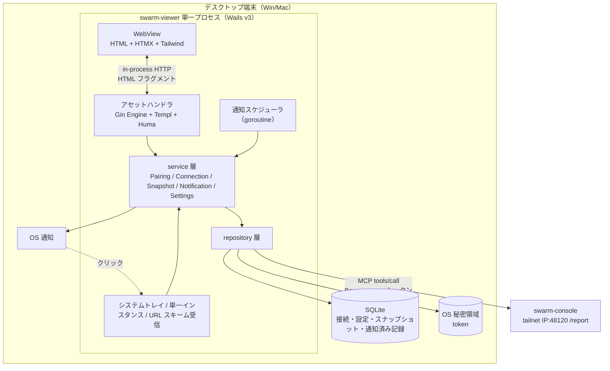
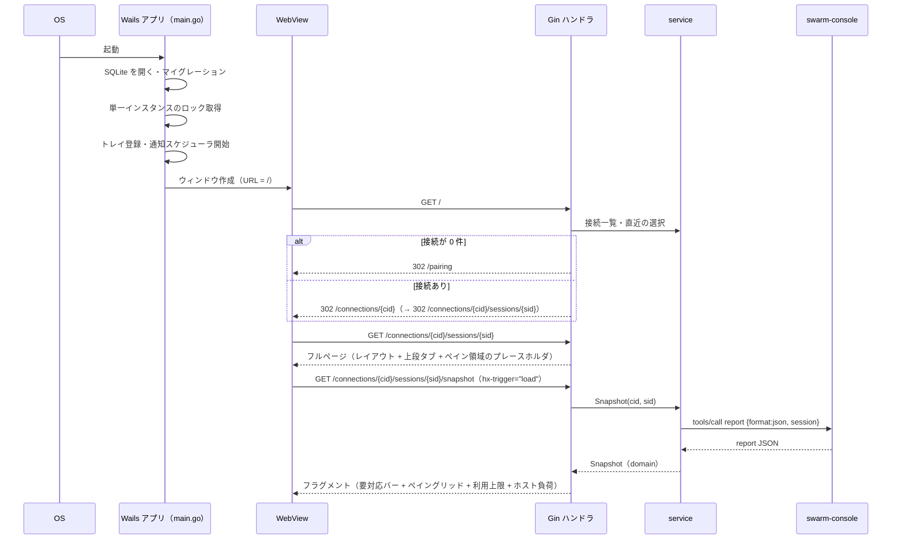
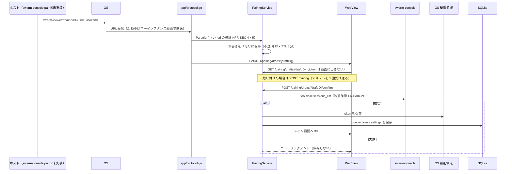
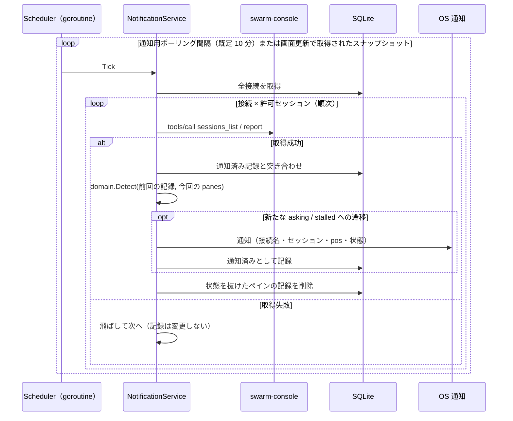
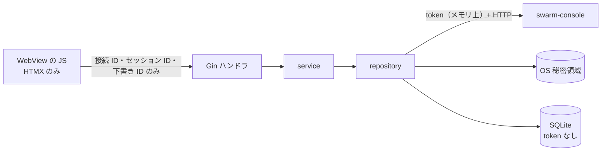

# アーキテクチャ設計

swarm-viewer の全体構成・技術選定・レイヤー構造・通信フローを定める。要件は[機能要件](../requirements/functional.md)・[非機能要件](../requirements/non-functional.md)、保存データは[ER / データモデル](er.md)、画面ルートと外部 API の形は [API 仕様](../api/endpoints.md)、モジュール分割は[コンポーネント設計](../components/overview.md)を参照する。

## 1. 設計方針

フロントエンドは **HALT（HTMX + Atomic Design + Lit + Templ）** に従う。バックエンドファースト・SPA を作らない・状態はサーバー（Go）が持つ。

| 方針 | viewer での適用 |
|------|----------------|
| サーバーがUI制御を握る | 画面は Go（Gin + Templ）が HTML で返し、HTMX が差し替える。クライアント JS は HTMX 本体と、可視性制御の数行（`app.js`）、グローバルのエラーリスナーのみ |
| HATEOAS | 利用可能なアクションだけを HTML に含める。viewer は読み取り専用のため、操作系のコントロール自体を持たない（ペインへの送信・選択ボタンは存在しない） |
| 「サーバー」はアプリ内 | HTTP は Wails のアセットハンドラ（`http.Handler`）経由で WebView と Go が話す。**TCP ポートは開かない**（token を WebView の JS に渡さない NFR-SEC-3 と、外部プロセスからの到達を避けるため） |
| 疎結合 | swarm-console との通信（MCP）・SQLite・OS 秘密領域・OS 通知は、それぞれ interface の裏に置いて差し替え可能にする |
| 読み取り専用 | swarm-console への呼び出しは許可リストのツールだけ。`/ops` のコードパスを持たない（NFR-SEC-1） |

## 2. 技術スタック

| レイヤー | 技術 | 役割・選定理由 |
|---------|------|---------------|
| デスクトップシェル | Wails v3（v3.0.0 以降） | Win/Mac ネイティブ。アセットハンドラに `http.Handler` を渡せる。カスタム URL スキーム・シングルインスタンス・システムトレイ・ネイティブ通知を提供する |
| サーバーフレームワーク | Go + Gin | ルーティング + SSR（`*gin.Engine` は `http.Handler`。Wails のアセットハンドラへそのまま渡す） |
| API フレームワーク | Huma | OpenAPI 3.1 自動生成。HALT 標準に従って組み込む。v1 は公開する JSON オペレーションを持たない（§4.3） |
| テンプレートエンジン | Templ | 型安全な Go HTML テンプレート |
| インタラクション | HTMX（+ `response-targets` 拡張） | サーバー駆動の DOM 更新、ポーリング |
| リッチ UI | Lit | **初版は使わない**（使用基準に該当する画面がない）。導入時の規約は §8 |
| スタイリング | Tailwind CSS | ユーティリティクラス。ダークモードは CSS カスタム変数 + Tailwind |
| MCP クライアント | 公式 Go SDK（`github.com/modelcontextprotocol/go-sdk/mcp`） | swarm-console `/report` へ `tools/call`。HTTP トランスポートに独自の `http.Client` を渡し、Bearer 付与とタイムアウトを制御する |
| 内部 DB | SQLite（`modernc.org/sqlite`、CGO 不要） | 接続・設定・直近スナップショット・通知済み記録（NFR-DAT-1・2。[ER](er.md)） |
| 秘密領域 | OS キーストア（macOS Keychain / Windows Credential Manager）を `github.com/zalando/go-keyring` 経由で利用 | token の保存（NFR-SEC-2）。ライブラリ選定の理由は[コンポーネント設計 §1](../components/overview.md) |
| ビルド | `wails3 build` + Tailwind CLI | HTMX は `node_modules` から配置。esbuild は Lit 導入時に追加する |

> **Wails v3 について**: 公式ドキュメント（2026-11-03 時点）は v3.0.0 をリリース済みとして記載している。API 差異が大きい領域（トレイ・通知・URL スキーム）は §11 の未確認項目に挙げ、実機で確認してから確定する。

## 3. 全体構成



## 4. レイヤー構造

### 4.1 ディレクトリ構成

HALT のレイヤード構成に、デスクトップシェルの `app/` を加える。

```
swarm-viewer/
├── main.go                      # エントリーポイント（Wails アプリ生成・配線のみ）
├── build/config.yml             # Wails ビルド設定（URL スキーム swarm-viewer を宣言）
├── internal/
│   ├── domain/                  # ドメインモデル・純粋ロジック（他層に依存しない）
│   │   ├── report.go            #   Report / Pane / PaneState / Usage / Host / Attention / Warning
│   │   ├── connection.go        #   Connection / PairingPayload / URL 検証（NFR-SEC-4・5）
│   │   ├── notify.go            #   状態遷移の検知・通知対象判定（純粋関数）
│   │   └── settings.go          #   Settings とその許容値
│   ├── repository/              # データアクセス層（domain のみに依存）
│   │   ├── report/              #   swarm-console /report への MCP クライアント
│   │   ├── store/               #   SQLite（マイグレーション付き）
│   │   └── secret/              #   OS 秘密領域
│   ├── service/                 # アプリケーションサービス層
│   │   ├── pairing.go
│   │   ├── connection.go
│   │   ├── snapshot.go          #   report 取得・single-flight・直近値キャッシュ
│   │   ├── notification.go      #   通知スケジューラ・遷移検知・重複抑止
│   │   └── settings.go
│   ├── app/                     # Wails シェル（service を呼ぶ・UI 層ではない）
│   │   ├── window.go            #   メインウィンドウ・SetURL による遷移（Navigator 実装）
│   │   ├── tray.go              #   トレイ常駐・メニュー
│   │   ├── protocol.go          #   swarm-viewer:// の受信
│   │   ├── notifier.go          #   OS 通知（service が使う interface の実装）
│   │   ├── logging.go           #   slog + lumberjack のローテーション・マスク
│   │   ├── clock.go             #   Clock の実装
│   │   └── id.go                #   IDGenerator（ULID）の実装
│   ├── router/                  # Gin ルーティング定義（画面ルート + Huma の登録）
│   └── web/                     # Web 層
│       ├── handler/             #   画面ハンドラ（機能ドメイン別）
│       │   ├── main.go          #     メイン画面・ペイン領域
│       │   ├── connection.go    #     接続の一覧・削除
│       │   ├── pairing.go       #     ペアリング（貼り付け・下書き・確定）
│       │   └── settings.go
│       ├── middleware/          #   CSRF・NoStore・CSP・Recover・RequestLog
│       ├── atoms/               #   badge / progress_bar / spinner / toast / button / input
│       ├── molecules/           #   pane_card / usage_row / host_row / session_tab / attention_item
│       ├── organisms/           #   session_tabs / pane_grid / usage_panel / host_panel / attention_bar / connection_list
│       ├── pages/               #   main / connections / pairing / settings
│       └── layout/              #   base（head・htmx・CSP meta・CSRF meta）
└── static/
    ├── src/css/app.css          # Tailwind エントリ
    └── dist/                    # ビルド成果物（go:embed 対象）
        ├── js/htmx.min.js
        ├── js/app.js            # 可視性制御（非表示中のポーリング停止・復帰時の即時取得）
        └── css/app.css
```

### 4.2 依存ルール

依存は上から下への一方向のみ。逆方向の import は禁止する。

```
handler → service → repository → domain
   ↓            ↑
 Templ       app（Wails シェル）は service を呼ぶ／service が定義した interface を実装する
```

- `domain/`: 他層に依存しない。Report の型、状態遷移の検知（`(前回の状態, 今回の状態) → 通知対象か`）、URL 検証などの純粋なロジック
- `repository/`: `domain/` のみに依存。MCP・SQLite・キーストアという外部とのやり取りを、それぞれ domain の型で返す
- `service/`: `domain/`・`repository/` に依存。ユースケースを実装する。OS 通知など Wails 依存の機能は **service 側に interface を定義**し、`app/` が実装する（service が Wails を import しない）
- `web/handler/`: `service/`・`domain/` に依存。**`repository/` を直接使わない**
- `app/`: Wails 依存。`service/` を呼び、`service/` が要求する interface（通知・ウィンドウ遷移）を実装する。`web/` には依存しない
- `router/`: `handler/` を参照してルートを定義する

### 4.3 Huma の位置付け

HALT 標準に従い Gin に Huma を載せ、`/api/v1/openapi.json` を公開する構成にする。ただし:

- v1 は Lit を使わず、JSON を必要とするクライアントがいないため、**登録する JSON オペレーションは持たない**（OpenAPI スペックは空の paths になる）
- Huma は「Lit アイランドを足すときに `/api/v1/...` を生やす土台」を用意しておく目的で入れている。未使用の依存が残るコストは実装 Issue のレビューで再確認する（受け入れ条件に明記）
- 画面と同じデータソースを使う原則（Output の `Body` に domain モデルを使う）は、オペレーション追加時に守る

## 5. 通信フロー

### 5.1 起動とメイン画面表示



### 5.2 画面更新ポーリング（HTMX）

スナップショット領域は HTMX が自分自身を再取得する。

```html
<div id="snapshot"
     hx-get="/connections/c1/sessions/0/snapshot"
     hx-trigger="load, every 10s, refresh from:body"
     hx-swap="innerHTML">
</div>
```

- 間隔（`10s` の部分）は設定（`screen_poll_seconds`）に従い、**サーバーが属性値をレンダリングする**（クライアントは値をハードコードしない）
- 非表示・最小化中の停止と、復帰時の即時取得は、同梱の静的 `app.js` が行う（`document.hidden` の間は `htmx:beforeRequest` で `…/snapshot` を取り消し、`visibilitychange` で `refresh` を発火。NFR-AVL-4・FR-POLL-3）。トリガーフィルタ式 `[document.visibilityState === …]` は使わない: htmx が eval で評価するが、CSP は `unsafe-eval` を許さないため
- 「更新」ボタンは `hx-get` で同じ URL を明示的に取得する（FR-POLL-2）
- 前のリクエストが終わる前に次を出さないため `hx-sync="this:drop"` を付ける（NFR-PERF-5）。サーバー側も同一 `(接続, セッション)` の取得を single-flight にし、重複リクエストが重なっても swarm-console へ出す `report` は 1 本にする
- 失敗時はこれまでの表示を残したまま失敗状態のバナー OOB を返す（FR-ERR-1）。HTTP ステータスはアプリ内の通信なので 200 のまま返し、状態は HTML で表現する

### 5.3 セッション・接続の切り替え

- **セッションタブ**: 各タブは `hx-get="/connections/{cid}/sessions/{sid}"` + `hx-target="#main"` + `hx-push-url` なし。クリックで main 領域（タブ + スナップショット）を差し替える。差し替え時にサーバーが `last_session` を SQLite へ記録する（FR-SESS-3）
- **接続切り替え**: 接続セレクタから `/connections/{cid}` へ遷移し、サーバーがその接続の `last_session`（なければ先頭の許可セッション）へ 302 する
- 切り替え後の最初の取得は、対象セッションの `report` のみ（他セッションは取得しない）

### 5.4 ペアリング



- ディープリンクで受けた token は **WebView に渡さない**。下書き ID だけを URL に載せる。貼り付けは入力テキストを一度だけ POST し、サーバーは解析後に即座に破棄する（NFR-SEC-7）
- 再ペア（同じ `url`）は新規追加でなく token の差し替えにする（[機能要件 §4.2](../requirements/functional.md)）

### 5.5 通知スケジューラ



- 画面更新（選択中セッション）で取得した結果も同じ `Detect` に流す。ペインの同一性は `id`（tmux ペイン ID）、記録のキーは `(接続, セッション, ペイン ID, 状態)`
- 通知がオフの間は取得しない（[機能要件 §8.3](../requirements/functional.md)）
- 接続の新規ペアリング後、全許可セッションの一巡（`connections.baselined_at` が埋まるまで）は、通知せず現在の状態の記録だけを行う
- 通知のクリックは `app/notifier.go` がウィンドウを前面に出し、`SetURL(/connections/{cid}/sessions/{sid})` で該当タブへ遷移する

## 6. ウィンドウ・プロセスの挙動

| 操作 | 挙動 |
|------|------|
| ウィンドウを閉じる | 終了せずトレイに常駐する。通知用ポーリングは通知オンの間は継続する |
| トレイのメニュー | 「開く」「終了」（終了でプロセスを終了し、スケジューラを止める）。通知オフ・取得失敗の状態はトレイのアイコンに出さない（最小構成） |
| 2 つ目の起動 | 単一インスタンスのため起動せず、既存インスタンスのウィンドウを前面に出す。ディープリンク引数があれば既存インスタンスで処理する（`SingleInstanceOptions.OnSecondInstanceLaunch`、データは信頼できない入力として検証。NFR-AVL-6） |
| 最小化・OS サスペンド | 画面更新ポーリングは止まる（§5.2）。通知用ポーリングはスケジューラが動き続ける |

## 7. セキュリティ境界



- token は repository 層の中だけで扱い、ハンドラ・テンプレート・ログに値を渡さない。ドメイン型の `Connection` は token を持たない（秘密領域のキーだけを持つ）
- アセットハンドラは WebView のみから呼ばれる（TCP ポートなし）。それでも画面の状態変更ルート（POST/DELETE）には CSRF トークンを要求する（`<body hx-headers='{"X-CSRF-Token":"…"}'>` で配布。トークンはプロセス起動ごとに生成）
- CSP: `default-src 'self'`、`connect-src 'self'`、`script-src 'self'`（`unsafe-eval`・`unsafe-inline` なし）、`style-src 'self'`、インラインスクリプトなし（NFR-SEC-9）。HTMX は `<meta name="htmx-config" content='{"allowEval":false,"includeIndicatorStyles":false}'>` で eval とインラインスタイル注入を止める。外部ホストへは WebView から一切アクセスしない
- 画面に出す文字列はすべて Templ のエスケープに任せ、HTML として解釈しない（`templ.Raw` を使わない。NFR-SEC-10）
- MCP の許可リスト: `sessions_list`・`report`（v1 で呼ぶのは 2 本）。リストは repository/report 内の定数で、それ以外のツール名は呼び出し時にエラーにする（NFR-SEC-1）

## 8. Lit 導入時の規約（初版では未使用）

初版では Lit コンポーネントを作らない。導入するときは HALT の規約に従う。

- 使用基準: リアルタイム編集・複雑な DnD・Canvas/WebGL・WebSocket 同期のいずれかに該当する場合のみ。HTMX で足りる箇所には使わない
- 命名: `<sv-{feature-name}>`（プレフィックス `sv`）
- `static/src/components/{feature-name}/{feature-name}.ts` に置き、esbuild で `static/dist/js/` にバンドルする。`lib/api.ts` 経由でのみ API を呼ぶ（直接 `fetch()` を使わない）
- URL・権限は Templ が属性で注入する（HATEOAS）。HTMX は Lit を含む領域を swap しない
- この時点で Huma の `/api/v1/...` を追加し、`esbuild`・`@web/test-runner` を導入する

## 9. ビルドと開発

| 対象 | ツール | 備考 |
|------|-------|------|
| Templ → Go | `templ generate`（`--watch`） | `_templ.go` と `static/dist/` はコミットしない。`task generate` で生成する（[環境構築](../environment/setup.md)） |
| CSS | Tailwind CLI（`static/src/css/app.css` → `static/dist/css/app.css`） | 本番は minify |
| JS | HTMX を `node_modules` から `static/dist/js/htmx.min.js` へコピー。`static/src/js/app.js` を `static/dist/js/app.js` へコピー | `response-targets` 拡張も同様。`app.js` はバンドル不要の静的ファイル |
| アプリ | `wails3 build`（`-tags production`）/ `wails3 dev` | `static/dist/` は `go:embed` でバイナリに同梱。バイナリ単体で外部アセット不要 |
| パッケージ | Windows: NSIS インストーラ（URL スキーム登録に必要）、macOS: `.app`（`Info.plist` の `CFBundleURLTypes`） | `build/config.yml` の `protocols:` で `swarm-viewer` を宣言する |

- 静的ファイルの `Cache-Control` は埋め込み配信のため `no-cache` でよい（ネットワーク配信ではない）

## 10. テスト戦略

| レイヤー | 手法 | 検証内容 |
|---------|------|---------|
| domain | ユニットテスト | 状態遷移の検知・重複抑止（`asking`→`asking` は再通知しない、離脱→再突入は再通知）、URL 検証の境界値（NFR-QLT-2）、未知の `state`・`kind` の扱い |
| repository/report | 固定サンプルの応答 + スタブ HTTP サーバー | report・sessions_list のパース、401/403/`isError` の変換、タイムアウト |
| repository/store | 一時ファイルの SQLite | マイグレーション、通知済み記録の上限（NFR-DAT-3） |
| service | fake repository | ポーリングの single-flight、通知スケジューラ（フェイククロック。固定時間の待ちに頼らない。NFR-QLT-3） |
| web/handler・Templ | `httptest` + HTML アサーション | フルページ/フラグメントの返し分け、エラー・古いデータ表示、token が HTML に含まれないこと |
| E2E | Playwright（ブラウザで Gin を直接叩くモード）+ 実機確認 | HTMX の更新・タブ切り替え。Wails 固有（トレイ・通知・URL スキーム）は実機で確認する |

## 11. 未確認事項（実装時に実機で確認して確定）

| # | 項目 | 確認内容 |
|---|------|---------|
| 1 | go-sdk と swarm-console（ステートレス運用） | `initialize`→`tools/call` の組み合わせで通るか。クライアント `Close` 時の `DELETE` が 405 で返ったときの扱い（ログにエラーが出ても動作に影響しないか）。`Accept: text/event-stream` に対する応答が単発 JSON か SSE か |
| 2 | Wails v3 のトレイ・通知 | Windows 11 / macOS で、ウィンドウを閉じてトレイ常駐する挙動、通知クリックからのウィンドウ前面化、未署名アプリの通知許可 |
| 3 | URL スキームの実機登録 | NSIS インストーラ・macOS `.app` の外では登録されない。`wails3 dev` ではディープリンクを検証できないため、検証手順（インストーラ生成後）を決める |
| 4 | `SetURL` による遷移 | WebView の履歴・フォーカス・`hx-` 状態が遷移後に正しく初期化されるか |
| 5 | `visibilityState` | WebView（WebView2 / WKWebView）で最小化・トレイ格納時に `hidden` になるか |
| 6 | OS サスペンドからの復帰 | 通知スケジューラ（`Clock` の ticker）がサスペンド後に遅れず発火するか、復帰時の即時取得（NFR-AVL-4）を WebView の `visibilitychange` だけで満たせるか。足りなければ Wails の電源イベントを使う |

## 改訂履歴

| 版 | 日付 | 変更内容 | 変更理由 |
|----|------|---------|---------|
| 1.0 | 2026-11-03 | 新規作成。フロントエンドを HALT（Gin + Huma + Templ + HTMX、初版 Lit なし）、Wails v3、公式 Go SDK、SQLite、トレイ常駐で定義 | 初版 |
| 1.1 | 2026-11-03 | ディレクトリ構成を app・handler・middleware の詳細に合わせて更新。秘密領域ライブラリを確定 | コンポーネント設計との整合 |
| 1.2 | 2026-11-03 | トリガーフィルタ式を廃止し静的 `app.js` で可視性を制御。htmx-config と CSRF 配布方法を明記 | CSP（`unsafe-eval` なし）で htmx のフィルタ式が動かないため |
| 1.3 | 2026-11-03 | 生成物（`_templ.go`・`static/dist/`）をコミットしないと確定 | 環境構築ドキュメントでの決定 |
