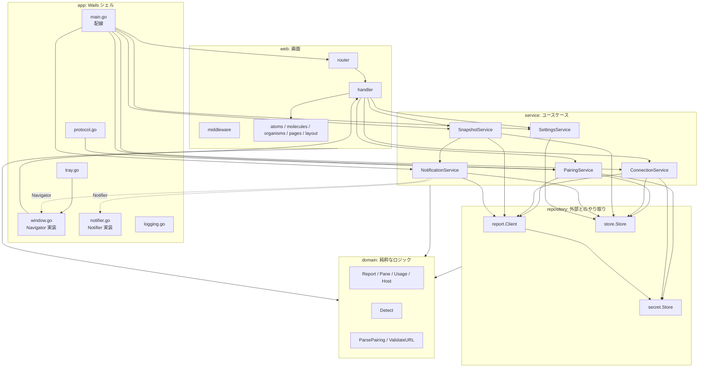

# コンポーネント設計

[アーキテクチャ設計](../architecture/overview.md)のレイヤー構造を、コンポーネント（Go パッケージ・Templ 部品）の責務・依存・インターフェースに分解する。要件は[機能要件](../requirements/functional.md)・[非機能要件](../requirements/non-functional.md)、データは [ER](../architecture/er.md)、ルートと外部 API は [API 仕様](../api/endpoints.md)を参照する。

Go モジュールパスは `github.com/ousiassllc/swarm-viewer`。

## 1. 採用ライブラリ

| 用途 | ライブラリ | 使う層 | 選定理由 |
|------|-----------|-------|---------|
| デスクトップシェル | `github.com/wailsapp/wails/v3` | app | Win/Mac。トレイ・通知・URL スキーム・単一インスタンス |
| ルーティング | `github.com/gin-gonic/gin` | router, web | HALT 標準。`http.Handler` として Wails のアセットハンドラに渡す |
| OpenAPI | `github.com/danielgtaylor/huma/v2` | router | HALT 標準（v1 は JSON オペレーション 0 本） |
| テンプレート | `github.com/a-h/templ` | web | 型安全な HTML |
| MCP クライアント | `github.com/modelcontextprotocol/go-sdk` | repository/report | 公式 SDK |
| SQLite | `modernc.org/sqlite` | repository/store | CGO 不要 |
| 秘密領域 | `github.com/zalando/go-keyring` | repository/secret | Keychain / Credential Manager を `Set`/`Get`/`Delete` で扱う。エントリ一覧は取れないため孤立エントリの掃除は行わない（[ER §4](../architecture/er.md)）。サイズ上限内の token を前提とする。**採用版は `go.mod` 固定前に、macOS 実装が token を `security` コマンドの引数（argv）ではなく stdin（`security -i`）で渡すことを確認する**。argv 渡しだと保存の瞬間に `ps` で token が見え、NFR-SEC-2・7 に反する |
| ID | `github.com/oklog/ulid/v2` | repository/store（ID 発行は service が `IDGenerator` 経由） | ULID |
| ログ | 標準 `log/slog` + `gopkg.in/natefinch/lumberjack.v2` | app（初期化）、全層は `*slog.Logger` を受け取る | 5MB×3 世代のローテーション。`slog.LevelVar` で実行時に切替 |
| single-flight | `golang.org/x/sync/singleflight` | service | 同一 `(接続, セッション)` の取得を 1 本にまとめる |
| マイグレーション | 自前（`go:embed` の SQL + `PRAGMA user_version`） | repository/store | 版が少なく、ツール導入が過剰 |
| 時間 | 自前の `Clock` interface | service | テストで時間を進めるため（NFR-QLT-3） |
| UI | HTMX（`response-targets` 拡張）、Tailwind CSS | web, static | 初版は Lit なし |

- 上記以外の依存は追加しない。ライブラリを足すときは、このドキュメントの表に理由を追記する

## 2. コンポーネント構成



- 実線は import。破線は「service が定義した interface を app が実装する」関係（service は Wails を import しない）
- `Navigator` / `Notifier` / `Clock` / `IDGenerator` / `ReportClient` / `Store` / `SecretStore` は service パッケージが定義する **consumer-defined interface**。repository 実装がそれを満たす

## 3. domain（`internal/domain`）

他層に依存しない。副作用なし。単体テストの中心。

### 3.1 型

| 型 | 内容 |
|----|------|
| `PaneState` | `string` 型。定数 `StateWorking`・`StateAsking`・`StateIdle`・`StateStalled`・`StateShell`・`StateUnknown`。未知の値は `ParsePaneState(s)` が `StateUnknown` に正規化する |
| `Pane` | `Pos`・`ID`・`Agent`（`*string`）・`State`・`Title`・`CWD`・`Elapsed`・`Activity`・`ActivityTruncated`・`ChangedAgo`・`Note`（`*Note`） |
| `Note` | `From`・`Repo`・`Items []string`・`Next`（viewer は `Repo`・`Items` のみ表示） |
| `Layout` | `Rows int`・`Cols []int`。`Valid(paneCount)` でグリッドとして成立するか検査 |
| `Attention` | `Kind string`・`Pane string`・`Detail string` |
| `Warning` | `Code`・`Message` |
| `Usage` | `Status`・`Reason`・`FetchedAt *time.Time`・`Claude []AgentAccount`・`Codex []AgentAccount`・`Cursor []CursorAccount` |
| `AgentAccount` / `CursorAccount` / `Slot` | `Slot{Available bool, Used *float64, Unit string, Status string, ResetsAt *time.Time}` |
| `Host` | `CPU`・`Swap`・`Disk []Disk`（各 `Available` と率） |
| `Report` | `At`・`Layout`・`Panes`・`Attention`・`Usage`・`Host`・`Warnings`・`Auth`（`auth.agents` の `agent`・`status`・`expires_at`） |
| `Session` | `ID string`・`Allowed bool` |
| `Connection` | `ID`・`Name`・`URL`・`LastSession`・`BaselinedAt`・`CreatedAt`・`UpdatedAt`。**token を持たない** |
| `Settings` | `NotificationsEnabled`・`ScreenPollSeconds`・`NotifyPollMinutes`・`DebugLog`・`LastConnectionID` |
| `PairingPayload` | `Version`・`URL`（検証・正規化済み）・`Token`・`Name`・`SessionsHint`。`Token` を持つ唯一の domain 型で、`String()`/`GoString()`/`MarshalJSON`/`LogValue` で token を伏せる |
| `Snapshot` | `Report`・`FetchedAt`・`Stale bool` |

### 3.2 関数

| 関数 | 役割 | テスト観点 |
|------|------|-----------|
| `ParseReport(json []byte) (Report, error)` | `report` 応答を domain 型へ。未知キーは無視、欠落は零値、未知の `state` は `StateUnknown` | 欠落・`null`・未知値・`available: false` |
| `ParseSessions(json []byte) ([]Session, error)` | `sessions_list` 応答を `allowed` のみに絞る | `allowed: false` のスタブ |
| `ParsePairing(raw string) (PairingPayload, error)` | [API 仕様 §2.1](../api/endpoints.md) の検証をすべて行う | 重複キー・サイズ超過・未知の `v`・未知パラメータ |
| `ValidateURL(raw string) (string, error)` | NFR-SEC-4・5。tailnet 範囲（`100.64.0.0/10`、`fd7a:115c:a1e0::/48`）またはループバックの IP リテラル、scheme `http`、port `48120`（ループバックは任意）、path `/report` | 範囲の境界値、ホスト名、`0.0.0.0`、userinfo・クエリ付き |
| `Detect(known []NotifiedKey, panes []Pane, baselining bool) Diff` | 通知判定（[ER §3.4 の更新規則](../architecture/er.md)） | `asking`→`asking` は再通知なし、離脱→再突入は再通知、`asking`→`stalled` は通知、`baselining` のときは通知なし |
| `Classify(err error, httpStatus int, toolCode string) *FetchError` | swarm-console の失敗を `ErrKind` に分類（[API 仕様 §1.5](../api/endpoints.md)） | 各 HTTP/コード |
| `UsageTone(slot Slot) Tone` | しきい値（80 / 95）と `exhausted` の色判定。`unit != percent` はしきい値なし | 境界値 79.9 / 80 / 94.9 / 95 |

`Diff` は `Notify []NotifyEvent`（`Pane` と `State` を持つ）、`Insert []NotifiedKey`、`Delete []NotifiedKey`。`NotifiedKey` は `(PaneID, State)`。接続・セッションの軸は呼び出し側（service）が持つ。

### 3.3 エラー

```go
type ErrKind int
const (
    ErrUnreachable ErrKind = iota
    ErrUnauthorized
    ErrForbiddenScope
    ErrSessionRequired
    ErrSessionForbidden
    ErrSessionMissing
    ErrHostError
    ErrProtocol
)
type FetchError struct{ Kind ErrKind; Code string } // Code は swarm-console のエラーコード。message・details は持たない
```

`FetchError` は `errors.As` で判定する。`Error()` は固定文言（種別名と `Code`）のみで、応答本文を含めない（NFR-LOG-3）。

## 4. repository

domain のみに依存する。外部（ネットワーク・ファイル・OS）とのやり取りを domain 型に変換して返す。

### 4.1 `repository/report`（swarm-console `/report` クライアント）

| 項目 | 内容 |
|------|------|
| 責務 | `sessions_list` と `report` の呼び出し、HTTP/MCP の失敗の分類、タイムアウト（10 秒）、Bearer 付与 |
| 依存 | go-sdk、`secret.Store`（token を内部で解決）、domain |
| 許可リスト | `var allowedTools = map[string]struct{}{"sessions_list": {}, "report": {}}`。他のツール名を渡す経路は公開しない（メソッドが 2 本だけで、ツール名は定数） |
| token の扱い | `Connection.ID` から `secret.Store` を引いて Authorization ヘッダを組み立てる。token を戻り値・エラー・ログに出さない |
| Transport | 独自 `http.RoundTripper`。Bearer 付与・URL の再検証（`ValidateURL` を毎回通す）・リダイレクト追従の禁止（`CheckRedirect` が `ErrUseLastResponse`） |
| 接続の生成 | 呼び出しごとに SDK のクライアント・セッションを開き閉じる。ステートレス運用のため接続を保持しない（再利用は実機確認後に判断。[アーキテクチャ設計 §11](../architecture/overview.md)） |
| SDK の差し替え | service は `ReportClient` interface（§5.1）にだけ依存する。go-sdk がステートレスな swarm-console（POST のみ、GET・DELETE は 405）と合わない場合は、`tools/call` を POST するだけの自前クライアントに `report.Client` の内部を差し替える（service・handler は変更しない） |

```go
type Client struct{ /* http.Client, secret.Store, *slog.Logger */ }

func (c *Client) Sessions(ctx context.Context, conn domain.Connection) ([]domain.Session, error)
func (c *Client) Report(ctx context.Context, conn domain.Connection, session string) (domain.Report, error)
// ペアリングの疎通確認。保存前なので token を直接受け取る。成功したらタブ用の一覧を返す
func (c *Client) Probe(ctx context.Context, url, token string) ([]domain.Session, error)
```

### 4.2 `repository/store`（SQLite）

| 項目 | 内容 |
|------|------|
| 責務 | [ER](../architecture/er.md)のテーブルへの読み書き、マイグレーション、DB の整合性チェック |
| 依存 | `modernc.org/sqlite`、`database/sql`、domain |
| 起動 | `Open(path)`: ファイルを `0600` で作成、PRAGMA（`foreign_keys`・`journal_mode=WAL`・`busy_timeout`）、`user_version` 照合、マイグレーション適用 |
| 失敗 | 開けない・壊れている → `ErrCorrupt`。新しい `user_version` → `ErrSchemaTooNew`。service/app はこれを受けて起動を止めず初期化導線を出す（NFR-AVL-5・CMP-4） |
| トランザクション | 通知済み記録の更新と `baselined_at` の更新は 1 トランザクション |

```go
type Store struct{ db *sql.DB }

// connections
func (s *Store) Connections(ctx context.Context) ([]domain.Connection, error)
func (s *Store) ConnectionByID(ctx context.Context, id string) (domain.Connection, error)
func (s *Store) ConnectionByURL(ctx context.Context, url string) (domain.Connection, bool, error)
func (s *Store) SaveConnection(ctx context.Context, c domain.Connection) error   // UPSERT（url で一意）
func (s *Store) DeleteConnection(ctx context.Context, id string) error             // snapshots・notified_states は ON DELETE CASCADE
func (s *Store) SetLastSession(ctx context.Context, id, session string) error
func (s *Store) MarkBaselined(ctx context.Context, id string, at time.Time) error

// settings（id=1 の 1 行）
func (s *Store) Settings(ctx context.Context) (domain.Settings, error)
func (s *Store) SaveSettings(ctx context.Context, st domain.Settings) error

// snapshots
func (s *Store) Snapshot(ctx context.Context, connID, session string) (domain.Snapshot, bool, error)
func (s *Store) SaveSnapshot(ctx context.Context, connID, session string, sn domain.Snapshot) error
func (s *Store) PruneSnapshots(ctx context.Context, connID string, keep []string) error // sessions_list から消えたセッション分を削除

// notified_states
func (s *Store) NotifiedKeys(ctx context.Context, connID, session string) ([]domain.NotifiedKey, error)
// Diff を 1 トランザクションで適用。INSERT は OR IGNORE し、実際に挿入できたキーだけを返す（二重通知の最終防衛線）
func (s *Store) ApplyNotified(ctx context.Context, connID, session string, d domain.Diff) (inserted []domain.NotifiedKey, err error)
```

- `ApplyNotified` が返す `inserted` だけを通知する。画面更新と通知用ポーリングが同時に同じ遷移を検知しても、DB の主キー制約で 1 回だけ通る
- 件数上限（接続あたり 1,000 件、NFR-DAT-3）は `ApplyNotified` の中で古い順に削除する

### 4.3 `repository/secret`（OS 秘密領域）

```go
type Store struct{ service string } // "swarm-viewer"

func (s *Store) Set(connID, token string) error     // キー "connection:{connID}"
func (s *Store) Get(connID string) (string, error)  // 無ければ ErrNotFound
func (s *Store) Delete(connID string) error         // 無くてもエラーにしない
```

- `go-keyring` を薄く包む。サービス名・キー規則は定数。argv 渡しだった場合は、この `secret.Store`（service 側の `SecretStore` interface の裏）で stdin 渡しの実装（`security -i`）に差し替える
- `ErrNotFound` は service が「token なし」（`ErrUnauthorized` 相当）として扱い、再ペアリングを促す

## 5. service

domain・repository に依存し、ユースケースを組み立てる。Wails を import しない。

### 5.1 service が定義する interface（consumer-defined）

```go
type Clock interface {
    Now() time.Time
    NewTicker(d time.Duration) Ticker   // Ticker: C() <-chan time.Time, Reset(d), Stop()
}
type IDGenerator interface{ NewID() string }              // ULID
type Notifier interface {                                // app が実装（OS 通知）
    Notify(ctx context.Context, n Notification) error
    Permitted() PermissionState                           // 設定画面の表示用
}
type Navigator interface {                               // app が実装（Wails の SetURL）
    Open(path string)
}
type ReportClient interface {                            // repository/report.Client が満たす
    Sessions(ctx context.Context, conn domain.Connection) ([]domain.Session, error)
    Report(ctx context.Context, conn domain.Connection, session string) (domain.Report, error)
    Probe(ctx context.Context, url, token string) ([]domain.Session, error)
}
type SecretStore interface { /* secret.Store の 3 メソッド */ }
type Store interface { /* store.Store の公開メソッド */ }
```

`Notification` は `ConnectionID`・`ConnectionName`・`Session`・`Pos`・`State`・`Detail`（`asking` のみ）。token・URL は持たない。

### 5.2 PairingService

| 項目 | 内容 |
|------|------|
| 責務 | 接続文字列の解析、下書きの管理、疎通確認、接続の保存（SQLite と秘密領域） |
| 状態 | 下書き 1 件（`DraftID`・`PairingPayload`・期限）をメモリに保持。`sync.Mutex` で保護 |

```go
func (s *PairingService) Parse(raw string) (DraftID, error)                 // domain.ParsePairing → 下書き作成（古い下書きを破棄）
func (s *PairingService) Draft(id DraftID) (DraftView, error)               // 表示用（token を含まない）。期限切れは ErrDraftExpired
func (s *PairingService) Confirm(ctx context.Context, id DraftID) (domain.Connection, error)
func (s *PairingService) Discard(id DraftID)
```

- `Confirm`: ①`Probe`（疎通） → ②同じ `url` の接続があるか → ③あれば token を差し替え、なければ新規 ID で `SaveConnection` → ④`secret.Set` → ⑤下書き削除。④が失敗したら新規作成した行を削除して失敗を返す（行だけ残る不整合を防ぐ）
- 新規接続は `baselined_at = NULL` で保存する（初回一巡は通知しない）。同じ `url` の再ペアリングでも `baselined_at` は維持する
- 期限（5 分）の判定は `Clock.Now()` で行う

### 5.3 ConnectionService

| 項目 | 内容 |
|------|------|
| 責務 | 接続の一覧・削除、セッションタブの取得、`last_session` の記録、`needs_repair` フラグの管理 |
| 状態 | `needs_repair`（接続 ID → bool）をメモリに保持。タブ一覧のキャッシュ（接続 ID → `[]Session`、取得時刻） |

```go
func (s *ConnectionService) List(ctx context.Context) ([]domain.Connection, error)
func (s *ConnectionService) Delete(ctx context.Context, id string) error   // 先に Store.DeleteConnection、次に secret.Delete。後者の失敗は警告ログのみ
func (s *ConnectionService) Tabs(ctx context.Context, id string) ([]domain.Session, error) // sessions_list。結果を NotificationService と共有しない（呼び出しごとに取得）
func (s *ConnectionService) ResolveSession(ctx context.Context, id, requested string) (string, error) // 許可外・消滅時は先頭の許可セッション。0 件は ErrNoSessions
func (s *ConnectionService) NeedsRepair(id string) bool
func (s *ConnectionService) MarkRepaired(id string)
```

- `Tabs` が `ErrUnauthorized` / `ErrForbiddenScope` を受けたら `needs_repair = true`
- `Delete` はその接続のメモリ上の状態（`needs_repair`・タブキャッシュ・single-flight）と通知用の mutex も解放する

### 5.4 SnapshotService

| 項目 | 内容 |
|------|------|
| 責務 | 選択中セッションの `report` 取得、直近値のメモリキャッシュと保存、取得失敗時のフォールバック、通知判定への受け渡し |
| 依存 | `ReportClient`、`Store`、`NotificationService`、`singleflight.Group` |

```go
type SnapshotResult struct {
    Snapshot domain.Snapshot      // 取得成功なら最新、失敗なら直前（メモリ → snapshots）。無ければ零値
    Fresh    bool                 // 今回の取得が成功したか
    Err      *domain.FetchError   // 失敗の種別。Fresh のとき nil
}
func (s *SnapshotService) Get(ctx context.Context, connID, session string) SnapshotResult
func (s *SnapshotService) Last(ctx context.Context, connID, session string) (domain.Snapshot, bool) // 取得せず直前値（Stale）だけ返す。メイン画面の初回描画用（FR-POLL-4）
```

- `Get` は `singleflight`（キー `connID + "\x00" + session`）で包む。同じキーの同時呼び出しは `report` 1 本にまとまる
- 成功: ①メモリキャッシュ更新 ②`SaveSnapshot` ③`NotificationService.Observe` を呼ぶ（通知のオン/オフに関わらず呼ぶ。オフのときは `Observe` が通知の送出だけを抑止し、記録は更新する）
- 失敗: `Err` に分類済みエラーを入れ、`Snapshot` は直前値（`Stale: true`）を返す。401/403 は `ConnectionService` の `needs_repair` を立てる
- `needs_repair` の接続は `Get` が **取得せず**即座に `Err`（`ErrUnauthorized`）を返す（自動ポーリングの停止）。再ペアリングで `MarkRepaired` される

### 5.5 NotificationService

| 項目 | 内容 |
|------|------|
| 責務 | 状態遷移の検知、通知の送出、通知用ポーリングのスケジューラ |
| 依存 | `ReportClient`、`Store`、`Notifier`、`Clock`、`SettingsService`（有効/間隔）、`ConnectionService`（`needs_repair`） |
| 状態 | 接続ごとの `sync.Mutex`（`Observe` の直列化）、スケジューラの goroutine |

```go
// 画面更新・通知用ポーリングの両方がここへ流す
func (s *NotificationService) Observe(ctx context.Context, conn domain.Connection, session string, r domain.Report) error
// スケジューラ。ctx のキャンセルで停止。設定変更（通知オン/オフ・間隔）に追随する
func (s *NotificationService) Run(ctx context.Context)
```

`Observe` の手順:

1. 接続の mutex を取得
2. `NotifiedKeys(conn, session)` を読み、`domain.Detect(known, r.Panes, baselining = conn.BaselinedAt == nil)`
3. `ApplyNotified` で Diff を適用し、実際に挿入できたキー（`inserted`）を得る
4. `baselining` でなく、かつ通知がオンのとき、`inserted` に対応する各ペインについて `Notifier.Notify`。通知がオフの間は記録だけ更新する（オン復帰後に、オフの間に入った状態が一斉に通知されるのを防ぐ）。通知の失敗は警告ログ（記録は戻さない。再通知しないことを優先）

`Run` の手順（通知用ポーリング）:

1. `Clock.NewTicker(settings.NotifyPollMinutes)` で周期を作る。起動直後に 1 回実行する（再起動後の取りこぼしを減らす）
2. `settings.NotificationsEnabled == false` の間は取得しない（ticker は動かしてよいが tick で即 return）。設定変更の通知で ticker を `Reset`
3. Tick ごとに接続を順次処理（並列にしない。NFR-PERF-6）: `needs_repair` はスキップ → `Sessions` → `PruneSnapshots` → 各許可セッションを `Report` → `Observe`。失敗した接続・セッションは飛ばす（記録は変更しない。NFR-AVL-3）
4. 全許可セッションが成功した一巡の最後に、`BaselinedAt == nil` なら `MarkBaselined`
5. 1 接続の失敗が 401/403 なら `needs_repair` を立てて次の接続へ

### 5.6 SettingsService

```go
func (s *SettingsService) Get(ctx context.Context) (domain.Settings, error)
func (s *SettingsService) Update(ctx context.Context, in SettingsInput) (domain.Settings, error) // 許容値検証。違反は ValidationError
func (s *SettingsService) Subscribe() <-chan domain.Settings                                    // 変更通知（スケジューラ・ログレベル）
```

- 許容値: `screen_poll_seconds ∈ {5,10,30,60}`、`notify_poll_minutes ∈ {5,10,30,60}`（[ER §3.2](../architecture/er.md)）。DB の `CHECK` と二重に守る
- `Update` 後に購読者へ新しい設定を送る（スケジューラの ticker の `Reset`、`slog.LevelVar` の更新）
- `LastConnectionID` の更新は `ConnectionService`/ハンドラが `SetLastConnection` 経由で行う

### 5.7 エラーの扱い

| 発生元 | service のエラー | 呼び出し側の動作 |
|--------|------------------|-----------------|
| `FetchError`（`ErrUnreachable` など） | そのまま返す（`*domain.FetchError`） | ハンドラが §6.3 のとおり表示 |
| `ErrNoSessions` | `ResolveSession` が返す | 「許可されたセッションがありません」ページ |
| `ErrDraftExpired` | `Draft`・`Confirm` | 「もう一度ペアリングしてください」 |
| `ValidationError` | `Update`・`Parse` | 422 でフォーム再描画 |
| `store.ErrCorrupt` / `ErrSchemaTooNew` | 起動時に app へ | 起動は止めず、初期化導線の画面を出す |

## 6. web 層

### 6.1 handler（`internal/web/handler`）

`service/`・`domain/` にだけ依存し、`repository/` を直接使わない。

| ファイル | ルート（[API 仕様 §4.2](../api/endpoints.md)） | 主な呼び出し |
|---------|---------------------------------------------|-------------|
| `main.go` | `GET /`、`GET /connections/{cid}`、`GET /connections/{cid}/sessions/{sid}`、`GET …/snapshot` | `ConnectionService.ResolveSession/Tabs`、`SnapshotService.Get` |
| `connection.go` | `GET /connections`、`DELETE /connections/{cid}` | `ConnectionService.List/Delete` |
| `pairing.go` | `GET/POST /pairing`、`GET /pairing/drafts/{did}`、`POST …/confirm`、`POST …/discard` | `PairingService` |
| `settings.go` | `GET /settings`、`PUT /settings` | `SettingsService` |

- ページルートは `HX-Request` でフルページ / フラグメントを分岐する（[API 仕様 §4.1](../api/endpoints.md)）
- snapshot ハンドラは `SnapshotResult` を `organisms.SnapshotView` に渡す。`Fresh == false` のときは直前値のグレーアウトと失敗バナー（[API 仕様 §4.4](../api/endpoints.md)）。`needs_repair` のときはポーリング属性を出さない

### 6.2 middleware

| 名前 | 役割 |
|------|------|
| `CSRF` | プロセス起動時に生成したトークンを `<meta name="csrf-token">` で配り、`POST`・`PUT`・`DELETE` で `X-CSRF-Token` を検証（定数時間比較）。不一致は 403 |
| `NoStore` | 全応答に `Cache-Control: no-store` |
| `CSP` | `Content-Security-Policy: default-src 'self'; script-src 'self'; style-src 'self'; connect-src 'self'; object-src 'none'; base-uri 'none'`（NFR-SEC-9） |
| `Recover` | パニックを捕捉し、スタックはログ（token・本文を含まない）、画面は汎用エラーフラグメント |
| `RequestLog` | メソッド・パス・ステータス・所要時間のみ。クエリ・本文・ヘッダは出さない |

### 6.3 Templ コンポーネント（Atomic Design）

| 層 | コンポーネント | Props（要点） | 備考 |
|----|---------------|--------------|------|
| atoms | `Badge` | `Text`・`Tone` | エージェント種別・状態・要対応 |
| atoms | `ProgressBar` | `Percent`・`Tone` | 利用上限・ホスト負荷 |
| atoms | `Spinner` | `Size` | `hx-indicator` 用 |
| atoms | `Toast` | `Kind`・`Message` | OOB 用 |
| atoms | `Button` / `Input` | 通常の属性 | |
| molecules | `PaneCard` | `Pane`・`Stale` | 状態ラベル・activity・note 要約。操作ボタンは**持たない** |
| molecules | `UsageRow` | `Label`・`Slot` | `unit` で percent / usd を出し分け。`available: false` は「—」 |
| molecules | `HostRow` | `Label`・`Percent`・`Detail` | |
| molecules | `SessionTab` | `ConnectionID`・`Session`・`Selected` | `hx-get` |
| molecules | `AttentionItem` | `Attention`・`AuthExpiresAt` | 未知の `kind` は文字列表示 |
| organisms | `SessionTabs` | `[]Session`・`Selected` | |
| organisms | `PaneGrid` | `Layout`・`[]Pane` | `Layout.Valid` でなければリスト表示 |
| organisms | `UsagePanel` | `Usage`・`Stale` | `usage.status` による分岐（[機能要件 §5.1](../requirements/functional.md)） |
| organisms | `HostPanel` | `Host` | |
| organisms | `AttentionBar` | `[]Attention`・`[]Warning` | |
| organisms | `SnapshotView` | `SnapshotResult`・`PollSeconds`・`Repair` | ポーリング属性（`hx-trigger`）を出す／出さないの判断を含む |
| organisms | `ConnectionList` | `[]Connection` | |
| pages | `MainPage` | 接続・タブ・スナップショット | |
| pages | `PairingPage` / `PairingDraftPage` / `ConnectionsPage` / `SettingsPage` / `NoSessionsPage` / `DraftExpiredPage` / `RecoveryPage`（DB 破損時） | | |
| layout | `Base` | `Title`・`CSRFToken` | `<head>`（CSP は HTTP ヘッダで付与。`htmx-config` の meta を含む）、`<body hx-headers='{"X-CSRF-Token":"…"}'>`、`htmx.min.js`・`app.js`・`app.css` を読み込む |

- 状態の表示ラベル・色（`StateLabel`・`StateTone`、`UsageTone` の結果から Tailwind クラスへの対応）は **web 層**に置く（presentation。domain は意味だけを持つ）。ラベルは[機能要件 §3](../requirements/functional.md)の表に一致させる
- 時刻・相対時間の整形（`elapsed` は文字列のまま、`resets_at` は「あと N 時間」）も web 層のヘルパー（`web/format`）。`Clock.Now()` を引数に取り、テストを固定時刻で行う

## 7. app（Wails シェル）

Wails に依存する唯一の層。`service/` を呼び、service の interface を実装する。`web/` には依存しない（URL 文字列でルートを指す）。

| ファイル | 責務 |
|---------|------|
| `main.go`（ルート） | 依存の組み立て（§8）。Wails アプリ生成、アセットハンドラに Gin を渡す、ウィンドウ・トレイ・単一インスタンス・URL スキームの登録、`NotificationService.Run` の起動 |
| `app/window.go` | メインウィンドウ。閉じる操作を「非表示」に置換（終了しない）。`Navigator` を実装（`Open(path)` → `SetURL`＋前面化）。トレイ「開く」で呼ぶ |
| `app/tray.go` | システムトレイ（macOS はメニューバー）。メニューは「開く」「終了」。「終了」は `ctx` をキャンセルして `NotificationService.Run` を止めてからアプリを終了 |
| `app/protocol.go` | `ApplicationLaunchedWithUrl` と `OnSecondInstanceLaunch` の引数から `swarm-viewer://` を取り出し、`PairingService.Parse` → `Navigator.Open("/pairing/drafts/{did}")`。他のスキーム・形式不正は破棄してログ（URL は host のみ。token を出さない） |
| `app/notifier.go` | `Notifier` を実装。Wails の通知 API で OS 通知を出し、クリックで `Navigator.Open("/connections/{cid}/sessions/{sid}")`。OS の許可状態を `Permitted()` で返す |
| `app/applog` | `slog` + `lumberjack`（上限 5MB、現行 + 退避 2 = 3 世代、`UserConfigDir()/swarm-viewer/logs/`）。`slog.LevelVar` を `SettingsService` の購読で更新。ハンドラの `ReplaceAttr` で `token`・`authorization`・`body`・`activity`・`note` などのキーを伏せ、`url` 系のキーは host のみに丸める。メッセージ・その他の値に含まれる URL は `scheme://host` に縮め、Bearer の値を伏せる |
| `service.SystemClock` | 実時間の `Clock`（`app` では独自実装を持たず、これを使う） |
| `app/idgen` | `IDGenerator` の ULID 実装（`oklog/ulid/v2`、`crypto/rand`） |
| `app/deeplink` | 引数・イベントから `swarm-viewer://` を取り出す（引用符・大文字小文字・他 scheme の破棄）。`Parse` → `Navigator.Open` の流れと、起動直後に届いたリンクを溜める `Dispatcher`。Wails 非依存で、`protocol.go` と `Shell` の 2 つ目の起動の受信から呼ばれる。解析失敗は `paths.PairingInvalidLink`（固定文言）へ遷移する |
| `app/compose` | SQLite を開き、service・router を documented order で組み立てる。`ErrCorrupt`/`ErrSchemaTooNew` は recovery モード（`router.NewRecovery`）で続行し、`POST /recovery/reset` で DB を退避して通常モードへ切り替える（ハンドラは `app/swap` で差し替え）。通知スケジューラは Wails の準備完了（`Ready`）後に 1 度だけ起動する |
| `app/notice`・`app/navpath`・`app/swap` | 通知の本文組み立てとクリック時の遷移先復元、遷移先パスの検証（同一オリジンの絶対パスのみ）、atomic に差し替えられる `http.Handler` |

- ウィンドウを閉じて非表示のとき、WebView が `visibilityState === 'hidden'` になるかは実機で確認する（[アーキテクチャ設計 §11](../architecture/overview.md) の未確認事項 5）。`hidden` にならない場合、非表示中の画面更新ポーリングを止めるため、`window.go` が非表示/表示の遷移時に `refresh`/停止用のイベントを発行する設計に変更する
- **可視性制御**: 非表示中のポーリング停止と復帰時の即時取得は、静的 `static/src/js/app.js`（`htmx:beforeRequest` で `…/snapshot` を取り消し、`visibilitychange` で `refresh` を発火）が行う。`SnapshotView` の `hx-trigger` にフィルタ式 `[…]` は使わない（CSP が `unsafe-eval` を許さず、htmx の `allowEval:false` と矛盾するため）

## 8. 配線（main.go）

```go
func main() {
    // 1. 設定領域・ログ（slog + lumberjack）
    // 2. SQLite を開く。ErrCorrupt/ErrSchemaTooNew は recovery モードで続行（RecoveryPage のみ提供）
    // 3. repository: secret.Store, store.Store, report.Client(secret)
    // 4. service: Settings, Connection, Pairing, Notification, Snapshot（Clock と IDGenerator を注入）
    // 5. web: gin.Engine（CSRF/NoStore/CSP/Recover）＋ router.Register（handler に service を渡す）＋ huma.New（paths 0）
    // 6. app: Wails アプリ（アセットハンドラ = Gin、単一インスタンス、protocol、tray、window）
    // 7. Navigator = window, Notifier = notifier を service に渡す
    // 8. ctx を作って NotificationService.Run(ctx) を goroutine で起動
    // 9. app.Run()（終了時に ctx をキャンセル）
}
```

- 依存は `main.go` で明示的に組み立てる（DI コンテナは使わない）
- recovery モードでは `store` なしで動く最小ルート（`/` が `RecoveryPage` を返す）だけを登録し、通知スケジューラは起動しない

## 9. 並行性

| 要素 | 並行性 | 排他 |
|------|-------|------|
| 画面更新の取得 | WebView の HTMX リクエスト 1 本ごとに goroutine（Gin） | `singleflight` で同一 `(接続, セッション)` を 1 本に |
| 通知スケジューラ | goroutine 1 本。接続・セッションを順次 | `NotificationService.Observe` が接続ごとの mutex で直列化 |
| `Observe` の呼び出し元 | 画面更新（Gin の goroutine）と通知用ポーリング（スケジューラ）の 2 系統 | 接続ごとの mutex + DB の主キー制約（`ApplyNotified`） |
| ペアリング下書き | 1 件 | `PairingService` の mutex |
| `needs_repair`・タブキャッシュ | 読み書きあり | `ConnectionService` の `RWMutex` |
| SQLite | `database/sql` のプール。WAL + `busy_timeout=5000` | 書き込みは SQLite が直列化 |

## 10. テスト設計

| 対象 | 手法 | 具体 |
|------|------|------|
| `domain.ParsePairing`・`ValidateURL` | テーブルテスト | NFR-QLT-2 の境界値すべて |
| `domain.Detect` | テーブルテスト | [ER §3.4](../architecture/er.md) の更新規則の全行 |
| `domain.ParseReport` | 固定サンプル（swarm-console `docs/api/endpoints-report.md` の JSON と、欠落・未知値・`available:false` を足したもの） | NFR-QLT-1 |
| `repository/report` | `httptest.Server`（Streamable HTTP を模擬） | 401・403・405・ツール `isError`（`session_required`・`session_forbidden`・`invalid_args`）・タイムアウト・リダイレクト拒否・許可リスト |
| `repository/store` | 一時ファイルの SQLite | マイグレーション、`ErrSchemaTooNew`、`ApplyNotified` の二重挿入、1,000 件上限、`ON DELETE CASCADE` |
| `service`（Pairing・Connection・Snapshot・Notification・Settings） | fake `ReportClient`/`Store`/`SecretStore`/`Notifier`/`Clock` | single-flight、`needs_repair` による停止、`Observe` の二重通知防止、一巡後の `MarkBaselined`、`Delete` 時の順序（SQLite → 秘密領域）、下書きの期限（フェイク `Clock`。固定時間の待ちを使わない） |
| `web/handler`・Templ | `httptest` + HTML アサーション | フルページ/フラグメント、CSRF 拒否、token が HTML に含まれない、グレーアウト・バナー、`needs_repair` でポーリング属性なし、`PaneCard` に操作系の要素がない |
| `app` | 実機 | トレイ・通知・URL スキーム・単一インスタンス（自動テスト対象外。確認手順は実装 Issue に記載） |

## 11. 要件との対応

| 要件 | コンポーネント |
|------|---------------|
| FR-PAIR-1〜4 | `PairingService`、`handler/pairing.go`、`app/protocol.go`、`secret.Store` |
| FR-SESS-1〜3 | `ConnectionService.Tabs/ResolveSession`、`store.SetLastSession`、`organisms.SessionTabs` |
| FR-PANE-1〜3 | `organisms.PaneGrid`、`molecules.PaneCard`、`web` の `StateLabel`/`StateTone` |
| FR-USE-1・2 | `organisms.UsagePanel`/`HostPanel`、`domain.UsageTone` |
| FR-ATT-1 | `organisms.AttentionBar` |
| FR-POLL-1〜4 | `organisms.SnapshotView`（`hx-trigger`）、`SnapshotService`、`store.Snapshot` |
| FR-NTF-1〜3 | `NotificationService`、`domain.Detect`、`store.ApplyNotified`、`app/notifier.go` |
| FR-SET-1 | `SettingsService`、`handler/settings.go`、`app/logging.go`（デバッグログ） |
| FR-ERR-1 | `domain.Classify`、`organisms.SnapshotView` のバナー |
| FR-APP-1・2 | `app/tray.go`、`app/window.go`、単一インスタンス設定（`main.go`） |
| NFR-SEC-1 | `report.Client` の許可リスト |
| NFR-SEC-2・3 | `secret.Store`、token を持つ domain 型の限定（`PairingPayload`）、`report.Client` 内でのみ token 解決 |
| NFR-LOG-1〜4 | `app/logging.go` |

## 改訂履歴

| 版 | 日付 | 変更内容 | 変更理由 |
|----|------|---------|---------|
| 1.0 | 2026-11-03 | 新規作成 | 初版 |
| 1.1 | 2026-11-03 | 通知オフ中も記録は更新する規則を明記 | 機能要件 §8.3 の補足 |
| 1.2 | 2026-11-03 | `Base` に htmx-config・`hx-headers`・`app.js` を追加。可視性制御の方式を明記 | CSP と htmx のトリガーフィルタ式の不整合の解消 |
| 1.3 | 2026-11-03 | go-keyring の macOS での token 受け渡し（argv/stdin）の確認事項と、MCP クライアントの差し替え方針を追記 | セキュリティ・互換性リスクの明示 |
