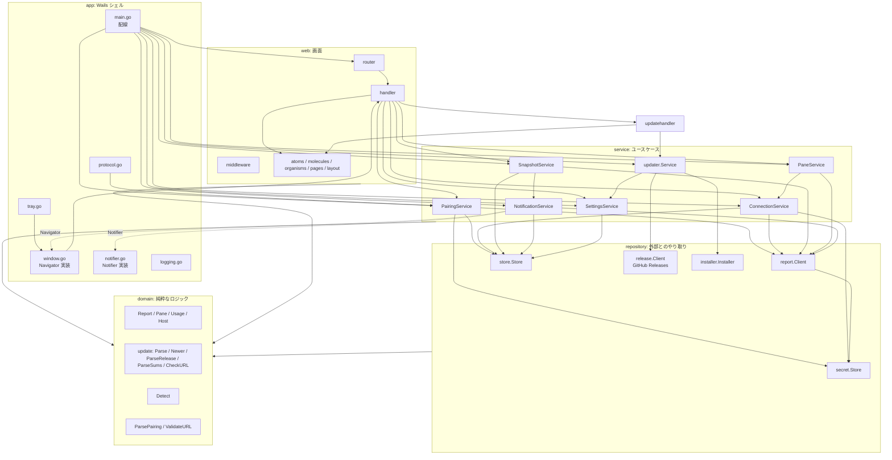

# コンポーネント設計

[アーキテクチャ設計](../architecture/overview.md)のレイヤー構造を、コンポーネント（Go パッケージ・Templ 部品）の責務・依存・インターフェースに分解する。要件は[機能要件](../requirements/functional.md)・[非機能要件](../requirements/non-functional.md)、データは [ER](../architecture/er.md)、ルートと外部 API は [API 仕様](../api/endpoints.md)を参照する。

Go モジュールパスは `github.com/ousiassllc/swarm-viewer`。

## 1. 採用ライブラリ

| 用途 | ライブラリ | 使う層 | 選定理由 |
|------|-----------|-------|---------|
| デスクトップシェル | `github.com/wailsapp/wails/v3` | app | Win/Mac。トレイ・通知・URL スキーム・単一インスタンス |
| ルーティング | `github.com/gin-gonic/gin` | router, web | HALT 標準。`http.Handler` として Wails のアセットハンドラに渡す |
| OpenAPI | `github.com/danielgtaylor/huma/v2` | router | HALT 標準（v1 は JSON オペレーション 0 本） |
| テンプレート | `github.com/a-h/templ` | web | 型安全な HTML |
| MCP クライアント | `github.com/modelcontextprotocol/go-sdk` | repository/report | 公式 SDK（`/report`・`/ops` の `tools/call`） |
| SQLite | `modernc.org/sqlite` | repository/store | CGO 不要 |
| 秘密領域 | `github.com/zalando/go-keyring` | repository/secret | Keychain / Credential Manager を `Set`/`Get`/`Delete` で扱う。エントリ一覧は取れないため孤立エントリの掃除は行わない（[ER §4](../architecture/er.md)）。サイズ上限内の token を前提とする。**採用版は `go.mod` 固定前に、macOS 実装が token を `security` コマンドの引数（argv）ではなく stdin（`security -i`）で渡すことを確認する**。argv 渡しだと保存の瞬間に `ps` で token が見え、NFR-SEC-2・7 に反する |
| ID | `github.com/oklog/ulid/v2` | repository/store（ID 発行は service が `IDGenerator` 経由） | ULID |
| ログ | 標準 `log/slog` + `gopkg.in/natefinch/lumberjack.v2` | app（初期化）、全層は `*slog.Logger` を受け取る | 5MB×3 世代のローテーション。`slog.LevelVar` で実行時に切替 |
| single-flight | `golang.org/x/sync/singleflight` | service | 同一 `(接続, セッション)` の取得を 1 本にまとめる |
| マイグレーション | 自前（`go:embed` の SQL + `PRAGMA user_version`） | repository/store | 版が少なく、ツール導入が過剰 |
| Windows API | `golang.org/x/sys/windows` | repository/installer（`launch_windows.go`。ビルドタグ `windows` のときだけ） | NSIS インストーラの起動に `ShellExecute` が必要（昇格の確認を OS が出す。`os/exec` の `CreateProcess` では昇格できない）。標準ライブラリに `ShellExecute` が無いため。Issue #109 |
| 時間 | 自前の `Clock` interface | service | テストで時間を進めるため（NFR-QLT-3） |
| UI | HTMX（`response-targets` 拡張）、Tailwind CSS | web, static | 初版は Lit なし |

- 上記以外の依存は追加しない。ライブラリを足すときは、このドキュメントの表に理由を追記する

## 2. コンポーネント構成



- 実線は import。破線は「service が定義した interface を app が実装する」関係（service は Wails を import しない）
- `Navigator` / `Notifier` / `Clock` / `IDGenerator` / `ReportClient` / `Store` / `SecretStore` は service パッケージが定義する **consumer-defined interface**。repository 実装がそれを満たす

## 3. domain（`internal/domain`）

他層に依存しない。副作用なし。単体テストの中心。

### 3.1 型

| 型 | 内容 |
|----|------|
| `PaneState` | `string` 型。定数 `StateWorking`・`StateAsking`・`StateIdle`・`StateStalled`・`StateShell`・`StateUnknown`。未知の値は `ParsePaneState(s)` が `StateUnknown` に正規化する |
| `Pane` | `Pos`・`ID`・`Agent`（`*string`）・`State`・`Title`・`CWD`・`Elapsed`・`Activity`・`ActivityTruncated`・`ChangedAgo`・`Note`（`*Note`） |
| `Note` | `From`・`Repo`・`Items []string`・`Next`（viewer は `Repo`・`Items` のみ表示） |
| `Layout` | `Rows int`・`Cols []int`。`Valid(paneCount)` でグリッドとして成立するか検査 |
| `Attention` | `Kind string`・`Pane string`・`Detail string` |
| `Warning` | `Code`・`Message` |
| `Usage` | `Status`・`Reason`・`FetchedAt *time.Time`・`Claude []AgentAccount`・`Codex []AgentAccount`・`Cursor []CursorAccount` |
| `AgentAccount` / `CursorAccount` / `Slot` | `AgentAccount`・`CursorAccount` は `Reason *string`（枠を取れなかった理由。無ければ `nil`）を持つ。`Slot{Available bool, Used *float64, Unit string, Status string, ResetsAt *time.Time}` |
| `Host` | `CPU`・`Mem`・`Swap`・`Disk []Disk`（各 `Available` と率。`Mem` は `Swap` と同じ形で、`host.mem` が無ければ零値） |
| `Report` | `At`・`Layout`・`Panes`・`Attention`・`Usage`・`Host`・`Warnings`・`Auth`（`auth.agents` の `agent`・`status`・`expires_at`） |
| `Session` | `ID string`・`Allowed bool` |
| `ConnectionKind` | `string` 型。`KindView`（見るだけ。`/report`）・`KindOps`（操作。`/ops`）。DB に列は持たず、`KindOfURL(url)`（path が `/ops` ちょうどなら `KindOps`、それ以外は判定できない URL を含めて `KindView`）から導く |
| `Connection` | `ID`・`Name`・`URL`・`LastSession`・`BaselinedAt`・`CreatedAt`・`UpdatedAt`。`Kind()` は `URL` の path から種類を返す。**token を持たない** |
| `PaneTail`・`AskCard`・`PickResult`・`SendResult`・`EscapeResult`・`StartResult`・`CloseResult`・`DirList`・`SkillList`（`domain/ops`） | 操作モードのツール結果（[API 仕様 §1.5.2](../api/endpoints.md)）。`AskCard` は `Options []AskOption{N, Label, Recommended}`・`Cursor`・`AllowsCustom`、`DirList` は `Entries []DirEntry{Name, Path, Git}`・`Truncated`、`SkillList`（`skill_list`。仮称）は `Agent`・`Skills []Skill{Name, Description, Invoke}`・`Truncated`。未知のキーは無視し、形が想定外なら `ErrInvalidResponse`（`protocol`）。linterly の 1 ディレクトリ 2,000 行の上限のため、`internal/domain` 直下ではなくサブパッケージ `internal/domain/ops` に置く |
| `Pick`・`StartRequest`・`FirstTask`（`domain/ops`） | 操作の入力。`Pick` は `N` か `Text`（同時指定は不可。`Check()` が検査）。`StartRequest` は `Agent`・`Cwd`・`Title`（`Normalize()` が前後の空白除去・`agent` が `omp`・`claude`・`codex`・1〜80 字・制御文字なしを検査）。`FirstTask` は最初のタスクの `Skill`（`skill_list` の `invoke`。任意）・`Task`（本文。任意）で、`Empty()`（どちらも空なら今までどおり起動だけ）と `Text()`（スキルと本文の両方 = `<invoke> <本文>`（半角スペース 1 つ）、スキルだけ = `<invoke>`、本文だけ = `<本文>` を組み立て、`CheckText` を通す。`skill_list` の結果との照合はしない）を持つ。`CheckText` が `send_text`・`ask_pick` の `text`（8000 字まで、`\n`・`\t` 以外の制御文字は不可）を検査する。`NormalizeTailLines` が `pane_tail` の `lines` を 1〜200（既定 30）に収める |
| `Settings` | `NotificationsEnabled`・`ScreenPollSeconds`・`NotifyPollMinutes`・`DebugLog`・`LastConnectionID` |
| `PairingPayload` | `Version`・`URL`（検証・正規化済み）・`Token`・`Name`・`SessionsHint`。`Token` を持つ唯一の domain 型で、`String()`/`GoString()`/`MarshalJSON`/`LogValue` で token を伏せる |
| `Snapshot` | `Report`・`FetchedAt`・`Stale bool` |

### 3.2 関数

| 関数 | 役割 | テスト観点 |
|------|------|-----------|
| `ParseReport(json []byte) (Report, error)` | `report` 応答を domain 型へ。未知キーは無視、欠落は零値、未知の `state` は `StateUnknown` | 欠落・`null`・未知値・`available: false` |
| `ParseSessions(json []byte) ([]Session, error)` | `sessions_list` 応答を `allowed` のみに絞る | `allowed: false` のスタブ |
| `ops.ParsePaneTail`・`ParseAskCard`・`ParsePick`・`ParseSend`・`ParseEscape`・`ParseStart`・`ParseClose`・`ParseDirList`・`ParseSkillList` | 操作モードのツール結果を型へ（`content[0].text` の JSON）。`ParseSkillList` は `name` か `invoke` が空の項目を捨てる（送れないスキルを出さない） | `ok: false`・`accepted: false`・`card_closed: false`・`asking: false`・欠落・未知のキー・形の不正 |
| `ParsePairing(raw string) (PairingPayload, error)` | [API 仕様 §2.1](../api/endpoints.md) の検証をすべて行う | 重複キー・サイズ超過・未知の `v`・未知パラメータ |
| `ValidateURL(raw string) (string, error)` | NFR-SEC-4・5。tailnet 範囲（`100.64.0.0/10`、`fd7a:115c:a1e0::/48`）またはループバックの IP リテラル、scheme `http`、port `48120`（ループバックは任意）、path `/report` または `/ops` ちょうど | 範囲の境界値、ホスト名、`0.0.0.0`、userinfo・クエリ付き、`/ops` の許可、末尾スラッシュ・別表記（`/OPS`・`/ops/`・`%2Fops`）の拒否 |
| `Detect(known []NotifiedKey, panes []Pane, baselining bool) Diff` | 通知判定（[ER §3.4 の更新規則](../architecture/er.md)） | `asking`→`asking` は再通知なし、離脱→再突入は再通知、`asking`→`stalled` は通知、`baselining` のときは通知なし |
| `Classify(err error, httpStatus int, toolCode string) *FetchError` | swarm-console の失敗を `ErrKind` に分類（[API 仕様 §1.5](../api/endpoints.md)）。操作ツールの失敗コード（allow-list）は `ErrOperation` | 各 HTTP/コード、`operation` の対象コード、未知コードは `protocol` |
| `ops.Failure(toolCode, detailsField string) *FetchError` | `session` を取る操作系ツールの `isError` を分類する。`invalid_args` は `details.field` が `"session"` のときだけ `ErrSessionMissing`、それ以外は `ErrOperation`。ほかは `Classify` と同じ。`ops.Error(code)` は送る前の検査で断るときの `ErrOperation`（通信しない） | `invalid_args` の `field` による分岐 |
| `UsageTone(slot Slot) Tone` | しきい値（80 / 95）と `exhausted` の色判定。`unit != percent` はしきい値なし | 境界値 79.9 / 80 / 94.9 / 95 |

`Diff` は `Notify []NotifyEvent`（`Pane` と `State` を持つ）、`Insert []NotifiedKey`、`Delete []NotifiedKey`。`NotifiedKey` は `(PaneID, State)`。接続・セッションの軸は呼び出し側（service）が持つ。

### 3.3 エラー

```go
type ErrKind int
const (
    ErrUnreachable ErrKind = iota
    ErrUnauthorized
    ErrForbiddenScope
    ErrSessionRequired
    ErrSessionForbidden
    ErrSessionMissing
    ErrHostError
    ErrProtocol
    ErrOperation // 操作ツールの失敗（invalid_state・not_asking など。HTTP 200 の isError）。Code で理由を区別する
)
type FetchError struct{ Kind ErrKind; Code string } // Code は swarm-console のエラーコード。message・details は持たない
```

`FetchError` は `errors.As` で判定する。`Error()` は固定文言（種別名と `Code`）のみで、応答本文を含めない（NFR-LOG-3）。

## 4. repository

domain のみに依存する。外部（ネットワーク・ファイル・OS）とのやり取りを domain 型に変換して返す。

### 4.1 `repository/report`（swarm-console `/report` クライアント）

| 項目 | 内容 |
|------|------|
| 責務 | `sessions_list`・`report`・`pane_tail`・`ask_card`（見るだけ）と、`ask_pick`・`send_text`・`send_escape`・`pane_start`・`pane_close`・`dir_list`・`skill_list`（操作）の呼び出し、HTTP/MCP の失敗の分類、**ツール別のタイムアウト**（基準 10 秒。`tools.go` の `toolTimeoutScale` で `ask_pick`・`send_text`・`send_escape` は 3 倍、`pane_start`・`pane_close` は 5 倍、`skill_list` を含むほかは 1 倍。swarm-console の `accept_timeout`（既定 10 秒）・`start_timeout`（既定 30 秒）に待つ余地を残すため。`timeoutFor(tool)`）、Bearer 付与 |
| 依存 | go-sdk、`secret.Store`（token を内部で解決）、domain |
| 許可リスト | `tools.go` の種類別の定数 `viewTools`（`sessions_list`・`report`・`pane_tail`・`ask_card`）と `opsTools`（上の 4 つ ＋ `ask_pick`・`send_text`・`send_escape`・`pane_start`・`pane_close`・`dir_list`・`skill_list` の 11 個）。`toolAllowed(kind, name)` が接続の種類（`Connection.Kind()`）で引く。他のツール名を渡す経路は公開しない（メソッドごとにツール名は定数）。見るだけの接続に操作系ツール（`skill_list` を含む）を呼ぶと、**通信せずに** `FetchError{Kind: ErrProtocol, Code: "tool_not_allowed"}` |
| token の扱い | `Connection.ID` から `secret.Store` を引いて Authorization ヘッダを組み立てる。token を戻り値・エラー・ログに出さない |
| Transport | 独自 `http.RoundTripper`。Bearer 付与・URL の再検証（`ValidateURL` を毎回通す）・**送信内容の検査**（リクエストの URL の path が `/report` なら見るだけの 4 つ、`/ops` なら 11 個だけを通す。呼び出し口の検査との二重）・リダイレクト追従の禁止（`CheckRedirect` が `ErrUseLastResponse`） |
| 接続の生成 | 呼び出しごとに SDK のクライアント・セッションを開き閉じる。ステートレス運用のため接続を保持しない（再利用は実機確認後に判断。[アーキテクチャ設計 §11](../architecture/overview.md)） |
| SDK の差し替え | service は `ReportClient` interface（§5.1）にだけ依存する。go-sdk がステートレスな swarm-console（POST のみ、GET・DELETE は 405）と合わない場合は、`tools/call` を POST するだけの自前クライアントに `report.Client` の内部を差し替える（service・handler は変更しない） |

```go
type Client struct{ /* http.Client, secret.Store, *slog.Logger */ }

func (c *Client) Sessions(ctx context.Context, conn domain.Connection) ([]domain.Session, error)
func (c *Client) Report(ctx context.Context, conn domain.Connection, session string) (domain.Report, error)
// ペアリングの疎通確認。保存前なので token を直接受け取る。成功したらタブ用の一覧を返す
func (c *Client) Probe(ctx context.Context, url, token string) ([]domain.Session, error)
// ペインの閲覧（見るだけの接続でも呼べる）。session は常に明示。pane は report の panes[].pos
func (c *Client) PaneTail(ctx context.Context, conn domain.Connection, session, pane string, lines int) (ops.PaneTail, error)
func (c *Client) AskCard(ctx context.Context, conn domain.Connection, session, pane string) (ops.AskCard, error)
// 操作（操作の接続だけ。見るだけの接続は通信せず tool_not_allowed）
func (c *Client) AskPick(ctx context.Context, conn domain.Connection, session, pane string, pick ops.Pick) (ops.PickResult, error)
func (c *Client) SendText(ctx context.Context, conn domain.Connection, session, pane, text string) (ops.SendResult, error)
func (c *Client) SendEscape(ctx context.Context, conn domain.Connection, session, pane string, confirmed bool) (ops.EscapeResult, error)
func (c *Client) PaneStart(ctx context.Context, conn domain.Connection, session, pane string, req ops.StartRequest) (ops.StartResult, error)
func (c *Client) PaneClose(ctx context.Context, conn domain.Connection, session, pane string) (ops.CloseResult, error)
func (c *Client) DirList(ctx context.Context, conn domain.Connection, path string) (ops.DirList, error) // session は取らない
func (c *Client) SkillList(ctx context.Context, conn domain.Connection, agent string) (ops.SkillList, error) // session は取らない。agent は omp / claude / codex（仮称の skill_list。未実装の swarm-console では unknown_tool）
```

- 入力は通信前に検査する（`Pick.Check`・`CheckText`・`StartRequest.Normalize`・`session`・`pane` が空でないこと、`SkillList` の `agent` が `omp`・`claude`・`codex` のどれかであること）。最初のタスクの組み立てと検査（`FirstTask.Text`）は `PaneService.Start`・`Resend`（§5.8）が行う。`SendEscape` は `confirmed` が `false` なら通信せずに `confirm_required`（`ErrOperation`）で断る（`confirm: true` を無条件に付けない。NFR-SEC-12）
- 操作ツールの `isError` は `ops.Failure` で分類する（`skill_list` の `unknown_tool` はコードのまま呼び出し側が判別できる）。`pane_tail`・`ask_card` の本文・送信本文・`skill_list` の `name`・`description`・`invoke` は、戻り値のほかには保持せず、ログにもエラーにも出さない

### 4.2 `repository/store`（SQLite）

| 項目 | 内容 |
|------|------|
| 責務 | [ER](../architecture/er.md)のテーブルへの読み書き、マイグレーション、DB の整合性チェック |
| 依存 | `modernc.org/sqlite`、`database/sql`、domain |
| 起動 | `Open(path)`: ファイルを `0600` で作成（既存ファイルの権限が緩ければ `0600` に締める。Windows を除く）、PRAGMA（`foreign_keys`・`busy_timeout`）、`user_version` 照合（新しい版は DB を変更せず `ErrSchemaTooNew`）、整合性チェック、`journal_mode=WAL`、マイグレーション適用（WAL への切り替えは版・整合性の確認後。DB ファイルを書き換えるため） |
| 失敗 | 開けない・壊れている → `ErrCorrupt`。新しい `user_version` → `ErrSchemaTooNew`。service/app はこれを受けて起動を止めず初期化導線を出す（NFR-AVL-5・CMP-4） |
| トランザクション | 通知済み記録の更新と `baselined_at` の更新は 1 トランザクション |

```go
type Store struct{ db *sql.DB }

// connections
func (s *Store) Connections(ctx context.Context) ([]domain.Connection, error)
func (s *Store) ConnectionByID(ctx context.Context, id string) (domain.Connection, error)
func (s *Store) ConnectionByURL(ctx context.Context, url string) (domain.Connection, bool, error)
func (s *Store) SaveConnection(ctx context.Context, c domain.Connection) error   // UPSERT（url で一意）
func (s *Store) DeleteConnection(ctx context.Context, id string) error             // snapshots・notified_states は ON DELETE CASCADE
func (s *Store) SetLastSession(ctx context.Context, id, session string) error
func (s *Store) MarkBaselined(ctx context.Context, id string, at time.Time) error

// settings（id=1 の 1 行）
func (s *Store) Settings(ctx context.Context) (domain.Settings, error)
func (s *Store) SaveSettings(ctx context.Context, st domain.Settings) error

// snapshots
func (s *Store) Snapshot(ctx context.Context, connID, session string) (domain.Snapshot, bool, error)
func (s *Store) SaveSnapshot(ctx context.Context, connID, session string, sn domain.Snapshot) error
func (s *Store) PruneSnapshots(ctx context.Context, connID string, keep []string) error // sessions_list から消えたセッション分を削除

// notified_states
func (s *Store) NotifiedKeys(ctx context.Context, connID, session string) ([]domain.NotifiedKey, error)
// Diff を 1 トランザクションで適用。INSERT は OR IGNORE し、実際に挿入できたキーだけを返す（二重通知の最終防衛線）
func (s *Store) ApplyNotified(ctx context.Context, connID, session string, d domain.Diff) (inserted []domain.NotifiedKey, err error)
```

- `ApplyNotified` が返す `inserted` だけを通知する。画面更新と通知用ポーリングが同時に同じ遷移を検知しても、DB の主キー制約で 1 回だけ通る
- 件数上限（接続あたり 1,000 件、NFR-DAT-3）は `ApplyNotified` の中で古い順に削除する

### 4.3 `repository/secret`（OS 秘密領域）

```go
type Store struct{ service string } // "swarm-viewer"

func (s *Store) Set(connID, token string) error     // キー "connection:{connID}"
func (s *Store) Get(connID string) (string, error)  // 無ければ ErrNotFound
func (s *Store) Delete(connID string) error         // 無くてもエラーにしない
```

- `go-keyring` を薄く包む。サービス名・キー規則は定数。argv 渡しだった場合は、この `secret.Store`（service 側の `SecretStore` interface の裏）で stdin 渡しの実装（`security -i`）に差し替える
- `ErrNotFound` は service が「token なし」（`ErrUnauthorized` 相当）として扱い、再ペアリングを促す

## 5. service

domain・repository に依存し、ユースケースを組み立てる。Wails を import しない。

### 5.1 service が定義する interface（consumer-defined）

```go
type Clock interface {
    Now() time.Time
    NewTicker(d time.Duration) Ticker   // Ticker: C() <-chan time.Time, Reset(d), Stop()
}
type IDGenerator interface{ NewID() string }              // ULID
type Notifier interface {                                // app が実装（OS 通知）
    Notify(ctx context.Context, n Notification) error
    Permitted() PermissionState                           // 設定画面の表示用
}
type Navigator interface {                               // app が実装（Wails の SetURL）
    Open(path string)
}
type ReportClient interface {                            // repository/report.Client が満たす
    Sessions(ctx context.Context, conn domain.Connection) ([]domain.Session, error)
    Report(ctx context.Context, conn domain.Connection, session string) (domain.Report, error)
    Probe(ctx context.Context, url, token string) ([]domain.Session, error)
}
```

操作モードの service は、`ReportClient` とは別の小さな interface `paneservice.Client`（`PaneTail`・`AskCard`・`AskPick`・`SendText`・`SendEscape`・`PaneStart`・`PaneClose`・`DirList`・`SkillList`。引数・戻り値は §4.1 のとおり。`report.Client` が満たす）にだけ依存する。取得だけの既存のフェイクを壊さないため、`ReportClient` には足さない。`PaneService`（§5.8）だけが使う。

```go
type SecretStore interface { /* secret.Store の 3 メソッド */ }
type Store interface { /* store.Store の公開メソッド */ }
```

`Notification` は `ConnectionID`・`ConnectionName`・`Session`・`Pos`・`State`・`Detail`（`asking` のみ）。token・URL は持たない。

### 5.2 PairingService

| 項目 | 内容 |
|------|------|
| 責務 | 接続文字列の解析、下書きの管理、疎通確認、接続の保存（SQLite と秘密領域） |
| 状態 | 下書き 1 件（`DraftID`・`PairingPayload`・期限）をメモリに保持。`sync.Mutex` で保護 |

```go
func (s *PairingService) Parse(raw string) (DraftID, error)                 // domain.ParsePairing → 下書き作成（古い下書きを破棄）
func (s *PairingService) Draft(id DraftID) (DraftView, error)               // 表示用（token を含まない）。期限切れは ErrDraftExpired
func (s *PairingService) Confirm(ctx context.Context, id DraftID) (domain.Connection, error)
func (s *PairingService) Discard(id DraftID)
```

- `Confirm`: ①`Probe`（疎通） → ②同じ `url` の接続があるか → ③あれば token を差し替え、なければ新規 ID で `SaveConnection` → ④`secret.Set` → ⑤下書き削除。④が失敗したら新規作成した行を削除して失敗を返す（行だけ残る不整合を防ぐ）
- 新規接続は `baselined_at = NULL` で保存する（初回一巡は通知しない）。同じ `url` の再ペアリングでも `baselined_at` は維持する
- 期限（5 分）の判定は `Clock.Now()` で行う。加えて、下書きがある間は `Clock.NewTicker` の掃除 goroutine が期限後に（呼び出しを待たず）下書きをメモリから消す。下書きが無くなれば goroutine は終わり、次の `Parse` が再び起動する
- `Confirm` の成功後に `PollTrigger.Wake(connID)`（`SetPollTrigger` で配線。`*NotificationService` が満たす）を呼び、新しい接続の最初の通知用ポーリングを次の周期（10〜60 分）まで待たせない

### 5.3 ConnectionService

| 項目 | 内容 |
|------|------|
| 責務 | 接続の一覧・削除、セッションタブの取得、`last_session` の記録、`needs_repair` フラグの管理 |
| 状態 | `needs_repair`（接続 ID → bool）をメモリに保持。タブ一覧のキャッシュ（接続 ID → `[]Session`、取得時刻） |

```go
func (s *ConnectionService) List(ctx context.Context) ([]domain.Connection, error)
func (s *ConnectionService) Delete(ctx context.Context, id string) error   // 先に secret.Delete、次に Store.DeleteConnection。前者の失敗は接続を残してエラーを返す（再試行可）。後者の失敗は needs_repair 扱いで接続が残る
func (s *ConnectionService) Tabs(ctx context.Context, id string) ([]domain.Session, error) // sessions_list。結果を NotificationService と共有しない（呼び出しごとに取得）
func (s *ConnectionService) ResolveSession(ctx context.Context, id, requested string) (string, error) // 許可外・消滅時は先頭の許可セッション。0 件は ErrNoSessions
func (s *ConnectionService) NeedsRepair(id string) bool
func (s *ConnectionService) MarkRepaired(id string)
```

- `Tabs` が `ErrUnauthorized` / `ErrForbiddenScope` を受けたら `needs_repair = true`
- `Delete` はその接続のメモリ上の状態（`needs_repair`・タブキャッシュ・single-flight）と通知用の mutex も解放する

### 5.4 SnapshotService

| 項目 | 内容 |
|------|------|
| 責務 | 選択中セッションの `report` 取得、直近値のメモリキャッシュと保存、取得失敗時のフォールバック、通知判定への受け渡し |
| 依存 | `ReportClient`、`Store`、`NotificationService`、`singleflight.Group` |

```go
type SnapshotResult struct {
    Snapshot domain.Snapshot      // 取得成功なら最新、失敗なら直前（メモリ → snapshots）。無ければ零値
    Fresh    bool                 // 今回の取得が成功したか
    Err      *domain.FetchError   // 失敗の種別。Fresh のとき nil
}
func (s *SnapshotService) Get(ctx context.Context, connID, session string) SnapshotResult
func (s *SnapshotService) Last(ctx context.Context, connID, session string) (domain.Snapshot, bool) // 取得せず直前値（Stale）だけ返す。メイン画面の初回描画用（FR-POLL-4）
```

- `Get` は `singleflight`（キー `connID + "\x00" + session`）で包む。同じキーの同時呼び出しは `report` 1 本にまとまる
- 成功: ①メモリキャッシュ更新 ②`SaveSnapshot` ③`NotificationService.Observe` を呼ぶ（通知のオン/オフに関わらず呼ぶ。オフのときは `Observe` が通知の送出だけを抑止し、記録は更新する）
- 失敗: `Err` に分類済みエラーを入れ、`Snapshot` は直前値（`Stale: true`）を返す。401/403 は `ConnectionService` の `needs_repair` を立てる
- `needs_repair` の接続は `Get` が **取得せず**即座に `Err`（`ErrUnauthorized`）を返す（自動ポーリングの停止）。再ペアリングで `MarkRepaired` される

### 5.5 NotificationService

| 項目 | 内容 |
|------|------|
| 責務 | 状態遷移の検知、通知の送出、通知用ポーリングのスケジューラ |
| 依存 | `ReportClient`、`Store`、`Notifier`、`Clock`、`SettingsService`（有効/間隔）、`ConnectionService`（`needs_repair`） |
| 状態 | 接続ごとの `sync.Mutex`（`Observe` の直列化）、スケジューラの goroutine |

```go
// 画面更新・通知用ポーリングの両方がここへ流す
func (s *NotificationService) Observe(ctx context.Context, conn domain.Connection, session string, r domain.Report) error
// スケジューラ。ctx のキャンセルで停止。設定変更（通知オン/オフ・間隔）に追随する
func (s *NotificationService) Run(ctx context.Context)
// 1 接続の通知用ポーリングを、次の周期を待たずに回すよう Run へ依頼する（待たずに返る。PairingService.Confirm が呼ぶ）
func (s *NotificationService) Wake(connID string)
```

`Observe` の手順:

1. 接続の mutex を取得
2. `NotifiedKeys(conn, session)` を読み、`domain.Detect(known, r.Panes, baselining = conn.BaselinedAt == nil)`
3. `ApplyNotified` で Diff を適用し、実際に挿入できたキー（`inserted`）を得る
4. `baselining` でなく、かつ通知がオンのとき、`inserted` に対応する各ペインについて `Notifier.Notify`。通知がオフの間は記録だけ更新する（オン復帰後に、オフの間に入った状態が一斉に通知されるのを防ぐ）。通知の失敗は警告ログ（記録は戻さない。再通知しないことを優先）

`Run` の手順（通知用ポーリング）:

1. `Clock.NewTicker(settings.NotifyPollMinutes)` で周期を作る。起動直後に 1 回実行する（再起動後の取りこぼしを減らす）
2. `settings.NotificationsEnabled == false` の間は取得しない（ticker は動かしてよいが tick で即 return）。設定変更の通知で ticker を `Reset`
3. Tick ごとに接続を順次処理（並列にしない。NFR-PERF-6）: `needs_repair` はスキップ → `Sessions` → `PruneSnapshots` → 各許可セッションを `Report` → `Observe`。失敗した接続・セッションは飛ばす（記録は変更しない。NFR-AVL-3）
4. 全許可セッションが成功した一巡の最後に、`BaselinedAt == nil` なら `MarkBaselined`。一部のセッションが失敗し続けている間は `baselined_at` を記録せず、その接続は通知せず記録だけを続ける（機能要件 §8.2。残余リスクは [ER §3.5](../architecture/er.md)）
5. 1 接続の失敗が 401/403 なら `needs_repair` を立てて次の接続へ

### 5.6 SettingsService

```go
func (s *SettingsService) Get(ctx context.Context) (domain.Settings, error)
func (s *SettingsService) Update(ctx context.Context, in SettingsInput) (domain.Settings, error) // 許容値検証。違反は ValidationError
func (s *SettingsService) Subscribe() <-chan domain.Settings                                    // 変更通知（スケジューラ・ログレベル）
```

- 許容値: `screen_poll_seconds ∈ {5,10,30,60}`、`notify_poll_minutes ∈ {5,10,30,60}`（[ER §3.2](../architecture/er.md)）。DB の `CHECK` と二重に守る
- `Update` 後に購読者へ新しい設定を送る（スケジューラの ticker の `Reset`、`slog.LevelVar` の更新）
- `LastConnectionID` の更新は `ConnectionService`/ハンドラが `SetLastConnection` 経由で行う
- `SettingsInput` は `AutoUpdateCheck`（新しい版の自動確認。FR-UPD-6）を含む。`Update` 後の購読者に `updater.Service`（`Run`）が加わり、オフからオンへの変更で新しい版をすぐ確認する（§5.9）

### 5.7 エラーの扱い

| 発生元 | service のエラー | 呼び出し側の動作 |
|--------|------------------|-----------------|
| `FetchError`（`ErrUnreachable` など） | そのまま返す（`*domain.FetchError`） | ハンドラが §6.3 のとおり表示 |
| `ErrNoSessions` | `ResolveSession` が返す | 「許可されたセッションがありません」ページ |
| `ErrDraftExpired` | `Draft`・`Confirm` | 「もう一度ペアリングしてください」 |
| `ValidationError` | `Update`・`Parse` | 422 でフォーム再描画 |
| `store.ErrCorrupt` / `ErrSchemaTooNew` | 起動時に app へ | 起動は止めず、初期化導線の画面を出す |

### 5.8 PaneService（操作モード。`internal/service/paneservice`）

linterly の 1 ディレクトリ 2,000 行の上限のため、`internal/service` 直下ではなくサブパッケージ `internal/service/paneservice` に置く（`service.ConnectionService` に依存する）。

| 項目 | 内容 |
|------|------|
| 責務 | ペイン詳細の取得（`Tail`・`Card`）と操作（`Pick`・`Send`・`Escape`・`Start`・`Resend`・`Close`・`Dirs`・`Skills`）。接続の種類の確認、同じペインへの操作の排他、401/403 の `needs_repair`、ログ。`Start` は任意の最初のタスク（スキル・本文）を、起動（`pane_start`）に続けて `send_text` で送るところまでを 1 つの操作として行う |
| 依存 | `paneservice.Client`（§5.1。`report.Client` が満たす）、`service.ConnectionService`（接続の解決・`needs_repair`）、`*slog.Logger` |
| 状態 | 実行中のペインの集合（キー `接続 ID + "\x00" + session + "\x00" + pane`）。mutex で保護 |
| エラー | `ErrOpsRequired`（見るだけの接続で操作を求められた）・`ErrBusy`（同じペインの操作が実行中）。どちらも通信しない |

```go
func (s *PaneService) Tail(ctx context.Context, connID, session, pane string, lines int) (ops.PaneTail, error)
func (s *PaneService) Card(ctx context.Context, connID, session, pane string) (ops.AskCard, error)
func (s *PaneService) Pick(ctx context.Context, connID, session, pane string, pick ops.Pick) (ops.PickResult, error)
func (s *PaneService) Send(ctx context.Context, connID, session, pane, text string) (ops.SendResult, error)
func (s *PaneService) Escape(ctx context.Context, connID, session, pane string, confirmed bool) (ops.EscapeResult, error)
func (s *PaneService) Start(ctx context.Context, connID, session, pane string, req ops.StartRequest, first ops.FirstTask) (StartOutcome, error) // first が Empty なら今までどおり pane_start だけ
func (s *PaneService) Resend(ctx context.Context, connID, session, pane string, first ops.FirstTask) (ops.SendResult, error) // 「もう一度送る」。send_text だけ（pane_start は呼ばない）
func (s *PaneService) Close(ctx context.Context, connID, session, pane string, confirmed bool) (ops.CloseResult, error)
func (s *PaneService) Dirs(ctx context.Context, connID, path string) (ops.DirList, error)
func (s *PaneService) Skills(ctx context.Context, connID, agent string) (ops.SkillList, error)

// StartOutcome は pane_start の結果と、最初のタスクの扱い。pane_start の失敗は error で返し、最初のタスクは送らない
type StartOutcome struct {
    Start ops.StartResult
    Task  TaskStatus     // TaskNone（first が空）・TaskSent・TaskNotIdle（state が idle 以外で未送信）・TaskFailed（send_text が失敗または accepted: false）
    Send  ops.SendResult // Task が TaskSent・TaskFailed のとき
    Err   error          // TaskFailed のときの失敗（FetchError。固定文言に変換する）
}
```

- 順序は「接続の解決 → 種類の確認（`Tail`・`Card` 以外の操作は `Kind() == KindOps` が必要。見るだけは通信せず `ErrOpsRequired`）→ `needs_repair` なら通信せず `ErrUnauthorized`（`needs_repair`）→ 排他の取得（ペインへ送信する操作だけ。取れなければ通信せず `ErrBusy`）→ `paneservice.Client` の呼び出し」。入力の検査（`Pick.Check`・`CheckText`・`StartRequest.Normalize`・`confirmed`）は通信前に `report.Client` の呼び出し口で行う。最初のタスク（`FirstTask.Text` の長さ・制御文字）は `PaneService.Start`・`Resend` が排他を取ったあと、`pane_start` の前に検査し、違反なら `pane_start` も `send_text` も呼ばずに断る
- `Start` の最初のタスク: `pane_start` が `ok: true` で `StartResult` の `state` が `idle` のときだけ、**同じ排他を保ったまま**（排他を放さず）続けて `send_text`（`FirstTask.Text()`）を送る。`pane_start` の失敗（`ok: false` を含む）なら送らず従来どおりの失敗を返す。`state` が `idle` 以外なら送らず `TaskNotIdle`。`send_text` が失敗または `accepted: false` でも、**自動の再送はせず**、`pane_close` も呼ばず（起動を取り消さない）、`TaskFailed` で返す。通信の上限は各ツールのまま（`pane_start` 50 秒・`send_text` 30 秒。合算の上限は設けない）
- `Resend` は `FirstTask.Text()` を `send_text` で 1 回だけ送る（排他あり。`pane_start` は呼ばない。ペインが `idle` かの検査はハンドラが送る前に行う）
- `Tail`・`Card`・`Dirs`・`Skills` は排他に入らない（ペインに何も送らない読み取り。5 秒ごとの自動更新と操作が互いを止めない）。`Dirs`・`Skills` は操作の接続だけ。`Skills` の結果は保持しない（画面を開いている間のメモリだけ）
- 401・403 は `needs_repair` を立てる（`SnapshotService` と同じ。その接続の自動更新・操作を止め、再ペアリングへ誘導する）
- ログは接続 ID・ツール名・種別・コード・ペイン位置まで。`text`・`pane_tail` の本文、スキル名・`invoke`・最初のタスクの本文は出さない（NFR-SEC-11）

### 5.9 UpdaterService（新しい版の確認と更新。`internal/service/updater`）

linterly の 1 ディレクトリ 2,000 行の上限のため、`internal/service` 直下ではなくサブパッケージ。Issue #109。

```go
type Source interface {                       // repository/release.Client が満たす
    Latest(ctx context.Context) (update.Release, error)
    Download(ctx context.Context, asset update.Asset, dst io.Writer) error
}
type Installer interface {                    // repository/installer.Installer が満たす
    Install(ctx context.Context, file string) error
}
type SettingsReader interface {               // service.SettingsService が満たす
    Get(ctx context.Context) (domain.Settings, error)
    Subscribe() <-chan domain.Settings
}
func New(o Options) *Service                                 // Options: Source・Installer・Settings・Clock・Log・Version・GOOS・Quit・TempRoot
func (s *Service) Enabled() bool                             // 版が "X.Y.Z" で読め、この OS に更新ファイルがあるとき true
func (s *Service) Status() Status                            // Available・Latest・Updating・Done・Total・ApplyFailed（FailKind）・CheckFailed
func (s *Service) Run(ctx context.Context)                   // 起動時と CheckInterval（6 時間）ごとに Check。購読で オフ→オン は即確認
func (s *Service) Check(ctx context.Context)                 // 直列。更新中は何もしない
func (s *Service) ApplyAsync() (<-chan struct{}, error)      // ErrNotAvailable・ErrBusy。別 goroutine で 15 分の上限
```

| 項目 | 内容 |
|------|------|
| 責務 | 確認（`domain/update.Newer` で比較）と更新（この OS のアセットと `SHA256SUMS` の存在確認 → `SHA256SUMS` の取得（64 KiB まで）→ アセットの取得（一時フォルダ `swarm-viewer-update-*`、`0600`、SHA-256 を同時に計算）→ ハッシュの比較 → `Installer.Install` → `Quit`） |
| 失敗の種類 | `FailDownload`（取得）・`FailVerify`（アセット・`SHA256SUMS` の欠け・書式・64 KiB 超過・ハッシュ不一致）・`FailInstall`（適用）。画面の文言は `updatehandler` が種類から引く（[機能要件 §4.10](../requirements/functional.md)） |
| 無効な環境 | `Enabled()` が false（版が `dev` など読めない・`update.AssetName` が無い OS）なら `Run`・`Check` は何もしない |
| 状態 | `Status`（mutex で保護）と、確認した `update.Release`。確認は `checkMu` で直列、更新は `Updating` で単一（二重開始は `ErrBusy`） |
| 失敗時 | 一時フォルダを消し、`FailKind` を状態に入れて更新中を終える。成功した Windows だけ一時フォルダを残す（インストーラが使う）。コンテキストのキャンセルは確認の失敗として扱わない |
| ログ | タグ・失敗の種類・原因のエラー（[非機能要件 NFR-LOG-3](../requirements/non-functional.md) の限界を参照） |

- `repository/release.Client`: `NewClient(userAgent)` は接続先を `domain/update` の定数に固定する。`Latest`（30 秒・4 MiB）・`Download`（`MaxAssetBytes` = 512 MiB・`Content-Length`/`Size` との一致・圧縮なし）。専用の `http.Client` は `guard`（全リクエストの検査と資格情報の除去）・`CheckRedirect`（5 回まで・同じ検査）・`denyPrivate`（`net.Dialer.Control`。名前解決後のアドレス）を持つ。`ErrNoRelease`（404）は確認の失敗にしない
- `repository/installer.Installer`: `New()` は実行中の OS 向け。`Install(ctx, file)` は Windows で `launchWindows`（`ShellExecute`）、macOS で `installMacOS`（`extractApp` → 2 回の `rename` → `relaunch`）、それ以外は `ErrUnsupported`。OS の起動・`rename`・実行ファイルの場所は関数として注入でき、Linux でもテストできる（実機の確認は[アーキテクチャ設計 §11](../architecture/overview.md) #18・#19）
- `internal/buildinfo.Version` は `compose.Config.Version` へ渡す。`compose.Runtime` が `updater.Service` を組み立て（`update.go`。`Config.Releases`・`Installer`・`GOOS` はテストが差し替える）、`startWorkersLocked` が通常モードで準備できたとき通知スケジューラと一緒に `Run` を 1 度だけ起動する。recovery モードでは起動しない

## 6. web 層

### 6.1 handler（`internal/web/handler`・`internal/web/panehandler`）

`service/`・`domain/` にだけ依存し、`repository/` を直接使わない（depguard の `web-handler` 規則が両方のパッケージに掛かる）。ペイン詳細・操作のルートは、linterly の 1 ディレクトリ 2,000 行の上限のため別パッケージ `panehandler` に置く。

新しい版の通知・更新は、同じ理由で別パッケージ `updatehandler`（`GET /update/notice`・`POST /update/apply`。`Handler.Enabled()` がメイン画面の通知の領域の出し分けにも使われる）に置く。`updater.Status` を `organisms.UpdateNoticeProps`（固定文言と進み具合の百分率）に解決する。depguard の `web-handler` 規則は `updatehandler` にも掛かる。

| ファイル | ルート（[API 仕様 §4.2](../api/endpoints.md)） | 主な呼び出し |
|---------|---------------------------------------------|-------------|
| `main.go`・`tabs.go`・`snapshot.go` | `GET /`、`GET /connections/{cid}`、`GET /connections/{cid}/sessions/{sid}`、`GET …/snapshot` | `ConnectionService.CachedTabs/Tabs`、`SnapshotService.Last/Get` |
| `connection.go` | `GET /connections`、`DELETE /connections/{cid}` | `ConnectionService.List/Delete` |
| `pairing.go` | `GET/POST /pairing`、`GET /pairing/drafts/{did}`、`POST …/confirm`、`POST …/discard` | `PairingService` |
| `settings.go` | `GET /settings`、`PUT /settings` | `SettingsService` |
| `panehandler/panehandler.go`・`live.go`・`actions.go`・`start.go` | `GET …/panes/{pos}`・`GET …/panes/{pos}/live`（`live.go`）、`POST …/pick`・`…/send`・`…/escape`・`…/close`（`actions.go`）、`GET …/start`・`…/start/dirs`・`…/start/skills`（`agent` が不正なら通信せず 400）、`POST …/start`（`start.go`。`confirm=1` が無ければ確認画面だけ。`skill`・`task` を受け、`resend=1` は `send_text` だけを送る。`resend=1` はペインが `idle` でなければ通信せず `invalid_state`）、ルート登録・対象の解決・見るだけの接続への 403（`panehandler.go`）（[API 仕様 §4.2・§4.6](../api/endpoints.md)） | `paneservice.PaneService`（`Skills`・`Start`・`Resend` を含む）、`SnapshotService`（状態の取り直し）。見るだけの接続は操作ルート（`…/start/skills` を含む）で通信せず 403 を返す |
| `updatehandler/updatehandler.go` | `GET /update/notice`（通知の領域の読み直し）、`POST /update/apply`（更新の開始。CSRF 必須）（[API 仕様 §4.2](../api/endpoints.md)） | `updater.Service`（`Enabled`・`Status`・`ApplyAsync`）。`Handler.Enabled()` が false（recovery・対象外の環境）なら空の領域を返す。`ApplyAsync` が返す `ErrBusy`・`ErrNotAvailable` は何も始めずに状態を返す |

- ページルートは `HX-Request` でフルページ / フラグメントを分岐する（[API 仕様 §4.1](../api/endpoints.md)）
- 通常モードのルートは 3xx を返さない（WebKit の WebView が `http.Redirect` を扱えないため）。フルページはその場に描画し、HX の移動は `HX-Redirect`（[API 仕様 §4.1](../api/endpoints.md)、[アーキテクチャ設計 §11](../architecture/overview.md) #7）
- メイン画面の初回描画はホストと通信しない（保存済みスナップショットと直近のタブで描画し、最新のタブは snapshot 応答の `#session-tabs` OOB が反映する。[API 仕様 §4.2](../api/endpoints.md)）
- snapshot ハンドラは `SnapshotResult` を `organisms.SnapshotView` に渡す。`Fresh == false` のときは直前値のグレーアウトと失敗バナー（[API 仕様 §4.4](../api/endpoints.md)）。`needs_repair` のときはポーリング属性を出さない

### 6.2 middleware

| 名前 | 役割 |
|------|------|
| `CSRF` | プロセス起動時に生成したトークンを `<meta name="csrf-token">` で配り、`POST`・`PUT`・`DELETE` で `X-CSRF-Token` を検証（定数時間比較）。不一致は 403 |
| `NoStore` | 全応答に `Cache-Control: no-store` |
| `CSP` | `Content-Security-Policy: default-src 'self'; script-src 'self'; style-src 'self'; connect-src 'self'; object-src 'none'; base-uri 'none'`（NFR-SEC-9） |
| `Recover` | パニックを捕捉し、スタックはログ（token・本文を含まない）、画面は汎用エラーフラグメント |
| `RequestLog` | メソッド・パス・ステータス・所要時間のみ。クエリ・本文・ヘッダは出さない |

### 6.3 Templ コンポーネント（Atomic Design）

| 層 | コンポーネント | Props（要点） | 備考 |
|----|---------------|--------------|------|
| atoms | `Badge` | `Text`・`Tone`・`Marker` | エージェント種別・状態・要対応。`Marker` が true のとき、文言の前に文字と同じ色の小さな点を置く（状態を示すバッジだけに付け、エージェント名のバッジには付けない） |
| atoms | `ProgressBar` | `Percent`・`Tone` | 利用上限・ホスト負荷。塗りの色は呼び出し側が `format.SlotTone`・`format.PercentTone` で決める（80% 以上 `warning`・95% 以上 `danger`。NFR-DSG-20） |
| atoms | `Spinner` | `ID`・`Static` | `hx-indicator` 用。ガイドどおり 20px・線 2px・回転 0.9s の 1 種だけ（サイズの指定はない）。`Static` が true のとき `htmx-indicator` を付けず常に表示する（ポーリングで描画し直す更新中の行など、`hx-indicator` に頼らない処理中表示。Issue #109） |
| atoms | `Toast` | `Message` | OOB 用。1 行の短文（エラー詳細には使わず、`Alert` を使う）。幅は `min(92vw, 420px)` で頭打ち、出現・退出の移動量は 8px |
| atoms | `Alert` | `Kind`（`info`・`success`・`warning`・`danger`）・`Title`・`Message`・`Attrs`・子要素 | インラインアラート（アイコン＋見出し＋本文）。`Title` は任意（SemiBold・14px）で、取得失敗バナーは失敗の種別を見出し、「前回取得 … / 次回再試行 …」を本文にする。1 文で足りるエラーは `Message` だけで出す（NFR-DSG-7）。応答全体の失敗・フォームのエラー・警告バナー・取得失敗バナーはすべてこれに載せる。状態は色だけでなくアイコンと文言でも伝える（ガイド C4）。`danger`・`warning` は `role="alert"`、`info`・`success` は `role="status"` |
| atoms | `Icon` | `Name`・`Class` | Iconoir（MIT）の線画をインライン `<svg>`（`aria-hidden`・`currentColor`。HTML 埋め込みなので `xmlns` は付けない）で出す。現在は `warning-circle`・`warning-triangle`・`info-circle`・`check-circle`・`check`・`xmark` |
| atoms | `Checkbox` | `Name`・`Value`・`Checked` | 18px・`--r-sm`・外枠 `--mute`。オンの印は Iconoir の `check`（インライン SVG。16px = `--icon-sm` を箱の中央に置く）。文言と並べる `<label>` のクラスは定数 `CheckboxRowClass`（箱→文言は 10px = `--list-marker-gap`） |
| atoms | `EmptyState` | `Message`・子要素 | 空状態（破線の枠・`--r-lg`・padding 縦 48・横 24（画面幅で変えない）・48px の `--accent-soft` の円に 24px のアイコン＋文言＋子要素の主ボタン）。ローディングは `Spinner` を使う |
| atoms | `ConfirmDialog` | なし | 確認・破壊的操作の中央モーダル。レイアウトに 1 つだけ置き、`modal.js` が `htmx:confirm`（`hx-confirm`）で開く。見出し・ラベルは要素の `data-confirm-title`・`data-confirm-label` |
| atoms | `ModalHeader` | `ID`・`Title`・`Attrs` | モーダルのヘッダー（ガイドの見本の `header`）。見出し（h2）と閉じる × のアイコンボタン（`data-modal-close`・32px・Iconoir の `xmark`）を左右に置き、下に 1px の `--border`。本文・フッターのクラスは定数 `ModalBodyClass`・`ModalFooterClass`（フッターは右寄せ・ボタン間 8px・上に 1px の `--border`）。`ModalClass` は余白なし・幅は最大 420px で、`ConfirmDialog` とペアリング確認が使う |
| atoms | `Button` / `Input` | `Button`: `Label`・`Type`・`Variant`・`Size`（標準 / `ButtonSmall`）・`Attrs`。`Input`: 通常の属性 | `Input`・select・textarea は `FieldClass`（高さ 40・文字 16px）。検証に失敗した入力欄は `FieldInvalidClass` を重ねる（`--danger` の枠・`--ring-danger` のリング）。select は `SelectClass`（`FieldClass` に OS の矢印を消して `--mute` のシェブロンを足したもの）。`Button` は `cursor-pointer`、無効（処理中の `hx-disabled-elt` を含む）は `cursor-not-allowed`。ホバーは `hover-fade` の 180ms の遷移で、主は地を `--accent` の 85%（文字は薄くしない。NFR-DSG の承認済みの逸脱）、副は `--accent-soft` の地、危険は `--danger` の 10% の地 |
| molecules | `PaneCard` | `Pane`・`Highlight`・`ReportWaiting` | 状態ラベル・activity・note 要約。`ReportWaiting` は state バッジの隣に「報告待ち」を出す。カード全体がペイン詳細へのリンク（`organisms.PaneGrid` が `<a>` で包む）。ペインへの送信ボタンは**持たない**。「＋ 始める」は `PaneGrid` が操作の接続（`PaneGridProps.Kind`）の `shell` のカードにだけ出す（見るだけの接続には出さない） |
| molecules | `PaneTail`・`PaneHeader`・`KindBadge` | `PaneTail`: `PaneTailProps`（本文・行数）。`PaneHeader`: `PaneHeaderProps`（位置・状態・タイトル・cwd・メモ・エージェント）。`KindBadge`: `domain.ConnectionKind` | `pane_tail` の本文（`<pre>` で等幅・テキストとして）、ペイン詳細のヘッダ（メモの `repo` と `items` は全件を折り返して全文で出す。カードの `paneNote` は要約のまま。NFR-DSG-19）、接続の種類のバッジ（「操作」「見るだけ」。文言を併記し色だけに頼らない）。質問の選択肢の型 `AskOption` は `domain/ops` |
| molecules | `UsageRow` | `Label`・`Slot` | `unit` で percent / usd を出し分け。`available: false` は「—」 |
| molecules | `HostRow` | `Label`・`Percent`・`Detail` | |
| molecules | `SessionTab` | `ConnectionID`・`Session`・`Selected` | `hx-get` |
| molecules | `AttentionItem` | `Attention`・`AuthExpiresAt` | 未知の `kind` は文字列表示 |
| organisms | `SessionTabs` | `[]Session`・`Selected` | |
| organisms | `PaneGrid` | `Layout`・`[]Pane` | `Layout.Valid` でなければリスト表示 |
| organisms | `UsagePanel` | `Usage`・`RegionGrayed`・`Now` | `usage.status` による分岐（[機能要件 §5.1](../requirements/functional.md)） |
| organisms | `HostPanel` | `Host` | |
| organisms | `AttentionBar` | `[]Attention`・`[]Warning`・`Auth` | ペイン関連とログイン関連の 2 グループに分け、グループ間とエージェントごとに区切り線を入れる（[機能要件 §7](../requirements/functional.md)） |
| organisms | `SnapshotView` | `SnapshotResult`・`PollSeconds`・`Repair` | ポーリング属性（`hx-trigger`）を出す／出さないの判断を含む |
| organisms | `ConnectionList` | `[]Connection`・`Error` | `Error` があれば一覧の上に `Alert`（`danger`）を出す（削除失敗）。各接続に種類のバッジ（「操作」「見るだけ」）を出す |
| organisms | `UpdateNotice` | `UpdateNoticeProps`: `Initial`・`Available`・`Latest`・`Updating`・`Percent`（負なら不明）・`FailMessage`・`CheckFailed` | 新しい版の通知（`#update-notice`。`organisms/update_notice.templ`）。`hx-get`（`paths.UpdateNotice`）で自分自身を読み直す（最初は `load, every 60s`、ふだん 60 秒、更新中 1 秒。`hx-sync="this:drop"`）。新しい版があるとき `Alert`（info）に「新しい版 vX.Y.Z があります」と「更新する」（`hx-post`: `paths.UpdateApply`）、更新中は `Spinner{Static}`・無効のボタン・`ProgressBar`（サイズが分かるとき）。失敗は `Alert`（danger）の固定文言 1 行、確認の失敗は控えめな 1 行。何も無いときは空（`empty:hidden`） |
| organisms | `panedetail`（サブパッケージ）: `Live`・`AskCard`・`SendForm`・`StartForm`・`StartConfirm`・`DirPicker`・`SkillPicker`・`StartTaskResult` | `LiveProps`: `Ref`・`Kind`・`Pane`・`Tail`・`Lines`・`Card`・`Banner`・`Repair`・`Notice`・`RetryClose`・`ClearInput`。`AskCardProps`: `Ref`・`Card`・`Lines`・`Ops`。`StartFormProps`（`Skill`・`Task` を含む）・`StartConfirmProps`（スキル・本文の先頭の要約と、`skill`・`task` の hidden 項目）・`DirPickerProps`（`Ref`・`Dir`・`Recent`・`Error`）・`SkillPickerProps`（`Ref`・`Agent`・`Skills`・`Error`・`Reload`）・`StartTaskResultProps`（`Ref`・`Title`・`Reason`・`Resend`・`Skill`・`Task`） | ペイン詳細の本文（`Live`。状態ヘッダ・質問カード・`pane_tail`・状態に応じた送信欄・中断・終了）、質問カード、送信欄（状態で無効と理由を出す）、中断・終了（確認ダイアログ付き。詳細の最下部）、新しいセッションの入力画面・確認画面とフォルダピッカー、スキルの選択部品（`SkillPicker`。「スキルなし」と一覧の各行（`name`・`description`）。取得に失敗したら一覧を出さず固定文言を出し、`Reload` が真のときだけ「再読み込み」を付ける（`unknown_tool` は古いホストの固定文言で、再読み込みは付けない）。どちらでもスキルは空のまま本文だけ・タスクなしで進める）、最初のタスクを送っていない・送れなかったときの結果の表示（`StartTaskResult`。常に「ペイン詳細を開く」、`Resend` が真のとき（送信の失敗）だけ「もう一度送る」。`idle` 以外で送らなかったときは `Resend` なしで本文も持たない。本文は hidden 項目にだけ持ち、この表示の間だけメモリに残る）。`SendForm`・`DirPicker`・`SkillPicker`・中断・終了と質問カードのボタンは、操作の接続のときだけ描画する（見るだけの `AskCard` は一覧と案内だけ。見るだけの接続には「スキル」「本文」の部品も描画しない）。`name`・`description`・`invoke`・本文は常にテキストとして描画する（`templ.Raw` を使わない） |
| pages | `MainPage` | 接続・タブ・スナップショット（ヘッダに種類のバッジ）・`UpdateNotice`（`MainProps.UpdateNotice` が true のときだけ、ヘッダの下に初回の枠を置く） | |
| pages | `PaneDetailPage`・`PaneStartPage`（`pages/pane.templ`） | `PaneDetailProps`: `Ref`・`Kind`。`PaneStartProps`: `Form`・`Blocked`（最初のタスクの入力は `Form`（`StartFormProps`）の `Skill`・`Task`） | ペイン詳細（S4）と新しいセッション（S5。操作の接続だけ） |
| pages | `PairingPage` / `PairingDraftPage`・`PairingDraftContent`（貼り付け画面の上に確認モーダル。`DraftProps.HasConnections` は背面の画面用。操作の接続の警告を含む） / `ConnectionsPage` / `SettingsPage` / `NoSessionsPage` / `DraftExpiredPage` / `RecoveryPage`（DB 破損時） | | |
| layout | `Base` | `Title`・`CSRFToken` | `<head>`（CSP は HTTP ヘッダで付与。`htmx-config` の meta を含む）、`<body hx-headers='{"X-CSRF-Token":"…"}'>`、`htmx.min.js`・`app.js`・`modal.js`・`app.css` を読み込む |

- 状態の表示ラベル・色（`StateLabel`・`StateTone`、`UsageTone` の結果から Tailwind クラスへの対応）は **web 層**に置く（presentation。domain は意味だけを持つ）。ラベルは[機能要件 §3](../requirements/functional.md)の表に一致させる
- 時刻・相対時間の整形（`elapsed` は文字列のまま、`resets_at` は「あと N 時間」）も web 層のヘルパー（`web/format`）。`Clock.Now()` を引数に取り、テストを固定時刻で行う

## 7. app（Wails シェル）

Wails に依存する唯一の層。`service/` を呼び、service の interface を実装する。`web/` には依存しない（URL 文字列でルートを指す）。

| ファイル | 責務 |
|---------|------|
| `main.go`（ルート） | 依存の組み立て（§8）。Wails アプリ生成、アセットハンドラに Gin を渡す、ウィンドウ・トレイ・単一インスタンス・URL スキームの登録、`NotificationService.Run` の起動 |
| `app/window.go` | メインウィンドウ。閉じる操作を「非表示」に置換（終了しない）。`Navigator` を実装（`Open(path)` → `SetURL`＋前面化）。トレイ「開く」で呼ぶ |
| `app/tray.go` | システムトレイ（macOS はメニューバー）。メニューは「開く」「終了」。「終了」は `ctx` をキャンセルして `NotificationService.Run` を止めてからアプリを終了 |
| `app/protocol.go` | `ApplicationLaunchedWithUrl` と `OnSecondInstanceLaunch` の引数から `swarm-viewer://` を取り出し、`PairingService.Parse` → `Navigator.Open("/pairing/drafts/{did}")`。他のスキーム・形式不正は破棄してログ（URL は host のみ。token を出さない） |
| `app/notifier.go` | `Notifier` を実装。Wails の通知 API で OS 通知を出し、クリックで `Navigator.Open("/connections/{cid}/sessions/{sid}")`。OS の許可状態を `Permitted()` で返す |
| `app/applog` | `slog` + `lumberjack`（上限 5MB、現行 + 退避 2 = 3 世代、`UserConfigDir()/swarm-viewer/logs/`）。`slog.LevelVar` を `SettingsService` の購読で更新。ハンドラの `ReplaceAttr` で `token`・`authorization`・`body`・`activity`・`note` などのキーを伏せ、`url` 系のキーは host のみに丸める。メッセージ・その他の値に含まれる URL は `scheme://host` に縮め、Bearer の値を伏せる |
| `service.SystemClock` | 実時間の `Clock`（`app` では独自実装を持たず、これを使う） |
| `app/idgen` | `IDGenerator` の ULID 実装（`oklog/ulid/v2`、`crypto/rand`） |
| `app/deeplink` | 引数・イベントから `swarm-viewer://` を取り出す（引用符・大文字小文字・他 scheme の破棄）。`Parse` → `Navigator.Open` の流れと、起動直後に届いたリンクを溜める `Dispatcher`。Wails 非依存で、`protocol.go` と `Shell` の 2 つ目の起動の受信から呼ばれる。解析失敗は `paths.PairingInvalidLink`（固定文言）へ遷移する |
| `app/compose` | SQLite を開き、service・router を documented order で組み立てる。`ErrCorrupt`/`ErrSchemaTooNew` は recovery モード（`router.NewRecovery`）で続行し、`POST /recovery/reset` で DB を退避して通常モードへ切り替える（ハンドラは `app/swap` で差し替え）。通知スケジューラは Wails の準備完了（`Ready`）後に 1 度だけ起動する |
| `app/notice`・`app/navpath`・`app/swap` | 通知の本文組み立てとクリック時の遷移先復元、遷移先パスの検証（同一オリジンの絶対パスのみ）、atomic に差し替えられる `http.Handler` |

- ウィンドウを閉じて非表示のとき、WebView が `visibilityState === 'hidden'` になるかは実機で確認する（[アーキテクチャ設計 §11](../architecture/overview.md) の未確認事項 5）。`hidden` にならない場合、非表示中の画面更新ポーリングを止めるため、`window.go` が非表示/表示の遷移時に `refresh`/停止用のイベントを発行する設計に変更する
- **可視性制御**: 非表示中のポーリング停止と復帰時の即時取得は、静的 `static/src/js/app.js`（`htmx:beforeRequest` で `…/snapshot` と `…/live` を取り消し、`visibilitychange` で `refresh` を発火）が行う。`SnapshotView`・ペイン詳細の本文の `hx-trigger` にフィルタ式 `[…]` は使わない（CSP が `unsafe-eval` を許さず、htmx の `allowEval:false` と矛盾するため）
- **確認ダイアログ**: 中断・終了のボタンは `hx-confirm` と `data-confirm-title`・`data-confirm-label` を持ち、`modal.js` の `htmx:confirm` が共通の `atoms.ConfirmDialog`（取り消しのボタンは「キャンセル」）を開く。確定したフォームだけが `POST …/escape`・`POST …/close` に `confirm=true` を付け、ハンドラは `confirm=true` が無ければ `PaneService.Escape(confirmed=false)`・`PaneService.Close(confirmed=false)` を呼び、通信せずに `confirm_required` で拒否する。確認ダイアログが開いている間、`app.js` は `…/live` の自動更新を取り消す（`dialog[data-modal][open]`）。操作のボタン・送信は `hx-sync="#pane-live:replace"` で自動更新に先んじて送り、「その他」・指示の入力欄は `hx-preserve` で再描画から守る

## 8. 配線（main.go）

```go
func main() {
    // 1. 設定領域・ログ（slog + lumberjack）
    // 2. SQLite を開く。ErrCorrupt/ErrSchemaTooNew は recovery モードで続行（RecoveryPage のみ提供）
    // 3. repository: secret.Store, store.Store, report.Client(secret)
    // 4. service: Settings, Connection, Pairing, Notification, Snapshot（Clock と IDGenerator を注入）
    // 5. web: gin.Engine（CSRF/NoStore/CSP/Recover）＋ router.Register（handler に service を渡す）＋ huma.New（paths 0）
    // 6. app: Wails アプリ（アセットハンドラ = Gin、単一インスタンス、protocol、tray、window）
    // 7. Navigator = window, Notifier = notifier を service に渡す
    // 8. ctx を作って NotificationService.Run(ctx) と updater.Service.Run(ctx)（buildinfo.Version・shell.Quit を渡す。通常モードのみ）を goroutine で起動
    // 9. app.Run()（終了時に ctx をキャンセル）
}
```

- 依存は `main.go` で明示的に組み立てる（DI コンテナは使わない）
- recovery モードでは `store` なしで動く最小ルート（`/` が `RecoveryPage` を返す）だけを登録し、通知スケジューラは起動しない
- 版は `internal/buildinfo.Version`（リポジトリでは `dev`。release.yml が `set-version.sh` でタグの `X.Y.Z` に書き換える）。`dev` のビルドでは `updater.Service` は何もしない

## 9. 並行性

| 要素 | 並行性 | 排他 |
|------|-------|------|
| 画面更新の取得 | WebView の HTMX リクエスト 1 本ごとに goroutine（Gin） | `singleflight` で同一 `(接続, セッション)` を 1 本に |
| 通知スケジューラ | goroutine 1 本。接続・セッションを順次 | `NotificationService.Observe` が接続ごとの mutex で直列化 |
| `Observe` の呼び出し元 | 画面更新（Gin の goroutine）と通知用ポーリング（スケジューラ）の 2 系統 | 接続ごとの mutex + DB の主キー制約（`ApplyNotified`） |
| ペアリング下書き | 1 件 | `PairingService` の mutex |
| ペインへの操作 | HTMX のリクエスト 1 本ごとに goroutine（Gin） | `PaneService` の `(接続, セッション, ペイン)` ごとの排他（取れなければ通信せず `ErrBusy`）。`Start` の `pane_start` → `send_text` は 1 つの排他の中（途中で放さない）。`Tail`・`Card`・`Dirs`・`Skills` は排他に入らない |
| 新しい版の確認・更新 | `updater.Service.Run` の goroutine 1 本（確認は 6 時間ごと）と、更新 1 本（`ApplyAsync` の goroutine） | 確認は `checkMu` で直列、更新は `Status.Updating` で単一（二重開始は `ErrBusy`）、更新中は確認しない。状態は mutex。画面の読み直し（Gin の goroutine）は `Status` のスナップショットを読むだけ |
| `needs_repair`・タブキャッシュ | 読み書きあり | `ConnectionService` の `RWMutex` |
| SQLite | `database/sql` のプール。WAL + `busy_timeout=5000` | 書き込みは SQLite が直列化 |

## 10. テスト設計

| 対象 | 手法 | 具体 |
|------|------|------|
| `domain.ParsePairing`・`ValidateURL` | テーブルテスト | NFR-QLT-2 の境界値すべて |
| `domain.Detect` | テーブルテスト | [ER §3.4](../architecture/er.md) の更新規則の全行 |
| `domain.ParseReport` | 固定サンプル（swarm-console `docs/api/endpoints-report.md` の JSON と、欠落・未知値・`available:false` を足したもの） | NFR-QLT-1 |
| `repository/report` | `httptest.Server`（Streamable HTTP を模擬） | 401・403・405・ツール `isError`（`session_required`・`session_forbidden`・`invalid_args`・操作ツールのコード）・タイムアウト・リダイレクト拒否・種類別の許可リスト（見るだけで操作系は通信なし、送信内容の検査。`/ops` は 11 個・`/report` は 4 個で、`skill_list` は見るだけから通信なしの `tool_not_allowed`）・操作ツールの引数（`session` 明示・`/ops` path・Bearer。`skill_list` は `agent` だけで `session` を取らない）・`skill_list` のタイムアウトが 1 倍（10 秒）・`unknown_tool` の判別・ツール結果の解析（`skills[]{name, description, invoke}`・`truncated`） |
| `repository/store` | 一時ファイルの SQLite | マイグレーション、`ErrSchemaTooNew`、`ApplyNotified` の二重挿入、1,000 件上限、`ON DELETE CASCADE` |
| `service`（Pairing・Connection・Snapshot・Notification・Settings・Pane） | fake `ReportClient`/`paneservice.Client`/`Store`/`SecretStore`/`Notifier`/`Clock` | single-flight、`needs_repair` による停止、`Observe` の二重通知防止、一巡後の `MarkBaselined`、`Delete` 時の順序（秘密領域 → SQLite。どちらの失敗でも接続が残り再試行できる）、下書きの期限（フェイク `Clock`。固定時間の待ちを使わない）、`PaneService` の種類の確認・同じペインの排他（2 つ目は通信なし）・確認なしの `Escape`・`Close` の拒否・ログに本文が出ないこと。最初のタスク: `pane_start` が `ok: true` かつ `idle` のときだけ `send_text` が送られる（`idle` 以外・`ok: false` では `send_text` が 0 件）、スキルと本文の組み立て（両方・スキルだけ・本文だけ。空は `pane_start` だけ）と `CheckText` の違反で `pane_start` も 0 件、`pane_start` から `send_text` まで排他が途切れない（その間の同じペインへの操作は通信なしで `ErrBusy`）、`send_text` の失敗・`accepted: false` で `pane_close` が 0 件・自動再送なし、`Resend` が `send_text` だけ送る、見るだけの接続の `Skills` は通信なし、スキル名・`invoke`・本文がログに出ない |
| `web/handler`・`web/panehandler`・Templ | `httptest` + HTML アサーション | フルページ/フラグメント、CSRF 拒否、token が HTML に含まれない、グレーアウト・バナー、`needs_repair` でポーリング属性なし、見るだけの接続のペイン詳細に操作部品（`pick`・`send`・`escape`・`close`・`start`）が無く偽コンソールへの `/ops` が 0 件、操作ルートの直接呼び出しは 403 で通信 0 件、操作の接続で期待どおりのツール・引数が届く（NFR-QLT-4）、`P/close`・`P/start` のサーバー側の状態の再検査。最初のタスク: `P/start/skills` が操作の接続で `skill_list`（`agent` 付き・`session` なし）を呼び、見るだけは 403 で通信 0 件、見るだけの新しいセッションの画面に「スキル」「本文」の部品が無い、`POST P/start` が `confirm=1` なしで確認画面（スキル・本文の先頭の要約）だけを返し `pane_start`・`send_text` が 0 件、`confirm=1` で `pane_start` → `send_text` の順に届く（`skill` と `task` の両方 = `<invoke> <本文>`、スキルだけ、本文だけ）、`pane_start` が `ok: false`・`idle` 以外のときは `send_text` が 0 件で固定文言（`idle` 以外は `HX-Redirect` でなく結果の表示で「起動しました。最初のタスクはまだ送っていません」と「ペイン詳細を開く」を返す）、`send_text` の失敗で結果の表示（「ペイン詳細を開く」・「もう一度送る」）と `pane_close` 0 件、`resend=1` が `send_text` だけを送り `pane_start` は 0 件（`idle` でなければ通信 0 件で `invalid_state`）、`unknown_tool` で古いホストの固定文言・それ以外で「再読み込み」、スキル名・`description`・`invoke`・本文が HTML エスケープされる（`templ.Raw` なし）・ログに出ない |
| `app` | 実機 | トレイ・通知・URL スキーム・単一インスタンス（自動テスト対象外。確認手順は実装 Issue に記載）。更新の実機の適用（Windows のインストーラ・macOS の `.app` の差し替え）も実機（[アーキテクチャ設計 §11](../architecture/overview.md) #18・#19） |
| `domain/update` | テーブルテスト | 版の比較（v0.1.9 < v0.1.13）・`Parse` の拒否（`v` なし・先頭の 0・成分の数・桁数）・`ParseRelease`（draft・prerelease・タグ不正）・`ParseSums`（書式不正・行なし・重複・バイナリ表記）・`CheckURL`（完全一致・https のみ・ポート・userinfo）（NFR-QLT-5） |
| `repository/release` | `httptest.Server`・偽の `RoundTripper` | 資格情報を付けない・外す、リダイレクトの再検査・上限、許可外ホストと http への転送の拒否、途中切れ（`Content-Length`・`Size`）・上限超過、プライベート／tailnet アドレスの拒否（`denyPrivate`）、404 は「リリースなし」 |
| `repository/installer` | 一時フォルダ・注入した `launchWindows`・`rename`・`relaunch` | Windows は起動 1 回と失敗、macOS は zip の拒否条件の表・差し替え・巻き戻し・開き直しの補助スクリプト（親の終了待ち。固定時間でなく上限付きの条件待ち） |
| `service/updater` | 偽の `Source`・`Installer`・`SettingsReader`・フェイククロック | 確認（新しい・同じ・古い・読めない）、定期と購読、自動確認オフで通信 0 件、無効な環境、SHA-256 の不一致・途中切れ・オフライン・アセット欠落でインストールせずファイルを消す、成功で `Quit` 1 回、二重開始の拒否、進み具合 |
| `web/updatehandler`・`organisms.UpdateNotice` | `httptest` + HTML アサーション | 通知・更新中（スピナー・無効ボタン・進み具合）・失敗の固定文言（原因を出さない）・CSRF なしの `POST /update/apply` は 403・無効な環境は空・メイン画面の通知の枠の出し分け |
| `.github/scripts/set-version_test.sh` | シェルのテスト（task は偽物） | `internal/buildinfo` の書き換え・形が変わったら失敗・不正なタグの拒否 |

## 11. 要件との対応

| 要件 | コンポーネント |
|------|---------------|
| FR-PAIR-1〜4 | `PairingService`、`handler/pairing.go`、`app/protocol.go`、`secret.Store` |
| FR-SESS-1〜3 | `ConnectionService.Tabs/CachedTabs`、`store.SetLastSession`、`organisms.SessionTabs` |
| FR-PANE-1〜3 | `organisms.PaneGrid`、`molecules.PaneCard`、`web` の `StateLabel`/`StateTone` |
| FR-USE-1・2 | `organisms.UsagePanel`/`HostPanel`、`domain.UsageTone` |
| FR-ATT-1 | `organisms.AttentionBar` |
| FR-POLL-1〜4 | `organisms.SnapshotView`（`hx-trigger`）、`SnapshotService`、`store.Snapshot` |
| FR-NTF-1〜3 | `NotificationService`、`domain.Detect`、`store.ApplyNotified`、`app/notifier.go` |
| FR-SET-1 | `SettingsService`・`SettingsInput.AutoUpdateCheck`、`handler/settings.go`、`organisms.SettingsForm`、`app/logging.go`（デバッグログ） |
| FR-ERR-1 | `domain.Classify`、`organisms.SnapshotView` のバナー |
| FR-OPS-1・2 | `domain.ConnectionKind`・`Connection.Kind()`、`organisms.ConnectionList`・`pages.MainPage`・`pages.PairingDraftContent`・`molecules.KindBadge` の種類のバッジと警告 |
| FR-OPS-3 | `panehandler`（`P`・`P/live`）、`molecules.PaneTail`・`PaneHeader`、`panedetail.Live`、`PaneService.Tail` |
| FR-OPS-4 | `panedetail.AskCard`（`domain/ops.AskOption`）、`PaneService.Card/Pick` |
| FR-OPS-5・6・8 | `panedetail.SendForm`・`Live` の中断・終了、`PaneService.Send/Escape/Close`、`modal.js`（確認） |
| FR-OPS-7 | `pages.PaneStartPage`・`panedetail.StartForm`・`StartConfirm`・`DirPicker`、`PaneService.Dirs/Start` |
| FR-OPS-9 | `PaneService` の排他（取れなければ `ErrBusy`）、`hx-disabled-elt` |
| FR-OPS-10 | `ops.Failure`・`domain.Classify`、`web/format` の固定文言 |
| FR-OPS-11 | `ops.FirstTask`・`ops.SkillList`・`report.Client.SkillList`（`skill_list`）、`PaneService.Skills/Start/Resend`（`pane_start` → `send_text`・同じ排他・`idle` のときだけ・自動再送なし）、`panehandler`（`P/start/skills`・`POST P/start` の `skill`・`task`・`resend=1`）、`panedetail.SkillPicker`・`StartConfirm`・`StartTaskResult`、`web/format` の固定文言 |
| FR-APP-1・2 | `app/tray.go`、`app/window.go`、単一インスタンス設定（`main.go`） |
| NFR-SEC-1・NFR-SEC-14 | `report.Client` の種類別の許可リスト（`viewTools`・`opsTools`・`roundTripper` の送信内容の検査）、`PaneService` の種類の確認、`panehandler` の 403 |
| NFR-SEC-12 | `modal.js` の確認、`PaneService.Escape(confirmed)`・`Close(confirmed)`、`panehandler` の `confirm=true` の検査 |
| NFR-SEC-13 | `pages.PairingDraftContent` の警告（操作の接続のみ）、README の token 失効の案内 |
| NFR-SEC-2・3 | `secret.Store`、token を持つ domain 型の限定（`PairingPayload`）、`report.Client` 内でのみ token 解決 |
| NFR-LOG-1〜4 | `app/logging.go` |
| FR-UPD-1・2 | `updater.Service`（`Run`・`Check`）、`domain/update`（`Newer`・`ParseRelease`）、`release.Client.Latest`、`updatehandler`（`GET /update/notice`）、`organisms.UpdateNotice`、`pages.MainPage`、`buildinfo.Version` |
| FR-UPD-3・4 | `updater.Service.ApplyAsync`（取得・検証）、`domain/update`（`AssetName`・`ParseSums`）、`release.Client.Download`、`installer.Installer`（Windows の `ShellExecute`・macOS の `.app` の差し替え）、`updatehandler`（`POST /update/apply`） |
| FR-UPD-5 | `updater.FailKind`、`updatehandler` の固定文言、`organisms.UpdateNotice`（`atoms.Spinner{Static}`） |
| FR-UPD-6 | `domain.Settings.AutoUpdateCheck`、`store`（`settings.auto_update_check`・マイグレーション 2）、`SettingsService`、`updater.Service.Run`（購読）、`organisms.SettingsForm` |
| NFR-SEC-15〜19 | `domain/update`（`CheckURL`・`AllowedHosts`）、`release.Client`（`guard`・`CheckRedirect`・`denyPrivate`・サイズ上限）、`updater.Service`（SHA-256 の検証・削除）、`installer`（`extractApp`・`rename`・補助スクリプト）、`.golangci.yml` の depguard（`updatehandler`）、`release/dev.go`（`devupdate`） |

## 改訂履歴

| 版 | 日付 | 変更内容 | 変更理由 |
|----|------|---------|---------|
| 1.0 | 2026-11-03 | 新規作成 | 初版 |
| 1.1 | 2026-11-03 | 通知オフ中も記録は更新する規則を明記 | 機能要件 §8.3 の補足 |
| 1.2 | 2026-11-03 | `Base` に htmx-config・`hx-headers`・`app.js` を追加。可視性制御の方式を明記 | CSP と htmx のトリガーフィルタ式の不整合の解消 |
| 1.3 | 2026-11-03 | go-keyring の macOS での token 受け渡し（argv/stdin）の確認事項と、MCP クライアントの差し替え方針を追記 | セキュリティ・互換性リスクの明示 |
| 1.4 | 2026-11-04 | `ConnectionService.Delete` の順序と失敗時の扱いを ER §4 に合わせて変更 | 孤立 token を残さないため |
| 1.5 | 2026-11-04 | 下書きの能動的な期限切れ掃除、`Confirm` 後の `Wake`、`Store.Open` の手順を追記 | 未確定の token をメモリに残さない・新規接続の最初の通知を早めるため |
| 1.6 | 2026-11-05 | `AgentAccount`・`CursorAccount` に `Reason *string` を追加 | Issue #11 |
| 1.7 | 2026-11-05 | `Host` に `Mem` を追加 | Issue #10 |
| 1.8 | 2026-11-05 | `PaneCard` に `ReportWaiting`、`AttentionBar` にグループ分けと区切り線を追記 | Issue #8 |
| 1.9 | 2026-11-05 | atoms に `Alert`（種別・アイコン付き）と `Icon` を追加し、各所のエラー文・バナーを `Alert` に統一。`muted` バッジの文字を ink に変更 | Issue #33（デザインガイド C4・C6） |
| 2.0 | 2026-11-05 | atoms に `Checkbox`・`EmptyState` を追加。空状態・読み込み中の表示を分け、フォームの余白と `app.css` のトークン名（`--r-*`・`--ring`・`--motion-*`・`--ease-in-out`）をガイドにそろえた | Issue #35（デザインガイド S1・S2・S4・S5） |
| 2.1 | 2026-11-05 | atoms に `ConfirmDialog`・定数 `ModalClass` を追加。`PairingDraftPage` を全画面から確認モーダルに変更（`DraftProps.HasConnections` を追加） | Issue #37（デザインガイド O1・O2） |
| 2.2 | 2026-11-05 | `Alert` に任意の `Title`（見出し）を追加し、取得失敗バナーで使う。`Spinner` の `Size` を廃止して 20px の 1 種にした | Issue #42（デザインガイド O8） |
| 2.3 | 2026-11-05 | `ModalClass` の出現を `.fade-in`（320ms）から専用の `.modal-in`（280ms）に変更。`Alert` のアイコンと文の間を 12px（`gap-3`）に。`Base` の `hx-ext` に `leave-fade` を追加 | Issue #54・#55（デザインガイド S2・M5） |
| 2.4 | 2026-11-05 | atoms に `ModalHeader`・定数 `ModalBodyClass`・`ModalFooterClass` を追加し、`ModalClass` を余白なし・幅 420px に変更。`Icon` に `xmark` を追加し `xmlns` を外した。`Toast` の高さを `h-(--toast-h)` に | Issue #62・#63（デザインガイド M1・O2） |
| 2.5 | 2026-11-05 | 確認ダイアログとモーダルの JS を `app.js` から `modal.js` に分け、`Base` が `modal.js` を読み込む | linterly の行数上限（300 行）への対処 |
| 2.6 | 2026-11-05 | props の表を実装に合わせて修正: `Badge` に `Marker`、`Button` に `Size`（標準 / `ButtonSmall`）を追加。`PaneCard` から存在しない `Stale` を外し、`UsagePanel` を `Usage`・`RegionGrayed`・`Now` に直した | 独立レビューの指摘（docs と実装の乖離） |
| 2.7 | 2026-11-05 | `Checkbox` の行の定数 `CheckboxRowClass`（箱→文言 10px）を追加。`EmptyState` の padding を縦 48・横 24 に変更 | Issue #72（デザインガイド S2・S4） |
| 2.8 | 2026-11-05 | 定数 `FieldInvalidClass` を追加し、ペアリングの検証失敗で入力欄の枠を `--danger` に。`Toast` に幅の上限（`min(92vw, 420px)`）を追加 | Issue #73（デザインガイド O3・O7） |
| 2.9 | 2026-11-08 | 操作モード（Issue #97）。domain に `ConnectionKind`・`ErrOperation`、サブパッケージ `domain/ops`（ツール結果型・パーサ・入力の検査・`Failure`）、repository/report に種類別の許可リストと操作メソッド・送信内容の検査（path 別）、サブパッケージ `service/paneservice` に `PaneService`（種類の確認・排他・`needs_repair`）、web にペイン詳細・質問カード・送信欄・中断・終了・新しいセッションの部品とルート、確認ダイアログの流れ、要件との対応を追加 | Issue #97（操作モード） |
| 3.0 | 2026-11-09 | 独立レビューの指摘とコード修正の反映。§4.1 の責務にツール別のタイムアウト（`toolTimeoutScale`）、§5.1・§10 の interface 名を `paneservice.Client` に、§5.8 の `Close` に `confirmed`、§6.1・§6.2・§11 の web 層の名前を実在の構成（`panehandler`・`molecules.PaneTail`/`PaneHeader`/`KindBadge`・`organisms/panedetail`・`pages.PaneDetailPage`/`PaneStartPage`・`PairingDraftContent`）に訂正、確認ダイアログの動作（`ConfirmDialog` の「キャンセル」・`confirm=true`・自動更新の停止）を追記 | Issue #97（独立レビュー ReviewDocs） |
| 3.1 | 2026-11-09 | atoms の `Button` の説明に、ホバー表現（主は `--accent` の 85% の地）を追記 | Issue #93（デザインガイドの主ボタンに `:hover` の規定がない） |
| 3.2 | 2026-11-09 | molecules の `PaneHeader` は、メモの `repo` と `items` を全件・折り返しの全文で出す。`PaneCard` の `paneNote` は要約のまま（`paneNote` の `full` 引数） | Issue #106（Web のペイン詳細のメモが要約のまま） |
| 3.3 | 2026-11-09 | 最初のタスク（Issue #103）。§3 の `domain/ops` に `SkillList`・`FirstTask`・`ParseSkillList`、§4.1 の `report.Client` に `SkillList`（`skill_list`。`opsTools` 11 個・`toolTimeoutScale` は 1 倍・`roundTripper` の `/ops` は 11 個）、§5.1 の `paneservice.Client` に `SkillList`、§5.8 の `PaneService` に `Skills`・`Start`（`pane_start` → `send_text`）・`Resend`、§6 に `P/start/skills`・`SkillPicker`・`StartTaskResult`・`StartFormProps` の `Skill`/`Task`、§10 のテスト、§11 の FR-OPS-11 を追加 | Issue #103（空きセッションへの最初のタスク） |
| 3.4 | 2026-11-10 | 新しい版の確認と自動アップデート（Issue #109）。§1 に `golang.org/x/sys/windows`、§2 の構成図に `updater`・`release`・`installer`・`update`・`updatehandler`、§5.6 に `AutoUpdateCheck`、§5.9 `UpdaterService`（`Source`・`Installer`・`SettingsReader`・失敗の種類・`release.Client`・`installer.Installer`・`buildinfo`）、§6.1 の `updatehandler`、§6.3 の `Spinner` の `Static` と `UpdateNotice`・`MainPage`、§8・§9・§10・§11 を追記 | Issue #109（新しい版の確認と自動アップデート） |
