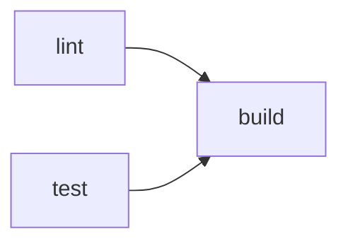

# 環境構築

swarm-viewer の開発環境・CI/CD・lint・format・Git Hooks を定める。構成の根拠は[アーキテクチャ設計](../architecture/overview.md)・[コンポーネント設計](../components/overview.md)、品質要件は[非機能要件](../requirements/non-functional.md)を参照する。

## 1. 概要

| 項目 | 内容 |
|------|------|
| 言語 | Go（Wails v3 の要求に合わせ **Go 1.26 以降**。`go.mod` の `go` ディレクティブで固定） |
| デスクトップシェル | Wails v3（v3.0.0 以降） |
| Web 層 | Gin + Huma + Templ + HTMX（HALT）、Tailwind CSS。初版は Lit なし |
| JS / CSS ツール | **bun**（Tailwind CLI・htmx の配置・Biome・linterly・Lefthook の実行）。npm / yarn / pnpm は使わない |
| タスクランナー | Taskfile（Wails v3 標準）。`task <名前>`（または `wails3 task <名前>`） |
| Lint / Format | Go: golangci-lint（gofmt・goimports を含む）、Templ: `templ fmt`、JS/CSS: Biome |
| 行数管理 | linterly |
| Git Hooks | Lefthook |
| CI | GitHub Actions（セルフホステッドランナー: Linux） |
| Swagger / OpenAPI | 対象外（§10） |
| 対応 OS（開発・配布） | Windows 11 / 最新 2 世代の macOS。CI のランナーは Linux のみ（§5.4 の制約と、Windows / macOS 向けの `go vet` による穴埋めを参照） |

- 生成物（Templ の `*_templ.go`、Tailwind の `static/dist/css/app.css`、`static/dist/js/*.js`）は**コミットしない**。clone 後・変更後は `task generate` で生成する（§3.2・§3.3）
- 生成物をコミットしない方針は、[アーキテクチャ設計 §9](../architecture/overview.md) の持ち越し事項（`_templ.go` をコミットするか）の確定である

## 2. ディレクトリ構造

[アーキテクチャ設計 §4.1](../architecture/overview.md) のとおり。環境構築で追加するファイルは次のとおり。

```
swarm-viewer/
├── .github/workflows/ci.yml   # CI（§5）
├── .golangci.yml              # Go の lint / format（§6）
├── .linterly.yml              # 行数管理（§8）
├── .linterlyignore
├── biome.json                 # JS/CSS の lint / format（§6）
├── lefthook.yml               # Git Hooks（§9）
├── Taskfile.yml               # タスクランナー（§3.2）
├── package.json               # bun の依存（devDependencies のみ）
├── bun.lock                   # bun のロックファイル（コミットする）
└── .gitignore                 # 生成物（*_templ.go・static/dist/ など）を除外
```

- `package.json` は **devDependencies のみ**（実行時の JS 依存はない。`static/dist/js/` に配置するのは htmx と自前の `app.js`）
- ロックファイルは `bun.lock`（bun のバージョンが出力する形式に従う）。`package-lock.json`・`yarn.lock`・`pnpm-lock.yaml` は作らない・コミットしない

## 3. 開発環境セットアップ

### 3.1 必要なツール

| ツール | 用途 | 導入 |
|--------|------|------|
| Go 1.26 以降 | ビルド・テスト | [公式手順](https://go.dev/doc/install)。`~/go/bin` を `PATH` に通す |
| bun | Tailwind CLI・Biome・linterly・Lefthook の実行 | [公式手順](https://bun.sh)。バージョンは最新の安定版 |
| Wails CLI（`wails3`） | ビルド・パッケージ | `go install github.com/wailsapp/wails/v3/cmd/wails3@v3.0.0` |
| Task（`task`） | タスクランナー | `wails3 task` でも実行できる。単体の `task` を使う場合は [公式手順](https://taskfile.dev/installation/) |
| golangci-lint | Go の lint / format | 公式のバイナリ導入手順。CI の action と同じメジャー版に揃える |
| templ | `.templ` の生成・整形 | `go.mod` の `tool` ディレクティブで版を固定し、`go tool templ …` で実行する（別途インストールしない） |
| 各 OS のプラットフォーム依存 | WebView・ビルド | 下表 |

プラットフォーム依存（[Wails のインストール手順](https://wails.io/getting-started/installation/)に従う。導入後に `wails3 doctor` で確認する）:

| OS | 依存 |
|----|------|
| macOS | Xcode Command Line Tools（`xcode-select --install`）。ビルドの対象は macOS 12.0 以降 |
| Windows | WebView2 Runtime（ほとんどの Windows 11 に導入済み） |
| Linux（CI ランナー用） | `gcc` などの標準ビルドツールと、`gtk4`・`webkitgtk-6.0` の開発パッケージ（Ubuntu 24.04 が対象）。必要なパッケージ名は `wails3 doctor` の出力に従う。**ランナーのホストに事前に導入しておく**（ジョブ内で `apt` は実行しない。§5.1） |

### 3.2 タスク一覧（`Taskfile.yml`）

| タスク | 内容 |
|--------|------|
| `task setup` | `bun install --frozen-lockfile` → `bunx lefthook install` → `task generate`。clone 直後に 1 回実行する |
| `task generate` | `go tool templ generate` → Tailwind CLI で `static/dist/css/app.css` を生成（`bunx @tailwindcss/cli -i static/src/css/app.css -o static/dist/css/app.css --minify`）→ htmx（と `response-targets` 拡張）を `node_modules` から、`app.js` を `static/src/js/` から `static/dist/js/` へコピー |
| `task fmt` | `golangci-lint fmt` → `go tool templ fmt .` → `bunx biome format --write .` |
| `task lint` | `golangci-lint run ./...` → `go tool templ fmt -fail .` → `bunx biome check .` → `bunx linterly check` |
| `task test` | `task generate` → `go test ./...` |
| `task build` | `task generate` → `wails3 build` |
| `task dev` | `wails3 dev`（Templ・Tailwind は `wails3 dev` から監視ビルドする設定を `Taskfile.yml` に持つ） |

- すべてのコマンド例は bun（`bun install`・`bunx`）で書く。`npm`・`npx`・`yarn`・`pnpm` は使わない
- `go build`・`go vet`・`go test`・golangci-lint は、生成物（`*_templ.go` と `static/dist/`、`go:embed` の対象）が無いと失敗する。**必ず先に `task generate`**（または `task setup`）を実行する。CI と Git Hooks もこの順で実行する

### 3.3 初回セットアップ手順

```sh
# 1. 取得
git clone https://github.com/ousiassllc/swarm-viewer.git
cd swarm-viewer

# 2. ツールの確認（Go 1.26 以降・bun・wails3・task・golangci-lint）
wails3 doctor

# 3. 依存の導入・Hooks の登録・生成物の作成
task setup

# 4. 動作確認
task test
task dev
```

## 4. 方針メモ（コード規約）

lint で機械的に守らせるアーキテクチャ上のルール（§6.1 の `depguard`・`forbidigo`）。

| ルール | 根拠 |
|--------|------|
| `internal/domain` は他層を import しない | [アーキテクチャ設計 §4.2](../architecture/overview.md) |
| `internal/repository` は `domain` だけに依存する | 同上 |
| `internal/service` は Wails（`github.com/wailsapp/wails/...`）を import しない | 同上。Wails 依存は `internal/app` に閉じ込める |
| `internal/web/handler` は `repository` を import しない | 同上 |
| `internal/web` は `internal/app` を import しない | [コンポーネント設計 §7](../components/overview.md) |
| `templ.Raw` を使わない | NFR-SEC-10（HTML として解釈しない） |
| `repository/report` から、許可リスト（`sessions_list`・`report`）以外のツール名を呼ばない | NFR-SEC-1。ツール名は定数で、レビューと単体テストで担保する |

## 5. CI/CD

### 5.1 プラットフォームとトリガー

| 項目 | 内容 |
|------|------|
| プラットフォーム | GitHub Actions（`.github/workflows/ci.yml`） |
| ランナー | **セルフホステッドランナー**。全ジョブに `runs-on: [self-hosted, linux, x64]` を指定する（ラベルは登録するランナーに合わせて実装時に確定する） |
| ランナーの前提 | ジョブは `apt` や `sudo` を使わない。Linux 向けの Wails のビルドには `gcc`・`gtk4`・`webkitgtk-6.0`・`libsoup-3.0` の開発パッケージ（§3.1）が要る。**現在のランナーホストにはこれらが未導入**のため、Linux のジョブは `internal/app` 直下と `main.go` を検査対象から外し、Windows 向け（CGO 不要）の検査で補う（§5.2）。開発パッケージをホストに導入したら、この除外と `build` ジョブの Windows 向けビルドを Linux 向けへ戻す。Go と bun は `actions/setup-go`・`oven-sh/setup-bun` でジョブごとに準備する |
| 実行の制限 | リポジトリは private。セルフホステッドランナーで信頼できないコードを実行しないよう、`pull_request` は同一リポジトリのブランチ（`github.event.pull_request.head.repo.full_name == github.repository`）のときだけジョブを実行する。リポジトリを public にする場合は、ランナーの利用を見直す |
| トリガー | `push`（`main` と `feat/**`）、`pull_request`（`main` 向け） |
| 並行実行 | 同じ ref の古い実行を `concurrency` でキャンセルする。ランナーが 1 台のときはジョブが直列に実行される |
| 作業ディレクトリ | ジョブの最初に `actions/checkout`（`clean: true`）で作業ツリーを初期化する。ランナーの `_work` に前回の生成物が残っていても、`task generate` が毎回作り直す |
| 権限 | `permissions: contents: read` のみ |

### 5.2 ジョブ構成（lint → test → build）



| ジョブ | 内容 |
|--------|------|
| `lint` | チェックアウト → Go（`actions/setup-go`、`go-version-file: go.mod`）・bun（`oven-sh/setup-bun`）の準備 → `bun install --frozen-lockfile` → **`task generate`（最初の検査より前に必ず実行）** → `golangci-lint`（`golangci/golangci-lint-action` で導入。Linux では Wails 直下を除いたパッケージ、続けて `GOOS=windows CGO_ENABLED=0` で `./...`）→ `go tool templ fmt -fail .` → `bunx biome check .` → `bunx linterly check` |
| `test` | 同じ準備 → **`task generate`** → `go vet`（Wails 直下を除く）→ Windows / macOS 向けの `go vet`（下記）→ `go test`（Wails 直下を除く。テストは固定時間の待ちに頼らない。[NFR-QLT-3](../requirements/non-functional.md)） |
| `build` | `lint`・`test` が成功したときだけ。同じ準備 → `task generate` → `GOOS=windows CGO_ENABLED=0 go build -tags production .`（Windows 向けのコンパイル確認。`wails3` CLI 自体が Linux で GTK 系の開発パッケージを要するため、CLI は使わず直接ビルドする。Linux 向けは上記の前提により現状行わない。成果物は配布しない） |

- Windows / macOS 向けの `go vet`（`test` ジョブ内）: OS 別のビルドタグを持つコード（`go-keyring`・SQLite ドライバ・`filepath` まわりなど）を、Linux のランナーでもコンパイルして検査する安価な穴埋め。Wails 依存の `internal/app` 直下と `main.go` は、Windows なら CGO なしでコンパイルできるため windows の検査に含める（darwin は CGO が要るため対象外）。
  - `CGO_ENABLED=0 GOOS=windows go vet ./...`
  - `CGO_ENABLED=0 GOOS=darwin go vet ./internal/domain/... ./internal/repository/... ./internal/service/... ./internal/web/...`
- `wails3 build` の実ビルド（Windows の NSIS インストーラ・macOS の `.app` を含む）は CI では行わない。**配布前の手動確認項目**とする（§5.4）
- `actions/setup-go` のキャッシュ保存は無効（`cache: false`）にする。セルフホステッドランナーで post ステップが 20 分以上止まりジョブがタイムアウトしたため。Go のモジュール・ビルドキャッシュはランナーのローカルに残る。bun のキャッシュは `oven-sh/setup-bun` の既定に任せる
- 生成物をコミットしないため、生成物の差分検知ステップ（`git diff --exit-code`）は置かない
- リリース用のワークフロー（Windows の NSIS インストーラ・macOS の `.app` を Releases へ配布）は、このドキュメントの範囲外。[NFR-DST-1](../requirements/non-functional.md) に従い別途定める

### 5.3 デプロイ

デプロイ設定は持たない（ネイティブアプリで、配布は GitHub Releases の手動リリース。[NFR-DST-3](../requirements/non-functional.md) のとおり自動更新もない）。

### 5.4 既知の制約（Linux ランナーのみの CI）

配布対象は Windows 11 / macOS だが、CI は Linux のランナーでしか動かない。次は**CI で検知できない**。

| 検知できないもの | 補完 |
|------------------|------|
| `internal/app`（Wails 依存）の Windows / macOS 固有のビルド失敗、`wails3 build` のパッケージング | 開発者本人の Windows / macOS 環境で、pre-push（`go test ./...`）と `task build` を実行する。**配布前に、それぞれの OS で `wails3 build` を実行し、実機確認（[アーキテクチャ設計 §11](../architecture/overview.md)）を行う**（手動確認項目） |
| `app` 以外の Windows / macOS 固有のコンパイルエラー | §5.2 の `GOOS=windows`・`GOOS=darwin` の `go vet` で拾う（ただし実行時の挙動は拾えない） |
| トレイ・OS 通知・URL スキームの動作 | 自動テスト対象外。実機で確認する |
| Windows のパス・改行（CRLF）に依存する不具合 | `.gitattributes` で `* text=auto eol=lf` を指定し、パス処理は `path/filepath` を使う |

OS 別のマトリクス（Windows / macOS のセルフホステッドランナーの追加）は、Windows / macOS 固有の破損が実際に見つかった時点で検討する。

## 6. Lint

| 対象 | ツール | 設定ファイル |
|------|--------|-------------|
| Go | golangci-lint（v2 系の設定形式） | `.golangci.yml` |
| Templ | `templ fmt`（整形のみ。lint はない） | なし（`task lint` が `go tool templ fmt -fail .` で未整形を検知する） |
| JS / CSS | Biome | `biome.json` |

### 6.1 golangci-lint

- 有効にするリンター（初期セット。実装の Issue で必要に応じて調整する）: `errcheck`・`govet`・`staticcheck`・`unused`・`ineffassign`・`gosec`・`bodyclose`・`errorlint`・`depguard`・`forbidigo`
- `gosec`: token・ファイル権限（SQLite は `0600`）・平文通信まわりの誤りを拾うため有効にする。tailnet 内 HTTP は仕様（NFR-SEC-6）なので、該当箇所だけ理由つきの `//nolint:gosec` を許可する
- `depguard`・`forbidigo`: §4 のルールを機械的に守らせる。層ごとにパス別のルールを定義する
- 生成コード（`*_templ.go`）は golangci-lint の既定の除外（`generated: lax`）に任せる
- `//nolint` は**必ず理由を書く**（`nolintlint` を有効にして理由なしを禁止する）

### 6.2 Biome

- 対象: `static/src/js/app.js`、`static/src/css/app.css`（Tailwind のディレクティブを含む。Biome の CSS 解析で Tailwind ディレクティブを許可する設定を `biome.json` に持つ）
- 対象外: `static/dist/`（生成物）、`node_modules/`、`.templ` と Go ファイル
- lint と format は `biome check` に統合する（`bunx biome check .`）

## 7. Format

| 対象 | ツール | 実行 |
|------|--------|------|
| Go | `golangci-lint fmt`（`gofmt` と `goimports`。`.golangci.yml` の `formatters` に定義） | `task fmt` |
| Templ | `go tool templ fmt` | `task fmt` |
| JS / CSS | Biome の format | `task fmt`（`bunx biome format --write .`） |

- エディタの保存時フォーマットは各自の設定に任せる。リポジトリには `.editorconfig`（`indent_style`・`end_of_line = lf`・`insert_final_newline`）だけを置く
- コミットされるコードは必ず Git Hooks（§9）の format を通る

## 8. Linterly

行数管理ツール。ファイル・ディレクトリ単位で行数上限を設け、肥大化を防ぐ。

| 項目 | 内容 |
|------|------|
| 導入 | `bun add -D @linterly/cli`（`package.json` の devDependencies） |
| 実行 | `bunx linterly check`（`task lint`・CI・pre-commit） |
| 設定ファイル | `.linterly.yml` |

`.linterly.yml`:

```yaml
rules:
  # max_lines_per_file / max_lines_per_directory はデフォルト値（300/2000）を使う。
  # 特別な理由がない限り変更しない。
  # max_lines_per_file: 300
  # max_lines_per_directory: 2000
  warning_threshold: 10       # 早めに警告を出す

count_mode: all               # 変更しない
default_excludes: true        # ビルド成果物等のデフォルト除外を有効化
language: ja

# ignore でパス別に除外する場合も慎重に。
# 生成コードなど明確な理由がある場合のみ追加する。
```

`.linterlyignore`:

```
# 手書きソースコードの除外は基本追加しない。
# 自動生成コードだけを除外する（生成物はコミットしないが、ローカルの作業ツリーには存在するため除外する）。
*_templ.go
```

- `max_lines_per_file`（300）・`max_lines_per_directory`（2000）は既定値のまま使う。超えそうなファイルは分割で対処し、ignore で逃がさない
- 実装の目安: Templ の部品は atoms / molecules / organisms の単位でファイルを分け、300 行に収める

## 9. Git Hooks

| 項目 | 内容 |
|------|------|
| ツール | Lefthook（`bun add -D lefthook`、`bunx lefthook install`。`task setup` が登録する） |
| 設定ファイル | `lefthook.yml` |
| ルール | `--no-verify` は使わない。フックが失敗したら原因を直す |

| フック | コマンド | 対象 |
|--------|---------|------|
| `pre-commit` | `generate`（`task generate`。**常に最初に実行**） | 生成物を最新にする（golangci-lint が `*_templ.go`・`static/dist/` の欠落で失敗しないように。`pull` で `.templ` が変わった直後でも古い生成物で検査しない） |
| | `go-fmt`（`golangci-lint fmt {staged_files}`、`stage_fixed: true`） | ステージ済みの `*.go` |
| | `templ-fmt`（`go tool templ fmt {staged_files}`、`stage_fixed: true`） | ステージ済みの `*.templ` |
| | `golangci-lint`（`golangci-lint run ./...`） | Go 全体 |
| | `biome`（`bunx biome check --write {staged_files}`、`stage_fixed: true`） | ステージ済みの `static/src/**` の JS/CSS |
| | `linterly`（`bunx linterly check {staged_files}`） | ステージ済みのファイル |
| `pre-push` | `test`（`go test ./...`。`task generate` の後） | リポジトリ全体 |

- `go test ./...` は開発者のローカル OS で `internal/app`（Wails 依存）も含めてコンパイル・テストする。Windows / macOS 固有の破損は、ここで初めて拾える（CI は Linux のランナーのみ。§5.4）
- `pre-push` が遅い場合は、まず `go test` のキャッシュに頼る。コマンドの対象を減らす変更は、その理由とともにこの表を更新する

## 10. Swagger / OpenAPI

**対象外**。viewer は外部に公開する JSON API を持たず（[API 仕様](../api/endpoints.md)冒頭）、Huma で登録する JSON オペレーションは初版では 0 本のため、Swagger の生成・UI（Stoplight Elements）・`SWAGGER_ENABLED`・生成忘れ検知の CI は設けない。

Lit を導入して `/api/v1/...` を Huma に登録する時点で、次を追加する。

- 仕様生成: Huma が自動生成する OpenAPI（`/api/v1/openapi.json`）
- UI: Stoplight Elements（静的 HTML を `/swagger` で配信。`SWAGGER_ENABLED` で有効/無効を切り替え、開発では `true`、本番では `false`）
- CI: 生成した OpenAPI の差分検知

## 改訂履歴

| 版 | 日付 | 変更内容 | 変更理由 |
|----|------|---------|---------|
| 1.0 | 2026-11-03 | 新規作成 | 初版 |
| 1.1 | 2026-11-03 | CI のランナーをセルフホステッド（Linux）に変更。ジョブ内の `apt` を廃止して事前導入前提にした。Windows / macOS 向けの `go vet` を追加。pre-commit の `task generate` を常時実行に変更 | 実行環境の指定と、Linux CI では拾えないビルドタグ依存コードの穴埋め |
| 1.2 | 2026-11-04 | CI: Linux ランナーに GTK 系の開発パッケージが無いため Linux の検査から Wails 直下を外し Windows 向け検査で補う。`build` を `wails3 build` から Windows 向けの `go build` に変更。`setup-go` のキャッシュを無効化 | 実ランナーの環境と、post ステップの停止 |
