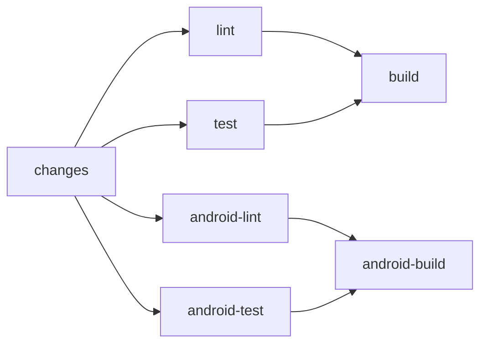
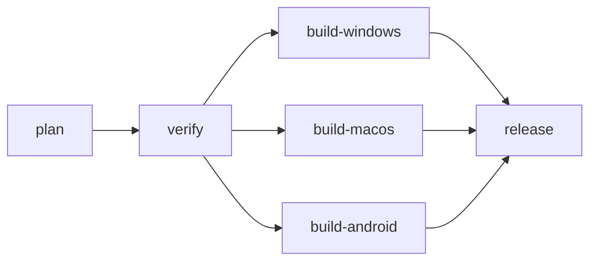

# 環境構築

swarm-viewer の開発環境・CI/CD・lint・format・Git Hooks を定める。構成の根拠は[アーキテクチャ設計](../architecture/overview.md)・[コンポーネント設計](../components/overview.md)、品質要件は[非機能要件](../requirements/non-functional.md)を参照する。

## 1. 概要

| 項目 | 内容 |
|------|------|
| 言語 | Go（Wails v3 の要求に合わせ **Go 1.26 以降**。`go.mod` の `go` ディレクティブで固定） |
| デスクトップシェル | Wails v3（v3.0.0 以降） |
| Web 層 | Gin + Huma + Templ + HTMX（HALT）、Tailwind CSS。初版は Lit なし |
| JS / CSS ツール | **bun**（Tailwind CLI・htmx の配置・Biome・linterly・Lefthook の実行）。npm / yarn / pnpm は使わない |
| タスクランナー | Taskfile（Wails v3 標準）。`task <名前>`（または `wails3 task <名前>`） |
| Lint / Format | Go: golangci-lint（gofmt・goimports を含む）、Templ: `templ fmt`、JS/CSS: Biome |
| 行数管理 | linterly |
| Git Hooks | Lefthook |
| CI | GitHub Actions（セルフホステッドランナー: Linux） |
| Swagger / OpenAPI | 対象外（§10） |
| 対応 OS（開発・配布） | Windows 11 / 最新 2 世代の macOS。CI のランナーは Linux のみ（§5.4 の制約と、Windows / macOS 向けの `go vet` による穴埋めを参照）。Android 版は §11 |

- 生成物（Templ の `*_templ.go`、Tailwind の `static/dist/css/app.css`、`static/dist/js/*.js`）は**コミットしない**。clone 後・変更後は `task generate` で生成する（§3.2・§3.3）
- 生成物をコミットしない方針は、[アーキテクチャ設計 §9](../architecture/overview.md) の持ち越し事項（`_templ.go` をコミットするか）の確定である
- Android 版（同じリポジトリの `android/`。Kotlin + Jetpack Compose）の開発環境・CI・署名鍵・リリースは [§11](#11-android-版) に定める。§1〜§10 は、断りがない限りデスクトップ版（Go）の定義

## 2. ディレクトリ構造

[アーキテクチャ設計 §4.1](../architecture/overview.md) のとおり。環境構築で追加するファイルは次のとおり。

```
swarm-viewer/
├── .github/workflows/ci.yml   # CI（§5.1〜§5.4）
├── .github/workflows/release.yml  # リリース（§5.5）
├── .github/scripts/           # release.yml が使うスクリプト（plan-release.sh・set-version.sh・install-nsis.sh）とそのテスト
├── .golangci.yml              # Go の lint / format（§6）
├── .linterly.yml              # 行数管理（§8）
├── .linterlyignore
├── biome.json                 # JS/CSS の lint / format（§6）
├── lefthook.yml               # Git Hooks（§9）
├── Taskfile.yml               # タスクランナー（§3.2）
├── package.json               # bun の依存（devDependencies のみ）
├── bun.lock                   # bun のロックファイル（コミットする）
├── .gitignore                 # 生成物（*_templ.go・static/dist/ など）を除外
├── android/                   # Android 版（Gradle プロジェクト。§11）
└── testdata/vectors/          # デスクトップ（Go）と Android（Kotlin）が共有するテストベクタ（§11.5）
```

- `package.json` は **devDependencies のみ**（実行時の JS 依存はない。`static/dist/js/` に配置するのは htmx と自前の `app.js`。フォントの woff2 は変換済みのものを `static/src/fonts/` にコミットし、ビルドでは変換しない）
- ロックファイルは `bun.lock`（bun のバージョンが出力する形式に従う）。`package-lock.json`・`yarn.lock`・`pnpm-lock.yaml` は作らない・コミットしない

## 3. 開発環境セットアップ

### 3.1 必要なツール

| ツール | 用途 | 導入 |
|--------|------|------|
| Go 1.26 以降 | ビルド・テスト | [公式手順](https://go.dev/doc/install)。`~/go/bin` を `PATH` に通す |
| bun | Tailwind CLI・Biome・linterly・Lefthook の実行 | [公式手順](https://bun.sh)。バージョンは最新の安定版 |
| Wails CLI（`wails3`） | ビルド・パッケージ | `go install github.com/wailsapp/wails/v3/cmd/wails3@v3.0.0` |
| Task（`task`） | タスクランナー | `wails3 task` でも実行できる。単体の `task` を使う場合は [公式手順](https://taskfile.dev/installation/) |
| golangci-lint | Go の lint / format | 公式のバイナリ導入手順。CI の action と同じメジャー版に揃える |
| templ | `.templ` の生成・整形 | `go.mod` の `tool` ディレクティブで版を固定し、`go tool templ …` で実行する（別途インストールしない） |
| 各 OS のプラットフォーム依存 | WebView・ビルド | 下表 |

プラットフォーム依存（[Wails のインストール手順](https://wails.io/getting-started/installation/)に従う。導入後に `wails3 doctor` で確認する）:

| OS | 依存 |
|----|------|
| macOS | Xcode Command Line Tools（`xcode-select --install`）。ビルドの対象は macOS 12.0 以降 |
| Windows | WebView2 Runtime（ほとんどの Windows 11 に導入済み） |
| Linux（CI ランナー用） | `gcc` などの標準ビルドツールと、`gtk4`・`webkitgtk-6.0` の開発パッケージ（Ubuntu 24.04 が対象）。必要なパッケージ名は `wails3 doctor` の出力に従う。**ランナーのホストに事前に導入しておく**（ジョブ内で `apt` は実行しない。§5.1） |

### 3.2 タスク一覧（`Taskfile.yml`）

| タスク | 内容 |
|--------|------|
| `task setup` | `bun install --frozen-lockfile` → `bunx lefthook install` → `task generate`。clone 直後に 1 回実行する |
| `task generate` | `go tool templ generate` → Tailwind CLI で `static/dist/css/app.css` を生成（`bunx @tailwindcss/cli -i static/src/css/app.css -o static/dist/css/app.css --minify`）→ htmx（と `response-targets` 拡張）を `node_modules` から、`app.js` を `static/src/js/` から `static/dist/js/` へコピー → 同梱フォントの woff2（Sora・Noto Sans JP・JetBrains Mono・Symbols Nerd Font。コミット済みの `static/src/fonts/`）を `static/dist/fonts/` へコピー |
| `task fmt` | `golangci-lint fmt` → `go tool templ fmt .` → `bunx biome format --write .` |
| `task lint` | `golangci-lint run ./...` → `go tool templ fmt -fail .` → `bunx biome check .` → `bunx linterly check` |
| `task test` | `task generate` → `go test ./...` |
| `task build` | `task generate` → `wails3 build` |
| `task dev` | `wails3 dev`（Templ・Tailwind は `wails3 dev` から監視ビルドする設定を `Taskfile.yml` に持つ） |

- すべてのコマンド例は bun（`bun install`・`bunx`）で書く。`npm`・`npx`・`yarn`・`pnpm` は使わない
- `go build`・`go vet`・`go test`・golangci-lint は、生成物（`*_templ.go` と `static/dist/`、`go:embed` の対象）が無いと失敗する。**必ず先に `task generate`**（または `task setup`）を実行する。CI と Git Hooks もこの順で実行する

### 3.3 初回セットアップ手順

```sh
# 1. 取得
git clone https://github.com/ousiassllc/swarm-viewer.git
cd swarm-viewer

# 2. ツールの確認（Go 1.26 以降・bun・wails3・task・golangci-lint）
wails3 doctor

# 3. 依存の導入・Hooks の登録・生成物の作成
task setup

# 4. 動作確認
task test
task dev
```

## 4. 方針メモ（コード規約）

lint で機械的に守らせるアーキテクチャ上のルール（§6.1 の `depguard`・`forbidigo`）。

| ルール | 根拠 |
|--------|------|
| `internal/domain` は他層を import しない | [アーキテクチャ設計 §4.2](../architecture/overview.md) |
| `internal/repository` は `domain` だけに依存する | 同上 |
| `internal/service` は Wails（`github.com/wailsapp/wails/...`）を import しない | 同上。Wails 依存は `internal/app` に閉じ込める |
| `internal/web/handler` は `repository` を import しない | 同上 |
| `internal/web` は `internal/app` を import しない | [コンポーネント設計 §7](../components/overview.md) |
| `templ.Raw` を使わない | NFR-SEC-10（HTML として解釈しない） |
| `repository/report` から、許可リスト（`sessions_list`・`report`）以外のツール名を呼ばない | NFR-SEC-1。ツール名は定数で、レビューと単体テストで担保する |

## 5. CI/CD

### 5.1 プラットフォームとトリガー

| 項目 | 内容 |
|------|------|
| プラットフォーム | GitHub Actions（`.github/workflows/ci.yml`） |
| ランナー | **セルフホステッドランナー**。全ジョブに `runs-on: [self-hosted, linux, x64]` を指定する（ラベルは登録するランナーに合わせて実装時に確定する） |
| ランナーの前提 | ジョブは `apt` や `sudo` を使わない。Linux 向けの Wails のビルドには `gcc`・`gtk4`・`webkitgtk-6.0`・`libsoup-3.0` の開発パッケージ（§3.1）が要る。**現在のランナーホストにはこれらが未導入**のため、Linux のジョブは `internal/app` 直下と `main.go` を検査対象から外し、Windows 向け（CGO 不要）の検査で補う（§5.2）。開発パッケージをホストに導入したら、この除外と `build` ジョブの Windows 向けビルドを Linux 向けへ戻す。Go と bun は `actions/setup-go`・`oven-sh/setup-bun` でジョブごとに準備する |
| 実行の制限 | リポジトリは private。セルフホステッドランナーで信頼できないコードを実行しないよう、`pull_request` は同一リポジトリのブランチ（`github.event.pull_request.head.repo.full_name == github.repository`）のときだけジョブを実行する。リポジトリを public にする場合は、ランナーの利用を見直す |
| トリガー | `push`（`main` と `feat/**`）、`pull_request`（`main` 向け） |
| 並行実行 | 同じ ref の古い実行を `concurrency` でキャンセルする。ランナーが 1 台のときはジョブが直列に実行される |
| 作業ディレクトリ | ジョブの最初に `actions/checkout`（`clean: true`）で作業ツリーを初期化する。ランナーの `_work` に前回の生成物が残っていても、`task generate` が毎回作り直す |
| 権限 | `permissions: contents: read` のみ |
| Go 側と Android 側の出し分け | 先頭の `changes` ジョブが、変更されたファイルから Go 側（`lint`・`test`・`build`）と Android 側（`android-lint`・`android-test`・`android-build`）のどちらを動かすかを決め、各ジョブの `if` で出し分ける。`paths` で workflow ごと止めない（必須チェックが pending のまま残るため）。skip したジョブは必須チェックでは成功として扱われる。詳細は §11.2 |

### 5.2 ジョブ構成（changes → lint / test → build、Android は並行）



| ジョブ | 内容 |
|--------|------|
| `changes` | `lint`・`test` より前に動く。変更されたファイルから、Go 側と Android 側のどちらのジョブを動かすかを `go`・`android` の出力にする（`.github/scripts/detect-changes.sh`。§11.2）。fork の PR では動かさない |
| `lint` | チェックアウト → Go（`actions/setup-go`、`go-version-file: go.mod`）・bun（`oven-sh/setup-bun`）の準備 → `bun install --frozen-lockfile` → **`task generate`（最初の検査より前に必ず実行）** → `golangci-lint`（`golangci/golangci-lint-action` で導入。Linux では Wails 直下を除いたパッケージ、続けて `GOOS=windows CGO_ENABLED=0` で `./...`）→ `go tool templ fmt -fail .` → `bunx biome check .` → `bunx linterly check` |
| `test` | 同じ準備 → **`task generate`** → `go vet`（Wails 直下を除く）→ Windows / macOS 向けの `go vet`（下記）→ `go test`（Wails 直下を除く。テストは固定時間の待ちに頼らない。[NFR-QLT-3](../requirements/non-functional.md)）→ `bash .github/scripts/plan-release_test.sh`（リリースの版を決める `plan-release.sh` の表駆動テスト。ネットワーク不要。§5.5）→ `bash .github/scripts/install-nsis_test.sh`（NSIS の取得の再試行・sha256 検証のテスト。ネットワーク不要。§5.5）→ `bash .github/scripts/android-version_test.sh`（Android の `versionName`・`versionCode` を決める `android-version.sh` の表駆動テスト。§11.4）→ `bash .github/scripts/sign-android-apk_test.sh`（APK の署名・検証・後始末のテスト。`apksigner` などは偽物に差し替え、SDK 不要。§11.4）→ `bash .github/scripts/detect-changes_test.sh`（下の `changes` ジョブの変更検知のテスト。§11.2） |
| `build` | `lint`・`test` が成功したときだけ。同じ準備 → `task generate` → `GOOS=windows CGO_ENABLED=0 go build -tags production .`（Windows 向けのコンパイル確認。`wails3` CLI 自体が Linux で GTK 系の開発パッケージを要するため、CLI は使わず直接ビルドする。Linux 向けは上記の前提により現状行わない。成果物は配布しない） |
| `android-lint`・`android-test`・`android-build` | Android（`android/**`）の検査。`changes` ジョブが Android 側を動かすと決めたときだけ動く。内容は §11.2 |

- Windows / macOS 向けの `go vet`（`test` ジョブ内）: OS 別のビルドタグを持つコード（`go-keyring`・SQLite ドライバ・`filepath` まわりなど）を、Linux のランナーでもコンパイルして検査する安価な穴埋め。Wails 依存の `internal/app` 直下と `main.go` は、Windows なら CGO なしでコンパイルできるため windows の検査に含める（darwin は CGO が要るため対象外）。
  - `CGO_ENABLED=0 GOOS=windows go vet ./...`
  - `CGO_ENABLED=0 GOOS=darwin go vet ./internal/domain/... ./internal/repository/... ./internal/service/... ./internal/web/...`
- `wails3 build` の実ビルド（Windows の NSIS インストーラ・macOS の `.app` を含む）は CI では行わない。配布物は release.yml（§5.5）が GitHub ホストランナーで作り、**その成果物を実機で確認する**（§5.4）
- `actions/setup-go` のキャッシュ保存は無効（`cache: false`）にする。セルフホステッドランナーで post ステップが 20 分以上止まりジョブがタイムアウトしたため。Go のモジュール・ビルドキャッシュはランナーのローカルに残る。bun のキャッシュは `oven-sh/setup-bun` の既定に任せる
- 生成物をコミットしないため、生成物の差分検知ステップ（`git diff --exit-code`）は置かない
- リリース（Windows の NSIS インストーラ・macOS の `.app`・Android の署名済み APK を Releases へ配布）は release.yml が行う。トリガー・ジョブ構成・ランナー・権限・成果物は §5.5 に定める（[NFR-DST-1](../requirements/non-functional.md)）

### 5.3 デプロイ

配布は GitHub Releases。`vX.Y.Z` のタグが付くと release.yml が成果物を作って Release を公開する（§5.5。main の CI 成功で自動に付く場合と、手で打つ場合がある）。サーバーへのデプロイ設定は持たない（ネイティブアプリで、[NFR-DST-3](../requirements/non-functional.md) のとおり自動更新もない）。

### 5.4 既知の制約（Linux ランナーのみの CI）

配布対象は Windows 11 / macOS だが、CI は Linux のランナーでしか動かない。次は**CI で検知できない**。

| 検知できないもの | 補完 |
|------------------|------|
| `internal/app`（Wails 依存）の Windows / macOS 固有のビルド失敗、`wails3 build` のパッケージング | 開発者本人の Windows / macOS 環境で、pre-push（`go test ./...`）と `task build` を実行する。パッケージング（NSIS・`.app`）は release.yml（§5.5）が作るので、**Release の成果物を各 OS にインストールして実機確認（[アーキテクチャ設計 §11](../architecture/overview.md)）を行う**（手動確認項目。下記の「Release の成果物の実機確認」） |
| `app` 以外の Windows / macOS 固有のコンパイルエラー | §5.2 の `GOOS=windows`・`GOOS=darwin` の `go vet` で拾う（ただし実行時の挙動は拾えない） |
| トレイ・OS 通知・URL スキームの動作 | 自動テスト対象外。実機で確認する |
| Windows のパス・改行（CRLF）に依存する不具合 | `.gitattributes` で `* text=auto eol=lf` を指定し、パス処理は `path/filepath` を使う |

OS 別のマトリクス（Windows / macOS のセルフホステッドランナーの追加）は、Windows / macOS 固有の破損が実際に見つかった時点で検討する。

Release の成果物の実機確認（手動確認項目）:

1. Release の `SHA256SUMS` と、ダウンロードしたファイルの `sha256sum -c SHA256SUMS`（Windows は `Get-FileHash`）が一致する
2. Windows 11: インストーラを実行して起動する。ファイルのプロパティの製品バージョンがタグと一致する。`swarm-viewer://` のリンクでアプリが開く
3. macOS（Apple Silicon。可能なら Intel も）: zip を展開し、README の回避手順で起動する。`CFBundleShortVersionString` がタグと一致する。`swarm-viewer://` のリンクでアプリが開く
4. トレイ・通知など [アーキテクチャ設計 §11](../architecture/overview.md) の残りの項目

### 5.5 リリース

`.github/workflows/release.yml`。構成は ousiassllc/swarm-console の release.yml に合わせる。

| 項目 | 内容 |
|------|------|
| 成果物 | Release に次のファイルを載せる。`swarm-viewer_vX.Y.Z_windows_amd64_installer.exe`（NSIS インストーラ。`INSTALL_SCOPE` は Taskfile 既定の `machine`＝管理者権限）、`swarm-viewer_vX.Y.Z_darwin_universal.zip`（amd64 + arm64 のユニバーサル `.app` を `ditto` で zip にしたもの）、`swarm-viewer_vX.Y.Z_android_universal.apk`（署名済みの Android APK。署名鍵のシークレットが未登録なら載せない。§11.3・§11.4）、`SHA256SUMS`（上のファイルの `sha256sum`。`sha256sum -c SHA256SUMS`・`Get-FileHash` で確かめられる）。Windows は amd64 のみ。Linux 向けは配布しない |
| トリガー | (1) `workflow_run`: main への push の CI（`ci.yml`）が成功したら、main の先頭に次のパッチ版のタグを自動で付けてリリースする。(2) `push` の `v*` タグ: 手で打った `vX.Y.Z`。マイナー・メジャーを上げるときに使う。PR・フォーク・main 以外のブランチの CI では動かない |
| 版の決め方 | タグは厳密に `vX.Y.Z`（先頭の `v` あり、プレリリース・ビルドメタデータ・先頭の 0 は不可）。自動のときは、形の合う既存タグの最大のパッチ + 1（数として比較する。`v0.1.10` > `v0.1.9`）、無ければ `v0.1.0`。手で打つときは、既存の最大より大きいことを要する（GitHub の「最新のリリース」が古い版に戻らないため）。形の合わないタグでは Release を作らず失敗させる。決める処理は `.github/scripts/plan-release.sh`（テストは `plan-release_test.sh`。CI の `test` ジョブが実行する） |
| 古いコミット・main 以外 | 自動のタグは、CI が成功したコミットが **main の先頭**のときだけ付ける（古いコミットに新しい版を付けない。先頭に既に `v*` タグがあれば何もしない）。さらに verify ジョブが、リリースするコミットが **main の履歴にある**ことと、そのコミットで **`ci.yml` が成功している**ことを確かめる。手で打ったタグがこれを満たさなければ Release は作られない。lint・test は release.yml 内では再実行しない |
| 版の埋め込み | タグが版の唯一の元。ビルド前に `.github/scripts/set-version.sh` が `build/config.yml` の `info.version` をタグの `X.Y.Z` に書き換え、`task common:update:build-assets`（`wails3 update build-assets`）で `Info.plist`（`CFBundleShortVersionString`・`CFBundleVersion`）・`build/windows/info.json`（Windows のファイルのプロパティ）・`wails_tools.nsh`・`wails.exe.manifest` を再生成し、各ファイルに版が入ったことを確かめる（入っていなければ失敗）。このコマンドは `project.nsi`・各 Taskfile・`protocols` の設定には触れず、plist は既存の内容にマージする。ビルド後に、Windows は exe とインストーラの固定の版（`FileVersionRaw` = `X.Y.Z.0`）とインストーラの `ProductVersion` の文字列（exe の文字列欄は .NET の `VersionInfo` では空に見えるため見ない。Explorer のプロパティ表示は実機確認。§5.4）、macOS は `Info.plist` の版・URL スキーム・universal（`x86_64` と `arm64`）・署名の検証も行う。アプリ内の版の表示は持たない（`main.go` に `version` 変数はない） |
| ジョブ構成 | 下図 |
| ランナー | `plan`・`verify`・`release` は `ubuntu-latest`、`build-windows` は `windows-latest`、`build-macos` は `macos-latest`（いずれも GitHub ホストランナー）。**`build-android` だけは既存の Linux セルフホステッドランナー**（`[self-hosted, linux, x64]`。JDK 17・Android SDK は無ければジョブの最初にダウンロードする。§11.2）。リリースするのは `verify` を通った main の履歴のコミットだけなので、セルフホステッドでも信頼できないコードは動かない。**CI（`ci.yml`）はセルフホステッドだが、Windows / macOS のリリースは GitHub ホストランナーを使う。リポジトリは private なので、リリースごとに Actions の分数を消費する**（macOS は倍率が大きい） |
| 権限 | 既定は `contents: read`。`contents: write` を持つのは `release` ジョブだけ（タグも `gh release create --target <コミット>` でここで作る。手で打ったタグは `--verify-tag`）。`verify` は `gh run list` のために `actions: read` も持つ。署名鍵のシークレットを参照するのは `build-android` の署名の step だけで、`release` ジョブはシークレットを持たない（§11.3） |
| 同時実行 | `concurrency: group: release`、`cancel-in-progress: false`。次の版を既存のタグから決めるため、2 本を同時に動かさない |
| ツール | Go・bun・Task は ci.yml と同じ action・版。`wails3` CLI は `go.mod` の版を `go install` する。NSIS（`makensis`）は 3.11 系に固定する（release.yml の `NSIS_VERSION`）。`.github/scripts/install-nsis.sh` が、PATH か既定の場所の `makensis` の版が `NSIS_VERSION` と一致すればそれを使い、そうでなければ公式配布の `nsis-3.11.zip`（SourceForge の固定 URL）を取得して sha256（スクリプト内の `NSIS_SHA256`。公式配布物を実際に取得して確かめた値）を検証し、展開して PATH に足す。取得・検証の失敗は 10 秒・30 秒・60 秒の待ちを挟んで最大 4 回試し、試行し切ったあとだけ原因（HTTP エラーまたは sha256 の不一致）付きの `::error::` で失敗する。Chocolatey は使わない（一時障害の 503 でリリースが止まったため）。使った版は `makensis -VERSION` でログに出る（`install-nsis.sh` と `Build the NSIS installer`）。版を上げるときは `NSIS_VERSION` と `NSIS_SHA256` を一緒に直す。使う action は GitHub 公式（`actions/*`）と `oven-sh/setup-bun`・`go-task/setup-task` だけ |
| 署名 | Windows / macOS は署名しない（unsigned。[NFR-DST-2](../requirements/non-functional.md)）。macOS は Taskfile 既定の ad-hoc 署名のまま。Release ノートの冒頭に、unsigned であることと README の回避手順への案内を入れる（`--notes` + `--generate-notes`）。**Android の APK だけは release 署名鍵で署名する**（`build-android` が `apksigner` で署名・検証する。§11.3・§11.4。シークレットを使うのはその署名の step だけ。ノートには Android の案内も 1 行足す） |



- `workflow_run` のワークフローは**既定ブランチ（main）にあるファイルだけ**が動く。release.yml と ci.yml が main に入るまで、自動のリリースは始まらない。また、タグを付けられるのは main の履歴にあるコミットだけなので、実装が main に入るまで最初のリリース（`v0.1.0`）は作れない
- プレリリース（`v0.1.0-rc.1` など）は出さない。タグは `vX.Y.Z` に限る。ドライランの代わりに、最初の自動リリース（`v0.1.0`）の成果物を §5.4 の手順で実機確認する

## 6. Lint

| 対象 | ツール | 設定ファイル |
|------|--------|-------------|
| Go | golangci-lint（v2 系の設定形式） | `.golangci.yml` |
| Templ | `templ fmt`（整形のみ。lint はない） | なし（`task lint` が `go tool templ fmt -fail .` で未整形を検知する） |
| JS / CSS | Biome | `biome.json` |

### 6.1 golangci-lint

- 有効にするリンター（初期セット。実装の Issue で必要に応じて調整する）: `errcheck`・`govet`・`staticcheck`・`unused`・`ineffassign`・`gosec`・`bodyclose`・`errorlint`・`depguard`・`forbidigo`
- `gosec`: token・ファイル権限（SQLite は `0600`）・平文通信まわりの誤りを拾うため有効にする。tailnet 内 HTTP は仕様（NFR-SEC-6）なので、該当箇所だけ理由つきの `//nolint:gosec` を許可する
- `depguard`・`forbidigo`: §4 のルールを機械的に守らせる。層ごとにパス別のルールを定義する
- 生成コード（`*_templ.go`）は golangci-lint の既定の除外（`generated: lax`）に任せる
- `//nolint` は**必ず理由を書く**（`nolintlint` を有効にして理由なしを禁止する）

### 6.2 Biome

- 対象: `static/src/js/app.js`、`static/src/css/app.css`（Tailwind のディレクティブを含む。Biome の CSS 解析で Tailwind ディレクティブを許可する設定を `biome.json` に持つ）
- 対象外: `static/dist/`（生成物）、`node_modules/`、`.templ` と Go ファイル
- lint と format は `biome check` に統合する（`bunx biome check .`）

## 7. Format

| 対象 | ツール | 実行 |
|------|--------|------|
| Go | `golangci-lint fmt`（`gofmt` と `goimports`。`.golangci.yml` の `formatters` に定義） | `task fmt` |
| Templ | `go tool templ fmt` | `task fmt` |
| JS / CSS | Biome の format | `task fmt`（`bunx biome format --write .`） |

- エディタの保存時フォーマットは各自の設定に任せる。リポジトリには `.editorconfig`（`indent_style`・`end_of_line = lf`・`insert_final_newline`）だけを置く
- コミットされるコードは必ず Git Hooks（§9）の format を通る

## 8. Linterly

行数管理ツール。ファイル・ディレクトリ単位で行数上限を設け、肥大化を防ぐ。

| 項目 | 内容 |
|------|------|
| 導入 | `bun add -D @linterly/cli`（`package.json` の devDependencies） |
| 実行 | `bunx linterly check`（`task lint`・CI・pre-commit） |
| 設定ファイル | `.linterly.yml` |

`.linterly.yml`:

```yaml
rules:
  # max_lines_per_file / max_lines_per_directory はデフォルト値（300/2000）を使う。
  # 特別な理由がない限り変更しない。
  # max_lines_per_file: 300
  # max_lines_per_directory: 2000
  warning_threshold: 10       # 早めに警告を出す

count_mode: all               # 変更しない
default_excludes: true        # ビルド成果物等のデフォルト除外を有効化
language: ja

# ignore でパス別に除外する場合も慎重に。
# 生成コードなど明確な理由がある場合のみ追加する。
```

`.linterlyignore`:

```
# 手書きソースコードの除外は基本追加しない。
# 自動生成コードだけを除外する（生成物はコミットしないが、ローカルの作業ツリーには存在するため除外する）。
*_templ.go
```

- `max_lines_per_file`（300）・`max_lines_per_directory`（2000）は既定値のまま使う。超えそうなファイルは分割で対処し、ignore で逃がさない
- 実装の目安: Templ の部品は atoms / molecules / organisms の単位でファイルを分け、300 行に収める

## 9. Git Hooks

| 項目 | 内容 |
|------|------|
| ツール | Lefthook（`bun add -D lefthook`、`bunx lefthook install`。`task setup` が登録する） |
| 設定ファイル | `lefthook.yml` |
| ルール | `--no-verify` は使わない。フックが失敗したら原因を直す |

| フック | コマンド | 対象 |
|--------|---------|------|
| `pre-commit` | `generate`（`task generate`。**常に最初に実行**） | 生成物を最新にする（golangci-lint が `*_templ.go`・`static/dist/` の欠落で失敗しないように。`pull` で `.templ` が変わった直後でも古い生成物で検査しない） |
| | `go-fmt`（`golangci-lint fmt {staged_files}`、`stage_fixed: true`） | ステージ済みの `*.go` |
| | `templ-fmt`（`go tool templ fmt {staged_files}`、`stage_fixed: true`） | ステージ済みの `*.templ` |
| | `golangci-lint`（`golangci-lint run ./...`） | Go 全体 |
| | `biome`（`bunx biome check --write {staged_files}`、`stage_fixed: true`） | ステージ済みの `static/src/**` の JS/CSS |
| | `linterly`（`bunx linterly check {staged_files}`） | ステージ済みのファイル |
| `pre-push` | `test`（`go test ./...`。`task generate` の後） | リポジトリ全体 |

- `go test ./...` は開発者のローカル OS で `internal/app`（Wails 依存）も含めてコンパイル・テストする。Windows / macOS 固有の破損は、ここで初めて拾える（CI は Linux のランナーのみ。§5.4）
- `pre-push` が遅い場合は、まず `go test` のキャッシュに頼る。コマンドの対象を減らす変更は、その理由とともにこの表を更新する

## 10. Swagger / OpenAPI

**対象外**。viewer は外部に公開する JSON API を持たず（[API 仕様](../api/endpoints.md)冒頭）、Huma で登録する JSON オペレーションは初版では 0 本のため、Swagger の生成・UI（Stoplight Elements）・`SWAGGER_ENABLED`・生成忘れ検知の CI は設けない。

Lit を導入して `/api/v1/...` を Huma に登録する時点で、次を追加する。

- 仕様生成: Huma が自動生成する OpenAPI（`/api/v1/openapi.json`）
- UI: Stoplight Elements（静的 HTML を `/swagger` で配信。`SWAGGER_ENABLED` で有効/無効を切り替え、開発では `true`、本番では `false`）
- CI: 生成した OpenAPI の差分検知

## 11. Android 版

Android 版（`android/`）の開発環境・CI・署名鍵・リリース。設計は[Android 版の設計](../android/overview.md)・[アーキテクチャ設計 §12](../architecture/overview.md)、要件は[非機能要件 §10](../requirements/non-functional.md)を参照する。

### 11.1 開発環境

| ツール | 版 | 導入 |
|--------|----|------|
| JDK | **17** | 任意のディストリビューション（Temurin など）。`JAVA_HOME` を設定する。Gradle は `kotlin { jvmToolchain(17) }` で 17 を使う |
| Android SDK | `platforms;android-35`、`build-tools;35.0.0` 以降 | Android Studio、または [cmdline-tools](https://developer.android.com/tools) の `sdkmanager`。`ANDROID_HOME` を設定するか、`android/local.properties` に `sdk.dir=<パス>` を書く（`local.properties` はコミットしない） |
| Gradle | `android/gradle/wrapper/gradle-wrapper.properties` で固定 | ラッパー（`./gradlew`）が取得する。別途インストールしない |
| 実機 | Android 10（API 29）以降。まず Galaxy Fold7 | 開発者向けオプションの USB デバッグ。実機でしか確認できない項目は[アーキテクチャ設計 §11](../architecture/overview.md) #8〜#15 |

- Android の開発に Go・bun・Wails は要らない（デスクトップ版の `task` とは独立）。テストベクタ（§11.5）を変えるときだけ、Go のテスト（`go test ./internal/domain/... ./internal/web/format/...`）も実行する
- `android/` で実行するコマンド:

| コマンド | 内容 |
|----------|------|
| `./gradlew lint ktlintCheck` | Android Lint（警告もエラー扱い）と ktlint（設定はルートの `.editorconfig`） |
| `./gradlew ktlintFormat` | ktlint の指摘を自動修正する |
| `./gradlew test` | JVM 上のユニットテスト（テストベクタを読む domain のテストを含む） |
| `./gradlew assembleDebug` | debug APK（debug 署名。**配布しない**） |

- push 前は `./gradlew lint ktlintCheck test` がクリーンに通ることを確認する。詳細は `android/README.md`
- Kotlin の手書きソースにも linterly（§8）の行数上限（1 ファイル 300 行・1 ディレクトリ 2,000 行）が掛かる。Gradle のビルド成果物・生成物（`android/.gradle/`・`android/**/build/` など）だけを除外している

### 11.2 CI（`android/**`）

Android の検査は、デスクトップ版と同じ `ci.yml`（§5）に `android-lint`・`android-test`・`android-build` の 3 ジョブとして置く。

| 項目 | 内容 |
|------|------|
| ワークフロー | `ci.yml` の 1 ファイル。**`paths` で workflow ごと止めない**（必須チェックが「実行されない」まま pending で残るため）。先頭の `changes` ジョブが、変更されたファイルから Go 側（`lint`・`test`・`build`）と Android 側（`android-*`）を動かすかを決め、各ジョブの `if` で出し分ける。`if` で skip したジョブは、必須チェックでは成功として扱われる |
| 変更の検知 | `.github/scripts/detect-changes.sh`（テストは `detect-changes_test.sh`。`test` ジョブが実行する）。`git diff --name-only <比較元> HEAD`（比較元は PR の base・push の before）の一覧を読む。**Go 側**: `android/` の外のファイルが 1 つでもあれば動かす（`android/**` だけの変更では動かさない）。**Android 側**: `android/**`・`testdata/vectors/**`（Android のテストも読む）・`ci.yml`・`.editorconfig`・`.linterly.yml`・`.linterlyignore`・`package.json`・`bun.lock` が変わったときに動かす。比較元が無い・差分が取れないとき（新しいブランチの最初の push など）は両方動かす（検査を飛ばして壊れた変更を通さない側に倒す） |
| ランナー | 既存と同じ Linux セルフホステッドランナー（`runs-on: [self-hosted, linux, x64]`）。**ランナーのホストには JDK・Android SDK を導入しない**（ランナーの設定・サービスにも触れない）。各ジョブの最初に `.github/scripts/setup-android-toolchain.sh` が、環境（`JAVA_HOME`・`ANDROID_HOME`）に JDK 17 と Android SDK が**無ければダウンロード**して使う（下の手順）。`apt` / `sudo` は使わない |
| 実行の制限 | §5.1 と同じ。`pull_request` は同一リポジトリのブランチのときだけジョブを実行する（セルフホステッドランナーで信頼できないコードを実行しない）。`changes` ジョブも同じ条件 |
| ジョブ | `android-lint`（`bunx linterly check`・`./gradlew lint ktlintCheck`。Go 側の `lint` ジョブは `android/**` だけの変更では動かないため、Kotlin の行数上限の検査（§8）をここでも行う）、`android-test`（`./gradlew test`）、`android-build`（`android-lint`・`android-test` が成功したときだけ。`./gradlew assembleDebug`。コンパイルの確認だけで、成果物は配布しない）。lint・test・build は別のコマンドで 1 つずつ実行する。各ジョブの最初に `setup-android-toolchain.sh`（無ければダウンロード）→ `.github/scripts/check-android-env.sh`（JDK 17 と SDK の有無を確かめ、**足りなければ不足を 1 行で示して失敗する**）の順に実行する |
| 権限 | `permissions: contents: read` のみ。署名鍵などのシークレットは使わない |
| キャッシュ | `actions/setup-java` などで Gradle のキャッシュを保存するステップは使わない（セルフホステッドで post ステップが止まった経緯。§5.2）。Gradle のキャッシュ（`GRADLE_USER_HOME`）はランナーのローカルに残る。ダウンロードした JDK・SDK は、ランナーのツールキャッシュ（`RUNNER_TOOL_CACHE`）の `swarm-viewer-toolchain/` に置き、2 回目以降のジョブは再利用してダウンロードしない（post ステップを使わない） |

JDK・Android SDK の取得（`setup-android-toolchain.sh`。`android-lint`・`android-test`・`android-build`・`build-android` の最初に実行する。ランナーのホストでの手作業は要らない）:

1. 環境（`JAVA_HOME`）が JDK 17 を指していればそれを使い、ダウンロードしない。無ければ Temurin 17.0.21+9 の tar.gz を取得し、**スクリプトに固定した sha256 を検証**してから、`${RUNNER_TOOL_CACHE}/swarm-viewer-toolchain/jdk-17.0.21+9/` に展開する
2. 環境（`ANDROID_HOME`）に `platforms/android-35` と `build-tools`（`apksigner`・`zipalign`・`aapt2`）が有ればそれを使う。無ければ Android の cmdline-tools（版と sha256 を固定。sha256 は Google の配布一覧の sha1 とも照合済み）を取得して `sdkmanager --licenses` に同意し、`platforms;android-35`・`build-tools;35.0.0`・`build-tools;36.0.0`（AGP の既定）を同じツールキャッシュの `android-sdk-<版>/` に入れる
3. 結果を `JAVA_HOME`・`ANDROID_HOME`・`ANDROID_SDK_ROOT`（`GITHUB_ENV`）と JDK の `bin`（`GITHUB_PATH`）に書き、後続の step で使えるようにする
4. 取得は 10 秒・30 秒・60 秒待って再試行し、最後まで失敗したら URL と試行回数を示して止まる。sha256 が違うときは再試行せず止まる。導入は `flock` で直列にし、一時ディレクトリへ展開してから rename する（同じホストでジョブが同時に動いても壊れない）
5. ログには `cache hit … no download` か `cache miss, downloading …` が出るので、ダウンロードが走ったかどうかを確かめられる。ツールキャッシュが空になったとき（ランナーの `_tool` を消したときなど）は、次のジョブがダウンロードし直す

ランナーのホストに JDK・SDK を入れて環境変数を設定済みなら、ダウンロードは走らない。

### 11.3 署名鍵

署名済みの APK を GitHub Releases で配布する（サイドロード。[NFR-AND-DST-1〜3](../requirements/non-functional.md)）。

| 項目 | 内容 |
|------|------|
| 鍵 | release 署名鍵を 1 つだけ作る（`keytool -genkeypair`、PKCS12、RSA 4096 bit 以上、有効期間 10,000 日以上）。毎回同じ鍵で署名する。署名が変わるとインストール済みのアプリを上書きアップデートできず、アンインストール（アプリのデータが消え、再ペアリングが必要）が要る |
| 作成する場所 | 開発者本人のローカル。リポジトリ・CI のログ・チャットに keystore とパスワードを出さない。`*.jks`・`*.keystore`・`*.apk`・`*.aab` は `.gitignore` 済み |
| CI シークレット | `ANDROID_KEYSTORE_BASE64`（keystore を `base64` した文字列）、`ANDROID_KEYSTORE_PASSWORD`、`ANDROID_KEY_ALIAS`、`ANDROID_KEY_PASSWORD`。**これらを参照するのは release.yml の `build-android` ジョブ（`release-android.yml` を `secrets:` で明示して呼ぶ。`secrets: inherit` は使わない）と、呼ばれた側の署名の step だけ**（`ANDROID_KEYSTORE_BASE64` の登録の有無だけは、呼ばれた側の `gate` の step が真偽値で見る）。`ci.yml` のジョブ・`release` ジョブ（書き込みトークンを持つ）・PR・フォークの CI には渡さない（release.yml は PR では動かない。§5.5）。`sign-android-apk.sh` は keystore を `$RUNNER_TEMP` 配下の一時ディレクトリへ `0600` で復元し、署名の直後と終了時（`trap`）に消す。落とされた場合に備え、ジョブも成否にかかわらず（`if: always()`）一時ディレクトリを消す。パスワードは `apksigner` に `env:` で渡し（引数に出さない）、ログに値を出さない |
| シークレットが無いとき | **`ANDROID_KEYSTORE_BASE64` が未登録なら、`build-android` は Android のビルドも署名もせずに終わり（失敗にしない）、Release には APK を載せない**（警告を出す）。シークレットとランナーの準備は運用作業なので、それが済むまでデスクトップ版（Windows / macOS）のリリースを止めないため。debug 署名の APK は、どの場合も載せない。`ANDROID_KEYSTORE_BASE64` はあるのに、ほかのシークレットが空・不正なときは設定ミスなので、`build-android` を失敗させて Release を作らない |
| バックアップ | 鍵を失うと上書きアップデートできないため、keystore とパスワードを、**リポジトリ・GitHub とは別の 2 か所以上**に保管する（例: パスワードマネージャーの添付と、オフラインの暗号化メディア）。keystore とパスワードは別々の場所にも置く。バックアップ先の実際の場所はリポジトリに書かない（開発者本人が管理する）。**GitHub のシークレットは登録後に値を読み戻せないため、シークレットはバックアップにならない**。鍵の作成後、バックアップの復元（keystore を開いて `keytool -list` できること）を一度確かめる |
| 証明書の確認 | 署名証明書の SHA-256 フィンガープリント（`keytool -list -v` / `apksigner verify --print-certs`）を、鍵の作成時に `android/README.md` へ記録する。Release の APK がこの値と一致することを、リリースのたびに確かめる（`build-android` のログにも `Signer #1 certificate SHA-256 digest` が出る。公開情報） |
| debug 署名 | `assembleDebug` の APK は debug 署名で、**配布しない**。CI の成果物・Release に debug 署名の APK を載せない。`assembleRelease` は署名設定を持たない（`android/app/build.gradle.kts` に `signingConfig` を置かず、署名は `build-android` が `apksigner` で行う）。`sign-android-apk.sh` は、署名後の APK の証明書が debug 証明書（`Android Debug`）なら失敗する |

鍵の作成とシークレットの登録（開発者本人のローカルで一度行う。**リポジトリのコードでは行わない**）:

```bash
# 1. keystore を作る（パスワードは対話で入力する。コマンドラインに書かない）
keytool -genkeypair -v -keystore swarm-viewer-release.p12 -storetype PKCS12 \
  -alias swarm-viewer -keyalg RSA -keysize 4096 -validity 10000
# 2. バックアップを 2 か所以上に保管し、復元を確かめる（keytool -list -keystore swarm-viewer-release.p12）
# 3. 証明書の SHA-256 を android/README.md に記録する
keytool -list -v -keystore swarm-viewer-release.p12 -alias swarm-viewer | grep SHA256
# 4. GitHub のシークレット（リポジトリの Settings → Secrets and variables → Actions）に登録する。値は標準入力から渡す
base64 -w0 swarm-viewer-release.p12 | gh secret set ANDROID_KEYSTORE_BASE64
gh secret set ANDROID_KEYSTORE_PASSWORD   # 入力を促される
gh secret set ANDROID_KEY_ALIAS           # swarm-viewer
gh secret set ANDROID_KEY_PASSWORD        # 入力を促される
# 5. ローカルの keystore を、バックアップ以外は削除する
```

### 11.4 リリース

Android 版も、デスクトップ版と同じ release.yml（§5.5）のタグ方式（`vX.Y.Z`。`workflow_run` による自動のパッチ版、または手で打ったタグ）で、**同じタグ・同じ Release** に載せる。

| 項目 | 内容 |
|------|------|
| 成果物 | `swarm-viewer_vX.Y.Z_android_universal.apk`（署名済み。`universal` は ABI を分けない 1 つの APK の意味で、`versionName` = `X.Y.Z`）。`SHA256SUMS` に含める（デスクトップ版の 2 ファイルと同じファイル。署名鍵が未登録のリリースでは、APK を含めない） |
| 版 | タグが唯一の元。`.github/scripts/android-version.sh`（テストは `android-version_test.sh`。`test` ジョブが実行する）が、タグの `X.Y.Z` を `versionName`、`X × 1,000,000 + Y × 1,000 + Z` を `versionCode` として決め、Gradle に `-PappVersionName`・`-PappVersionCode` で渡す（[NFR-AND-DST-4](../requirements/non-functional.md)）。`android/app/build.gradle.kts` は渡されないとき `0.1.0` / `1` を使う（`assembleDebug` など）。`Y`・`Z` は 999 まで、`X` は 2099 まで（超えたら `versionCode` が単調増加でなくなるため失敗する）。`v0.0.0` も失敗する。版が上がれば `versionCode` は必ず大きくなるので、同じ署名鍵で上書きインストールできる |
| ジョブ | release.yml の `build-android` ジョブが、再利用可能なワークフロー `release-android.yml`（`workflow_call`。release.yml を linterly の 300 行の上限に収めるため別ファイルにした）を呼ぶ。呼ばれた側のジョブは既存の Linux セルフホステッドランナーで動き、`contents: read` のみ。`android-version.sh` → `./gradlew --no-build-cache assembleRelease`（署名なし）→ `sign-android-apk.sh` の順に動く。`sign-android-apk.sh` は `apksigner sign` で署名し、`zipalign -c -P 16 4`（署名の前に境界を確認）・`apksigner verify`（v2 または v3。署名者は 1 つ）・debug 証明書でないこと・`aapt2 dump badging` でパッケージ・`versionCode`・`versionName` が期待どおりであることを確かめてから `swarm-viewer_vX.Y.Z_android_universal.apk` として置く。1 つでも外れたら APK を残さず失敗する。APK は artifact（`release-android`）として `release` ジョブへ渡し、`release` ジョブが `SHA256SUMS` に含めて `gh release create` する。`release` ジョブ（`contents: write`）はシークレットを持たない |
| 署名の道具 | `apksigner`・`zipalign`・`aapt2`（Android SDK の build-tools。`setup-android-toolchain.sh` が入れた、または環境にある版）。`build-android` の最初に `setup-android-toolchain.sh` を実行したうえで `check-android-env.sh`（`CHECK_SIGNING_TOOLS=true`）が、JDK 17・`ANDROID_HOME`・これらの道具の有無を確かめる |
| 前提 | Android のジョブが失敗したときに、デスクトップ版の Release だけが出ることがないように、`release` ジョブはすべてのビルドジョブ（`build-android` を含む）が成功したときだけ動く（§5.5 の構成と同じ）。ただし署名鍵が未登録のときは `build-android` が（何もせず）成功し、Android の成果物を含まない Release が出る（§11.3）。`release` ジョブは、`release-android` の artifact に署名済みの APK があるときだけ `SHA256SUMS` と Release に載せる |
| リリースの実行 | `release.yml` の `workflow_run` は main の CI の成功で起動する。**ランナーが未準備のあいだ、`android/**` を含む main への push の CI は赤になり、その push のリリースは作られない**（Go だけの変更の CI は影響を受けない） |

Release の APK の確認（検証手順と実機確認。手動確認項目）:

1. ダウンロードしたファイルと `SHA256SUMS` を同じディレクトリに置き、`sha256sum -c SHA256SUMS`（APK を含む。ほかの OS の成果物を落としていなければ `--ignore-missing`）が一致する
2. `apksigner verify --verbose --print-certs swarm-viewer_vX.Y.Z_android_universal.apk` が `Verifies` で、`Number of signers: 1`。`Signer #1 certificate SHA-256 digest` が、記録した値（§11.3）と一致し、`CN=Android Debug` でない（`apksigner` は `$ANDROID_HOME/build-tools/<版>/` にある）
3. Galaxy Fold7 に APK をインストールする（初回は「提供元不明のアプリ」の許可が要る）
4. 前の版が入った状態で、新しい APK を上書きインストールでき、接続・設定が残っている（同じ署名鍵）
5. `swarm-viewer://` のリンクでアプリが開く。そのほか[アーキテクチャ設計 §11](../architecture/overview.md) #8〜#15

### 11.5 テストベクタ

| 項目 | 内容 |
|------|------|
| 場所 | `testdata/vectors/*.json` と `testdata/vectors/README.md`（形式の説明） |
| 読むテスト | Go: `internal/domain/vectors/*_test.go`・`internal/web/format/vectors_test.go`（`go test` の対象パッケージ。CI の `test` ジョブ）。Kotlin: `android/app/src/test/kotlin/com/ousiassllc/swarmviewer/domain/`（`./gradlew test`） |
| 変更の規則 | ベクタを変えたら、Go と Kotlin の両方のテストが通ることを確かめる。仕様の変更は、ドキュメント・ベクタ・Go・Kotlin を 1 つの PR で揃える（[アーキテクチャ設計 §12.4](../architecture/overview.md)） |
| CI | ベクタの変更は Go の CI と Android の CI の両方を動かす（§11.2） |

## 改訂履歴

| 版 | 日付 | 変更内容 | 変更理由 |
|----|------|---------|---------|
| 1.0 | 2026-11-03 | 新規作成 | 初版 |
| 1.1 | 2026-11-03 | CI のランナーをセルフホステッド（Linux）に変更。ジョブ内の `apt` を廃止して事前導入前提にした。Windows / macOS 向けの `go vet` を追加。pre-commit の `task generate` を常時実行に変更 | 実行環境の指定と、Linux CI では拾えないビルドタグ依存コードの穴埋め |
| 1.2 | 2026-11-04 | CI: Linux ランナーに GTK 系の開発パッケージが無いため Linux の検査から Wails 直下を外し Windows 向け検査で補う。`build` を `wails3 build` から Windows 向けの `go build` に変更。`setup-go` のキャッシュを無効化 | 実ランナーの環境と、post ステップの停止 |
| 1.3 | 2026-11-04 | §5.5「リリース」を追加（release.yml のトリガー・版の決め方・ジョブ構成・ランナー・権限・成果物・`SHA256SUMS`）。§5.2 の `test` に `plan-release_test.sh` を追加。§5.3 を release.yml による配布に、§5.4 を Release の成果物での実機確認に更新 | Issue #3（Windows / macOS の配布物を CI で作り Releases へ載せる） |
| 1.4 | 2026-11-05 | `task generate` に、フォント（`static/src/fonts/` → `static/dist/fonts/`）のコピーを追加 | Issue #9 |
| 1.5 | 2026-11-05 | §5.5 の NSIS の導入を `choco install` から、公式配布 zip（3.11 固定・sha256 検証・再試行）を取得する `install-nsis.sh` に変更。§5.2 の `test` に `install-nsis_test.sh` を追加 | Issue #6（Chocolatey の一時障害でリリースが止まる） |
| 1.6 | 2026-11-05 | §11「Android 版」を追加（JDK 17・Android SDK の導入、`android/**` の CI、署名鍵の扱い、Android のリリース手順、テストベクタ）。§1・§2 に Android を追記 | Issue #15（Android 版の仕様書への反映） |
| 1.7 | 2026-11-05 | §11.2 を `ci.yml` への Android ジョブ（`android-lint`・`android-test`・`android-build`）の追加と、`changes` ジョブによる出し分けに確定（別の `android-ci.yml` は置かない）。ランナーへの JDK・SDK の導入手順を追記。§11.3 に署名のシークレットの参照先（`build-android` の署名の step）、未登録のときの扱い、鍵の作成・登録の手順を追記。§11.4 を `build-android` が署名する構成・成果物名 `swarm-viewer_vX.Y.Z_android_universal.apk`・版の決め方・検証手順に確定。§5.2・§5.5 に Android を追記 | Issue #22（Android の CI と署名済み APK のリリース） |
| 1.8 | 2026-11-05 | §11.2 の Android ジョブの JDK 17・Android SDK を、ランナーのホストへの事前導入から、ジョブの最初に `setup-android-toolchain.sh` が無ければダウンロードする方式に変更（固定版・sha256 検証・再試行・ランナーのツールキャッシュで再利用）。§5.2・§11.4 の関連記述を更新 | Issue #22（悠太さんの依頼: セルフホストランナーのまま、無ければダウンロード） |
