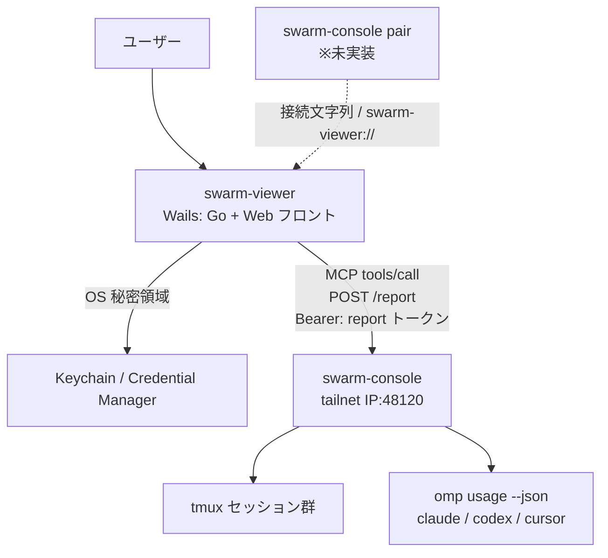

# プロジェクト概要

## 目的

デスクトップから、swarm-console が管理する tmux セッションの状態と、Claude Code・Codex の利用上限を **一目で** 確認できる読み取り専用アプリ（swarm-viewer）を提供する。

- tmux セッションごと・ペインごとに「どのエージェントが、いま何をしているか」を見る
- Claude Code（`claude`）と Codex（`codex`）の 5 時間枠・7 日枠の使用率とリセット時刻を見る
- 操作・送信・指示出しはしない。「本当にシンプル」を最優先にする

## 背景

- swarm-console（`ousiassllc/swarm-console`、接続先は main / 最新リリース v0.1.11）は MCP（Streamable HTTP, JSON-RPC 2.0）で `POST /report`（見るだけ）と `POST /ops`（見る＋操作）を公開している
- v0.1.11 でセッション分割（`sessions_list`、各ツールの `session` 引数、エラー `session_required` / `session_forbidden`）が入り、複数 tmux セッションを 1 トークンで扱える
- swarm-console は tailnet IP の 48120 のみ待ち受ける（`0.0.0.0` 不可）。viewer は同一 tailnet 上の端末から接続する
- `report` ツールの JSON 1 本で、ペイン状態・usage・attention が揃うため、viewer 専用のサーバ側 API 追加は不要。必要なのは **ペア UX（`pair` コマンド）** のみ

## スコープ

### 含むもの

- Tailscale（tailnet）経由で swarm-console の **`POST /report` のみ** に接続
- 読み取り専用トークン（scope=`report`）で MCP ツールを呼ぶ
- tmux セッションの一覧表示と **上段タブでの切り替え**（選択セッションのみ取得）。最後に選んだセッションは接続ごとに記憶し、次回起動時に復元する
- 選択セッションのペイン一覧（位置・エージェント・状態・タイトル・経過時間・activity・note 要約）
- 利用上限パネル（Claude / Codex / Cursor）とホスト負荷表示
- `attention` / `warnings` のバッジ・バナー表示
- 初回ペアリング（接続文字列の貼り付け／`swarm-viewer://` ディープリンク）、トークンの OS 秘密領域への保存、**複数接続の保存と切り替え**
- 10 秒（設定可能）の `report` ポーリングと手動更新
- 接続・認証・セッション許可のエラー表示
- Windows / macOS ネイティブアプリ（Wails）

### 含まないもの

- **`/ops` の利用**（操作ツール、`dispatch` を含む）
- ペインへの送信・選択・起動・終了・メモ書き込み
- `pane_tail` / `ask_card` / `report_read` の詳細ビュー
- インターネット公開・クラウド経由の中継
- Android 版（別トラック。同じ `/report` ＋ ペイロードで後続）
- swarm-console 本体の機能追加の実装（本リポの範囲外。`pair` コマンドの追加要望のみ非機能・API 仕様に記載）
- 自動更新、コード署名・公証（初版は手動入れ替え・unsigned）

## ステークホルダー / 想定ユーザー

| 区分 | 役割 | 備考 |
|------|------|------|
| swarm-console 運用者（開発者本人） | デスクトップから tmux・エージェント状態と利用上限を確認する | tailnet 参加端末の Windows / macOS。1 人〜少人数 |
| swarm-console（接続先） | `/report` で読み取り専用データを提供 | v0.1.11 以降。`pair` コマンドは未実装で追加が必要 |

## システム全体像

アーキテクチャの詳細は `docs/architecture/overview.md` を参照。

## ドキュメントマップ

このプロジェクトの仕様は以下のドキュメントで構成される。実装時はそれぞれ参照すること。

| ドキュメント | パス | 概要 |
|------------|------|------|
| 機能要件 | `docs/requirements/functional.md` | （フェーズ3で確定） |
| 非機能要件 | `docs/requirements/non-functional.md` | （フェーズ3で確定） |
| アーキテクチャ設計 | `docs/architecture/overview.md` | （フェーズ3で確定） |
| ER / データモデル | `docs/architecture/er.md` | （フェーズ3で確定） |
| API 仕様 | `docs/api/endpoints.md` | （フェーズ3で確定） |
| コンポーネント設計 | `docs/components/overview.md` | （フェーズ3で確定） |

## 用語集

| 用語 | 定義 |
|------|------|
| swarm-console | tmux 上のエージェント群を管理し、MCP で状態公開・操作を提供するホスト側ソフト。viewer の接続先 |
| MCP | Model Context Protocol。本件では Streamable HTTP 上の JSON-RPC 2.0 |
| `/report` | 読み取り専用の MCP 窓口。viewer が使う唯一の窓口 |
| `/ops` | 読み取り＋操作の MCP 窓口。viewer は使わない |
| report トークン | `swarm-console token add <名前> --scope report [--sessions …]` で発行する読み取り専用トークン |
| ペア / ペアリング | ホストで発行した接続情報（URL・トークン等）を viewer に登録すること |
| tailnet | Tailscale のプライベートネットワーク |
| セッション | swarm-console が扱う tmux セッション。`sessions_list` で許可分が取れる |
| ペイン | tmux ペイン。`pos`（T*/B*）、`agent`、`state` 等を持つ |
| `state` | ペイン状態。`working` / `asking` / `idle` / `stalled` / `shell` / `unknown` |
| `usage` | ホストが `omp usage --json` を周期実行（`usage_interval` 既定 5 分）して得る利用上限スナップショット |

## 改訂履歴

| 版 | 日付 | 変更内容 | 変更理由 |
|----|------|---------|---------|
| 1.0 | 2026-11-03 | 新規作成 | 初版 |
