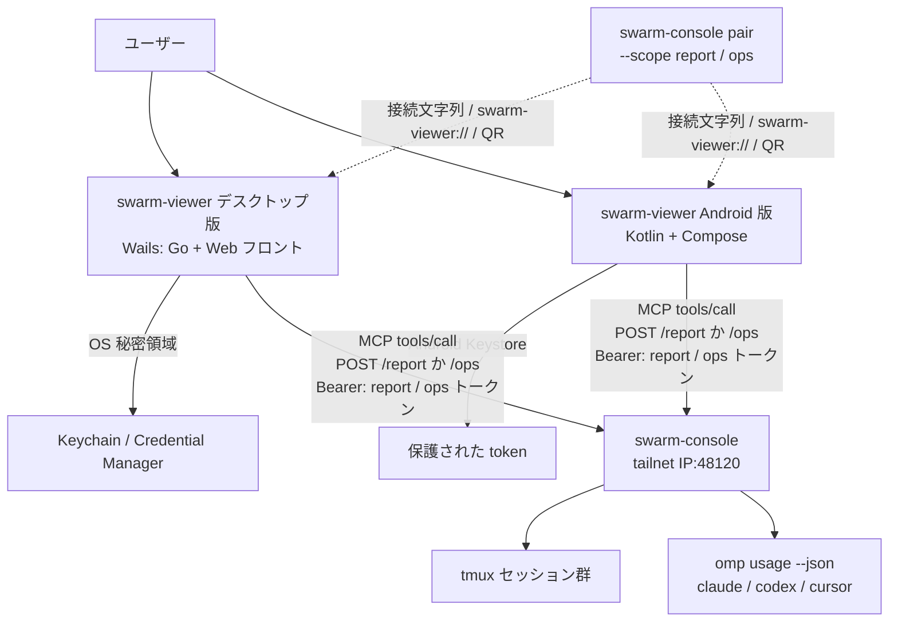

# プロジェクト概要

## 目的

デスクトップ・スマートフォンから、swarm-console が管理する tmux セッションの状態と、Claude Code・Codex の利用上限を **一目で** 確認できるアプリ（swarm-viewer）を提供する。既定は見るだけで、接続を「操作」（`/ops`）として登録したときだけ、ペインの中身を見る・質問に答える・指示を送る・中断する・新しいセッションを始める・終了することもできる（操作モード。Issue #97）。デスクトップ（Windows / macOS）に加え、Android 版（Kotlin + Jetpack Compose。まず Galaxy Fold7）を同じリポジトリで提供する。

- tmux セッションごと・ペインごとに「どのエージェントが、いま何をしているか」を見る
- Claude Code（`claude`）と Codex（`codex`）の 5 時間枠・7 日枠の使用率とリセット時刻を見る
- 操作の接続のときだけ、ペインへの回答・送信・中断・起動・終了ができる。見るだけの接続には操作の UI を出さない。「本当にシンプル」を最優先にする

## 背景

- swarm-console（`ousiassllc/swarm-console`、接続先は main / 最新リリース v0.1.11）は MCP（Streamable HTTP, JSON-RPC 2.0）で `POST /report`（見るだけ）と `POST /ops`（見る＋操作）を公開している
- v0.1.11 でセッション分割（`sessions_list`、各ツールの `session` 引数、エラー `session_required` / `session_forbidden`）が入り、複数 tmux セッションを 1 トークンで扱える
- swarm-console は tailnet IP の 48120 のみ待ち受ける（`0.0.0.0` 不可）。viewer は同一 tailnet 上の端末から接続する
- `report` ツールの JSON 1 本で、ペイン状態・usage・attention が揃うため、viewer 専用のサーバ側 API 追加は不要。必要なのは **ペア UX（`pair` コマンド）** のみ

## スコープ

### 含むもの

- Tailscale（tailnet）経由で swarm-console の **`POST /report`（見るだけ）または `POST /ops`（操作）** に接続。接続の種類は接続文字列の `url` の path で決まる
- 見るだけは読み取り専用トークン（scope=`report`）、操作は ops スコープのトークンで、接続の種類ごとの許可リストの MCP ツールだけを呼ぶ（NFR-SEC-1）
- tmux セッションの一覧表示と **上段タブでの切り替え**（選択セッションのみ取得）。最後に選んだセッションは接続ごとに記憶し、次回起動時に復元する
- 選択セッションのペイン一覧（位置・エージェント・状態・タイトル・経過時間・activity・note 要約）
- 利用上限パネル（Claude / Codex / Cursor）とホスト負荷表示
- `attention` / `warnings` のバッジ・バナー表示
- 初回ペアリング（接続文字列の貼り付け／`swarm-viewer://` ディープリンク）、トークンの OS 秘密領域への保存、**複数接続の保存と切り替え**
- 10 秒（設定可能）の `report` ポーリングと手動更新。前回取得分の表示（SQLite に最新 1 件を保存）
- `asking`（答え待ち）・`stalled`（止まってるかも）への遷移の OS 通知。通知は全接続・全許可セッションが対象（既定 10 分ごとの別ポーリング）、同じ状態の再通知はしない。通知のオン/オフは設定画面で切り替える
- ペイン詳細（`pane_tail`・`ask_card`）の閲覧（見るだけの接続でも）。操作の接続では質問への回答（`ask_pick`）・指示の送信（`send_text`）・中断（`send_escape`）・新しいセッションの起動（`dir_list` → `pane_start`）・終了（`pane_close`）。中断・終了は確認ダイアログを経る（FR-OPS-1〜10）
- 操作の接続の新しいセッションに、任意の最初のタスク（スキル・本文）を入れる（`skill_list` → `pane_start` → `send_text`。FR-OPS-11）
- ウィンドウを閉じてもトレイ（macOS はメニューバー）に常駐し、通知を継続する。単一インスタンス
- 接続・認証・セッション許可のエラー表示
- Windows / macOS ネイティブアプリ（Wails v3、フロントは HALT: Gin + Templ + HTMX）

#### Android 版

デスクトップ版と同じ `/report`・`/ops`・接続文字列・検証規則・通知の規則・操作モードの規則を使うビューア。設計は `docs/android/overview.md`。

- Kotlin + Jetpack Compose（Material 3）のネイティブアプリ（minSdk 29 / targetSdk 35）。同じリポジトリの `android/`。Go のコードは共有せず、仕様とテストベクタ（`testdata/vectors/`）を共有する
- ペアリングは接続文字列の貼り付け、`swarm-viewer://` ディープリンク（intent-filter）、QR 読み取りの 3 手段。token は Android Keystore で保護した領域に保存し、複数接続を保存・切替できる
- 画面は WindowSizeClass で切り替える（Compact: ペインのリスト、Medium / Expanded: `layout` のグリッド + 利用上限を横に）。フォアグラウンドの更新間隔はデスクトップと同じ（既定 10 秒）
- `asking` / `stalled` への遷移の通知は WorkManager の周期ジョブ（15 / 30 / 60 分、既定 15 分）で全接続・全許可セッションを確認する。Doze・バッテリー最適化で遅れうる。FCM・フォアグラウンドサービスは使わない
- 署名済み APK を GitHub Releases で配布する（サイドロード。Google Play は対象外）

### 含まないもの

- `dispatch`・`note_set`・`note_log`・`file_get`（画像・動画の表示は別 Issue）、`panes_status`・`host_status`・`report_read`・`tools/list` の利用
- Ctrl-C など任意のキーの送信
- インターネット公開・クラウド経由の中継
- Google Play での公開、プッシュ通知（FCM）、iOS 版
- swarm-console 本体の機能追加の実装（本リポの範囲外。`pair`・`dir_list` は swarm-console 側で実装済み。`skill_list` は viewer が前提とする要望で、swarm-console 側は未実装）、接続文字列・QR の生成
- 自動更新、コード署名・公証（デスクトップ版は初版は手動入れ替え・unsigned。Android 版は署名済み APK を手動で入れ替える。自動更新はしない）

## ステークホルダー / 想定ユーザー

| 区分 | 役割 | 備考 |
|------|------|------|
| swarm-console 運用者（開発者本人） | デスクトップ・スマートフォンから tmux・エージェント状態と利用上限を確認し、外出先からも質問への回答・指示ができる | tailnet 参加端末の Windows / macOS / Android（Galaxy Fold7）。1 人〜少人数 |
| swarm-console（接続先） | `/report` で読み取り専用データ、`/ops` で操作を提供 | v0.1.11 以降。`pair [--scope report\|ops]`・`dir_list` は実装済み。`skill_list` は未実装（要望。実装後にツール名・引数・返り値を確定する） |

## システム全体像

アーキテクチャの詳細は `docs/architecture/overview.md`（Android 版は §12）、Android 版の設計は `docs/android/overview.md` を参照。

## ドキュメントマップ

このプロジェクトの仕様は以下のドキュメントで構成される。実装時はそれぞれ参照すること。

| ドキュメント | パス | 概要 |
|------------|------|------|
| 機能要件 | `docs/requirements/functional.md` | ユースケース、機能一覧（ペアリング・セッション切替・ペイン表示・利用上限・通知・設定・操作モード FR-OPS）、ペイン `state` の表示ラベル、画面（ペイン詳細・質問カード・新しいセッション・最初のタスク）、エラー表示 |
| 非機能要件 | `docs/requirements/non-functional.md` | 対応環境、性能・リソース目標、セキュリティ（種類別の許可リスト・tailnet 範囲の URL 検証・token 保護・操作の確認）、可用性、ストレージ、ログ、配布 |
| アーキテクチャ設計 | `docs/architecture/overview.md` | HALT（Gin + Huma + Templ + HTMX）× Wails v3 の構成、レイヤー構造、通信フロー（ペイン詳細・操作を含む）、トレイ常駐、セキュリティ境界、未確認事項 |
| ER / データモデル | `docs/architecture/er.md` | SQLite 4 テーブル（connections・settings・snapshots・notified_states）、接続の種類は `url` の path から導出、秘密領域（token）、マイグレーション |
| API 仕様 | `docs/api/endpoints.md` | swarm-console `/report`・`/ops` の利用（種類別の許可リスト）、ペアリング形式、`pair [--scope report\|ops]`、画面ルート（ペイン詳細・操作） |
| コンポーネント設計 | `docs/components/overview.md` | 採用ライブラリ、domain/repository/service/web/app の責務・interface、並行性、テスト設計、要件との対応 |
| Android 版の設計 | `docs/android/overview.md` | WorkManager による通知の確認、通知チャンネル、権限、WindowSizeClass によるレイアウト切替、フォアグラウンドの更新、テストベクタの置き場所と読み方、操作モード（ペイン詳細・質問・送信・新しいセッション） |
| 環境構築 | `docs/environment/setup.md` | 開発環境のセットアップ、Taskfile、CI（GitHub Actions・セルフホステッドランナー）、lint/format、linterly、Git Hooks（bun 前提）、Android の開発環境・CI・署名鍵・リリース（§11） |

## 用語集

| 用語 | 定義 |
|------|------|
| swarm-console | tmux 上のエージェント群を管理し、MCP で状態公開・操作を提供するホスト側ソフト。viewer の接続先 |
| MCP | Model Context Protocol。本件では Streamable HTTP 上の JSON-RPC 2.0 |
| `/report` | 読み取り専用の MCP 窓口。見るだけの接続が使う（`sessions_list`・`report`・`pane_tail`・`ask_card`） |
| `/ops` | 読み取り＋操作の MCP 窓口。操作の接続が使う（上に加えて `ask_pick`・`send_text`・`send_escape`・`pane_start`・`pane_close`・`dir_list`・`skill_list`。`skill_list` は未実装・要望） |
| report トークン | `swarm-console token add <名前> --scope report [--sessions …]`（または `pair`）で発行する読み取り専用トークン |
| ops トークン | `swarm-console token add <名前> --scope ops [--sessions …]`（または `pair --scope ops`）で発行する操作用トークン。ペインへの送信・中断・起動・終了ができるため、漏れたら `swarm-console token revoke <名前>` で失効する |
| 接続の種類 | 見るだけ（`/report`）と操作（`/ops`）。接続文字列の `url` の path で決まる |
| ペア / ペアリング | ホストで発行した接続情報（URL・トークン等）を viewer に登録すること |
| tailnet | Tailscale のプライベートネットワーク |
| セッション | swarm-console が扱う tmux セッション。`sessions_list` で許可分が取れる |
| ペイン | tmux ペイン。`pos`（T*/B*）、`agent`、`state` 等を持つ |
| `state` | ペイン状態。`working` / `asking` / `idle` / `stalled` / `shell` / `unknown` |
| `usage` | ホストが `omp usage --json` を周期実行（`usage_interval` 既定 5 分）して得る利用上限スナップショット |
| WorkManager | Android の永続的なバックグラウンド処理の仕組み。Android 版は周期ジョブ（最小 15 分）で通知用の確認を行う |
| WindowSizeClass | 画面の幅の区分（Compact / Medium / Expanded）。Android 版はこれでペインの出し方（リスト / グリッド）を切り替える |
| テストベクタ | デスクトップ（Go）と Android（Kotlin）が同じ JSON ファイル（`testdata/vectors/`）を読み、挙動の一致を保つテストの入力と期待値 |

## 改訂履歴

| 版 | 日付 | 変更内容 | 変更理由 |
|----|------|---------|---------|
| 1.0 | 2026-11-03 | 新規作成 | 初版 |
| 1.1 | 2026-11-03 | ドキュメントマップを確定 | 全仕様書の作成完了 |
| 1.2 | 2026-11-03 | スコープに通知・トレイ常駐・前回表示・技術構成を反映 | 各仕様書との整合 |
| 1.3 | 2026-11-03 | ドキュメントマップに環境構築を追加 | 環境構築ドキュメントの作成 |
| 1.4 | 2026-11-03 | 環境構築の概要を更新（CI をセルフホステッドランナーに） | 環境構築ドキュメントの更新との整合 |
| 1.5 | 2026-11-05 | Android 版をスコープに追加（「含まないもの」から外す）。システム全体像・ドキュメントマップ・用語集に Android を反映 | Issue #15（Android 版の仕様書への反映） |
| 1.6 | 2026-11-08 | 操作モード（Issue #97）。目的・スコープ・範囲外を「既定は見るだけ、操作の接続のときだけ操作できる」に変更。システム全体像・ドキュメントマップ・用語集（`/ops`・ops トークン・接続の種類）を更新 | Issue #97（操作モード） |
| 1.7 | 2026-11-09 | 最初のタスクをスコープに追加（FR-OPS-11）。`skill_list`（要望・swarm-console 側は未実装）をステークホルダー・範囲外・用語集（`/ops`）に反映 | Issue #103（空きセッションへの最初のタスク） |
