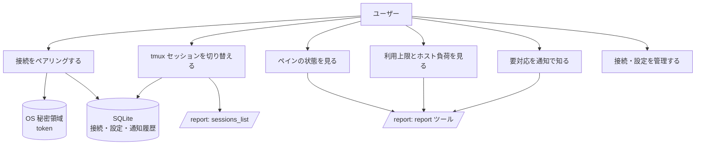
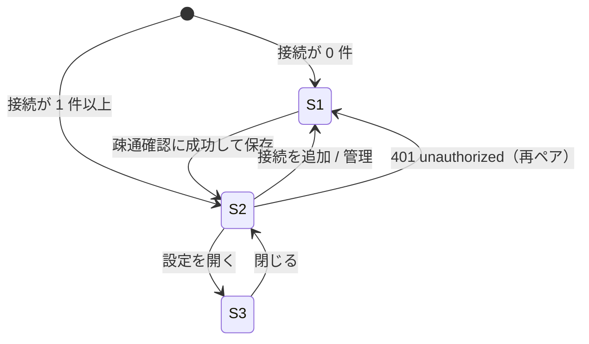
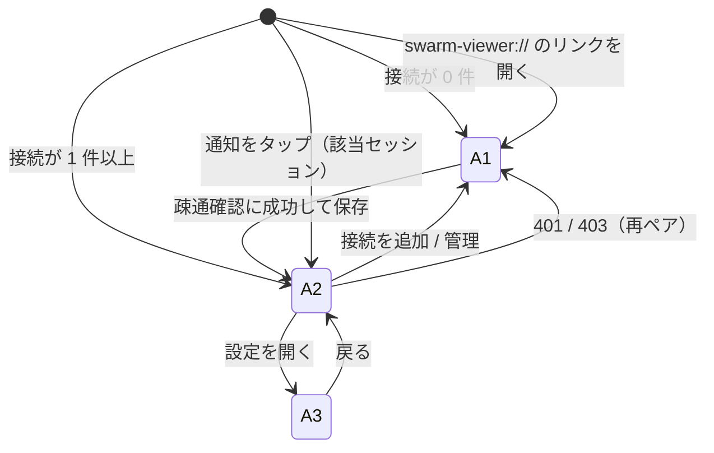

# 機能要件

[プロジェクト概要](../overview.md)の目的を満たすための機能を定める。viewer は **読み取り専用**で、swarm-console の `POST /report` だけを呼ぶ。API の形は [API 仕様](../api/endpoints.md)、保存データは [ER / データモデル](../architecture/er.md) を参照する。

> §1〜§11 はデスクトップ版（Windows / macOS）の機能。Android 版は同じ `/report` に接続する読み取り専用ビューアで、デスクトップ版と共通の規則（§3 の状態ラベル、§5〜§7 の表示、§8 の通知の規則、§10 のエラー表示）は変えず、差分を [§12](#12-android-版) に定める。

## 1. ユースケース



## 2. 機能一覧

| ID | 機能 | 概要 |
|----|------|------|
| FR-PAIR-1 | ペアリング | 接続文字列の貼り付け、または `swarm-viewer://` ディープリンクの受信で接続を登録する |
| FR-PAIR-2 | 疎通確認 | 登録前に `sessions_list` を呼び、成功したときだけ保存する |
| FR-PAIR-3 | 複数接続の保存 | 接続を複数保存し、切り替えられる。token は OS 秘密領域、それ以外は SQLite に保存する |
| FR-PAIR-4 | 切断・再ペア | 接続を削除すると秘密領域の token と、その接続の保存データを消す。同じ接続名の再ペアは token を差し替える |
| FR-SESS-1 | セッション一覧 | 接続ごとに `sessions_list` で許可セッション（`allowed: true`）を取得し、上段タブに並べる |
| FR-SESS-2 | セッション切替 | タブ選択で表示セッションを切り替える。以降のポーリングは **選択中セッションの `report` だけ**を取得する |
| FR-SESS-3 | 選択の記憶・復元 | 最後に選んだセッションを接続ごとに記憶し、次回起動・接続切替時に復元する。許可外・消滅時は先頭の許可セッションへフォールバックする |
| FR-PANE-1 | ペイングリッド | `layout`（`rows`、`cols[]`）に従って T*/B* 配置のグリッドで表示する。`layout` が欠落・不整合ならペイン順のリストで表示する |
| FR-PANE-2 | ペインカード | `pos`・`agent`・`state`・`title`・`elapsed`・`activity`・`note` を表示する（§4） |
| FR-PANE-3 | 状態表示 | `state` を §3 の表示ラベルで表示する |
| FR-USE-1 | 利用上限パネル | `usage.claude[]`・`usage.codex[]`・`usage.cursor[]` を表示する（§5） |
| FR-USE-2 | ホスト負荷 | `host.cpu`・`host.mem`・`host.swap`・`host.disk[]` の使用率を表示する（§6） |
| FR-ATT-1 | 要対応表示 | `attention[]`・`warnings[]` をバッジ・バナーで表示する（§7） |
| FR-POLL-1 | 画面更新ポーリング | 選択中セッションを既定 10 秒（設定可能）で `report` 取得する |
| FR-POLL-2 | 手動更新 | 即時に再取得する |
| FR-POLL-3 | 一時停止 | OS のサスペンド中・ウィンドウ最小化中は画面更新ポーリングを止め、復帰時に即時取得する |
| FR-POLL-4 | 前回の状態の表示 | 起動直後・取得失敗時は、SQLite に保存した直近のスナップショット（接続×セッションごとに最新 1 件）をグレーアウトして「前回取得 HH:MM」とともに表示し、取得に成功したら置き換える |
| FR-NTF-1 | OS 通知 | ペインが要対応状態になったとき OS 通知する（§8） |
| FR-NTF-2 | 通知対象の範囲 | 通知は保存済み全接続の**全許可セッション**が対象。画面表示用とは別の低頻度ポーリング（既定 10 分、設定可能）で取得する |
| FR-NTF-3 | 重複通知の抑止 | 一度通知した状態は、そのペインがその状態を抜けるまで再通知しない |
| FR-SET-1 | 設定画面 | 通知オン/オフ・画面更新間隔・通知用ポーリング間隔・デバッグログのオン/オフを設定する（§9） |
| FR-ERR-1 | エラー表示 | 接続・認証・セッション許可のエラーを短い文言で表示する（§10） |
| FR-APP-1 | トレイ常駐 | ウィンドウを閉じても終了せずトレイ（macOS はメニューバー）に常駐する。トレイメニューは「開く」「終了」。通知用ポーリングは通知オンの間、常駐中も継続する |
| FR-APP-2 | 単一インスタンス | 2 つ目の起動は既存ウィンドウを前面に出す。ディープリンクは既存インスタンスで処理する |

## 3. ペインの状態と表示ラベル

`state` の値は swarm-console の公式値（6 種）。表示ラベルは次のとおり。

| `state` | 表示ラベル | 意味 |
|---------|-----------|------|
| `working` | 作業中 | エージェントが作業している |
| `asking` | 答え待ち | 質問カードが出ている |
| `idle` | 指示待ち | 作業が終わって入力を待っている |
| `stalled` | 止まってるかも | `working` のまま、画面が `stalled_after`（既定 15 分）の間変わっていない |
| `shell` | 空き | エージェントが起動していない（シェルのみ） |
| `unknown` | 判定できない | 状態を判定できない |

- 上表以外の `state` 値を受け取ったときは `unknown` と同じ扱いで表示する（前方互換）
- `stalled` のカードには `changed_ago`（画面が最後に変わってからの経過）を併記する
- 既定の表示色（案）: `working`=accent、`asking`=warning、`idle`=success、`stalled`=error、`shell`・`unknown`=muted。色だけに依存せず、ラベルを必ず併記する
- state とは別に、attention 由来のバッジ（`report_waiting` の「報告待ち」）をカードに併記することがある（§7）。`idle`（指示待ち）のカードに「報告待ち」が並ぶことがある

## 4. 画面

### 4.1 画面一覧と遷移

| 画面 | ID | 概要 |
|------|----|------|
| 接続管理 / ペアリング | S1 | 接続の追加（貼り付け・ディープリンク）、保存済み接続の一覧・切替・削除 |
| メイン | S2 | 接続切替、セッションタブ、ペイングリッド、利用上限パネル、ホスト負荷、要対応表示 |
| 設定 | S3 | 通知・ポーリング間隔 |



### 4.2 S1 接続管理 / ペアリング

- 接続文字列の貼り付け欄と「接続」ボタン。`swarm-viewer://pair?...` を OS から受信したときは同じ処理を起動する（フォーマットは [API 仕様](../api/endpoints.md) の「ペアリング形式」）
- 保存済み接続の一覧（表示名、URL の**ホスト部のみ**。token は表示しない）、切替・削除
- 疎通確認（FR-PAIR-2）に失敗したら保存せず、§10 の文言を出す
- 同じ `url` が既に保存済みなら、新規追加ではなく token の差し替えとして扱う

### 4.3 S2 メイン

```
┌ 接続: [name ▾]                                  [更新] [設定] ┐
│ [session 0] [session 1] [session 2] …   ← 上段タブ           │
│ 要対応: ● asking T2   ● stalled B3     ← attention / warnings│
│ ┌T1────┐ ┌T2────┐ ┌T3────┐ ┌T4────┐                          │
│ │カード│ │カード│ │カード│ │カード│   ← layout の rows/cols  │
│ ├B1────┤ ├B2────┤ ├B3────┤ ├B4────┤                          │
│ └──────┘ └──────┘ └──────┘ └──────┘                          │
│ 利用上限: Claude / Codex / Cursor     ホスト: CPU / Swap / Disk│
└──────────────────────────────────────────────────────────────┘
```

- 接続が複数ある場合のみ接続切替を出す
- セッションが 1 つだけの場合もタブ（1 つ）を出し、`session` 引数は常に明示する（許可セッション数に依存した `session_required` を避ける）
- ペイングリッドの下、または側部に利用上限パネルとホスト負荷を置く。利用上限・ホスト負荷はセッションに属さないホスト全体の値で、タブを切り替えても同じ値になる

### 4.4 ペインカード

| 項目 | 出典 | 表示 |
|------|------|------|
| 位置 | `pos` | カード見出し（`T1` など） |
| エージェント | `agent` | `omp` / `claude` / `codex` のバッジ。`null` はバッジなし |
| 状態 | `state` | §3 のラベルと色 |
| タイトル | `title` | 1 行。長ければ省略（全文はツールチップ） |
| 経過時間 | `elapsed` | `42m` 形式。`null` なら非表示 |
| activity | `activity` | 1 行。`null` なら非表示。`truncated: true` なら末尾に `…` |
| 作業ディレクトリ | `cwd` | ツールチップのみ |
| メモ要約 | `note.repo`、`note.items` | `repo` と `items` 先頭 3 件。残りは `+N`。`note` が `null` なら非表示。全文はツールチップ |
| 画面無変化時間 | `changed_ago` | `stalled` のとき併記 |

- カードは**表示のみ**。クリックしても何も送らない・何も変えない（ツールチップ・展開表示は可）

## 5. 利用上限パネル（FR-USE-1）

`report` の `usage` を表示する。ホスト全体の値で、セッションを絞っても変わらない。

### 5.1 取得状態

| `usage.status` | 表示 |
|----------------|------|
| `ok` | 通常表示。`fetched_at`（最終取得時刻）を小さく併記 |
| `stale` | 前回成功分をグレーアウトして表示し、「古いデータ」と `fetched_at` を出す（`reason` は折りたたみ） |
| `unavailable` | 「取得できません」。数字は出さない |
| `pending` | 「取得中」。数字は出さない |
| `disabled` | 「利用上限の取得は無効です」。数字は出さない |

サーバ側 `usage_interval`（既定 5 分）より細かく見ても数字は変わらない。viewer は画面更新と同じ `report` 取得で値を更新するだけで、usage 専用の取得はしない。

### 5.2 枠の表示

- Claude / Codex: `account` ごとに `five_hour`（5 時間枠）・`seven_day`（7 日枠）を表示する。API 上の 7 日枠のキーは `seven_day`
- Cursor: `account` ごとに `window`（`monthly` / `weekly` / `null`）と `models` を表示する
- 各枠は `available` を必ず確認する。`available: false` は「—」表示（バー・数値なし）
- Claude / Codex で `five_hour`・`seven_day` の 2 枠とも `available: false` のアカウントは、「—」を 2 行出さず「取得できません」を 1 行で出す。`reason`（枠を取れなかった理由）があれば理由を添える。片方だけ `available: false` のアカウントは、上の規則どおり 2 行のまま（取れない枠は「—」）。Cursor は枠が 1 つなので「—」のまま
- `reason` の表示: `without_usage` →「ログイン切れの可能性」、`no_email` →「アカウントを特定できません（ログイン切れの可能性）」。`null`・欠落（`reason` を返さない古い swarm-console）・知らない値は理由なし（「取得できません」だけ）。原因は swarm-console からは確かには分からないため「可能性」と書く。`auth.agents` とは結び付けない
- `unit` が `percent` の枠はプログレスバー＋数値（`used` %）で表示する。`unit` が `usd` の枠は金額（`$` 付き）のみで、バー・しきい値色は付けない
- リセット時刻 `resets_at` はローカル時刻で表示し、相対表示（「あと 3 時間」）を併記する。`null` なら非表示

### 5.3 しきい値の色（`unit` = `percent` のみ）

| 条件 | 色 |
|------|----|
| `used` < 80 | 通常（accent） |
| 80 ≦ `used` < 95 | 黄（warning） |
| 95 ≦ `used` | 赤（error） |
| 枠の `status` = `exhausted` | 赤（`used` の値に関わらず） |

しきい値（80 / 95）は固定値とし、初版では設定項目にしない。

## 6. ホスト負荷（FR-USE-2）

| 表示 | フィールド | 備考 |
|------|-----------|------|
| CPU | `host.cpu.used_percent` | `available: false` は「—」 |
| メモリ | `host.mem.used_percent`（`used_gb` / `total_gb`） | `available: false`、および `host.mem` を返さない古い swarm-console は「—」（行は出す） |
| スワップ | `host.swap.used_percent`（`used_gb` / `total_gb`） | `total_gb: 0`（スワップ無し）は「なし」 |
| ディスク | `host.disk[]` の `mount`、`used_percent`、`free_gb` | マウントごとに 1 行。`available: false` は「—」 |

- ホスト全体の値でセッションに属さない。しきい値色は §5.3 と同じ規則を使う
- `load1`・`mem_free_gb` は表示しない（メモリは `host.mem` を使う）
- 表示順は CPU → メモリ → スワップ → ディスク。各行は「ラベル（固定幅）・バー（残り）・値（固定幅）」の 3 列に並べ、バーの左端と右端を全行でそろえる。値の列に率と補足（「87% 108.5 GB 空き」「41% 41.3 GB / 128 GB」）をまとめて右寄せにし、はみ出したら省略（`title` で全文）。「—」「なし」の行もバーの列は空にして同じ 3 列にのせる

## 7. 要対応・警告（FR-ATT-1）

`attention[]`（`kind`、`pane`、`detail`）と `warnings[]`（`code`、`message`）を、グリッドの上に表示する。

| `kind` | 表示 | 備考 |
|--------|------|------|
| `asking` | 答え待ち（`pane`、`detail` = 質問文の先頭） | |
| `stalled` | 止まってるかも（`pane`、`detail` = 停滞時間） | |
| `report_waiting` | 報告待ち（`pane`） | `detail` はサーバー上のファイルパスのため表示しない |
| `auth_expired` | ログイン期限切れ（`detail` = エージェント名） | `pane` は空文字。ペインに紐づけない |
| `auth_expiring` | ログイン期限間近（`detail` = エージェント名） | 同上。`auth.agents[].expires_at` があれば併記 |

- 未知の `kind` は無視せず、`kind` の文字列をそのまま表示する
- `warnings[].code` が `tmux_unavailable` / `session_missing` / `pane_unreadable` / `layout_changed` のとき、警告バナーに `message` を表示する
- `attention` の `asking` / `stalled` のペインカードは強調表示する
- `attention` の `report_waiting` に該当するペイン（`pane` が一致）のカードは、state バッジの隣に「報告待ち」バッジを出す。state バッジは消さずに並べ、`detail` は出さない。枠色の強調はしない（強調は `asking` / `stalled` だけ）。`pane` が空の項目はどのカードにも付けない
- 要対応バーの `attention[]` は次の 2 グループに分けて表示する。API が返す順は保証がないため、グループ内は並べ替える
  1. ペイン関連（`pane` が付く項目。未知の `kind` も含む。`auth_expired` / `auth_expiring` は除く）: ペイン位置順（T1…T4、B1…B4）
  2. エージェント・ログイン関連（`auth_expired` / `auth_expiring`、および `pane` が空の項目）: エージェント名（`detail`）順。同じエージェントの項目は 1 つのブロックにまとめる
- 2 グループの間には区切り線を入れ、ログイン関連ではエージェント（claude / codex / cursor …）ごとにもそれより薄い区切り線を入れる。片方のグループしかないとき、エージェントが 1 つしかないときは、その分の線を出さない
- ログイン期限（`auth.agents[].expires_at`）は年付きの「YYYY/MM/DD HH:MM」で表示する（年をまたぐ期限の誤読を防ぐ）。他の日時（「MM/DD HH:MM」）は変えない

## 8. OS 通知（FR-NTF-1〜3）

### 8.1 対象

- 通知対象のペイン状態は `asking`（答え待ち）と `stalled`（止まってるかも）。他の状態では通知しない
- 対象は保存済みの**全接続**の**全許可セッション**。画面に表示していないセッション・接続も含む
- 通知の取得経路は 2 つ。どちらも同じ検知・重複抑止の規則を使う
  1. 画面更新ポーリング（選択中セッション、既定 10 秒）
  2. 通知用ポーリング（全接続・全許可セッションを順に `report` 取得、既定 10 分、設定可能）

### 8.2 通知の発火と重複抑止

- 通知は、ペインの `state` が通知対象に**遷移したとき**に 1 回だけ出す
- 通知済みの `(接続, セッション, ペイン ID, 状態)` は SQLite に記録し、そのペインがその状態を抜けた（`state` が別の値になった、またはペインが消えた）ことを観測するまで**再通知しない**。アプリを再起動しても記録は残り、再通知しない
- 状態を抜けたあとに再び同じ状態になったら、新しい遷移として 1 回通知する
- 接続を新規ペアリングしたあと、全許可セッションを一巡して取得するまでの結果は、通知せず現在の状態を記録するだけにする（既存の `asking` ペインで通知が一斉に出るのを防ぐ）。一巡が取得失敗で終わらなかった場合は、次の周期でも通知せず記録を続ける。一巡後に新しく現れたセッション・ペインは通常どおり通知する
- ペインの同一性は `id`（tmux ペイン ID、例 `%12`）で判定する（`pos` はレイアウト変更で変わりうるため）
- 通知本文: 接続表示名・セッション・`pos`・状態ラベル（`asking` は `attention` の `detail` も添える）。token・URL 全体は含めない
- 通知は読み取り専用のまま。通知をクリックしたときはアプリを前面に出し、該当接続・セッションのタブを選択する

### 8.3 無効時・失敗時

- 設定で通知をオフにしている間は、通知用ポーリングも行わない（OS 通知のためだけの取得のため）。画面更新ポーリングは続き、取得した結果の通知済み記録は更新するが OS 通知は出さない（オンに戻したとき、オフの間に入った状態が一斉に通知されるのを防ぐ）
- OS が通知を許可していない場合は、設定画面にその旨を表示する
- 通知用ポーリングの途中で接続・セッションの取得が失敗したら、その接続・セッションを飛ばして次へ進む。失敗したことで通知済み記録を変更しない

## 9. 設定画面 S3（FR-SET-1）

| 項目 | 選択肢 | 既定 |
|------|--------|------|
| 通知 | オン / オフ | オン |
| 画面更新間隔（選択中セッション） | 5 / 10 / 30 / 60 秒 | 10 秒 |
| 通知用ポーリング間隔（全セッション） | 5 / 10 / 30 / 60 分 | 10 分 |
| デバッグログ | オン / オフ | オフ |

- 設定は SQLite に保存する（アプリ全体で 1 セット。接続ごとの設定は持たない）
- 画面更新間隔を 5 秒より細かくしても、サーバのサンプラー（`poll_interval` 既定 5 秒）より新鮮にはならないため、選択肢に含めない

## 10. エラー表示（FR-ERR-1）

ユーザー向けの文言は短くし、詳細コードは折りたたみで見せる。

| 状況 | 検知 | 表示 |
|------|------|------|
| tailnet 未接続・到達不可 | 接続タイムアウト・ネットワークエラー | 「ホストに届きません。Tailscale 接続を確認してください」 |
| 401 `unauthorized` | HTTP 401 | 「認証できません。再ペアしてください」→ S1 へ誘導 |
| 403 `forbidden_scope` | HTTP 403 | 「このトークンでは接続できません（report 用が必要）」 |
| `session_required` | ツールエラー | 「セッションを選んでください」→ タブから選択。viewer は常に `session` を明示するため通常は出ない |
| `session_forbidden` | ツールエラー | 「このセッションは許可されていません」。次回の `sessions_list` で一覧から外れる |
| `invalid_args`（`session` の名前が存在しない） | ツールエラー | 「セッションが存在しません」。一覧を再取得して選択を更新する |
| `tmux_unavailable` / `session_missing` | `warnings[]` | 警告バナー（§7） |
| `usage.status` が `ok` 以外 | `usage` | 利用上限パネルに状態を表示（§5.1） |

- 取得に失敗してもこれまで表示していた内容は消さず、「最終更新時刻」と失敗の状態を併記してグレーアウトする
- 失敗時は次の周期で自動再試行する。連続失敗でも間隔は延ばさない（最小構成。バックオフは持たない）
- ただし `401`・`403`（認証・スコープのエラー）の接続は、再ペアリングされるまで画面・通知の自動ポーリングを止める（再試行しても通らないため。[API 仕様 §1.5](../api/endpoints.md)）

## 11. 範囲外（確認用）

- `/ops`、ペインへの送信・操作・メモ書き込み・`dispatch`
- `pane_tail` / `ask_card` / `report_read` の詳細ビュー
- 自動更新、コード署名（デスクトップ版。Android 版の署名は §12・[非機能要件 §10](non-functional.md)）
- Android 版の範囲外: Google Play での公開、プッシュ通知（FCM）、iOS 版、ウィジェット・Wear OS、アプリ内アップデート、Tailscale の同梱・制御、tailnet 外（インターネット経由）の接続

## 12. Android 版

Kotlin + Jetpack Compose のネイティブアプリ。デスクトップ版と同じ swarm-console の `POST /report`（report スコープ token）に tailnet 経由で接続し、tmux セッション・ペインの状態、利用上限、ホスト負荷を**読み取り専用**で表示する。呼ぶツールは `sessions_list` と `report` だけ（NFR-SEC-1）。対象端末はまず Galaxy Fold7（折りたたみ時・展開時）。設計は[Android 版の設計](../android/overview.md)、非機能要件は[非機能要件 §10](non-functional.md)を参照する。

### 12.1 機能一覧（Android）

デスクトップ版の FR（§2）のうち、Android で読み替える・追加するもの。ここに無い FR（FR-SESS-*・FR-PANE-*・FR-USE-*・FR-ATT-*・FR-POLL-1・FR-POLL-2・FR-POLL-4・FR-NTF-1・FR-NTF-3・FR-ERR-1 など）は同じ規則で適用する。

| ID | 機能 | 概要 |
|----|------|------|
| FR-AND-1 | ペアリングの手段 | 接続文字列の**貼り付け**、`swarm-viewer://pair?...` の**ディープリンク**（intent-filter）、**QR の読み取り**の 3 つ。QR の中身は[API 仕様 §2.1](../api/endpoints.md) の接続文字列そのまま。どの手段でも同じパーサ・同じ検証（§2.1・§2.2）を通し、同じ確認画面に入る。確認画面に token は表示しない。疎通確認（FR-PAIR-2）に成功したときだけ保存する。カメラ権限は QR の読み取りを開始したときだけ要求する |
| FR-AND-2 | レイアウトの切替 | 画面の幅の区分（WindowSizeClass）で、Compact は `pos` 順のリスト、Medium / Expanded は `layout` のグリッド（T* / B*）と、利用上限・ホスト負荷を**横**に置く表示に切り替える（FR-PANE-1 の拡張）。切替（折りたたみ⇔展開）で、選択中のセッションとスクロール位置を保つ |
| FR-AND-3 | バックグラウンドの確認 | 通知（FR-NTF-2）のための全接続・全許可セッションの取得は、WorkManager の周期ジョブで行う。間隔は 15 / 30 / 60 分（既定 15 分）。通知がオフの間はジョブを止める。FCM・フォアグラウンドサービスは使わない |
| FR-AND-4 | 通知の権限 | 初回に通知の権限（`POST_NOTIFICATIONS`。Android 13 以降）を要求する。拒否されたら、設定画面にシステムの通知設定を開く案内を出す（§8.3） |
| FR-AND-5 | 通知からの遷移 | 通知をタップするとアプリを開き、該当接続・該当セッションのタブを選択する（§8.2） |
| FR-AND-6 | 再起動後の再開 | 端末を再起動しても通知用の周期ジョブが再開する。通知済み状態は再起動後も保たれる（FR-NTF-3） |
| FR-AND-7 | 遅れの明記 | Doze・アプリスタンバイ・バッテリー最適化により、通知が設定した間隔より遅れうることを、設定画面に明記する |
| FR-AND-8 | フォアグラウンドの更新 | 画面更新ポーリング（FR-POLL-1）は画面が見えている間だけ動かし、バックグラウンドに回ったら止め、戻ったら即時に 1 回取得する（FR-POLL-3 の読み替え）。手動更新（FR-POLL-2）は「プルして更新」 |
| FR-AND-9 | 接続・設定の保存 | 接続・設定・スナップショット・通知済み状態は Room、token は Android Keystore で保護した領域に保存する（[ER §7](../architecture/er.md)）。複数接続の保存・切替・削除（FR-PAIR-3・FR-PAIR-4）ができ、削除で token・スナップショット・通知済み状態が消える |

- Android では FR-APP-1（トレイ常駐）・FR-APP-2（単一インスタンス）は適用されない。ホーム画面・最近使ったアプリからの起動と、ディープリンク・通知からの起動が入口になる
- 取得失敗時は直前の表示をグレーアウトして残す（FR-POLL-4・§10）。401・403 の接続は画面・通知の自動ポーリングを止めて再ペアリングへ誘導する
- 起動直後・失敗時は、接続×セッションごとに最新 1 件のスナップショットを「前回取得 HH:MM」として表示する（FR-POLL-4）

### 12.2 画面（Android）

| 画面 | ID | 概要 |
|------|----|------|
| 接続管理 / ペアリング | A1 | 接続の追加（貼り付け・QR 読み取り）、ディープリンクで受けたときの確認、保存済み接続の一覧・切替・削除（S1 に相当） |
| メイン | A2 | 接続切替、セッションのタブ、ペイン（リスト / グリッド）、利用上限、ホスト負荷、要対応・警告（S2 に相当） |
| 設定 | A3 | 通知・各間隔・デバッグログ・通知権限の状態（S3 に相当） |



A1（S1 との差分）:

- 入力手段は貼り付け欄と「QR を読み取る」ボタン。ディープリンクは同じ確認画面に入る。確認画面には表示名・接続先のホスト部・ホストが申告した許可セッションを出し、**token は出さない**
- 解析（`parsePairing`）に失敗したら、[API 仕様 §2.2](../api/endpoints.md) の固定文言を出し、入力した文字列（token を含みうる）は保存・ログ出力しない
- 保存済み接続の一覧は表示名と URL の**ホスト部のみ**。切替・削除（削除は確認つき）

A2（S2 との差分）:

- 上部のアプリバーに接続名（複数あるときは切替）と設定。その下にセッションのタブ（横スクロール）。更新は「プルして更新」
- Compact（折りたたみ時など狭い画面）: 要対応・警告 → ペインのリスト → 利用上限 → ホスト負荷 を縦に並べ、全体を 1 つのスクロールで見る
- Medium / Expanded（展開時など広い画面）: 左に `layout` のグリッド（T* / B*）、右に利用上限・ホスト負荷を置く。`layout` が欠落・不整合ならグリッドでなくペイン順のリストで出す
- ペインのカード項目は §4.4 と同じ（`pos`・`agent`・`state` のラベル・`title`・`elapsed`・`activity`・`changed_ago`・`note` 要約）。ツールチップの代わりに、カードのタップで全文を展開して表示してよい（展開は表示のみで、何も送らない・何も変えない）
- 利用上限（§5）・ホスト負荷（§6）・要対応と警告（§7）の表示規則はデスクトップ版と同じ
- **操作系のコントロールを持たない**（ペインへの送信・選択・起動・終了・メモ書き込みはない）

A3 の項目は §12.4。

### 12.3 ペアリング（Android）

| 手段 | 動作 |
|------|------|
| 貼り付け | 貼り付け欄の文字列を `parsePairing` で検証し、確認画面へ。貼り付けた内容は解析後すぐ破棄し、保存・ログ出力しない（NFR-SEC-7） |
| ディープリンク | `swarm-viewer://pair?...` のリンクを開くとアプリが起動し（起動済みでも前面に出て）、確認画面に入る。リンクは他のアプリからも送れるため、信頼できない入力として検証し、利用者が確定するまで保存しない。処理後は Intent のデータを消す（[API 仕様 §2.3](../api/endpoints.md)） |
| QR 読み取り | 「QR を読み取る」で読み取り画面を開く。読み取った文字列は貼り付けと同じ経路（`parsePairing` → 確認画面）に入る。カメラ権限はこのときだけ要求し、拒否されても他の 2 つの手段で使える |

- 検証・エラー文言・疎通確認・「同じ `url` は token の差し替え」の規則は §4.2・[API 仕様 §2](../api/endpoints.md) と同じ
- QR の生成側（`swarm-console pair` の出力か、デスクトップ版の表示か）はこのアプリの範囲外。当面は接続文字列（[API 仕様 §2.1](../api/endpoints.md)）を任意の QR 生成手段で QR にできる。token を含むため、チャットや共有の履歴に残さない（[API 仕様 §3](../api/endpoints.md) の注意と同じ）

### 12.4 設定画面 A3（Android）

| 項目 | 選択肢 | 既定 |
|------|--------|------|
| 通知 | オン / オフ | オン |
| 画面更新間隔（選択中セッション） | 5 / 10 / 30 / 60 秒 | 10 秒 |
| 通知確認間隔（全接続・全許可セッション） | **15 / 30 / 60 分** | **15 分** |
| デバッグログ | オン / オフ | オフ（Logcat の詳細ログ。ファイルには書かない） |

- 設定は Room に保存する（アプリ全体で 1 セット。接続ごとの設定は持たない）
- 通知確認間隔の選択肢に 5 / 10 分を含めない（WorkManager の周期ジョブの最小間隔が 15 分のため）。選択肢の下に「Doze・バッテリー最適化により、通知は設定した間隔より遅れることがあります」を常に表示する（FR-AND-7）
- 通知の権限が許可されていないとき（Android 13 以降）は、その旨とシステムの通知設定を開くボタンを表示する（FR-AND-4）

### 12.5 通知（Android）

§8 の規則（対象・遷移・再通知なし・初回の一巡は通知しない・オン/オフ・失敗時の扱い）をそのまま使う。Android での違いは次のとおり。

- 取得経路は 2 つ: 画面更新ポーリング（画面が見えている間、選択中セッション）と、WorkManager の周期ジョブ（全接続・全許可セッション、15 / 30 / 60 分）。どちらも同じ検知・重複抑止（通知済み状態の主キー制約）を使う
- 通知の本文は接続表示名・セッション・`pos`・状態ラベルだけにする（§8.2 のうち、`asking` の `detail` は Android では載せない。ペイン本文を通知に出さないため）。ロック画面には内容を出さない（[Android 版の設計 §4](../android/overview.md)）
- 通知オフの間は周期ジョブを止める（§8.3）。オンに戻したとき、ジョブを再登録する
- 通知がオフでなくても、通知の権限が拒否されている間は OS 通知が出ない。画面更新と通知済み記録の更新は続ける

## 改訂履歴

| 版 | 日付 | 変更内容 | 変更理由 |
|----|------|---------|---------|
| 1.0 | 2026-11-03 | 新規作成 | 初版 |
| 1.1 | 2026-11-03 | 設定画面にデバッグログのオン/オフを追加 | 非機能要件 NFR-LOG-2 との整合 |
| 1.2 | 2026-11-03 | トレイ常駐（FR-APP-1）・単一インスタンス（FR-APP-2）を追加 | アーキテクチャ設計（通知用ポーリングの継続）との整合 |
| 1.3 | 2026-11-03 | 前回スナップショットの表示（FR-POLL-4）を追加。初回の通知抑止の範囲を「全許可セッションの一巡」に明確化 | ER 設計（snapshots・`connections.baselined_at`）との整合 |
| 1.4 | 2026-11-03 | `invalid_args` の判定から未確認の `details.field` を除去。401/403 の接続は自動ポーリングを止める規則を追加 | API 仕様との整合 |
| 1.5 | 2026-11-03 | 通知オフ中も画面更新で通知済み記録は更新する規則を追加 | コンポーネント設計（`Observe`）との整合 |
| 1.6 | 2026-11-05 | §5.2 に、2 枠とも `available: false` のアカウントを「取得できません」1 行にまとめ、`reason` があれば理由を添える規則を追加 | Issue #11（「—」2 行では何が起きているか分からないため） |
| 1.7 | 2026-11-05 | §6 にメモリ（`host.mem`）の行を追加し、「`mem_free_gb` は表示しない」を「メモリは `host.mem` を使う」に整理。行の列（ラベル・バー・値）の幅を固定し、バーの幅をそろえる規則を追加 | Issue #10（メモリの使用率の表示、ゲージの横幅のばらつき） |
| 1.8 | 2026-11-05 | §3 に attention 由来のバッジを併記する注記を追加。§7 に、`report_waiting` のペインカードへの「報告待ち」バッジ、要対応バーのグループ分けと区切り線、ログイン期限の年表示を追加 | Issue #8（カードと要対応バーの表示の食い違い、要対応バーの読みにくさ） |
| 1.9 | 2026-11-05 | §12「Android 版」を追加（FR-AND-1〜9、画面 A1〜A3、ペアリング 3 手段、通知間隔 15 / 30 / 60 分）。§11 の範囲外から「Android 版」を外し、Android の範囲外を追記 | Issue #15（Android 版の仕様書への反映） |
