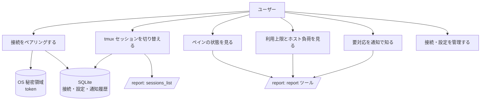
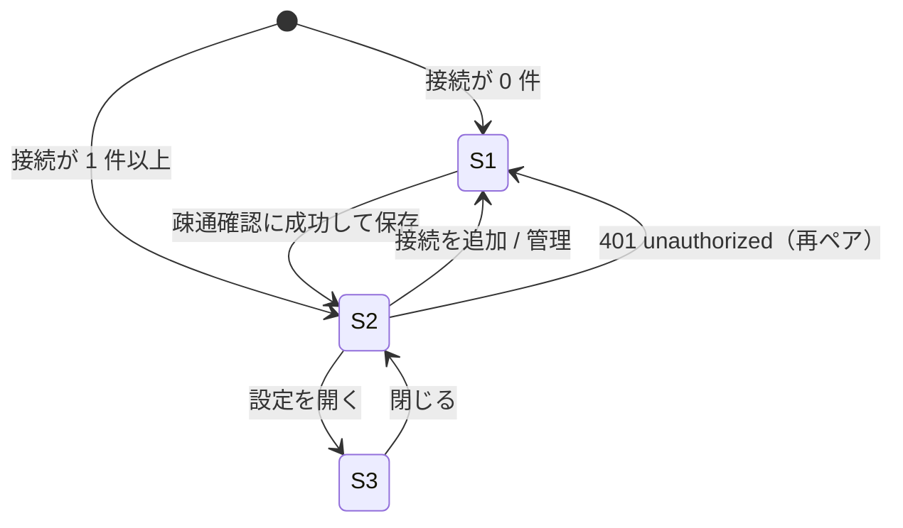

# 機能要件

[プロジェクト概要](../overview.md)の目的を満たすための機能を定める。viewer は **読み取り専用**で、swarm-console の `POST /report` だけを呼ぶ。API の形は [API 仕様](../api/endpoints.md)、保存データは [ER / データモデル](../architecture/er.md) を参照する。

## 1. ユースケース



## 2. 機能一覧

| ID | 機能 | 概要 |
|----|------|------|
| FR-PAIR-1 | ペアリング | 接続文字列の貼り付け、または `swarm-viewer://` ディープリンクの受信で接続を登録する |
| FR-PAIR-2 | 疎通確認 | 登録前に `sessions_list` を呼び、成功したときだけ保存する |
| FR-PAIR-3 | 複数接続の保存 | 接続を複数保存し、切り替えられる。token は OS 秘密領域、それ以外は SQLite に保存する |
| FR-PAIR-4 | 切断・再ペア | 接続を削除すると秘密領域の token と、その接続の保存データを消す。同じ接続名の再ペアは token を差し替える |
| FR-SESS-1 | セッション一覧 | 接続ごとに `sessions_list` で許可セッション（`allowed: true`）を取得し、上段タブに並べる |
| FR-SESS-2 | セッション切替 | タブ選択で表示セッションを切り替える。以降のポーリングは **選択中セッションの `report` だけ**を取得する |
| FR-SESS-3 | 選択の記憶・復元 | 最後に選んだセッションを接続ごとに記憶し、次回起動・接続切替時に復元する。許可外・消滅時は先頭の許可セッションへフォールバックする |
| FR-PANE-1 | ペイングリッド | `layout`（`rows`、`cols[]`）に従って T*/B* 配置のグリッドで表示する。`layout` が欠落・不整合ならペイン順のリストで表示する |
| FR-PANE-2 | ペインカード | `pos`・`agent`・`state`・`title`・`elapsed`・`activity`・`note` を表示する（§4） |
| FR-PANE-3 | 状態表示 | `state` を §3 の表示ラベルで表示する |
| FR-USE-1 | 利用上限パネル | `usage.claude[]`・`usage.codex[]`・`usage.cursor[]` を表示する（§5） |
| FR-USE-2 | ホスト負荷 | `host.cpu`・`host.swap`・`host.disk[]` の使用率を表示する（§6） |
| FR-ATT-1 | 要対応表示 | `attention[]`・`warnings[]` をバッジ・バナーで表示する（§7） |
| FR-POLL-1 | 画面更新ポーリング | 選択中セッションを既定 10 秒（設定可能）で `report` 取得する |
| FR-POLL-2 | 手動更新 | 即時に再取得する |
| FR-POLL-3 | 一時停止 | OS のサスペンド中・ウィンドウ最小化中は画面更新ポーリングを止め、復帰時に即時取得する |
| FR-NTF-1 | OS 通知 | ペインが要対応状態になったとき OS 通知する（§8） |
| FR-NTF-2 | 通知対象の範囲 | 通知は保存済み全接続の**全許可セッション**が対象。画面表示用とは別の低頻度ポーリング（既定 10 分、設定可能）で取得する |
| FR-NTF-3 | 重複通知の抑止 | 一度通知した状態は、そのペインがその状態を抜けるまで再通知しない |
| FR-SET-1 | 設定画面 | 通知オン/オフ・画面更新間隔・通知用ポーリング間隔・デバッグログのオン/オフを設定する（§9） |
| FR-ERR-1 | エラー表示 | 接続・認証・セッション許可のエラーを短い文言で表示する（§10） |

## 3. ペインの状態と表示ラベル

`state` の値は swarm-console の公式値（6 種）。表示ラベルは次のとおり。

| `state` | 表示ラベル | 意味 |
|---------|-----------|------|
| `working` | 作業中 | エージェントが作業している |
| `asking` | 答え待ち | 質問カードが出ている |
| `idle` | 指示待ち | 作業が終わって入力を待っている |
| `stalled` | 止まってるかも | `working` のまま、画面が `stalled_after`（既定 15 分）の間変わっていない |
| `shell` | 空き | エージェントが起動していない（シェルのみ） |
| `unknown` | 判定できない | 状態を判定できない |

- 上表以外の `state` 値を受け取ったときは `unknown` と同じ扱いで表示する（前方互換）
- `stalled` のカードには `changed_ago`（画面が最後に変わってからの経過）を併記する
- 既定の表示色（案）: `working`=accent、`asking`=warning、`idle`=success、`stalled`=error、`shell`・`unknown`=muted。色だけに依存せず、ラベルを必ず併記する

## 4. 画面

### 4.1 画面一覧と遷移

| 画面 | ID | 概要 |
|------|----|------|
| 接続管理 / ペアリング | S1 | 接続の追加（貼り付け・ディープリンク）、保存済み接続の一覧・切替・削除 |
| メイン | S2 | 接続切替、セッションタブ、ペイングリッド、利用上限パネル、ホスト負荷、要対応表示 |
| 設定 | S3 | 通知・ポーリング間隔 |



### 4.2 S1 接続管理 / ペアリング

- 接続文字列の貼り付け欄と「接続」ボタン。`swarm-viewer://pair?...` を OS から受信したときは同じ処理を起動する（フォーマットは [API 仕様](../api/endpoints.md) の「ペアリング形式」）
- 保存済み接続の一覧（表示名、URL の**ホスト部のみ**。token は表示しない）、切替・削除
- 疎通確認（FR-PAIR-2）に失敗したら保存せず、§10 の文言を出す
- 同じ `url` が既に保存済みなら、新規追加ではなく token の差し替えとして扱う

### 4.3 S2 メイン

```
┌ 接続: [name ▾]                                  [更新] [設定] ┐
│ [session 0] [session 1] [session 2] …   ← 上段タブ           │
│ 要対応: ● asking T2   ● stalled B3     ← attention / warnings│
│ ┌T1────┐ ┌T2────┐ ┌T3────┐ ┌T4────┐                          │
│ │カード│ │カード│ │カード│ │カード│   ← layout の rows/cols  │
│ ├B1────┤ ├B2────┤ ├B3────┤ ├B4────┤                          │
│ └──────┘ └──────┘ └──────┘ └──────┘                          │
│ 利用上限: Claude / Codex / Cursor     ホスト: CPU / Swap / Disk│
└──────────────────────────────────────────────────────────────┘
```

- 接続が複数ある場合のみ接続切替を出す
- セッションが 1 つだけの場合もタブ（1 つ）を出し、`session` 引数は常に明示する（許可セッション数に依存した `session_required` を避ける）
- ペイングリッドの下、または側部に利用上限パネルとホスト負荷を置く。利用上限・ホスト負荷はセッションに属さないホスト全体の値で、タブを切り替えても同じ値になる

### 4.4 ペインカード

| 項目 | 出典 | 表示 |
|------|------|------|
| 位置 | `pos` | カード見出し（`T1` など） |
| エージェント | `agent` | `omp` / `claude` / `codex` のバッジ。`null` はバッジなし |
| 状態 | `state` | §3 のラベルと色 |
| タイトル | `title` | 1 行。長ければ省略（全文はツールチップ） |
| 経過時間 | `elapsed` | `42m` 形式。`null` なら非表示 |
| activity | `activity` | 1 行。`null` なら非表示。`truncated: true` なら末尾に `…` |
| 作業ディレクトリ | `cwd` | ツールチップのみ |
| メモ要約 | `note.repo`、`note.items` | `repo` と `items` 先頭 3 件。残りは `+N`。`note` が `null` なら非表示。全文はツールチップ |
| 画面無変化時間 | `changed_ago` | `stalled` のとき併記 |

- カードは**表示のみ**。クリックしても何も送らない・何も変えない（ツールチップ・展開表示は可）

## 5. 利用上限パネル（FR-USE-1）

`report` の `usage` を表示する。ホスト全体の値で、セッションを絞っても変わらない。

### 5.1 取得状態

| `usage.status` | 表示 |
|----------------|------|
| `ok` | 通常表示。`fetched_at`（最終取得時刻）を小さく併記 |
| `stale` | 前回成功分をグレーアウトして表示し、「古いデータ」と `fetched_at` を出す（`reason` は折りたたみ） |
| `unavailable` | 「取得できません」。数字は出さない |
| `pending` | 「取得中」。数字は出さない |
| `disabled` | 「利用上限の取得は無効です」。数字は出さない |

サーバ側 `usage_interval`（既定 5 分）より細かく見ても数字は変わらない。viewer は画面更新と同じ `report` 取得で値を更新するだけで、usage 専用の取得はしない。

### 5.2 枠の表示

- Claude / Codex: `account` ごとに `five_hour`（5 時間枠）・`seven_day`（7 日枠）を表示する。API 上の 7 日枠のキーは `seven_day`
- Cursor: `account` ごとに `window`（`monthly` / `weekly` / `null`）と `models` を表示する
- 各枠は `available` を必ず確認する。`available: false` は「—」表示（バー・数値なし）
- `unit` が `percent` の枠はプログレスバー＋数値（`used` %）で表示する。`unit` が `usd` の枠は金額（`$` 付き）のみで、バー・しきい値色は付けない
- リセット時刻 `resets_at` はローカル時刻で表示し、相対表示（「あと 3 時間」）を併記する。`null` なら非表示

### 5.3 しきい値の色（`unit` = `percent` のみ）

| 条件 | 色 |
|------|----|
| `used` < 80 | 通常（accent） |
| 80 ≦ `used` < 95 | 黄（warning） |
| 95 ≦ `used` | 赤（error） |
| 枠の `status` = `exhausted` | 赤（`used` の値に関わらず） |

しきい値（80 / 95）は固定値とし、初版では設定項目にしない。

## 6. ホスト負荷（FR-USE-2）

| 表示 | フィールド | 備考 |
|------|-----------|------|
| CPU | `host.cpu.used_percent` | `available: false` は「—」 |
| スワップ | `host.swap.used_percent`（`used_gb` / `total_gb`） | `total_gb: 0`（スワップ無し）は「なし」 |
| ディスク | `host.disk[]` の `mount`、`used_percent`、`free_gb` | マウントごとに 1 行。`available: false` は「—」 |

- ホスト全体の値でセッションに属さない。しきい値色は §5.3 と同じ規則を使う
- `load1`・`mem_free_gb` は表示しない

## 7. 要対応・警告（FR-ATT-1）

`attention[]`（`kind`、`pane`、`detail`）と `warnings[]`（`code`、`message`）を、グリッドの上に表示する。

| `kind` | 表示 | 備考 |
|--------|------|------|
| `asking` | 答え待ち（`pane`、`detail` = 質問文の先頭） | |
| `stalled` | 止まってるかも（`pane`、`detail` = 停滞時間） | |
| `report_waiting` | 報告待ち（`pane`） | `detail` はサーバー上のファイルパスのため表示しない |
| `auth_expired` | ログイン期限切れ（`detail` = エージェント名） | `pane` は空文字。ペインに紐づけない |
| `auth_expiring` | ログイン期限間近（`detail` = エージェント名） | 同上。`auth.agents[].expires_at` があれば併記 |

- 未知の `kind` は無視せず、`kind` の文字列をそのまま表示する
- `warnings[].code` が `tmux_unavailable` / `session_missing` / `pane_unreadable` / `layout_changed` のとき、警告バナーに `message` を表示する
- `attention` の `asking` / `stalled` のペインカードは強調表示する

## 8. OS 通知（FR-NTF-1〜3）

### 8.1 対象

- 通知対象のペイン状態は `asking`（答え待ち）と `stalled`（止まってるかも）。他の状態では通知しない
- 対象は保存済みの**全接続**の**全許可セッション**。画面に表示していないセッション・接続も含む
- 通知の取得経路は 2 つ。どちらも同じ検知・重複抑止の規則を使う
  1. 画面更新ポーリング（選択中セッション、既定 10 秒）
  2. 通知用ポーリング（全接続・全許可セッションを順に `report` 取得、既定 10 分、設定可能）

### 8.2 通知の発火と重複抑止

- 通知は、ペインの `state` が通知対象に**遷移したとき**に 1 回だけ出す
- 通知済みの `(接続, セッション, ペイン ID, 状態)` は SQLite に記録し、そのペインがその状態を抜けた（`state` が別の値になった、またはペインが消えた）ことを観測するまで**再通知しない**。アプリを再起動しても記録は残り、再通知しない
- 状態を抜けたあとに再び同じ状態になったら、新しい遷移として 1 回通知する
- 接続を新規ペアリングして最初に取得した結果は、通知せず現在の状態を記録するだけにする（既存の `asking` ペインで通知が一斉に出るのを防ぐ）
- ペインの同一性は `id`（tmux ペイン ID、例 `%12`）で判定する（`pos` はレイアウト変更で変わりうるため）
- 通知本文: 接続表示名・セッション・`pos`・状態ラベル（`asking` は `attention` の `detail` も添える）。token・URL 全体は含めない
- 通知は読み取り専用のまま。通知をクリックしたときはアプリを前面に出し、該当接続・セッションのタブを選択する

### 8.3 無効時・失敗時

- 設定で通知をオフにしている間は、通知用ポーリングも行わない（OS 通知のためだけの取得のため）。画面更新ポーリングは続く
- OS が通知を許可していない場合は、設定画面にその旨を表示する
- 通知用ポーリングの途中で接続・セッションの取得が失敗したら、その接続・セッションを飛ばして次へ進む。失敗したことで通知済み記録を変更しない

## 9. 設定画面 S3（FR-SET-1）

| 項目 | 選択肢 | 既定 |
|------|--------|------|
| 通知 | オン / オフ | オン |
| 画面更新間隔（選択中セッション） | 5 / 10 / 30 / 60 秒 | 10 秒 |
| 通知用ポーリング間隔（全セッション） | 5 / 10 / 30 / 60 分 | 10 分 |
| デバッグログ | オン / オフ | オフ |

- 設定は SQLite に保存する（アプリ全体で 1 セット。接続ごとの設定は持たない）
- 画面更新間隔を 5 秒より細かくしても、サーバのサンプラー（`poll_interval` 既定 5 秒）より新鮮にはならないため、選択肢に含めない

## 10. エラー表示（FR-ERR-1）

ユーザー向けの文言は短くし、詳細コードは折りたたみで見せる。

| 状況 | 検知 | 表示 |
|------|------|------|
| tailnet 未接続・到達不可 | 接続タイムアウト・ネットワークエラー | 「ホストに届きません。Tailscale 接続を確認してください」 |
| 401 `unauthorized` | HTTP 401 | 「認証できません。再ペアしてください」→ S1 へ誘導 |
| 403 `forbidden_scope` | HTTP 403 | 「このトークンでは接続できません（report 用が必要）」 |
| `session_required` | ツールエラー | 「セッションを選んでください」→ タブから選択。viewer は常に `session` を明示するため通常は出ない |
| `session_forbidden` | ツールエラー | 「このセッションは許可されていません」。次回の `sessions_list` で一覧から外れる |
| `invalid_args`（`details.field` = `session`） | ツールエラー | 「セッションが存在しません」。一覧を再取得して選択を更新する |
| `tmux_unavailable` / `session_missing` | `warnings[]` | 警告バナー（§7） |
| `usage.status` が `ok` 以外 | `usage` | 利用上限パネルに状態を表示（§5.1） |

- 取得に失敗してもこれまで表示していた内容は消さず、「最終更新時刻」と失敗の状態を併記してグレーアウトする
- 失敗時は次の周期で自動再試行する。連続失敗でも間隔は延ばさない（最小構成。バックオフは持たない）

## 11. 範囲外（確認用）

- `/ops`、ペインへの送信・操作・メモ書き込み・`dispatch`
- `pane_tail` / `ask_card` / `report_read` の詳細ビュー
- Android 版、自動更新、コード署名

## 改訂履歴

| 版 | 日付 | 変更内容 | 変更理由 |
|----|------|---------|---------|
| 1.0 | 2026-11-03 | 新規作成 | 初版 |
| 1.1 | 2026-11-03 | 設定画面にデバッグログのオン/オフを追加 | 非機能要件 NFR-LOG-2 との整合 |
