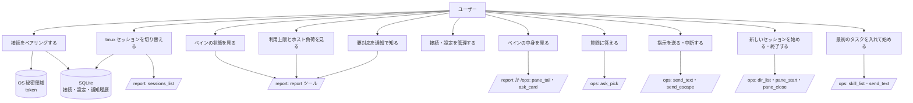
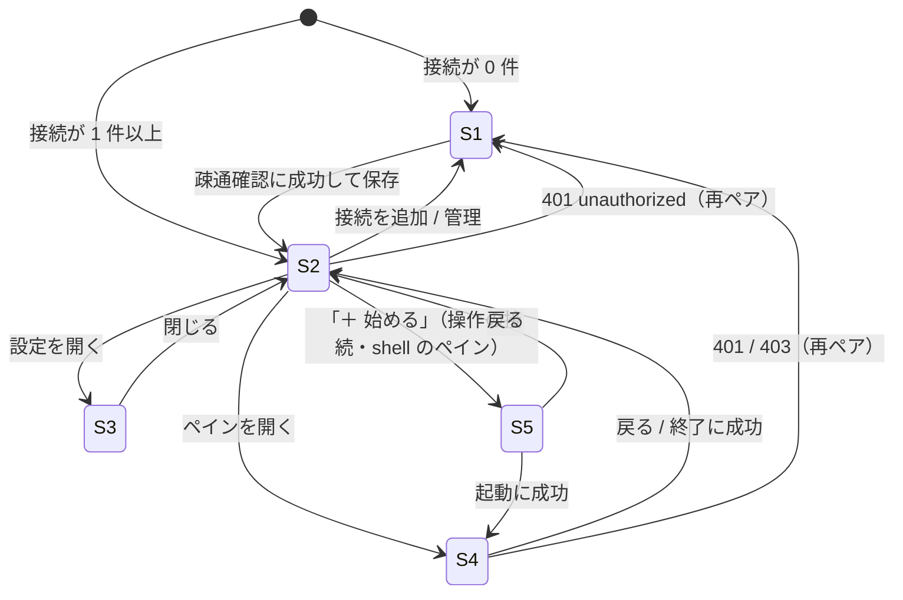
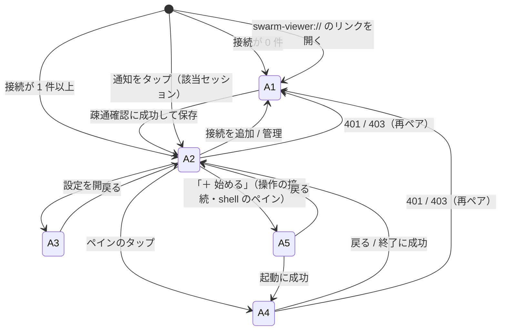

# 機能要件

[プロジェクト概要](../overview.md)の目的を満たすための機能を定める。viewer は **既定では見るだけ**で、swarm-console の `POST /report` を呼ぶ。接続を「操作」（`POST /ops`）として登録したときだけ、ペインへの送信・中断・起動・終了ができる（FR-OPS-1）。呼べるツールは接続の種類ごとの許可リストだけ（NFR-SEC-1）。API の形は [API 仕様](../api/endpoints.md)、保存データは [ER / データモデル](../architecture/er.md) を参照する。

> §1〜§11 はデスクトップ版（Windows / macOS）の機能。Android 版は同じ `/report`・`/ops` に接続するビューア（操作の接続のときだけ操作できる）で、デスクトップ版と共通の規則（§3 の状態ラベル、§5〜§7 の表示、§8 の通知の規則、§10 のエラー表示、§4.5〜§4.9 の操作モード）は変えず、差分を [§12](#12-android-版) に定める。

## 1. ユースケース



UC8〜UC11 は操作の接続（`/ops`）でだけ行える。UC7 は見るだけの接続でも行える（質問は読むだけ）。UC11 は UC10 の起動に続けて、スキルと本文の最初のタスクを入れる（FR-OPS-11）。

## 2. 機能一覧

| ID | 機能 | 概要 |
|----|------|------|
| FR-PAIR-1 | ペアリング | 接続文字列の貼り付け、または `swarm-viewer://` ディープリンクの受信で接続を登録する |
| FR-PAIR-2 | 疎通確認 | 登録前に `sessions_list` を呼び、成功したときだけ保存する |
| FR-PAIR-3 | 複数接続の保存 | 接続を複数保存し、切り替えられる。token は OS 秘密領域、それ以外は SQLite に保存する |
| FR-PAIR-4 | 切断・再ペア | 接続を削除すると秘密領域の token と、その接続の保存データを消す。同じ接続名の再ペアは token を差し替える |
| FR-SESS-1 | セッション一覧 | 接続ごとに `sessions_list` で許可セッション（`allowed: true`）を取得し、上段タブに並べる |
| FR-SESS-2 | セッション切替 | タブ選択で表示セッションを切り替える。以降のポーリングは **選択中セッションの `report` だけ**を取得する |
| FR-SESS-3 | 選択の記憶・復元 | 最後に選んだセッションを接続ごとに記憶し、次回起動・接続切替時に復元する。許可外・消滅時は先頭の許可セッションへフォールバックする |
| FR-PANE-1 | ペイングリッド | `layout`（`rows`、`cols[]`）に従って T*/B* 配置のグリッドで表示する。`layout` が欠落・不整合ならペイン順のリストで表示する |
| FR-PANE-2 | ペインカード | `pos`・`agent`・`state`・`title`・`elapsed`・`activity`・`note` を表示する（§4） |
| FR-PANE-3 | 状態表示 | `state` を §3 の表示ラベルで表示する |
| FR-USE-1 | 利用上限パネル | `usage.claude[]`・`usage.codex[]`・`usage.cursor[]` を表示する（§5） |
| FR-USE-2 | ホスト負荷 | `host.cpu`・`host.mem`・`host.swap`・`host.disk[]` の使用率を表示する（§6） |
| FR-ATT-1 | 要対応表示 | `attention[]`・`warnings[]` をバッジ・バナーで表示する（§7） |
| FR-POLL-1 | 画面更新ポーリング | 選択中セッションを既定 10 秒（設定可能）で `report` 取得する |
| FR-POLL-2 | 手動更新 | 即時に再取得する |
| FR-POLL-3 | 一時停止 | OS のサスペンド中・ウィンドウ最小化中は画面更新ポーリングを止め、復帰時に即時取得する |
| FR-POLL-4 | 前回の状態の表示 | 起動直後・取得失敗時は、SQLite に保存した直近のスナップショット（接続×セッションごとに最新 1 件）をグレーアウトして「前回取得 HH:MM」とともに表示し、取得に成功したら置き換える |
| FR-NTF-1 | OS 通知 | ペインが要対応状態になったとき OS 通知する（§8） |
| FR-NTF-2 | 通知対象の範囲 | 通知は保存済み全接続の**全許可セッション**が対象。画面表示用とは別の低頻度ポーリング（既定 10 分、設定可能）で取得する |
| FR-NTF-3 | 重複通知の抑止 | 一度通知した状態は、そのペインがその状態を抜けるまで再通知しない |
| FR-SET-1 | 設定画面 | 通知オン/オフ・画面更新間隔・通知用ポーリング間隔・デバッグログのオン/オフを設定する（§9） |
| FR-ERR-1 | エラー表示 | 接続・認証・セッション許可のエラーを短い文言で表示する（§10） |
| FR-APP-1 | トレイ常駐 | ウィンドウを閉じても終了せずトレイ（macOS はメニューバー）に常駐する。トレイメニューは「開く」「終了」。通知用ポーリングは通知オンの間、常駐中も継続する |
| FR-APP-2 | 単一インスタンス | 2 つ目の起動は既存ウィンドウを前面に出す。ディープリンクは既存インスタンスで処理する |
| FR-OPS-1 | 接続の種類 | 接続を「見るだけ」（`/report`）と「操作」（`/ops`）の 2 種類で持つ。種類は接続文字列の `url` の path で決める（保存データに種類の列は持たない）。見るだけの接続は `/ops` を呼ぶコードパスを一切通らず、操作の UI も出さない（§4.9） |
| FR-OPS-2 | 種類の表示と警告 | 接続一覧・メイン画面のヘッダに種類のバッジ（「操作」「見るだけ」）を出す。ペアリング確認画面は、操作の接続のときだけ強い警告を出す（§4.2） |
| FR-OPS-3 | ペイン詳細 | ペインカードのクリック・要対応の項目から、ペイン詳細を開き、`pane_tail` を等幅のテキストで表示する。手動の更新と、開いている間だけの 5 秒ごとの自動更新。見るだけの接続でも出す（§4.5） |
| FR-OPS-4 | 質問カード | 状態が `asking` のペインで `ask_card` を表示する。操作の接続は選択肢の大きなボタンと「その他（自分で書く）」で `ask_pick` を送る（押したらすぐ送る）。見るだけの接続は質問文と選択肢の一覧だけ（§4.6） |
| FR-OPS-5 | 指示を送る | 操作の接続のペイン詳細に送信欄を出し、`send_text`（8000 字まで）で送る。状態により無効にして理由を出す（§4.7） |
| FR-OPS-6 | 中断 | 操作の接続のペイン詳細に、目立たない「中断」を置く。確認ダイアログを経たときだけ `send_escape`（`confirm: true`）を送る（§4.7） |
| FR-OPS-7 | 新しいセッションを始める | 操作の接続で、`shell` のペインのカードの「＋ 始める」から、エージェント → フォルダ（`dir_list` で 1 階層ずつ）→（任意の最初のタスク。FR-OPS-11）→ タイトル → 確認の順に進み `pane_start` で起動する（§4.8） |
| FR-OPS-8 | 終了 | 操作の接続で、`idle`・`shell` のペインだけ「終了」を出す。確認ダイアログを経たときだけ `pane_close` を送る（確認済みの値が無ければ呼ばず `confirm_required`。`send_escape` と同じ）。`exit_timeout` は「もう一度試す」を出す（§4.7） |
| FR-OPS-9 | 二重送信の防止 | 操作の送信中は、同じペインのボタンをすべて無効にする。アプリ側（service）も同じペインへの操作を排他にし、実行中に次が来たら通信せずに断る（§4.9） |
| FR-OPS-10 | 操作結果・エラーの表示 | 操作の結果は固定文言のトースト（デスクトップの `pane_start`・`pane_close` の成功は画面遷移でトーストなし）、失敗は §10.1 の固定文言で出す。ホストの `message` は画面に出さない（§10.1） |
| FR-OPS-11 | 最初のタスクを入れる | 操作の接続で、新しいセッションの起動時に、任意で「スキル」（`skill_list` の一覧から 1 つ）と「本文」を指定できる。`pane_start` に成功して `state` が `idle` のときだけ、`send_text` で最初のタスクとして送る。どちらも空なら今までどおり起動だけ。送信に失敗しても起動は取り消さず、「もう一度送る」で `send_text` だけを送り直せる。`pane_start` から `send_text` までは 1 つの操作として同じペインの排他（FR-OPS-9）を保つ（§4.8） |

### 2.1 操作モード（Issue #97）の受け入れ条件との対応

| # | 受け入れ条件 | 仕様 |
|---|-------------|------|
| 1 | 見るだけの接続では操作 UI が一切出ず、`/ops` を呼ぶコードパスを通らない（テストで確認） | FR-OPS-1、§4.9、NFR-SEC-1・NFR-SEC-14、NFR-QLT-4（1）・NFR-AND-QLT-5 |
| 2 | 操作の接続のペアリング確認で警告が出て、一覧・メインで種類が見分けられる | FR-OPS-2、§4.2、NFR-SEC-13 |
| 3 | ペインのクリック / タップで `pane_tail` の中身が見え、更新できる | FR-OPS-3、§4.5、NFR-PERF-8 |
| 4 | 質問カードで選択肢ボタン・「その他」入力から答えられる | FR-OPS-4、§4.6 |
| 5 | 指示を送れ、受け付けの成否が表示される | FR-OPS-5・FR-OPS-10、§4.7・§10.1 |
| 6 | Esc は確認ダイアログを経ないと送れない | FR-OPS-6、§4.7、NFR-SEC-12 |
| 7 | 空きペインから エージェント → フォルダ（`dir_list`）→ タイトル で起動できる | FR-OPS-7、§4.8 |
| 8 | 終了は確認ダイアログを経る | FR-OPS-8、§4.7、NFR-SEC-12 |
| 9 | Galaxy Fold7（閉じ / 開き）とデスクトップで片手でも迷わず操作できる | FR-AND-10・FR-AND-11（§12.6）、NFR-DSG-16、NFR-AND-ENV-2 |
| 10 | 許可リスト外のツール名は呼べない（種類別の定数） | NFR-SEC-1、NFR-AND-SEC-5、[API 仕様 §1.2](../api/endpoints.md) |
| 11 | token・本文がログに出ない | NFR-SEC-11、NFR-LOG-3、NFR-AND-LOG-2、NFR-QLT-4（5） |

### 2.2 最初のタスク（Issue #103）の受け入れ条件との対応

| # | 受け入れ条件 | 仕様 |
|---|-------------|------|
| 1 | 空きペイン（`shell`）から エージェント → フォルダ → スキル（任意）→ 本文（任意）→ タイトル → 確認 で起動でき、起動後に最初のタスクが送られる | FR-OPS-7・FR-OPS-11、§4.8 |
| 2 | スキル一覧を取得できる（`skill_list`）。取れない・古いホストでも、スキルなし・本文だけ・タスクなしで起動できる | FR-OPS-11、§4.8・§10.1、[API 仕様 §1.5](../api/endpoints.md)、[アーキテクチャ設計 §11](../architecture/overview.md) の未確認事項 #17 |
| 3 | 起動が成功しても `idle` でなければ最初のタスクを勝手に送らず、ペイン詳細から送れる | FR-OPS-11・FR-OPS-5、§4.7・§4.8・§10.1 |
| 4 | 最初のタスクの送信に失敗したら起動を取り消さず、「もう一度送る」で `send_text` だけ再送できる（`pane_start` の二重起動をしない） | FR-OPS-9・FR-OPS-10・FR-OPS-11、§4.8・§10.1 |
| 5 | 見るだけの接続ではスキル・本文の部品が出ず、`skill_list` も呼ばない（通信 0 件・403） | FR-OPS-1・FR-OPS-11、§4.8・§4.9、NFR-SEC-1・NFR-SEC-14、NFR-QLT-4（1）・NFR-AND-QLT-5 |
| 6 | 許可リストは `/ops` 11 個・`/report` 4 個（種類別の定数）で、スキル名・本文がログに出ない | NFR-SEC-1・NFR-SEC-11、NFR-AND-SEC-5・NFR-AND-SEC-9、NFR-LOG-3、NFR-AND-LOG-2、NFR-QLT-4（5）、[API 仕様 §1.2](../api/endpoints.md) |
| 7 | 折りたたみ（Compact）・展開（Medium 以上）・デスクトップで片手でも迷わず操作できる（最小 48dp） | FR-AND-11・FR-AND-12（§12.6）、NFR-DSG-16、NFR-AND-ENV-2 |

## 3. ペインの状態と表示ラベル

`state` の値は swarm-console の公式値（6 種）。表示ラベルは次のとおり。

| `state` | 表示ラベル | 意味 |
|---------|-----------|------|
| `working` | 作業中 | エージェントが作業している |
| `asking` | 答え待ち | 質問カードが出ている |
| `idle` | 指示待ち | 作業が終わって入力を待っている |
| `stalled` | 止まってるかも | `working` のまま、画面が `stalled_after`（既定 15 分）の間変わっていない |
| `shell` | 空き | エージェントが起動していない（シェルのみ） |
| `unknown` | 判定できない | 状態を判定できない |

- 上表以外の `state` 値を受け取ったときは `unknown` と同じ扱いで表示する（前方互換）
- `stalled` のカードには `changed_ago`（画面が最後に変わってからの経過）を併記する
- 既定の表示色（案）: `working`=accent、`asking`=warning、`idle`=success、`stalled`=error、`shell`・`unknown`=muted。色だけに依存せず、ラベルを必ず併記する
- state とは別に、attention 由来のバッジ（`report_waiting` の「報告待ち」）をカードに併記することがある（§7）。`idle`（指示待ち）のカードに「報告待ち」が並ぶことがある

## 4. 画面

### 4.1 画面一覧と遷移

| 画面 | ID | 概要 |
|------|----|------|
| 接続管理 / ペアリング | S1 | 接続の追加（貼り付け・ディープリンク）、保存済み接続の一覧・切替・削除 |
| メイン | S2 | 接続切替、セッションタブ、ペイングリッド、利用上限パネル、ホスト負荷、要対応表示 |
| 設定 | S3 | 通知・ポーリング間隔 |
| ペイン詳細 | S4 | ペインの状態・`pane_tail`・質問カード。操作の接続では送信欄・中断・終了も出す（§4.5〜§4.7） |
| 新しいセッション | S5 | `shell` のペインでエージェント・フォルダ・（任意の最初のタスク: スキル・本文）・タイトルを選んで起動する。操作の接続だけ（§4.8） |



### 4.2 S1 接続管理 / ペアリング

- 接続文字列の貼り付け欄と「接続」ボタン。`swarm-viewer://pair?...` を OS から受信したときは同じ処理を起動する（フォーマットは [API 仕様](../api/endpoints.md) の「ペアリング形式」）
- 保存済み接続の一覧（表示名、URL の**ホスト部のみ**。token は表示しない）、切替・削除
- 疎通確認（FR-PAIR-2）に失敗したら保存せず、§10 の文言を出す
- 同じ `url` が既に保存済みなら、新規追加ではなく token の差し替えとして扱う
- 接続の種類（FR-OPS-1）は `url` の path で決まる。`/report` は「見るだけ」、`/ops` は「操作」。保存済み接続の一覧に種類のバッジを出す（FR-OPS-2。バッジは色だけに頼らず「操作」「見るだけ」の文言を併記する）
- 確認画面（ペアリング確認のモーダル）に、接続の種類のバッジを出す。**操作の接続のときだけ**、「この接続はペインに送信・中断・起動・終了できます」の警告（インラインアラート）に加えて、「token が漏れると、この Tailscale 内からペインを操作されます。紛失したらホストで `swarm-console token revoke <名前>` を実行してください」を添える（NFR-SEC-13）。見るだけの接続では出さない

### 4.3 S2 メイン

```
┌ 接続: [name ▾]                                  [更新] [設定] ┐
│ [session 0] [session 1] [session 2] …   ← 上段タブ           │
│ 要対応: ● asking T2   ● stalled B3     ← attention / warnings│
│ ┌T1────┐ ┌T2────┐ ┌T3────┐ ┌T4────┐                          │
│ │カード│ │カード│ │カード│ │カード│   ← layout の rows/cols  │
│ ├B1────┤ ├B2────┤ ├B3────┤ ├B4────┤                          │
│ └──────┘ └──────┘ └──────┘ └──────┘                          │
│ 利用上限: Claude / Codex / Cursor     ホスト: CPU / Swap / Disk│
└──────────────────────────────────────────────────────────────┘
```

- 接続が複数ある場合のみ接続切替を出す
- セッションが 1 つだけの場合もタブ（1 つ）を出し、`session` 引数は常に明示する（許可セッション数に依存した `session_required` を避ける）
- ペイングリッドの下、または側部に利用上限パネルとホスト負荷を置く。利用上限・ホスト負荷はセッションに属さないホスト全体の値で、タブを切り替えても同じ値になる
- 接続の種類のバッジ（「操作」「見るだけ」）を、接続名の隣（接続が 1 つのときも）に出す（FR-OPS-2）
- ペイン詳細（S4）への入口は、ペインカード（§4.4）と要対応バー（§7）の項目。操作の接続では、`shell` のペインのカードに「＋ 始める」（S5 への入口）を出す。見るだけの接続には出さない

### 4.4 ペインカード

| 項目 | 出典 | 表示 |
|------|------|------|
| 位置 | `pos` | カード見出し（`T1` など） |
| エージェント | `agent` | `omp` / `claude` / `codex` のバッジ。`null` はバッジなし |
| 状態 | `state` | §3 のラベルと色 |
| タイトル | `title` | 1 行。長ければ省略（全文はツールチップ） |
| 経過時間 | `elapsed` | `42m` 形式。`null` なら非表示 |
| activity | `activity` | 1 行。`null` なら非表示。`truncated: true` なら末尾に `…` |
| 作業ディレクトリ | `cwd` | ツールチップのみ |
| メモ要約 | `note.repo`、`note.items` | S2 のカード: `repo` と `items` 先頭 3 件。残りは `+N`。`note` が `null` なら非表示。全文はツールチップ。S4 のヘッダ（§4.5）は全件・全文を折り返して出す |
| 画面無変化時間 | `changed_ago` | `stalled` のとき併記 |

- カード自体は何も送らない・何も変えない（ツールチップ・展開表示は可）。カードをクリックするとペイン詳細（S4。§4.5）を開く

### 4.5 S4 ペイン詳細（FR-OPS-3）

- 開き方: S2 のペインカードをクリック、または要対応バー（§7）の項目から。`asking` の項目は、質問カード（§4.6）のあるこの画面へ直接進む。見るだけの接続でも開ける
- ヘッダ: ペイン位置・状態ラベル（§3。`report` の値）・タイトル・`cwd`・メモ（`note.repo` と `note.items` の全件。要約せず、折り返して全文を出す。タッチ・キーボードでも読める。NFR-DSG-19）・エージェント。接続の種類のバッジ
- 本文: `pane_tail`（`session` と `pane`（`report` の `panes[].pos`）を明示）を、等幅のテキストとして出す。HTML としては解釈しない（NFR-SEC-10）。既定 30 行で、「もっと見る」で 100 行 → 200 行（最大 200）にする。`raw` は付けない
- 更新: 手動の「更新」ボタンと、**開いている間だけ 5 秒ごと**の自動更新（NFR-PERF-8）。画面が見えていないとき（最小化・非表示）は止め、見えたら即時に 1 回取得する。デスクトップは、確認ダイアログが開いている間も自動更新を止める。「その他（自分で書く）」・指示の入力は、自動更新で消えない（デスクトップは `hx-preserve`、Android は ViewModel の状態）。操作のボタン・送信は自動更新に先んじて送る（デスクトップは `hx-sync`）。401・403 は自動更新を止めて再ペアリングへ誘導する（§10）。取得に失敗したら、直前の表示を残し、固定文言のバナーを出す
- 状態の取り方: 開くとき・更新のたびに `report` を取り直し（既存の取得の single-flight を使う）、ヘッダと「できる操作」を決める。`pane_tail` は常に取る。`ask_card` は状態が `asking` のときだけ取る（`unknown` のペインは `unsupported_agent` になるため `pane_tail` だけ）
- ペインが `report` から消えた（`pane_not_found`）ときは、「ペインが見つかりません。画面を更新してください」（§10.1）を出して操作部品を出さない

### 4.6 質問カード（FR-OPS-4）

`ask_card` が `asking: true` を返したときの表示。

| 接続の種類 | 表示 |
|-----------|------|
| 操作 | 質問文と、選択肢の**大きなボタン**（縦に並べる。`recommended` に「おすすめ」の印）。`allows_custom` が `true` なら「その他（自分で書く）」→ 入力欄（8000 字まで）→ 送信 |
| 見るだけ | 質問文と選択肢の**一覧**（ボタンにしない）と、「この質問には、操作できる接続から答えられます」の 1 行 |

- 選択肢のボタンは**押したらすぐ `ask_pick {n}` を送る**（確認は挟まない）。「その他」は `ask_pick {text}`。`n` と `text` は同時に指定しない
- 送信中は、同じペインのボタン（選択肢・その他・送信・中断・終了）をすべて無効にする（FR-OPS-9）。結果は固定文言のトースト（§10.1）。送れたらカードを取り直して閉じる
- 送る前にカードを取り直さない（押したらすぐ送る）。`cursor_mismatch`・`not_asking`・`option_out_of_range` のときは、カードを取り直して最新の質問を出す

### 4.7 指示を送る・中断・終了（FR-OPS-5・6・8。操作の接続のみ）

指示を送る（FR-OPS-5）:

- ペイン詳細の下部に送信欄。`send_text`（1〜8000 字、`\n`・`\t` は可、それ以外の制御文字は送る前に拒否する）。送信中は無効。`accepted: false` は「受け付けられませんでした」（§10.1）。送れたら入力欄を空にする
- 状態が `working`・`asking`・`shell`・`unknown` のとき、送信欄は**無効**にして理由を 1 行で出す。`idle`・`stalled` は送れる

| 状態 | 送信欄 | 理由の文言 |
|------|--------|-----------|
| `idle`・`stalled` | 使える | — |
| `working` | 無効 | 「作業中のため送れません。終わるまで待つか、中断してください」 |
| `asking` | 無効 | 「質問に答えてから送れます」 |
| `shell` | 無効 | 「エージェントが動いていません。「始める」から起動してください」 |
| `unknown` | 無効 | 「このペインには送れません」 |

中断（FR-OPS-6）:

- 詳細の最下部に、控えめな（目立たない）ボタン。`working`・`stalled`・`asking`・`idle` で出す
- 押すと確認ダイアログ「作業中のエージェントを止めます」（デスクトップは共通の確認ダイアログで取り消しは「キャンセル」と「中断する」、Android は `AppDialog` で「取り消し」と「中断する」）を出し、確定したときだけ `send_escape {confirm: true}` を送る。確認を経ない経路を作らない。アプリ側も、確認済みのフォーム値（デスクトップは `confirm=true`）が無ければ `send_escape` を呼ばない（NFR-SEC-12）
- 結果: `interrupted: true` は「中断しました」、`ok: false` は「状態が変わりませんでした」（§10.1）

終了（FR-OPS-8）:

- `idle`・`shell` のペインだけ「終了」を出す。確認ダイアログを経たときだけ `pane_close` を送る（NFR-SEC-12）。デスクトップは `POST P/close` に確認ダイアログを経たフォームだけが付ける `confirm=true` が無ければ `pane_close` を呼ばず `confirm_required` で断り、送る前にサーバー側でも最新の `report` のペイン状態を再検査する（`idle`・`shell` 以外は通信せず `invalid_state`）。成功したらメイン画面へ戻る（デスクトップは `HX-Redirect`）
- `exit_timeout`（終了コマンドを送ったが `shell` に戻らなかった）は、「終了が間に合いませんでした（もう一度試せます）」に「もう一度試す」ボタンを付けて出す（`pane_close` は呼び直してよい）。ボタンはその失敗のときだけ出し、ほかの結果が出たら落とす

### 4.8 S5 新しいセッション（FR-OPS-7・FR-OPS-11。操作の接続のみ）

1. S2 の `shell` のペインのカードの「＋ 始める」から入る（`shell` のペインだけ）
2. エージェントを選ぶ: `omp` / `claude` / `codex`（ラジオまたは大きな選択ボタン）
3. フォルダを選ぶ: `dir_list`（`path` 省略 = `allowed_roots`）から 1 階層ずつたどるピッカー。パンくず・戻る（1 つ上へ）・「このフォルダを選ぶ」・各行を押して 1 つ下へ。`git: true` のフォルダには印を付ける。`truncated: true` なら「一部のみ表示」の 1 行を出す
   - 「最近使ったフォルダ」: 現在の `report` の `panes[]` のうち `agent` があるペインの `cwd` を、重複を除いて最大 5 件（保存はしない）。許可外のフォルダなら `pane_start` が `forbidden_path` を返し、固定文言で出す
4. スキルを選ぶ（任意）: エージェントを選んだあとに `skill_list`（`agent` を渡す。`cwd` は渡さない。読み取り系なので通信の上限は 10 秒）で一覧を取得し、1 つ選ぶか「スキルなし」を選ぶ。一覧の取得結果は画面を開いている間のメモリだけに持ち、保存しない。各行は `name` と `description` を出し、`invoke` は選んだあとの確認で使う。`truncated: true` なら「一部のみ表示」の 1 行を出す
   - `unknown_tool`（ホストが古い）は、この手順に「スキルの一覧を取得できません（ホストの swarm-console が古い可能性があります）」を出す。それ以外の失敗は「スキルの一覧を読み込めませんでした」に「再読み込み」を付けて出す（§10.1）
   - どちらの場合も「スキルなし」で、本文だけのタスク・タスクなしの起動はできる（スキルが選べないことで起動を止めない）
5. 本文を入れる（任意）: 複数行の入力欄
6. タイトルを入れる（1〜80 字、制御文字なし。前後の空白は除く）
7. 確認（エージェント・フォルダ・スキル・本文の先頭を要約）→ `pane_start`。待つ間はスピナーを出してボタンを無効にする。`ok: false` は理由（§10.1。「起動を確認できませんでした（状態: …）」）を出し、最初のタスクは送らない。成功したらそのペインの詳細（S4）を開く（デスクトップはトーストを出さず `HX-Redirect`、Android は「起動しました」のトースト）。デスクトップの `POST P/start` は 2 段階で、確認の前（`confirm=1` が無いとき）は確認画面を返すだけで `pane_start` も `send_text` も呼ばない。`shell` 以外のペインへは、送る前にサーバー側でも最新の `report` で再検査し、通信せず `invalid_state` で断る

確認画面が最初のタスクの要約を出して確定を受けるので、最初のタスクのための確認ダイアログは足さない（`pane_start` の確認画面だけ）。見るだけの接続には「スキル」「本文」の部品も描画しない（§4.9）。

最初のタスクの送信（FR-OPS-11）:

- 送る文字列は、スキルと本文の両方なら `<invoke> <本文>`（半角スペース 1 つ）、スキルだけなら `<invoke>`、本文だけなら `<本文>`。`invoke` は `skill_list` が返す「そのスキルを呼ぶために送る入力文字列」（例 `/impl`）で、エージェントごとの呼び出し構文は viewer では持たず、そのまま使う。スキルも本文も空なら最初のタスクは無く、今までどおり起動だけ
- 送る文字列の合計は 1〜8000 字、制御文字は `\n`・`\t` だけ（`send_text` と同じ）。違反は送る前に入力欄の固定文言（§10.1 の `forbidden_control_char`・`text_too_long`）で拒否し、`pane_start` も呼ばない
- `pane_start` が `ok: true` で、`state` が `idle` のときだけ、`send_text` で最初のタスクを送る。`state` が `idle` 以外のときは送らず、結果の表示で「起動しました。最初のタスクはまだ送っていません（状態: …）。ペイン詳細から送れます」と「ペイン詳細を開く」を出す（デスクトップは `HX-Redirect` でトーストが消えるため、遷移せずこの表示で知らせる）。本文はこの表示の間だけメモリに残し、「もう一度送る」は出さない（`idle` に戻ってからペイン詳細の送信欄から送る）
- `send_text` が成功（`accepted: true`）したら、起動だけのときと同じく S4 を開く
- `send_text` が失敗、または `accepted: false` のときは、自動の再送はせず、起動も取り消さない（`pane_close` は呼ばない）。結果の表示で「起動しました。最初のタスクを送れませんでした」と理由（§10.1 の送信の文言）を出し、「ペイン詳細を開く」と「もう一度送る」を出す。「もう一度送る」は `send_text` だけを送り直す（`pane_start` は呼ばない）。送る前に、同じ検査（ペインが `idle` か）を最新の `report` で行い、`idle` でなければ通信せず `invalid_state` で断る
- 本文は、この結果の表示の間だけメモリに残す（デスクトップはフラグメントの hidden 項目、Android は ViewModel）。保存せず、ログにも出さない（NFR-SEC-11・NFR-AND-SEC-9）
- `pane_start` から `send_text` までは 1 つの操作として、同じペインの排他（FR-OPS-9）を保ったまま行う。通信の上限は各ツールの上限（`pane_start` 50 秒、`send_text` 30 秒）で、合算の上限は設けない
- スキル名・`description`・`invoke` はホスト由来の信頼できない入力として、常にテキストで描画する（NFR-SEC-10・NFR-AND-SEC-8。`templ.Raw` を使わない）
- デスクトップのルート: `GET P/start/skills?agent=`（スキルの選択部品のフラグメント。`skill_list`。見るだけの接続は通信せず 403 と固定文言）。`POST P/start` は `agent`・`cwd`・`title` に加えて `skill`（`skill_list` が返した `invoke` の文字列）・`task`（本文）を受ける。`skill` は長さと制御文字だけを検査し、一覧との照合はしない（任意の文字列は本文欄からも送れるため、権限は増えない）。`resend=1`（「もう一度送る」）は `skill`・`task` だけを使って `send_text` だけを送る

### 4.9 見るだけの接続と操作の接続の出し分け（FR-OPS-1・FR-OPS-9）

| 部品 | 見るだけ（`/report`） | 操作（`/ops`） |
|------|---------------------|----------------|
| 種類のバッジ | 「見るだけ」 | 「操作」 |
| ペイン詳細のヘッダ・`pane_tail`・更新 | 出す | 出す |
| 質問カード | 質問文と選択肢の一覧（ボタンなし）＋1 行の案内 | 選択肢のボタン・「その他」入力 |
| 送信欄・中断・終了・「＋ 始める」 | **描画しない**（HTML / Compose にも出さない）。代わりにペイン詳細に 1 行の案内「この接続は見るだけです。ペインへの指示は、操作の接続（/ops）で登録すると入力できます」（操作の部品ではない。Issue #101） | 出す（状態に応じて §4.7） |
| スキル・本文（最初のタスク。§4.8） | **描画しない**（`skill_list` も呼ばない） | 出す（新しいセッションの手順。§4.8） |
| 呼べるツール | `sessions_list`・`report`・`pane_tail`・`ask_card`（4 個） | 左の 4 つ ＋ `ask_pick`・`send_text`・`send_escape`・`pane_start`・`pane_close`・`dir_list`・`skill_list`（11 個） |

- 見るだけの接続は、`/ops` を呼ぶコードパスを一切通らない。操作系のルートを直接呼んでも（`GET P/start/skills` を含む）、**コンソールに通信せず** 403 と「この接続では操作できません（見るだけの接続です）」を返す
- 同じペインへの操作は排他にする。アプリ側（service）も、実行中に次の操作が来たら通信せず「前の操作がまだ終わっていません」で断る（ホストの `busy_timeout` を避ける）
- 操作結果・エラーは日本語の固定文言で出す（§10.1）。token・送信本文・最初のタスクの本文・スキル名・`invoke`・`pane_tail` と `ask_card` の本文はログに出さない（NFR-SEC-11・NFR-LOG-3）

## 5. 利用上限パネル（FR-USE-1）

`report` の `usage` を表示する。ホスト全体の値で、セッションを絞っても変わらない。

### 5.1 取得状態

| `usage.status` | 表示 |
|----------------|------|
| `ok` | 通常表示。`fetched_at`（最終取得時刻）を小さく併記 |
| `stale` | 前回成功分をグレーアウトして表示し、「古いデータ」と `fetched_at` を出す（`reason` は折りたたみ） |
| `unavailable` | 「取得できません」。数字は出さない |
| `pending` | 「取得中」。数字は出さない |
| `disabled` | 「利用上限の取得は無効です」。数字は出さない |

サーバ側 `usage_interval`（既定 5 分）より細かく見ても数字は変わらない。viewer は画面更新と同じ `report` 取得で値を更新するだけで、usage 専用の取得はしない。

### 5.2 枠の表示

- Claude / Codex: `account` ごとに `five_hour`（5 時間枠）・`seven_day`（7 日枠）を表示する。API 上の 7 日枠のキーは `seven_day`
- Cursor: `account` ごとに `window`（`monthly` / `weekly` / `null`）と `models` を表示する
- 各枠は `available` を必ず確認する。`available: false` は「—」表示（バー・数値なし）
- Claude / Codex で `five_hour`・`seven_day` の 2 枠とも `available: false` のアカウントは、「—」を 2 行出さず「取得できません」を 1 行で出す。`reason`（枠を取れなかった理由）があれば理由を添える。片方だけ `available: false` のアカウントは、上の規則どおり 2 行のまま（取れない枠は「—」）。Cursor は枠が 1 つなので「—」のまま
- `reason` の表示: `without_usage` →「ログイン切れの可能性」、`no_email` →「アカウントを特定できません（ログイン切れの可能性）」。`null`・欠落（`reason` を返さない古い swarm-console）・知らない値は理由なし（「取得できません」だけ）。原因は swarm-console からは確かには分からないため「可能性」と書く。`auth.agents` とは結び付けない
- `unit` が `percent` の枠はプログレスバー＋数値（`used` %）で表示する。`unit` が `usd` の枠は金額（`$` 付き）のみで、バー・しきい値色は付けない
- リセット時刻 `resets_at` はローカル時刻で表示し、相対表示（「あと 3 時間」）を併記する。`null` なら非表示

### 5.3 しきい値の色（`unit` = `percent` のみ）

| 条件 | 色 |
|------|----|
| `used` < 80 | 通常（accent） |
| 80 ≦ `used` < 95 | 黄（warning） |
| 95 ≦ `used` | 赤（error） |
| 枠の `status` = `exhausted` | 赤（`used` の値に関わらず） |

しきい値（80 / 95）は固定値とし、初版では設定項目にしない。

## 6. ホスト負荷（FR-USE-2）

| 表示 | フィールド | 備考 |
|------|-----------|------|
| CPU | `host.cpu.used_percent` | `available: false` は「—」 |
| メモリ | `host.mem.used_percent`（`used_gb` / `total_gb`） | `available: false`、および `host.mem` を返さない古い swarm-console は「—」（行は出す） |
| スワップ | `host.swap.used_percent`（`used_gb` / `total_gb`） | `total_gb: 0`（スワップ無し）は「なし」 |
| ディスク | `host.disk[]` の `mount`、`used_percent`、`free_gb` | マウントごとに 1 行。`available: false` は「—」 |

- ホスト全体の値でセッションに属さない。しきい値色は §5.3 と同じ規則を使う
- `load1`・`mem_free_gb` は表示しない（メモリは `host.mem` を使う）
- 表示順は CPU → メモリ → スワップ → ディスク。各行は「ラベル（固定幅）・バー（残り）・値（固定幅）」の 3 列に並べ、バーの左端と右端を全行でそろえる。値の列に率と補足（「87% 108.5 GB 空き」「41% 41.3 GB / 128 GB」）をまとめて右寄せにし、はみ出したら省略（`title` で全文）。「—」「なし」の行もバーの列は空にして同じ 3 列にのせる

## 7. 要対応・警告（FR-ATT-1）

`attention[]`（`kind`、`pane`、`detail`）と `warnings[]`（`code`、`message`）を、グリッドの上に表示する。

| `kind` | 表示 | 備考 |
|--------|------|------|
| `asking` | 答え待ち（`pane`、`detail` = 質問文の先頭） | |
| `stalled` | 止まってるかも（`pane`、`detail` = 停滞時間） | |
| `report_waiting` | 報告待ち（`pane`） | `detail` はサーバー上のファイルパスのため表示しない |
| `auth_expired` | ログイン期限切れ（`detail` = エージェント名） | `pane` は空文字。ペインに紐づけない |
| `auth_expiring` | ログイン期限間近（`detail` = エージェント名） | 同上。`auth.agents[].expires_at` があれば併記 |

- 未知の `kind` は無視せず、`kind` の文字列をそのまま表示する
- `warnings[].code` が `tmux_unavailable` / `session_missing` / `pane_unreadable` / `layout_changed` のとき、警告バナーに `message` を表示する
- `attention` の `asking` / `stalled` のペインカードは強調表示する
- `attention` の `report_waiting` に該当するペイン（`pane` が一致）のカードは、state バッジの隣に「報告待ち」バッジを出す。state バッジは消さずに並べ、`detail` は出さない。枠色の強調はしない（強調は `asking` / `stalled` だけ）。`pane` が空の項目はどのカードにも付けない
- 要対応バーの `attention[]` は次の 2 グループに分けて表示する。API が返す順は保証がないため、グループ内は並べ替える
  1. ペイン関連（`pane` が付く項目。未知の `kind` も含む。`auth_expired` / `auth_expiring` は除く）: ペイン位置順（T1…T4、B1…B4）
  2. エージェント・ログイン関連（`auth_expired` / `auth_expiring`、および `pane` が空の項目）: エージェント名（`detail`）順。同じエージェントの項目は 1 つのブロックにまとめる
- 2 グループの間には区切り線を入れ、ログイン関連ではエージェント（claude / codex / cursor …）ごとにも同じ区切り線を入れる。片方のグループしかないとき、エージェントが 1 つしかないときは、その分の線を出さない
- ログイン期限（`auth.agents[].expires_at`）は年付きの「YYYY/MM/DD HH:MM」で表示する（年をまたぐ期限の誤読を防ぐ）。他の日時（「MM/DD HH:MM」）は変えない

## 8. OS 通知（FR-NTF-1〜3）

### 8.1 対象

- 通知対象のペイン状態は `asking`（答え待ち）と `stalled`（止まってるかも）。他の状態では通知しない
- 対象は保存済みの**全接続**の**全許可セッション**。画面に表示していないセッション・接続も含む
- 通知の取得経路は 2 つ。どちらも同じ検知・重複抑止の規則を使う
  1. 画面更新ポーリング（選択中セッション、既定 10 秒）
  2. 通知用ポーリング（全接続・全許可セッションを順に `report` 取得、既定 10 分、設定可能）

### 8.2 通知の発火と重複抑止

- 通知は、ペインの `state` が通知対象に**遷移したとき**に 1 回だけ出す
- 通知済みの `(接続, セッション, ペイン ID, 状態)` は SQLite に記録し、そのペインがその状態を抜けた（`state` が別の値になった、またはペインが消えた）ことを観測するまで**再通知しない**。アプリを再起動しても記録は残り、再通知しない
- 状態を抜けたあとに再び同じ状態になったら、新しい遷移として 1 回通知する
- 接続を新規ペアリングしたあと、全許可セッションを一巡して取得するまでの結果は、通知せず現在の状態を記録するだけにする（既存の `asking` ペインで通知が一斉に出るのを防ぐ）。一巡が取得失敗で終わらなかった場合は、次の周期でも通知せず記録を続ける。一巡後に新しく現れたセッション・ペインは通常どおり通知する
- ペインの同一性は `id`（tmux ペイン ID、例 `%12`）で判定する（`pos` はレイアウト変更で変わりうるため）
- 通知本文: 接続表示名・セッション・`pos`・状態ラベル（`asking` は `attention` の `detail` も添える）。token・URL 全体は含めない
- 通知は表示のみで、通知から操作はしない。通知をクリックしたときはアプリを前面に出し、該当接続・セッションのタブを選択する

### 8.3 無効時・失敗時

- 設定で通知をオフにしている間は、通知用ポーリングも行わない（OS 通知のためだけの取得のため）。画面更新ポーリングは続き、取得した結果の通知済み記録は更新するが OS 通知は出さない（オンに戻したとき、オフの間に入った状態が一斉に通知されるのを防ぐ）
- OS が通知を許可していない場合は、設定画面にその旨を表示する
- 通知用ポーリングの途中で接続・セッションの取得が失敗したら、その接続・セッションを飛ばして次へ進む。失敗したことで通知済み記録を変更しない

## 9. 設定画面 S3（FR-SET-1）

| 項目 | 選択肢 | 既定 |
|------|--------|------|
| 通知 | オン / オフ | オン |
| 画面更新間隔（選択中セッション） | 5 / 10 / 30 / 60 秒 | 10 秒 |
| 通知用ポーリング間隔（全セッション） | 5 / 10 / 30 / 60 分 | 10 分 |
| デバッグログ | オン / オフ | オフ |

- 設定は SQLite に保存する（アプリ全体で 1 セット。接続ごとの設定は持たない）
- 画面更新間隔を 5 秒より細かくしても、サーバのサンプラー（`poll_interval` 既定 5 秒）より新鮮にはならないため、選択肢に含めない

## 10. エラー表示（FR-ERR-1）

ユーザー向けの文言は短くし、詳細コードは折りたたみで見せる。

| 状況 | 検知 | 表示 |
|------|------|------|
| tailnet 未接続・到達不可 | 接続タイムアウト・ネットワークエラー | 「ホストに届きません。Tailscale 接続を確認してください」 |
| 401 `unauthorized` | HTTP 401 | 「認証できません。再ペアしてください」→ S1 へ誘導 |
| 403 `forbidden_scope` | HTTP 403 | 「このトークンでは接続できません（report 用が必要）」。操作の接続（`/ops`）で出るときも同じ文言（既知の制約: 操作の接続では紛らわしい。ops スコープの token を使うべきところに report の token を使った場合などに出る。文言は変えない決定） |
| `session_required` | ツールエラー | 「セッションを選んでください」→ タブから選択。viewer は常に `session` を明示するため通常は出ない |
| `session_forbidden` | ツールエラー | 「このセッションは許可されていません」。次回の `sessions_list` で一覧から外れる |
| `invalid_args`（`session` の名前が存在しない） | ツールエラー | 「セッションが存在しません」。一覧を再取得して選択を更新する |
| `tmux_unavailable` / `session_missing` | `warnings[]` | 警告バナー（§7） |
| `usage.status` が `ok` 以外 | `usage` | 利用上限パネルに状態を表示（§5.1） |
| `invalid_args`（`session` 以外） | ツールエラー | 「入力内容を受け付けられませんでした」（§10.1） |
| 操作ツールのエラー（`invalid_state`・`not_asking` など） | ツールエラー | §10.1 の固定文言 |

- 取得に失敗してもこれまで表示していた内容は消さず、「最終更新時刻」と失敗の状態を併記してグレーアウトする
- 失敗時は次の周期で自動再試行する。連続失敗でも間隔は延ばさない（最小構成。バックオフは持たない）
- ただし `401`・`403`（認証・スコープのエラー）の接続は、再ペアリングされるまで画面・通知の自動ポーリングを止める（再試行しても通らないため。[API 仕様 §1.5](../api/endpoints.md)）
- 401・403 は操作の接続でも同じ扱い（`needs_repair`）。その接続のポーリングと操作を止め、再ペアリングへ誘導する。403 の文言は変えない（操作の接続に report スコープの token を使った場合も同じ。上の既知の制約）

### 10.1 操作のエラーと結果の表示（FR-OPS-10）

操作ツールの失敗（HTTP 200 の `isError`）は、種別 `operation` に分類し、`code` を保つ。画面にはホストの `message` を出さず、次の固定文言を出す。対象外のコードは従来どおり（[API 仕様 §1.5](../api/endpoints.md)）。

| code / 状況 | 文言 |
|------------|------|
| `invalid_state` | ペインの状態が変わったため、操作できませんでした。最新の状態を確認してください |
| `not_asking` | この質問はすでに閉じています |
| `option_out_of_range` | その選択肢はありません。最新の質問を読み込み直してください |
| `custom_not_allowed` | この質問は自由入力に対応していません |
| `cursor_mismatch` | 選択肢を合わせられませんでした（何も送っていません）。もう一度お試しください |
| `confirm_required` | 確認が必要です |
| `forbidden_control_char` | 使えない制御文字が含まれています（改行とタブだけ使えます） |
| `text_too_long` | 長すぎます（8000 字まで） |
| `forbidden_path` / `path_forbidden` | このフォルダは選べません |
| `file_unreadable` | ファイルを読めませんでした |
| `unsupported_agent` | このペインは対応していないエージェントです |
| `pane_not_found` | ペインが見つかりません。画面を更新してください |
| `busy_timeout` | 同じペインの別の操作がまだ終わっていません。しばらくしてからお試しください |
| `exit_timeout` | 終了が間に合いませんでした（もう一度試せます） |
| `not_found`（フォルダ） | フォルダが見つかりません |
| `unknown_tool`（`skill_list` 以外） | この接続では使えない操作です（ホストの swarm-console が古い可能性があります） |
| `invalid_args`（`session` の名前以外） | 入力内容を受け付けられませんでした |
| viewer 側の二重送信防止 | 前の操作がまだ終わっていません |
| 見るだけの接続への操作要求 | この接続では操作できません（見るだけの接続です） |

- `invalid_args` のうち `session` の名前が `sessions` にないものは、従来どおり `session_missing`（「セッションが存在しません」。§10）
- 上のコードのうち `[a-z0-9_]{1,64}` に合わないもの、一覧にないコードは、従来どおり `protocol`（内部のコードは画面に出さない）

操作の結果は、トーストで知らせる（成功・失敗の判定は `ok` などの値。NFR-DSG-5）。ただしデスクトップは、`pane_start` の成功（ペイン詳細へ）・`pane_close` の成功（メイン画面へ）ではトーストを出さず、そのまま遷移する（`HX-Redirect`）。Android は成功も下の文言のトーストで知らせる。

| ツール | 結果 | 文言 |
|--------|------|------|
| `ask_pick` | `ok: true` かつ `card_closed: true` | 送りました |
| `ask_pick` | `ok: false`（`card_closed: false`） | 選択を確定できませんでした。もう一度お試しください |
| `send_text` | `accepted: true` | 送りました |
| `send_text` | `accepted: false` | 受け付けられませんでした |
| `send_escape` | `interrupted: true`（`ok: true`） | 中断しました |
| `send_escape` | `ok: false` | 状態が変わりませんでした |
| `pane_start` | `ok: true` | 起動しました（Android のみ。デスクトップはトーストなしでペイン詳細へ遷移） |
| `pane_start` | `ok: false` | 起動を確認できませんでした（状態: <state>） |
| `pane_close` | `ok: true` | 終了しました（Android のみ。デスクトップはトーストなしでメイン画面へ遷移） |
| `pane_close` | `ok: false` | 片付けを確認できませんでした（状態: <state>） |
| `skill_list` | `unknown_tool` | スキルの一覧を取得できません（ホストの swarm-console が古い可能性があります） |
| `skill_list` | その他の失敗 | スキルの一覧を読み込めませんでした（「再読み込み」を付ける） |
| `pane_start`（最初のタスクあり） | `ok: true` だが `state` が `idle` 以外 | 起動しました。最初のタスクはまだ送っていません（状態: <state>）。ペイン詳細から送れます |
| `send_text`（最初のタスク） | 失敗または `accepted: false` | 起動しました。最初のタスクを送れませんでした ＋ 理由（上の表の `send_text` の失敗の文言。`accepted: false` は「受け付けられませんでした」） |

- 最初のタスク（FR-OPS-11。§4.8）の結果は、上の 4 行（`skill_list` 2 行・`pane_start`・`send_text`）の文言を出す（Android も同じ。`ui/OperationMessages.kt`）。スキルが選べなくても、本文だけのタスク・タスクなしの起動は止めない

## 11. 範囲外（確認用）

- `dispatch`・`note_set`・`note_log`・`file_get`（画像・動画の表示は別 Issue）、および `panes_status`・`host_status`・`report_read`・`tools/list` の利用（操作モード（§4.5〜§4.9）が呼ぶツールは [API 仕様 §1.2](../api/endpoints.md) の許可リストだけ）
- Ctrl-C など任意のキーの送信（ホスト側でも不可）
- 接続文字列・QR の生成（swarm-console の `pair`）
- 自動更新、コード署名（デスクトップ版。Android 版の署名は §12・[非機能要件 §10](non-functional.md)）
- Android 版の範囲外: Google Play での公開、プッシュ通知（FCM）、iOS 版、ウィジェット・Wear OS、アプリ内アップデート、Tailscale の同梱・制御、tailnet 外（インターネット経由）の接続
- Issue #103 の範囲外: スキルの内容の表示・作成・編集、複数ペインへの一斉投入、時刻指定の予約実行、見るだけの接続での利用、起動済み（`shell` でない）ペインへの「スキル付き送信」（既存の送信欄（§4.7）で本文を送ればよい。送信欄へのスキル選択の追加は対象外）

## 12. Android 版

Kotlin + Jetpack Compose のネイティブアプリ。デスクトップ版と同じ swarm-console の `POST /report`（report スコープ token）または `POST /ops`（ops スコープ token）に tailnet 経由で接続し、tmux セッション・ペインの状態、利用上限、ホスト負荷を表示する。見るだけの接続（`/report`）は、これらとペイン詳細・質問の閲覧だけを行う。操作の接続（`/ops`）だけが、質問への回答・指示の送信・中断・起動・終了を行える（§4.5〜§4.9。呼べるツールは接続の種類ごとの許可リスト。NFR-SEC-1）。対象端末はまず Galaxy Fold7（折りたたみ時・展開時）。設計は[Android 版の設計](../android/overview.md)、非機能要件は[非機能要件 §10](non-functional.md)を参照する。

### 12.1 機能一覧（Android）

デスクトップ版の FR（§2）のうち、Android で読み替える・追加するもの。ここに無い FR（FR-SESS-*・FR-PANE-*・FR-USE-*・FR-ATT-*・FR-POLL-1・FR-POLL-2・FR-POLL-4・FR-NTF-1・FR-NTF-3・FR-ERR-1 など）は同じ規則で適用する。

| ID | 機能 | 概要 |
|----|------|------|
| FR-AND-1 | ペアリングの手段 | 接続文字列の**貼り付け**、`swarm-viewer://pair?...` の**ディープリンク**（intent-filter）、**QR の読み取り**の 3 つ。QR の中身は[API 仕様 §2.1](../api/endpoints.md) の接続文字列そのまま。どの手段でも同じパーサ・同じ検証（§2.1・§2.2）を通し、同じ確認画面に入る。確認画面に token は表示しない。疎通確認（FR-PAIR-2）に成功したときだけ保存する。カメラ権限は QR の読み取りを開始したときだけ要求する |
| FR-AND-2 | レイアウトの切替 | 画面の幅の区分（WindowSizeClass）で、Compact は `pos` 順のリスト、Medium / Expanded は `layout` のグリッド（T* / B*）と、利用上限・ホスト負荷を**横**に置く表示に切り替える（FR-PANE-1 の拡張）。切替（折りたたみ⇔展開）で、選択中のセッションとスクロール位置を保つ |
| FR-AND-3 | バックグラウンドの確認 | 通知（FR-NTF-2）のための全接続・全許可セッションの取得は、WorkManager の周期ジョブで行う。間隔は 15 / 30 / 60 分（既定 15 分）。通知がオフの間はジョブを止める。FCM・フォアグラウンドサービスは使わない |
| FR-AND-4 | 通知の権限 | 初回に通知の権限（`POST_NOTIFICATIONS`。Android 13 以降）を要求する。拒否されたら、設定画面にシステムの通知設定を開く案内を出す（§8.3） |
| FR-AND-5 | 通知からの遷移 | 通知をタップするとアプリを開き、該当接続・該当セッションのタブを選択する（§8.2） |
| FR-AND-6 | 再起動後の再開 | 端末を再起動しても通知用の周期ジョブが再開する。通知済み状態は再起動後も保たれる（FR-NTF-3） |
| FR-AND-7 | 遅れの明記 | Doze・アプリスタンバイ・バッテリー最適化により、通知が設定した間隔より遅れうることを、設定画面に明記する |
| FR-AND-8 | フォアグラウンドの更新 | 画面更新ポーリング（FR-POLL-1）は画面が見えている間だけ動かし、バックグラウンドに回ったら止め、戻ったら即時に 1 回取得する（FR-POLL-3 の読み替え）。手動更新（FR-POLL-2）は「プルして更新」 |
| FR-AND-9 | 接続・設定の保存 | 接続・設定・スナップショット・通知済み状態は Room、token は Android Keystore で保護した領域に保存する（[ER §7](../architecture/er.md)）。複数接続の保存・切替・削除（FR-PAIR-3・FR-PAIR-4）ができ、削除で token・スナップショット・通知済み状態が消える |
| FR-AND-10 | ペイン詳細・操作の画面 | ペインカードのタップ・要対応のタップでペイン詳細（A4）を開き、§4.5〜§4.7 と同じ規則で `pane_tail`・質問カード・送信・中断・終了を出す（操作は操作の接続だけ）。自動更新は画面が見えている間（`LifecycleStartEffect`）だけ 5 秒ごと。中断・終了の確認はモーダルのダイアログ（`AppDialog`。§12.6） |
| FR-AND-11 | 折りたたみ・親指で押せる大きさ | ペイン詳細・新しいセッション（A5）は、折りたたみ（Compact）でも展開（Medium 以上）でも使える。Compact は 1 列、Medium 以上は本文の最大幅を制限して中央寄せにする。ボタン・選択肢は親指で押せる大きさ（最小 48dp。NFR-DSG-16） |
| FR-AND-12 | 最初のタスク（A5） | 新しいセッション（A5）に、スキルの選択（`skill_list`）と本文の入力欄を足し、起動後に最初のタスクを送る（FR-OPS-11・§4.8）。操作の接続だけ。選択中のスキル・本文は ViewModel が保持し、折りたたみ⇔展開でも失われない（§12.6） |

- Android では FR-APP-1（トレイ常駐）・FR-APP-2（単一インスタンス）は適用されない。ホーム画面・最近使ったアプリからの起動と、ディープリンク・通知からの起動が入口になる
- 取得失敗時は直前の表示をグレーアウトして残す（FR-POLL-4・§10）。401・403 の接続は画面・通知の自動ポーリングと操作を止めて再ペアリングへ誘導する
- 起動直後・失敗時は、接続×セッションごとに最新 1 件のスナップショットを「前回取得 HH:MM」として表示する（FR-POLL-4）

### 12.2 画面（Android）

| 画面 | ID | 概要 |
|------|----|------|
| 接続管理 / ペアリング | A1 | 接続の追加（貼り付け・QR 読み取り）、ディープリンクで受けたときの確認、保存済み接続の一覧・切替・削除（S1 に相当） |
| メイン | A2 | 接続切替、セッションのタブ、ペイン（リスト / グリッド）、利用上限、ホスト負荷、要対応・警告（S2 に相当） |
| 設定 | A3 | 通知・各間隔・デバッグログ・通知権限の状態（S3 に相当） |
| ペイン詳細 | A4 | ペインの状態・`pane_tail`・質問カード。操作の接続では送信欄・中断・終了も（S4 に相当。§12.6） |
| 新しいセッション | A5 | `shell` のペインから、エージェント・フォルダ・（任意の最初のタスク: スキル・本文）・タイトルを選んで起動（操作の接続だけ。S5 に相当） |



A1（S1 との差分）:

- 入力手段は貼り付け欄と「QR を読み取る」ボタン。ディープリンクは同じ確認画面に入る。確認画面は貼り付け画面の上に開くモーダルで、外側タップ・戻る・「キャンセル」で閉じる（保存しない）。確認画面には表示名・接続先のホスト部・ホストが申告した許可セッションを出し、**token は出さない**
- 解析（`parsePairing`）に失敗したら、[API 仕様 §2.2](../api/endpoints.md) の固定文言を出し、入力した文字列（token を含みうる）は保存・ログ出力しない
- 保存済み接続の一覧は表示名と URL の**ホスト部のみ**。切替・削除（削除は確認つき）

A2（S2 との差分）:

- 上部のアプリバーに接続名（複数あるときは切替）と設定。その下にセッションのタブ（横スクロール）。更新は「プルして更新」
- Compact（折りたたみ時など狭い画面）: 要対応・警告 → ペインのリスト → 利用上限 → ホスト負荷 を縦に並べ、全体を 1 つのスクロールで見る
- Medium / Expanded（展開時など広い画面）: 左に `layout` のグリッド（T* / B*）、右に利用上限・ホスト負荷を置く。`layout` が欠落・不整合ならグリッドでなくペイン順のリストで出す
- ペインのカード項目は §4.4 と同じ（`pos`・`agent`・`state` のラベル・`title`・`elapsed`・`activity`・`changed_ago`・`note` 要約）。カードのタップでペイン詳細（A4）を開き、`cwd` やメモの全文はそこで見る
- 利用上限（§5）・ホスト負荷（§6）・要対応と警告（§7）の表示規則はデスクトップ版と同じ
- 接続名の隣に接続の種類のバッジ（「操作」「見るだけ」）を出す。操作の接続の `shell` のペインのカードには「＋ 始める」（A5 への入口）を出す。見るだけの接続には、操作の UI を一切出さない（§4.9）

A3 の項目は §12.4。

### 12.3 ペアリング（Android）

| 手段 | 動作 |
|------|------|
| 貼り付け | 貼り付け欄の文字列を `parsePairing` で検証し、確認画面へ。貼り付けた内容は解析後すぐ破棄し、保存・ログ出力しない（NFR-SEC-7） |
| ディープリンク | `swarm-viewer://pair?...` のリンクを開くとアプリが起動し（起動済みでも前面に出て）、確認画面に入る。リンクは他のアプリからも送れるため、信頼できない入力として検証し、利用者が確定するまで保存しない。処理後は Intent のデータを消す（[API 仕様 §2.3](../api/endpoints.md)） |
| QR 読み取り | 「QR を読み取る」で読み取り画面を開く。読み取った文字列は貼り付けと同じ経路（`parsePairing` → 確認画面）に入る。カメラ権限はこのときだけ要求し、拒否されても他の 2 つの手段で使える |

- 検証・エラー文言・疎通確認・「同じ `url` は token の差し替え」の規則は §4.2・[API 仕様 §2](../api/endpoints.md) と同じ
- 確認画面に接続の種類のバッジを出す。操作の接続（`url` の path が `/ops`）のときだけ、§4.2 の警告（「この接続はペインに送信・中断・起動・終了できます」と、token の漏えい・失効の案内）を出す。QR の読み取りでも貼り付けでも同じ
- QR の生成側（`swarm-console pair` の出力か、デスクトップ版の表示か）はこのアプリの範囲外。当面は接続文字列（[API 仕様 §2.1](../api/endpoints.md)）を任意の QR 生成手段で QR にできる。token を含むため、チャットや共有の履歴に残さない（[API 仕様 §3](../api/endpoints.md) の注意と同じ）

### 12.4 設定画面 A3（Android）

| 項目 | 選択肢 | 既定 |
|------|--------|------|
| 通知 | オン / オフ | オン |
| 画面更新間隔（選択中セッション） | 5 / 10 / 30 / 60 秒 | 10 秒 |
| 通知確認間隔（全接続・全許可セッション） | **15 / 30 / 60 分** | **15 分** |
| デバッグログ | オン / オフ | オフ（Logcat の詳細ログ。ファイルには書かない） |

- 設定は Room に保存する（アプリ全体で 1 セット。接続ごとの設定は持たない）
- 通知確認間隔の選択肢に 5 / 10 分を含めない（WorkManager の周期ジョブの最小間隔が 15 分のため）。選択肢の下に「Doze・バッテリー最適化により、通知は設定した間隔より遅れることがあります」を常に表示する（FR-AND-7）
- 通知の権限が許可されていないとき（Android 13 以降）は、その旨とシステムの通知設定を開くボタンを表示する（FR-AND-4）

### 12.5 通知（Android）

§8 の規則（対象・遷移・再通知なし・初回の一巡は通知しない・オン/オフ・失敗時の扱い）をそのまま使う。Android での違いは次のとおり。

- 取得経路は 2 つ: 画面更新ポーリング（画面が見えている間、選択中セッション）と、WorkManager の周期ジョブ（全接続・全許可セッション、15 / 30 / 60 分）。どちらも同じ検知・重複抑止（通知済み状態の主キー制約）を使う
- 通知の本文は接続表示名・セッション・`pos`・状態ラベルだけにする（§8.2 のうち、`asking` の `detail` は Android では載せない。ペイン本文を通知に出さないため）。ロック画面には内容を出さない（[Android 版の設計 §4](../android/overview.md)）
- 通知オフの間は周期ジョブを止める（§8.3）。オンに戻したとき、ジョブを再登録する
- 通知がオフでなくても、通知の権限が拒否されている間は OS 通知が出ない。画面更新と通知済み記録の更新は続ける
- 通知は表示だけで、通知から操作はしない。通知のタップは該当接続・セッションのタブを開くだけ（操作の接続でも通知から送信・中断はしない）

### 12.6 ペイン詳細・新しいセッション（Android。FR-AND-10〜FR-AND-12）

規則は §4.5〜§4.9 と同じ。Android での違いだけを示す。

- ペイン詳細（A4）: `PaneDetailScreen`・`PaneDetailViewModel`。5 秒ごとの自動更新は、画面が見えている間（ライフサイクルが `STARTED` 以上。`LifecycleStartEffect`）だけ動かし、バックグラウンドに回ったら止める。操作中は ViewModel の `busy` で同じペインの全ボタンを無効にする
- 質問カード・送信欄・中断・終了: 見るだけの接続には Compose にも出さない（§4.9）。中断・終了の確認は `AppDialog`（NFR-DSG-8。「作業中のエージェントを止めます」。「取り消し」と「中断する」。`CONFIRM_CANCEL_ACTION`）で、確定しないと `send_escape`・`pane_close` を送らない
- 新しいセッション（A5）: `StartSessionScreen`・`StartSessionViewModel`（フォルダピッカーを含む）。手順は §4.8
- 画面の幅: Compact は 1 列。Medium 以上は本文の最大幅を制限して中央寄せにする。折りたたみ⇔展開の切替で、開いているペイン・入力途中の文字・スクロール位置は、ViewModel（`StateFlow`）が保持し、構成変更では失われない。画面を離れると状態と未消費のイベントを破棄する（`reset()`）。フォルダ一覧の取得に失敗したら「再読み込み」を出す。`ask_pick` が成功して質問が閉じたら、次に取り直すまでカードを出さない
- 最初のタスク（A5。FR-AND-12）: `StartSessionScreen` にスキルの選択（一覧の各行は最小 48dp）と本文の入力欄を足す。`StartSessionViewModel` が選択中のスキルと本文を `StateFlow` で保持し、折りたたみ⇔展開でも失われない（`reset()` で破棄）。`ReportClient.skillList(agent)` を足し、`ReportTools` の操作は 11 個（`skillList` を足す）、`GuardInterceptor` は `/ops` なら 11 個。`PaneService` の起動操作は最初のタスク（任意）を受け取り、`pane_start` → `send_text` を同じペインの排他の中で行う。成功は今までどおり「起動しました」のトースト。最初のタスクを送れなかったときは、結果の表示（「起動しました。最初のタスクを送れませんでした」＋理由、「ペイン詳細を開く」「もう一度送る」。§4.8）を出し、本文はその間だけ ViewModel に残す。スキル名・`invoke`・本文はログ・保存・通知・Intent に出さない（NFR-AND-SEC-9）。スキルの一覧が取れないときも、「スキルなし」で本文だけ・タスクなしの起動はできる
- ボタン・選択肢・フォルダの行は、親指で押せる大きさ（最小 48dp。NFR-DSG-16）。操作の文言は `ui/OperationMessages.kt` に置き、デスクトップ版と同じ文言を使う（§10.1）
- 画面に出す本文（`pane_tail`・質問文・選択肢・メモ）は常に `Text` で描画する（NFR-AND-SEC-8）

## 改訂履歴

| 版 | 日付 | 変更内容 | 変更理由 |
|----|------|---------|---------|
| 1.0 | 2026-11-03 | 新規作成 | 初版 |
| 1.1 | 2026-11-03 | 設定画面にデバッグログのオン/オフを追加 | 非機能要件 NFR-LOG-2 との整合 |
| 1.2 | 2026-11-03 | トレイ常駐（FR-APP-1）・単一インスタンス（FR-APP-2）を追加 | アーキテクチャ設計（通知用ポーリングの継続）との整合 |
| 1.3 | 2026-11-03 | 前回スナップショットの表示（FR-POLL-4）を追加。初回の通知抑止の範囲を「全許可セッションの一巡」に明確化 | ER 設計（snapshots・`connections.baselined_at`）との整合 |
| 1.4 | 2026-11-03 | `invalid_args` の判定から未確認の `details.field` を除去。401/403 の接続は自動ポーリングを止める規則を追加 | API 仕様との整合 |
| 1.5 | 2026-11-03 | 通知オフ中も画面更新で通知済み記録は更新する規則を追加 | コンポーネント設計（`Observe`）との整合 |
| 1.6 | 2026-11-05 | §5.2 に、2 枠とも `available: false` のアカウントを「取得できません」1 行にまとめ、`reason` があれば理由を添える規則を追加 | Issue #11（「—」2 行では何が起きているか分からないため） |
| 1.7 | 2026-11-05 | §6 にメモリ（`host.mem`）の行を追加し、「`mem_free_gb` は表示しない」を「メモリは `host.mem` を使う」に整理。行の列（ラベル・バー・値）の幅を固定し、バーの幅をそろえる規則を追加 | Issue #10（メモリの使用率の表示、ゲージの横幅のばらつき） |
| 1.8 | 2026-11-05 | §3 に attention 由来のバッジを併記する注記を追加。§7 に、`report_waiting` のペインカードへの「報告待ち」バッジ、要対応バーのグループ分けと区切り線、ログイン期限の年表示を追加 | Issue #8（カードと要対応バーの表示の食い違い、要対応バーの読みにくさ） |
| 1.9 | 2026-11-05 | §12「Android 版」を追加（FR-AND-1〜9、画面 A1〜A3、ペアリング 3 手段、通知間隔 15 / 30 / 60 分）。§11 の範囲外から「Android 版」を外し、Android の範囲外を追記 | Issue #15（Android 版の仕様書への反映） |
| 2.0 | 2026-11-05 | Android のペアリング確認を全画面の差し替えからモーダルに変更（FR-AND-1 まわりの記述） | Issue #37（デザインガイド O1・O2） |
| 2.1 | 2026-11-08 | 操作モードを追加。冒頭を「既定は見るだけ、操作の接続のときだけ操作できる」に変更。UC7〜UC10、FR-OPS-1〜10、受け入れ条件との対応（§2.1）、画面 S4・S5（§4.5〜§4.9）、§10.1（操作のエラーと結果の固定文言）、§11 の範囲外から `/ops`・送信・操作を外し `dispatch`・`note_set`・`note_log`・`file_get` を残す。Android は FR-AND-10・11、画面 A4・A5（§12.6） | Issue #97（操作モード） |
| 2.2 | 2026-11-09 | 独立レビューの指摘とコード修正を反映。確認ダイアログの取り消しの文言（デスクトップ「キャンセル」・Android「取り消し」）、`pane_start`・`pane_close` の成功のトースト（デスクトップは遷移、Android はトースト）、`pane_close` の `confirm=true`・サーバー側の状態の再検査、自動更新と確認ダイアログ・入力の保持、`forbidden_scope` の文言の既知の制約、Android の入力保持（ViewModel）・`reset()`・フォルダ一覧の再読み込みを追記 | Issue #97（独立レビュー ReviewDocs） |
| 2.3 | 2026-11-09 | §4.4 のメモ要約は S2 のカードだけの規則と明記し、§4.5 の S4 のヘッダは `note.repo` と `note.items` を全件・全文（折り返し）で出すと追記 | Issue #106（Web のペイン詳細のメモが要約のまま） |
| 2.4 | 2026-11-09 | 新しいセッションに「最初のタスク」を追加。UC11、FR-OPS-11、受け入れ条件との対応（§2.2）、S5 の手順（§4.8: スキル（任意。`skill_list`）→ 本文（任意）→ 起動後に `send_text`、`idle` でなければ送らない、失敗時は起動を取り消さず「もう一度送る」）、§4.9 の呼べるツールを `/ops` 11 個に、§10.1 の固定文言 4 件、§11 の範囲外。Android は FR-AND-12（§12.6） | Issue #103（空きセッションへの最初のタスク） |
